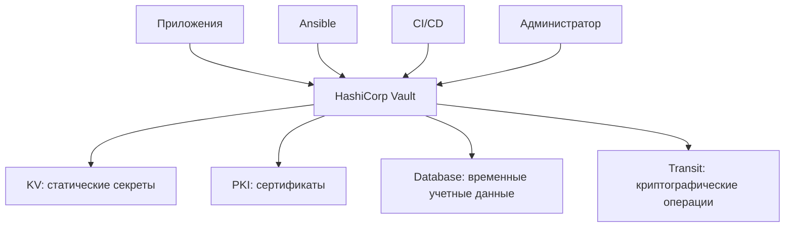
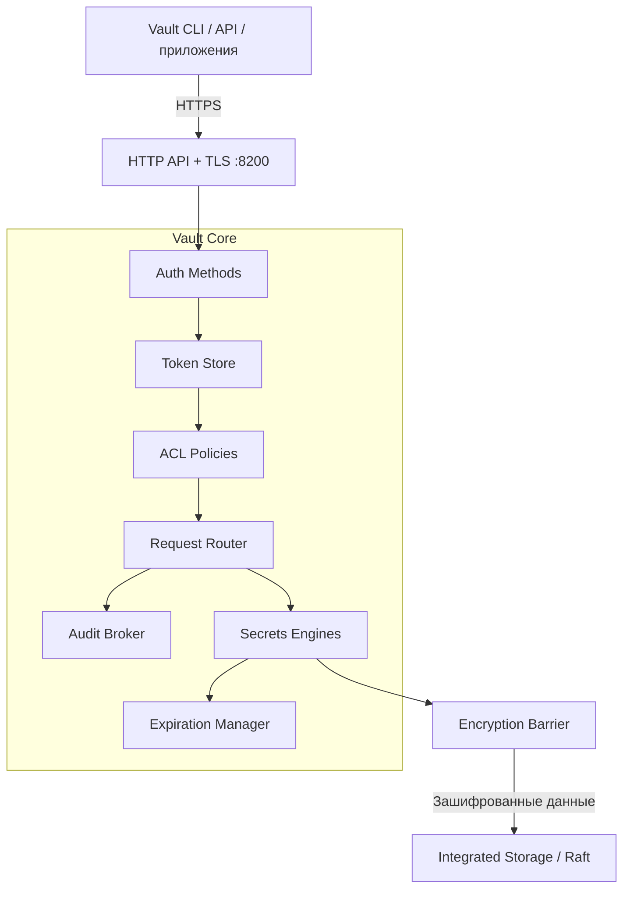
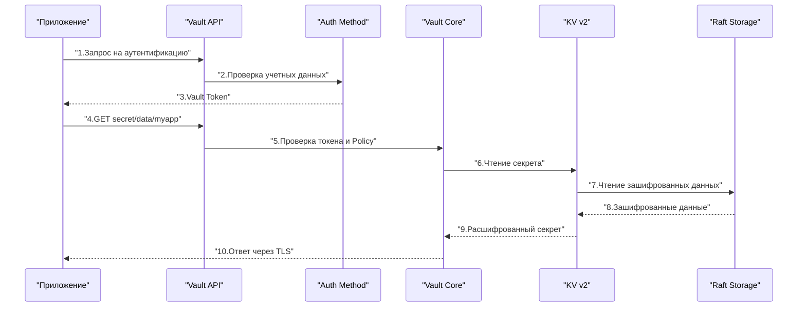
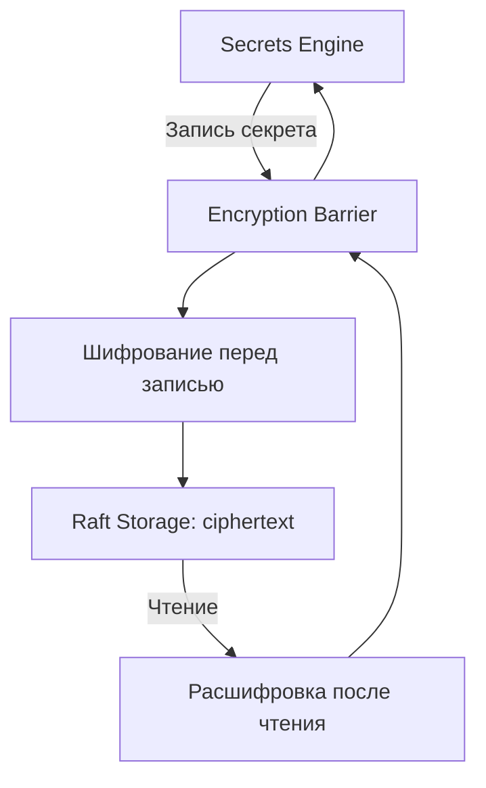
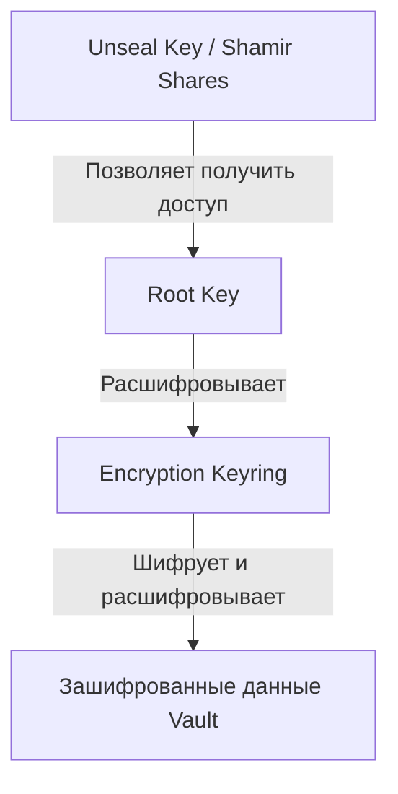
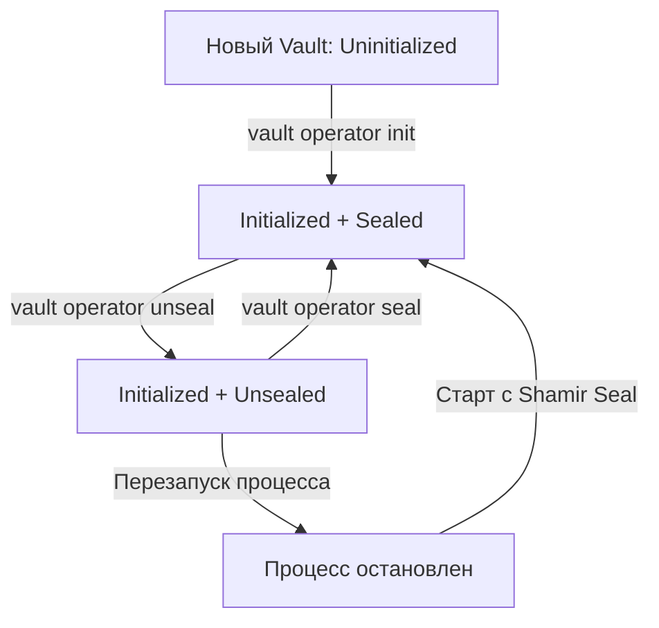

> [!INFO] Цель заметки  
> Понять архитектуру HashiCorp Vault настолько хорошо, чтобы самостоятельно спроектировать его развертывание на Linux VM, объяснить путь запроса к секрету, разобраться с Seal/Unseal, выбрать хранилище и диагностировать базовые проблемы.
> 
> Наш сценарий: один Vault на виртуальной машине, Integrated Storage (Raft), TLS, хранение секретов и выпуск внутренних TLS-сертификатов через PKI Secrets Engine.

## 1. Что такое Vault и какую проблему он решает

HashiCorp Vault — сервис централизованного управления секретами, криптографическими операциями и доступом к ним.

Без Vault секреты часто разбросаны по инфраструктуре:

- Пароли баз данных — в `.env` или переменных CI/CD.
- API-токены — в конфигурациях приложений.
- Приватные ключи — на серверах.
- Сертификаты — создаются вручную и забываются до истечения срока.
- Секреты Ansible — в зашифрованных файлах, которые всё равно необходимо кому-то расшифровывать.э

Vault позволяет организовать единый контролируемый интерфейс для получения и управления этими данными.



Важное различие: Vault — не просто зашифрованная база данных. Это сервис, который принимает решения о доступе. Он должен ответить на несколько вопросов:

1. Кто обращается?
2. Каким способом подтверждена его личность?
3. Что ему разрешено?
4. Какую операцию он хочет выполнить?
5. Нужно ли ограничить срок действия выданного доступа или секрета?
6. Как зафиксировать действие для аудита?

### 1.1. Что Vault умеет, а чего не делает

|Задача|Возможность Vault|
|---|---|
|Хранить пароль PostgreSQL|KV Secrets Engine|
|Выдать временного пользователя PostgreSQL|Database Secrets Engine|
|Выпустить сертификат для Nginx|PKI Secrets Engine|
|Выполнить шифрование без выдачи ключа приложению|Transit Secrets Engine|
|Проверить права приложения|Auth Methods + Policies|
|Записать факт обращения|Audit Devices|
|Обновить секрет в конфигурации приложения|Vault Agent + Templates|
|Автоматически защитить уже скомпрометированный сервер|Нет|

> [!WARNING] Граница безопасности  
> Если злоумышленник получил полный контроль над работающим, распечатанным Vault-сервером, защита секретов становится существенно сложнее. Шифрование данных на диске не означает, что данные недоступны самому работающему Vault или процессам с достаточными привилегиями на хосте.

## 2. Общая архитектура Vault

Архитектуру удобно разделить на пять уровней:

1. Клиенты — приложения, CLI, Terraform, Ansible, CI/CD.
2. API и TLS — точка входа в Vault.
3. Vault Core — аутентификация, авторизация, маршрутизация, жизненный цикл секретов.
4. Encryption Barrier — шифрование и расшифровка сохраняемых данных.
5. Storage Backend — долговременное хранение зашифрованного состояния.



Диаграмма упрощена: например, аудит охватывает разные этапы обработки запроса, а не только маршрутизатор.

### 2.1. Vault Core

Vault Core — основная логика сервера.

Он отвечает за:

- обработку API-запросов;
- проверку клиентских токенов;
- применение политик доступа;
- маршрутизацию запросов к нужным Secrets Engines;
- управление сроком действия токенов и динамических секретов;
- координацию операций хранения;
- аудит;
- внутреннее состояние Vault.

Важно понимать: Vault Core сам по себе не является конкретным хранилищем секретов. Он управляет компонентами, которые выполняют специализированную работу. Например, запрос:

```http
GET /v1/secret/data/production/database
```

направляется к KV v2 Secrets Engine, смонтированному по пути `secret/`.

А запрос:

```http
POST /v1/pki/issue/web-server
```

направляется к PKI Secrets Engine, смонтированному по пути `pki/`.

### 2.2. Secrets Engines

Secrets Engine — компонент, реализующий конкретные операции с секретами.

Он подключается к определенному пути — mount path.

|Mount Path|Engine|Назначение|
|---|---|---|
|`secret/`|KV v2|Статические секреты|
|`pki/`|PKI|Выпуск сертификатов|
|`database/`|Database|Динамические учетные данные|
|`transit/`|Transit|Шифрование, подпись, операции с ключами|

Например:

```
secret/data/myapp
pki/issue/web-server
database/creds/readonly
transit/encrypt/app-key
```

Первый компонент пути определяет, какому движку передать запрос.

У разных движков — разные API и правила работы.

Важно: mount path — это не каталог Linux и не обязательно физический каталог в Raft. Это логический маршрут внутри Vault.

Каждый mount получает изолированное представление своего пространства хранения, поэтому один движок не должен иметь прямого доступа к данным другого.

### 2.3. Auth Methods

Auth Method отвечает на вопрос:

«Как Vault установит, кто перед ним?». Примеры:

|Auth Method|Кто использует|Как подтверждается личность|
|---|---|---|
|Token|Скрипты, администраторы|Предъявление Vault Token|
|Userpass|Пользователи, лаборатория|Логин и пароль|
|AppRole|Сервисы, автоматизация|Role ID + Secret ID|
|Kubernetes|Pods|Kubernetes ServiceAccount JWT|
|JWT/OIDC|CI/CD, пользователи|Проверяемый токен от доверенного провайдера|

После успешной аутентификации Vault обычно выдает клиентский токен, с которым выполняются последующие запросы.

### 2.4. Policies

Policy — набор правил, определяющих разрешенные действия над путями Vault.

Например:

```hcl
path "secret/data/myapp/*" {
  capabilities = ["read"]
}
```

Эта политика разрешает чтение данных KV v2 по указанному шаблону.

Но она не дает права:

- записывать новые значения;
- удалять секреты;
- читать другие пути;
- менять конфигурацию Vault.

Политика не подтверждает личность клиента. Она определяет полномочия уже аутентифицированного клиента.

### 2.5. Audit Devices

Audit Device регистрирует операции с Vault.

Это может быть файловый журнал или другой поддерживаемый механизм аудита.

Он помогает отвечать на вопросы:

- Кто обращался к секрету?
- Когда это произошло?
- К какому пути был запрос?
- Успешно ли выполнена операция?
- С какого клиента пришел запрос?

Vault обычно защищает чувствительные значения в аудит-логах с помощью HMAC, но не следует считать все метаданные безусловно безопасными для публикации.

> [!IMPORTANT] Аудит — не обычный debug-лог  
> Audit Device нужен для отслеживания действий с секретами. Его доступность влияет на обработку запросов: если Vault не может записать событие ни в одно включенное audit device, соответствующий запрос может быть отклонен.
> 
> Поэтому место для audit-логов, права доступа и ротацию файлов нужно продумать до эксплуатации.

## 3. Как Vault обрабатывает запрос

Представим приложение, которому нужно прочитать пароль базы данных.



Здесь опущен Encryption Barrier между движком и физическим хранилищем. Он выполняет расшифровку данных до того, как секрет становится доступен движку.

### 3.1. Аутентификация

Приложение обращается к выбранному Auth Method.

Например, AppRole:

```http
POST /v1/auth/approle/login
```

Передает `role_id` и `secret_id`.

Vault проверяет данные и, если они корректны, выдает клиентский токен.

### 3.2. Авторизация

Приложение обращается к секрету с токеном.

Vault проверяет:

- существует ли токен;
- не истек ли его TTL;
- не отозван ли он;
- какие политики к нему применяются;
- разрешена ли операция `read` над конкретным путем.

Если право отсутствует, клиент получает ошибку `403 permission denied`.

### 3.3. Маршрутизация

Vault определяет движок по mount path.

Например:

```
secret/data/myapp
└────┘
 mount
```

Запрос передается KV v2.

### 3.4. Чтение данных

KV обращается к логическому хранилищу через Encryption Barrier.

Vault получает зашифрованные данные из Raft, расшифровывает их и формирует API-ответ.

### 3.5. Возврат секрета

Секрет передается клиенту по TLS.

После этого Vault не контролирует, что приложение сделает с полученным значением.

Приложение может случайно:

- записать пароль в лог;
- передать его другому процессу;
- сохранить в открытый файл;
- отправить в систему мониторинга.

Поэтому безопасность Vault — только часть безопасности всей цепочки доставки секрета.

> [!TIP] Практический вывод  
> Полезно мысленно разделять две задачи:
> 
> - Vault защищает секрет до выдачи и контролирует право его получить.
>     
> - Приложение отвечает за безопасное использование секрета после выдачи.
>     

## 4. Encryption Barrier: почему Raft не хранит секреты открытым текстом

Encryption Barrier — одна из ключевых частей архитектуры Vault.

Vault рассматривает Storage Backend как недоверенное хранилище.

Это означает, что безопасность секретов не должна зависеть только от прав доступа к файлам на диске.


### 4.1. Что именно защищает Encryption Barrier

Он защищает сохраняемое состояние Vault, включая данные движков и внутренние конфигурации, хранящиеся за барьером.

Но есть важные ограничения:

| Сценарий                               | Что обеспечивает Vault                                                          |
| -------------------------------------- | ------------------------------------------------------------------------------- |
| Украден выключенный диск VM            | Содержимое хранилища зашифровано                                                |
| Получен доступ к файлам Raft           | Секреты не должны быть доступны как plaintext                                   |
| Перехвачен сетевой трафик клиента      | TLS защищает передачу при корректной проверке сертификата                       |
| Украден действующий Vault Token        | Возможен доступ в пределах прав токена                                          |
| Скомпрометирован работающий Vault-хост | Encryption Barrier сам по себе не обеспечивает защиту от полного контроля хоста |
| Утеряны ключи распечатывания           | Возможна потеря доступа к сохраненным данным                                    |
### 4.2. Почему недостаточно LUKS

LUKS шифрует блочное устройство, а Encryption Barrier защищает данные на уровне Vault.

Эти механизмы дополняют друг друга.

LUKS:
- защищает диск в выключенном состоянии;
- после разблокировки файловая система доступна операционной системе.

Vault Encryption Barrier:
- сохраняет данные зашифрованными в Storage Backend;
- требует успешного Unseal, прежде чем Vault сможет выполнять обычные операции;
- не заменяет защиту ОС и управление привилегиями.

Даже если диск VM зашифрован LUKS, Vault всё равно должен использовать собственный механизм шифрования.

## 5. Ключи Vault: три разных уровня

Одна из самых важных тем для понимания — разница между ключами шифрования, Root Key и Unseal Key.

Не следует путать их с Root Token.



Это концептуальная схема иерархии ключей. Точная форма защиты Root Key зависит от выбранного Seal Mechanism.

### 5.1. Encryption Keys

Ключи из Encryption Keyring используются для шифрования данных, которые Vault сохраняет в Storage Backend.

Vault поддерживает управление и ротацию ключей барьера.

### 5.2. Root Key

Root Key защищает Encryption Keyring.

Это криптографический ключ, а не токен администратора.

Root Key нужен, чтобы Vault смог получить доступ к ключам шифрования данных.

### 5.3. Unseal Key

Unseal Key позволяет разблокировать Root Key.

При стандартном Shamir Seal этот секрет разделяется на несколько частей.

Например:

```
Количество частей: 5
Порог восстановления: 3
```

Для распечатывания нужно предъявить любые три действительные части из пяти.

Одна часть не должна позволять восстановить исходный секрет.

### 5.4. Root Token

Root Token — совершенно другая сущность.

Это административный токен Vault с практически неограниченными полномочиями внутри ACL-модели Vault.

Он позволяет выполнять критичные административные операции.

|Сущность|Для чего нужна|Используется при|
|---|---|---|
|Encryption Key|Шифрование сохраненных данных|Работе Storage Backend|
|Root Key|Защита Encryption Keyring|Unseal и внутренних криптографических операциях|
|Unseal Key / Shares|Разблокировка Root Key|Распечатывании Vault|
|Root Token|Административный доступ|Управлении Vault|

> [!DANGER] Типичная ошибка  
> Хранить Root Token и все Unseal Shares в одном файле на той же виртуальной машине.
> 
> В таком случае компрометация VM может дать злоумышленнику и данные хранилища, и материалы для их разблокировки, и административный доступ.
> 
> Root Token следует использовать только для начальной настройки и исключительных операций, после чего отозвать, когда подготовлены альтернативные административные способы доступа.

Механизм ключей и распечатывания подробно описан в официальной документации HashiCorp.

## 6. Жизненный цикл Vault: Initialize, Seal и Unseal

Важно различать состояние процесса и состояние хранилища. Установка пакета Vault не означает, что Vault уже инициализирован.

### 6.1. Основные состояния



### 6.2. Initialize

Initialize выполняется один раз для нового хранилища Vault.

При инициализации Vault создает необходимые криптографические материалы и первоначальный административный токен.

Пример команды:

```bash
vault operator init \
  -key-shares=5 \
  -key-threshold=3
```

Параметры:

- `-key-shares=5` — создать пять частей;
- `-key-threshold=3` — требовать три части для Unseal.

> [!WARNING] Не запускай команду наугад  
> Это пример для будущей практической заметки. Сначала нужно подготовить TLS, безопасный способ получения и хранения ключей и убедиться, что Vault подключен к правильному Storage Backend.
> 
> Вывод инициализации содержит критически чувствительные данные. Не отправляй его в чаты, тикеты или логи CI/CD.

### 6.3. Seal

В состоянии `Sealed` Vault не может обслуживать обычные запросы к секретам.

Он не имеет доступа к необходимым криптографическим материалам для расшифровки защищенного хранилища.

При этом процесс Vault может продолжать работать, а его API — отвечать на служебные запросы.

Это означает:

**`Работающий systemd service ≠ готовый к работе Vault.`**

### 6.4. Unseal

При Shamir Seal оператор предоставляет необходимое количество частей ключа.

Пример:

```bash
vault operator unseal
```

Команда запрашивает одну часть ключа.

После достижения порога Vault может получить доступ к ключам шифрования и начать обслуживать запросы.

### 6.5. Что происходит после перезагрузки VM

Для Shamir Seal:

1. VM перезагружается.
2. systemd запускает Vault.
3. Vault читает конфигурацию.
4. Подключается к Storage Backend.
5. Обнаруживает, что хранилище инициализировано.
6. Переходит в `Sealed`.
7. Ожидает Unseal Shares.
8. После успешного Unseal становится доступен клиентам.

Для нашей лаборатории это особенно важно: после перезагрузки приложения могут остаться без секретов до ручного Unseal.

### 6.6. Auto Unseal

Auto Unseal делегирует разблокировку доверенному внешнему механизму, например облачному KMS.

Это удобно, поскольку Vault может восстановить доступность после перезапуска без ручного ввода частей ключа.

Но возникает новая зависимость:

```
Vault startup
    ↓
Доступность KMS
    ↓
Возможность разблокировать Vault
```

При Auto Unseal обычно создаются Recovery Keys для определенных административных операций. Они не заменяют внешний механизм распечатывания и не позволяют самостоятельно расшифровать Root Key, если соответствующий KMS-ключ окончательно утрачен.

|Критерий|Shamir Seal|Auto Unseal|
|---|---|---|
|Нужен внешний KMS|Нет|Да, либо другой поддерживаемый механизм|
|Ручное действие после перезапуска|Обычно да|Обычно нет|
|Критичная зависимость|Доступность частей Unseal Key|Доступность внешнего Seal Mechanism|
|Для нашей первой VM|Подходит|Можно добавить позднее|
|Основной риск|Потеря или компрометация частей|Потеря или недоступность ключа внешнего механизма|

Для первой установки предлагаю Shamir Seal, чтобы своими руками увидеть весь жизненный цикл Vault и понять, что именно происходит при запуске.