> [!INFO] Цель заметки  
> Понять архитектуру HashiCorp Vault настолько хорошо, чтобы самостоятельно спроектировать его развертывание на Linux VM, объяснить путь запроса к секрету, разобраться с Seal/Unseal, выбрать хранилище и диагностировать базовые проблемы.
> 
> Наш сценарий: один Vault на виртуальной машине, Integrated Storage (Raft), TLS, хранение секретов и выпуск внутренних TLS-сертификатов через PKI Secrets Engine.

## 1. Что такое Vault и какую проблему он решает

HashiCorp Vault — сервис централизованного управления секретами, криптографическими операциями и доступом к ним.

Без Vault секреты часто разбросаны по инфраструктуре:

- Пароли баз данных — в `.env` или переменных CI/CD.
- API-токены — в конфигурациях приложений.
- Приватные ключи — на серверах.
- Сертификаты — создаются вручную и забываются до истечения срока.
- Секреты Ansible — в зашифрованных файлах, которые всё равно необходимо кому-то расшифровывать.э

Vault позволяет организовать единый контролируемый интерфейс для получения и управления этими данными.

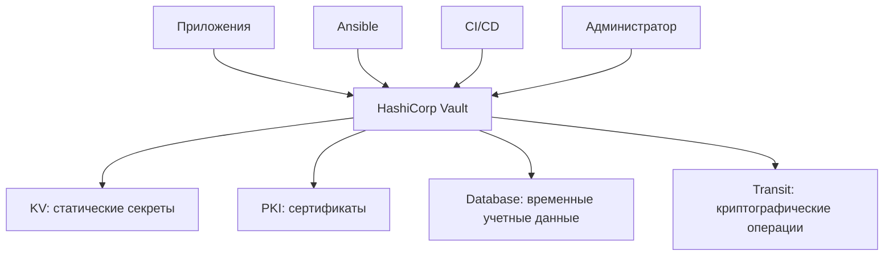

Важное различие: Vault — не просто зашифрованная база данных. Это сервис, который принимает решения о доступе. Он должен ответить на несколько вопросов:

1. Кто обращается?
2. Каким способом подтверждена его личность?
3. Что ему разрешено?
4. Какую операцию он хочет выполнить?
5. Нужно ли ограничить срок действия выданного доступа или секрета?
6. Как зафиксировать действие для аудита?

### 1.1. Что Vault умеет, а чего не делает

|Задача|Возможность Vault|
|---|---|
|Хранить пароль PostgreSQL|KV Secrets Engine|
|Выдать временного пользователя PostgreSQL|Database Secrets Engine|
|Выпустить сертификат для Nginx|PKI Secrets Engine|
|Выполнить шифрование без выдачи ключа приложению|Transit Secrets Engine|
|Проверить права приложения|Auth Methods + Policies|
|Записать факт обращения|Audit Devices|
|Обновить секрет в конфигурации приложения|Vault Agent + Templates|
|Автоматически защитить уже скомпрометированный сервер|Нет|

> [!WARNING] Граница безопасности  
> Если злоумышленник получил полный контроль над работающим, распечатанным Vault-сервером, защита секретов становится существенно сложнее. Шифрование данных на диске не означает, что данные недоступны самому работающему Vault или процессам с достаточными привилегиями на хосте.

## 2. Общая архитектура Vault

Архитектуру удобно разделить на пять уровней:

1. Клиенты — приложения, CLI, Terraform, Ansible, CI/CD.
2. API и TLS — точка входа в Vault.
3. Vault Core — аутентификация, авторизация, маршрутизация, жизненный цикл секретов.
4. Encryption Barrier — шифрование и расшифровка сохраняемых данных.
5. Storage Backend — долговременное хранение зашифрованного состояния.

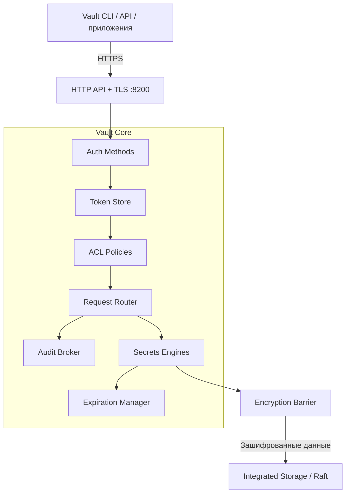

Диаграмма упрощена: например, аудит охватывает разные этапы обработки запроса, а не только маршрутизатор.

### 2.1. Vault Core

Vault Core — основная логика сервера.

Он отвечает за:

- обработку API-запросов;
- проверку клиентских токенов;
- применение политик доступа;
- маршрутизацию запросов к нужным Secrets Engines;
- управление сроком действия токенов и динамических секретов;
- координацию операций хранения;
- аудит;
- внутреннее состояние Vault.

Важно понимать: Vault Core сам по себе не является конкретным хранилищем секретов. Он управляет компонентами, которые выполняют специализированную работу. Например, запрос:

```http
GET /v1/secret/data/production/database
```

направляется к KV v2 Secrets Engine, смонтированному по пути `secret/`.

А запрос:

```http
POST /v1/pki/issue/web-server
```

направляется к PKI Secrets Engine, смонтированному по пути `pki/`.

### 2.2. Secrets Engines

Secrets Engine — компонент, реализующий конкретные операции с секретами.

Он подключается к определенному пути — mount path.

|Mount Path|Engine|Назначение|
|---|---|---|
|`secret/`|KV v2|Статические секреты|
|`pki/`|PKI|Выпуск сертификатов|
|`database/`|Database|Динамические учетные данные|
|`transit/`|Transit|Шифрование, подпись, операции с ключами|

Например:

```
secret/data/myapp
pki/issue/web-server
database/creds/readonly
transit/encrypt/app-key
```

Первый компонент пути определяет, какому движку передать запрос.

У разных движков — разные API и правила работы.

Важно: mount path — это не каталог Linux и не обязательно физический каталог в Raft. Это логический маршрут внутри Vault.

Каждый mount получает изолированное представление своего пространства хранения, поэтому один движок не должен иметь прямого доступа к данным другого.

### 2.3. Auth Methods

Auth Method отвечает на вопрос:

«Как Vault установит, кто перед ним?». Примеры:

|Auth Method|Кто использует|Как подтверждается личность|
|---|---|---|
|Token|Скрипты, администраторы|Предъявление Vault Token|
|Userpass|Пользователи, лаборатория|Логин и пароль|
|AppRole|Сервисы, автоматизация|Role ID + Secret ID|
|Kubernetes|Pods|Kubernetes ServiceAccount JWT|
|JWT/OIDC|CI/CD, пользователи|Проверяемый токен от доверенного провайдера|

После успешной аутентификации Vault обычно выдает клиентский токен, с которым выполняются последующие запросы.

### 2.4. Policies

Policy — набор правил, определяющих разрешенные действия над путями Vault.

Например:

```hcl
path "secret/data/myapp/*" {
  capabilities = ["read"]
}
```

Эта политика разрешает чтение данных KV v2 по указанному шаблону.

Но она не дает права:

- записывать новые значения;
- удалять секреты;
- читать другие пути;
- менять конфигурацию Vault.

Политика не подтверждает личность клиента. Она определяет полномочия уже аутентифицированного клиента.

### 2.5. Audit Devices

Audit Device регистрирует операции с Vault.

Это может быть файловый журнал или другой поддерживаемый механизм аудита.

Он помогает отвечать на вопросы:

- Кто обращался к секрету?
- Когда это произошло?
- К какому пути был запрос?
- Успешно ли выполнена операция?
- С какого клиента пришел запрос?

Vault обычно защищает чувствительные значения в аудит-логах с помощью HMAC, но не следует считать все метаданные безусловно безопасными для публикации.

> [!IMPORTANT] Аудит — не обычный debug-лог  
> Audit Device нужен для отслеживания действий с секретами. Его доступность влияет на обработку запросов: если Vault не может записать событие ни в одно включенное audit device, соответствующий запрос может быть отклонен.
> 
> Поэтому место для audit-логов, права доступа и ротацию файлов нужно продумать до эксплуатации.

## 3. Как Vault обрабатывает запрос

Представим приложение, которому нужно прочитать пароль базы данных.

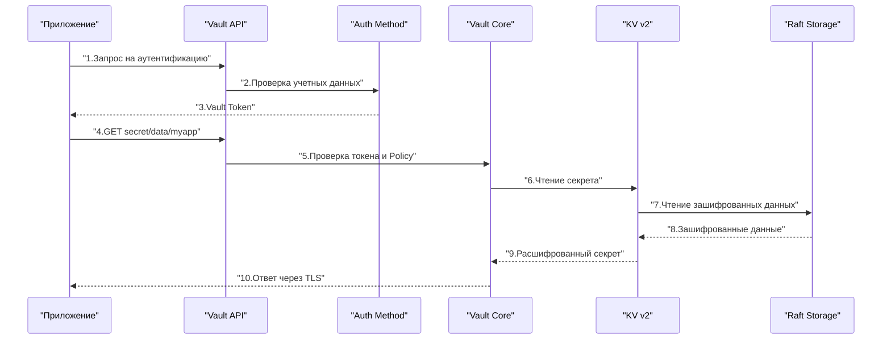

Здесь опущен Encryption Barrier между движком и физическим хранилищем. Он выполняет расшифровку данных до того, как секрет становится доступен движку.

### 3.1. Аутентификация

Приложение обращается к выбранному Auth Method.

Например, AppRole:

```http
POST /v1/auth/approle/login
```

Передает `role_id` и `secret_id`.

Vault проверяет данные и, если они корректны, выдает клиентский токен.

### 3.2. Авторизация

Приложение обращается к секрету с токеном.

Vault проверяет:

- существует ли токен;
- не истек ли его TTL;
- не отозван ли он;
- какие политики к нему применяются;
- разрешена ли операция `read` над конкретным путем.

Если право отсутствует, клиент получает ошибку `403 permission denied`.

### 3.3. Маршрутизация

Vault определяет движок по mount path.

Например:

```
secret/data/myapp
└────┘
 mount
```

Запрос передается KV v2.

### 3.4. Чтение данных

KV обращается к логическому хранилищу через Encryption Barrier.

Vault получает зашифрованные данные из Raft, расшифровывает их и формирует API-ответ.

### 3.5. Возврат секрета

Секрет передается клиенту по TLS.

После этого Vault не контролирует, что приложение сделает с полученным значением.

Приложение может случайно:

- записать пароль в лог;
- передать его другому процессу;
- сохранить в открытый файл;
- отправить в систему мониторинга.

Поэтому безопасность Vault — только часть безопасности всей цепочки доставки секрета.

> [!TIP] Практический вывод  
> Полезно мысленно разделять две задачи:
> 
> - Vault защищает секрет до выдачи и контролирует право его получить.
>     
> - Приложение отвечает за безопасное использование секрета после выдачи.
>     

## 4. Encryption Barrier: почему Raft не хранит секреты открытым текстом

Encryption Barrier — одна из ключевых частей архитектуры Vault.

Vault рассматривает Storage Backend как недоверенное хранилище.

Это означает, что безопасность секретов не должна зависеть только от прав доступа к файлам на диске.

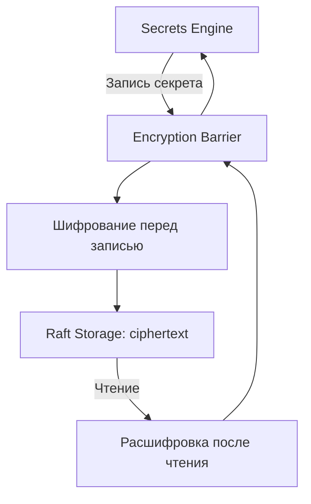
### 4.1. Что именно защищает Encryption Barrier

Он защищает сохраняемое состояние Vault, включая данные движков и внутренние конфигурации, хранящиеся за барьером.

Но есть важные ограничения:

| Сценарий                               | Что обеспечивает Vault                                                          |
| -------------------------------------- | ------------------------------------------------------------------------------- |
| Украден выключенный диск VM            | Содержимое хранилища зашифровано                                                |
| Получен доступ к файлам Raft           | Секреты не должны быть доступны как plaintext                                   |
| Перехвачен сетевой трафик клиента      | TLS защищает передачу при корректной проверке сертификата                       |
| Украден действующий Vault Token        | Возможен доступ в пределах прав токена                                          |
| Скомпрометирован работающий Vault-хост | Encryption Barrier сам по себе не обеспечивает защиту от полного контроля хоста |
| Утеряны ключи распечатывания           | Возможна потеря доступа к сохраненным данным                                    |
### 4.2. Почему недостаточно LUKS

LUKS шифрует блочное устройство, а Encryption Barrier защищает данные на уровне Vault.

Эти механизмы дополняют друг друга.

LUKS:
- защищает диск в выключенном состоянии;
- после разблокировки файловая система доступна операционной системе.

Vault Encryption Barrier:
- сохраняет данные зашифрованными в Storage Backend;
- требует успешного Unseal, прежде чем Vault сможет выполнять обычные операции;
- не заменяет защиту ОС и управление привилегиями.

Даже если диск VM зашифрован LUKS, Vault всё равно должен использовать собственный механизм шифрования.

## 5. Ключи Vault: три разных уровня

Одна из самых важных тем для понимания — разница между ключами шифрования, Root Key и Unseal Key.

Не следует путать их с Root Token.

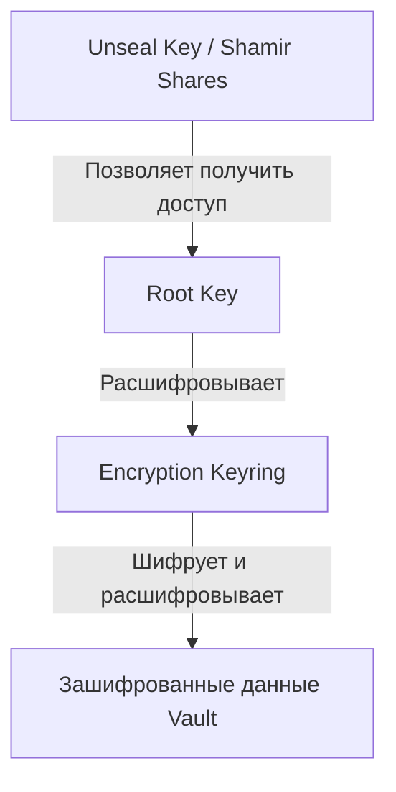

Это концептуальная схема иерархии ключей. Точная форма защиты Root Key зависит от выбранного Seal Mechanism.

### 5.1. Encryption Keys

Ключи из Encryption Keyring используются для шифрования данных, которые Vault сохраняет в Storage Backend.

Vault поддерживает управление и ротацию ключей барьера.

### 5.2. Root Key

Root Key защищает Encryption Keyring.

Это криптографический ключ, а не токен администратора.

Root Key нужен, чтобы Vault смог получить доступ к ключам шифрования данных.

### 5.3. Unseal Key

Unseal Key позволяет разблокировать Root Key.

При стандартном Shamir Seal этот секрет разделяется на несколько частей.

Например:

```
Количество частей: 5
Порог восстановления: 3
```

Для распечатывания нужно предъявить любые три действительные части из пяти.

Одна часть не должна позволять восстановить исходный секрет.

### 5.4. Root Token

Root Token — совершенно другая сущность.

Это административный токен Vault с практически неограниченными полномочиями внутри ACL-модели Vault.

Он позволяет выполнять критичные административные операции.

|Сущность|Для чего нужна|Используется при|
|---|---|---|
|Encryption Key|Шифрование сохраненных данных|Работе Storage Backend|
|Root Key|Защита Encryption Keyring|Unseal и внутренних криптографических операциях|
|Unseal Key / Shares|Разблокировка Root Key|Распечатывании Vault|
|Root Token|Административный доступ|Управлении Vault|

> [!DANGER] Типичная ошибка  
> Хранить Root Token и все Unseal Shares в одном файле на той же виртуальной машине.
> 
> В таком случае компрометация VM может дать злоумышленнику и данные хранилища, и материалы для их разблокировки, и административный доступ.
> 
> Root Token следует использовать только для начальной настройки и исключительных операций, после чего отозвать, когда подготовлены альтернативные административные способы доступа.

Механизм ключей и распечатывания подробно описан в официальной документации HashiCorp.

## 6. Жизненный цикл Vault: Initialize, Seal и Unseal

Важно различать состояние процесса и состояние хранилища. Установка пакета Vault не означает, что Vault уже инициализирован.

### 6.1. Основные состояния

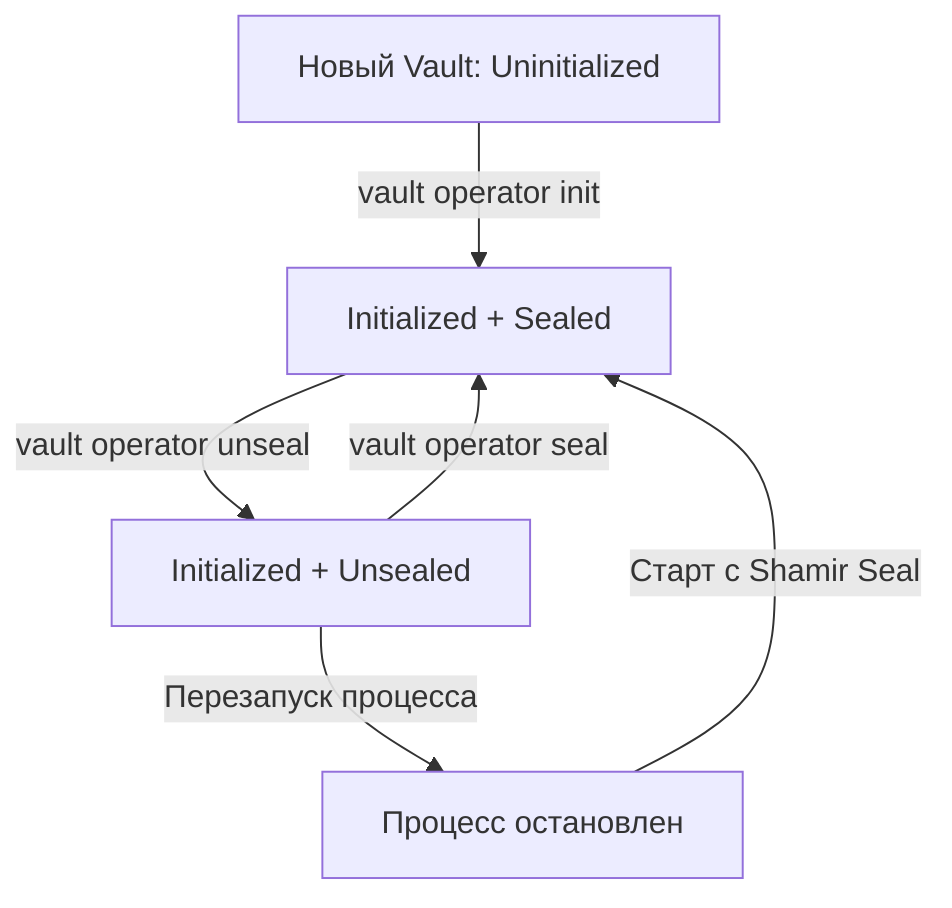

### 6.2. Initialize

Initialize выполняется один раз для нового хранилища Vault.

При инициализации Vault создает необходимые криптографические материалы и первоначальный административный токен.

Пример команды:

```bash
vault operator init \
  -key-shares=5 \
  -key-threshold=3
```

Параметры:

- `-key-shares=5` — создать пять частей;
- `-key-threshold=3` — требовать три части для Unseal.

> [!WARNING] Не запускай команду наугад  
> Это пример для будущей практической заметки. Сначала нужно подготовить TLS, безопасный способ получения и хранения ключей и убедиться, что Vault подключен к правильному Storage Backend.
> 
> Вывод инициализации содержит критически чувствительные данные. Не отправляй его в чаты, тикеты или логи CI/CD.

### 6.3. Seal

В состоянии `Sealed` Vault не может обслуживать обычные запросы к секретам.

Он не имеет доступа к необходимым криптографическим материалам для расшифровки защищенного хранилища.

При этом процесс Vault может продолжать работать, а его API — отвечать на служебные запросы.

Это означает:

**`Работающий systemd service ≠ готовый к работе Vault.`**

### 6.4. Unseal

При Shamir Seal оператор предоставляет необходимое количество частей ключа.

Пример:

```bash
vault operator unseal
```

Команда запрашивает одну часть ключа.

После достижения порога Vault может получить доступ к ключам шифрования и начать обслуживать запросы.

### 6.5. Что происходит после перезагрузки VM

Для Shamir Seal:

1. VM перезагружается.
2. systemd запускает Vault.
3. Vault читает конфигурацию.
4. Подключается к Storage Backend.
5. Обнаруживает, что хранилище инициализировано.
6. Переходит в `Sealed`.
7. Ожидает Unseal Shares.
8. После успешного Unseal становится доступен клиентам.

Для нашей лаборатории это особенно важно: после перезагрузки приложения могут остаться без секретов до ручного Unseal.

### 6.6. Auto Unseal

Auto Unseal делегирует разблокировку доверенному внешнему механизму, например облачному KMS.

Это удобно, поскольку Vault может восстановить доступность после перезапуска без ручного ввода частей ключа.

Но возникает новая зависимость:

```
Vault startup
    ↓
Доступность KMS
    ↓
Возможность разблокировать Vault
```

При Auto Unseal обычно создаются Recovery Keys для определенных административных операций. Они не заменяют внешний механизм распечатывания и не позволяют самостоятельно расшифровать Root Key, если соответствующий KMS-ключ окончательно утрачен.

|Критерий|Shamir Seal|Auto Unseal|
|---|---|---|
|Нужен внешний KMS|Нет|Да, либо другой поддерживаемый механизм|
|Ручное действие после перезапуска|Обычно да|Обычно нет|
|Критичная зависимость|Доступность частей Unseal Key|Доступность внешнего Seal Mechanism|
|Для нашей первой VM|Подходит|Можно добавить позднее|
|Основной риск|Потеря или компрометация частей|Потеря или недоступность ключа внешнего механизма|

Для первой установки предлагаю Shamir Seal, чтобы своими руками увидеть весь жизненный цикл Vault и понять, что именно происходит при запуске.

## 7. Storage Backend: где Vault хранит состояние

Storage Backend — механизм долговременного хранения данных Vault.

Vault должен сохранять не только секреты, но и внутреннее состояние:

- конфигурацию Secrets Engines;
- конфигурацию Auth Methods;
- политики доступа;
- данные токенов и их метаданные;
- сведения об аренде динамических секретов;
- криптографические материалы в защищенном виде;
- данные PKI, включая состояние выпуска и отзыва сертификатов.

### 7.1. Storage Backend — не Secrets Engine

Эти понятия легко перепутать.

|                               | Storage Backend                           | Secrets Engine                            |
| ----------------------------- | ----------------------------------------- | ----------------------------------------- |
| Задача                        | Сохранять внутреннее состояние Vault      | Выполнять операции с секретами            |
| Примеры                       | Raft, Consul, File                        | KV, PKI, Database, Transit                |
| Кто обращается                | Vault Core и внутренние компоненты        | Клиенты через API Vault                   |
| Что получает клиент           | Не обращается напрямую                    | Секрет, сертификат или результат операции |
| Можно ли подключить несколько | Один основной storage backend для сервера | Множество движков на разных mount paths   |

Например, когда PKI Engine выпускает сертификат, он выполняет криптографическую и прикладную работу, а необходимые сохраняемые данные размещаются через внутреннее хранилище Vault.

### 7.2. Сравнение вариантов хранения

|Критерий|File|Consul|Integrated Storage (Raft)|
|---|---|---|---|
|Дополнительный сервис|Нет|Да|Нет|
|Хранение на диске|Да|Через Consul|Да|
|HA|Нет|Да, при правильной конфигурации|Да, при нескольких узлах|
|Сложность инфраструктуры|Низкая|Выше|Умеренная|
|Подходит для одной VM|Для простых тестов|Избыточен|Да|
|Возможность развить в кластер|Потребуется миграция|Да|Да|

Integrated Storage — встроенный вариант хранения, использующий Raft. Он не требует отдельного Consul и поддерживает резервное копирование и восстановление через snapshots.

### 7.3. Почему выбираем Raft

Для нашей виртуальной машины Raft дает:

1. Меньше компонентов. Не нужно отдельно устанавливать и поддерживать Consul.
2. Единую точку администрирования. Vault управляет собственным хранилищем.
3. Путь к HA. В будущем можно добавить другие Vault-узлы.
4. Поддержку snapshots. Есть штатные механизмы резервного копирования.
5. Хорошую учебную базу. Мы изучим принципы кворума и репликации, которые встречаются и в других инфраструктурных системах.

Но Raft не превращает одну VM в отказоустойчивую систему.

Если у нас только один узел, он является единственной копией работающего Vault

## 8. Как устроен Raft внутри Vault

Raft — алгоритм согласования состояния между узлами распределенной системы.

Его задача — обеспечить согласованный порядок изменений в кластере.

### 8.1. Leader, Followers и Quorum

В кластере Raft есть:

- Leader — принимает и координирует изменения.
- Followers — получают и сохраняют реплицированные записи.
- Quorum — большинство узлов, необходимое для согласованного принятия изменений.

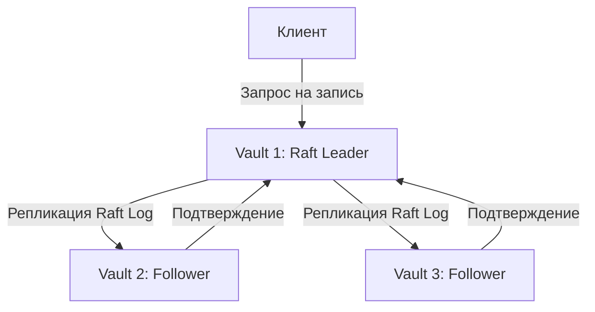

Для кластера из трех узлов достаточно двух для кворума.

|Число узлов|Кворум|Сколько отказов выдерживает|
|---|---|---|
|1|1|0|
|2|2|0|
|3|2|1|
|4|3|1|
|5|3|2|

Отсюда важный вывод: кластер из двух узлов не дает устойчивости к потере одного узла с точки зрения Raft-кворума.

### 8.2. Как происходит запись

Допустим, администратор записывает секрет:

```bash
vault kv put secret/myapp username=appuser
```

Упрощенная последовательность:

1. Vault проверяет токен и права.
2. KV Engine формирует изменение данных.
3. Encryption Barrier шифрует сохраняемое значение.
4. Raft Leader добавляет изменение в журнал.
5. Запись реплицируется на другие узлы.
6. После подтверждения кворумом изменение считается согласованным.
7. Vault возвращает клиенту результат.

На одном узле кворум равен одному: согласование с другими серверами не требуется.

### 8.3. Raft Leader и Active Vault

У Vault есть два связанных понятия:

- Raft Leader — лидер алгоритма репликации.
- Active Vault Node — узел, который обрабатывает основные клиентские операции в HA-кластере.

При использовании Integrated Storage активный Vault-узел соответствует Raft Leader, а остальные узлы обычно работают как Standby.

Standby может перенаправлять или пересылать клиентские запросы на активный узел в зависимости от типа запроса и конфигурации.

### 8.4. Что будет при отказе

**Один узел:**

```
Vault VM выключилась
    ↓
Нет работающего Vault
    ↓
Новые запросы на секреты недоступны
```

**Три узла:**

```
Vault 1 отказал
    ↓
Vault 2 и Vault 3 сохраняют кворум
    ↓
Выбирается новый лидер
    ↓
Кластер продолжает работу
```

Это не гарантирует отсутствие кратковременного перерыва при переключении, но позволяет восстановить обслуживание без возвращения отказавшего узла.

### 8.5. Raft Snapshot — не просто копия каталога

Raft использует журнал согласованных изменений и снимки состояния.

Snapshot позволяет сохранить согласованное состояние хранилища для последующего восстановления.

Пример команды, которую подробно разберем в эксплуатационной заметке:

```bash
vault operator raft snapshot save vault-backup.snap
```

Для восстановления:

```bash
vault operator raft snapshot restore vault-backup.snap
```

> [!WARNING] Восстановление требует отдельной процедуры  
> Команда `restore` приведена для знакомства с интерфейсом. Не запускай ее на рабочем Vault без плана восстановления.
> 
> Snapshot содержит чувствительное состояние Vault, хотя данные защищены механизмами Vault. Его необходимо хранить с ограниченным доступом, отдельно от основной VM, и проверять восстановление в тестовой среде.
> 
> Наличие snapshot также не отменяет необходимости сохранить материалы и зависимости, необходимые для Unseal.

## 9. Vault API, сетевые порты и TLS

Vault — сетевой сервис, доступный через HTTP API.

CLI `vault` не обходит API: он выступает клиентом сервера Vault.

### 9.1. Основные порты

|Порт|Назначение|Кому нужен|
|---|---|---|
|`8200/TCP`|Клиентский HTTP API и UI|Приложения, администраторы, автоматизация|
|`8201/TCP`|Внутрикластерная коммуникация|Узлы Vault в кластере|

Для одиночной VM основной рабочий порт — `8200`.

Порт `8201` пригодится при переходе к многонодовому кластеру. Межузловая коммуникация Vault использует взаимную TLS-аутентификацию.

### 9.2. Listener и API Address

В конфигурации Vault есть два разных понятия.

Listener определяет, на каком интерфейсе и порту процесс принимает соединения.

Например:

```hcl
listener "tcp" {
  address = "0.0.0.0:8200"
}
```

Это означает, что процесс слушает все IPv4-интерфейсы на порту `8200`.

**api_addr** задает адрес, по которому клиенты и другие компоненты должны обращаться к Vault.

Например:

```hcl
api_addr = "https://vault.example.internal:8200"
```

`0.0.0.0` подходит для привязки listener, но не является корректным адресом, который следует раздавать клиентам.

### 9.3. Почему TLS нужен даже внутри домашней сети

Vault передает чувствительные данные:

- токены;
- пароли;
- приватные ключи;
- сертификаты;
- ответы на запросы секретов.

Если использовать HTTP без TLS, любой участник с возможностью перехвата трафика потенциально сможет получить эти данные.

Поэтому для нашей VM будем использовать HTTPS.

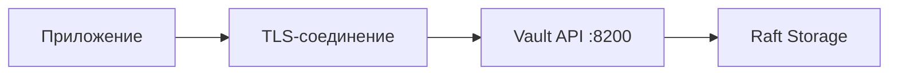

Важно, чтобы клиент не просто использовал HTTPS, а проверял сертификат Vault.

Переменная:

```bash
VAULT_SKIP_VERIFY=true
```

отключает проверку TLS-сертификата и не должна использоваться как постоянное решение проблем с доверием.

### 9.4. Проблема первого сертификата

Мы хотим использовать Vault как собственный CA.

Но для первого запуска Vault уже нужен TLS-сертификат.

Получается зависимость:

```
Чтобы запустить Vault безопасно, нужен TLS-сертификат.
Чтобы получить сертификат от Vault PKI, нужно запустить Vault.
```

Решение — bootstrap trust: для первоначального TLS-сертификата используем независимый источник доверия.

Например:

- существующий внутренний CA;
- сертификат от публичного доверенного CA, если условия позволяют;
- отдельный небольшой bootstrap CA для лаборатории.

Позже Vault PKI сможет выпускать сертификаты для других внутренних сервисов.

> [!IMPORTANT] Архитектурное решение  
> Не стоит делать работоспособность TLS самого Vault полностью зависимой от PKI Engine внутри этого же Vault без заранее продуманного механизма обновления и аварийного восстановления.
> 
> Иначе истекший сертификат Vault может затруднить доступ к системе, которая должна его перевыпустить.

## 10. Как связаны аутентификация, токены и политики

Vault отделяет подтверждение личности от проверки прав.

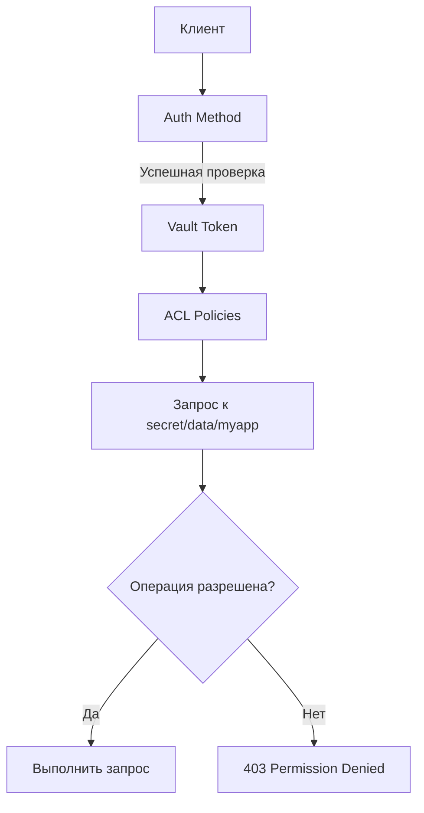

### 10.1. Токен — временное удостоверение доступа

Vault Token обычно имеет свойства, важные для безопасности:

- набор связанных политик;
- срок действия (TTL);
- возможность продления;
- возможность отзыва;
- связь с родительским токеном или другими механизмами жизненного цикла;
- дополнительные ограничения в зависимости от типа токена.

Токен может быть действительным, но не иметь права на конкретный секрет.

Поэтому:

```
Аутентификация прошла успешно
```

не означает:

```
Доступ ко всем секретам разрешен
```

### 10.2. Почему Root Token нельзя давать приложениям

Представим два подхода.

Неправильный:

```
Nginx → Root Token → Vault → Любые секреты
```

Если сервер Nginx скомпрометирован, злоумышленник получает почти полный административный доступ к Vault.

Правильный:

```
Nginx → AppRole → Короткоживущий Token
                      ↓
             Policy: только PKI issue
                      ↓
                Vault PKI
```

В этом случае компрометация Nginx все равно опасна, но область доступных злоумышленнику действий существенно ограничена.

### 10.3. ACL Policy: путь и действие

В Vault права описываются через `path` и `capabilities`.

Основные capabilities:

|Capability|Значение|
|---|---|
|`create`|Создание данных|
|`read`|Чтение|
|`update`|Изменение или выполнение соответствующей операции|
|`delete`|Удаление|
|`list`|Получение списка|
|`sudo`|Доступ к отдельным защищенным административным операциям|
|`deny`|Явный запрет|

Пример политики для приложения:

```hcl
path "secret/data/myapp/*" {
  capabilities = ["read"]
}

path "secret/metadata/myapp/*" {
  capabilities = ["list"]
}
```

Обрати внимание на различие `data` и `metadata` в KV v2.

Это внутренние API-пути KV v2, а не два отдельных mount paths.

Ошибки с ними — частая причина `403 permission denied`.

Подробно будем разбирать их в третьей заметке.

## 11. Lease, TTL, Renew и Revoke

Vault умеет не только хранить секреты, но и управлять сроком их действия.

### 11.1. Статические и динамические секреты

Статический секрет существует заранее.

Например:

```
secret/myapp
    username = appuser
    password = ...
```

Vault хранит значение и выдает его при наличии прав.

Динамический секрет создается по запросу.

Например, Database Secrets Engine может создать отдельного пользователя PostgreSQL с ограниченным временем жизни.

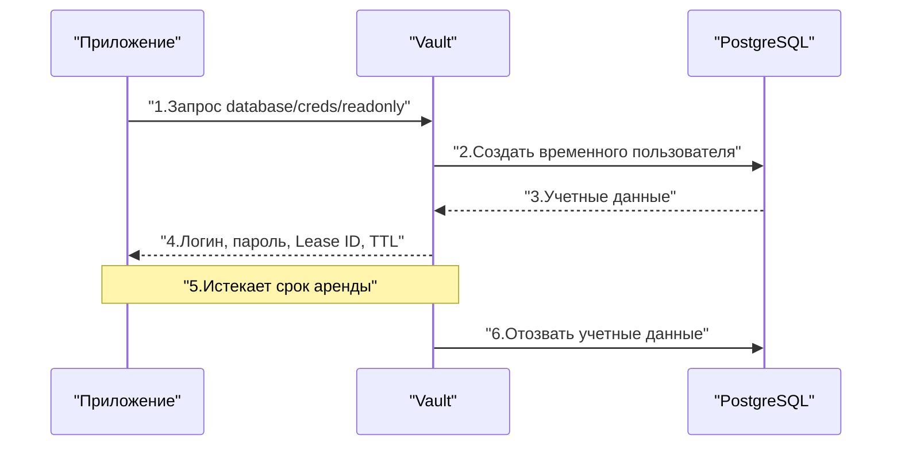

### 11.2. Что такое Lease

Lease — механизм управления сроком действия выданного секрета.

Он может содержать:

- идентификатор аренды;
- время жизни;
- признак возможности продления.

Для поддерживаемых динамических секретов Vault отслеживает истечение аренды и инициирует отзыв.

Но это не универсальная гарантия мгновенного удаления доступа во внешней системе.

Например, если PostgreSQL недоступен, Vault может не суметь немедленно удалить временного пользователя.

### 11.3. TTL и Renew

TTL определяет срок действия.

Renew позволяет продлить аренду, если это допускается настройками движка и политики жизненного цикла.

Revoke завершает аренду и запускает механизм отзыва.

|Термин|Смысл|
|---|---|
|TTL|Сколько еще действует токен или аренда|
|Renew|Продлить срок действия|
|Revoke|Отозвать доступ или секрет|
|Lease ID|Идентификатор конкретной аренды|
|Expiration Manager|Внутренний компонент, отслеживающий сроки действия|

### 11.4. Что будет, если Vault временно недоступен

Зависит от приложения и типа секрета.

Статический пароль: если приложение уже получило его и продолжает хранить в памяти, оно может работать дальше.

Динамический пароль: если его аренда истекла, а приложение не смогло продлить ее или получить новые учетные данные, возможен отказ доступа.

Сертификат: ранее выпущенный сертификат не становится автоматически недействительным только потому, что Vault недоступен. Но новый сертификат или продление через Vault получить не удастся.

Это важная причина продумывать не только доступность Vault, но и поведение приложений при его отказе.

## 12. Vault как центр сертификации (PKI)

Одна из наших основных задач — использовать Vault для выпуска TLS-сертификатов внутренних сервисов.

Для этого предназначен PKI Secrets Engine.

Он может:

- создавать и использовать CA;
- подписывать сертификаты;
- применять ограничения через PKI Roles;
- задавать срок действия сертификатов;
- учитывать выпущенные и отозванные сертификаты;
- предоставлять механизмы распространения информации об отзыве.

### 12.1. Root CA и Intermediate CA

Для нашей инфраструктуры целесообразно разделить корневой и выпускающий центры сертификации.

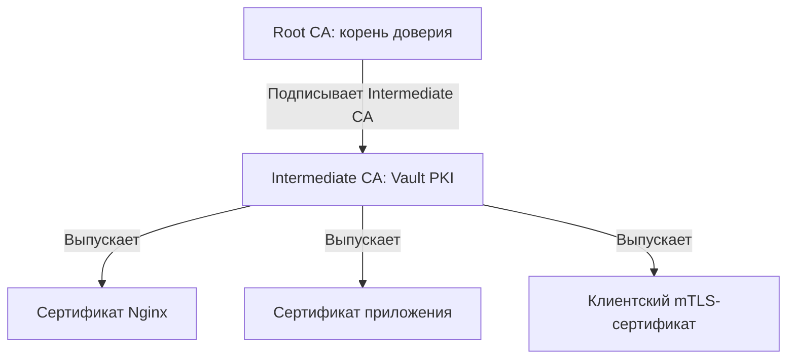

Root CA — основа доверия. Его приватный ключ следует защищать особенно тщательно, а при возможности держать вне постоянно работающего Vault.

Intermediate CA — непосредственно выпускает сертификаты для сервисов.

Почему так лучше, чем использовать один Root CA для всего?

Если ключ Intermediate CA скомпрометирован, можно отозвать этот Intermediate и создать новый, сохранив Root CA как доверенную основу. Это не отменяет необходимости заменить затронутые сертификаты и распространить информацию об отзыве.

### 12.2. Как приложение получает сертификат

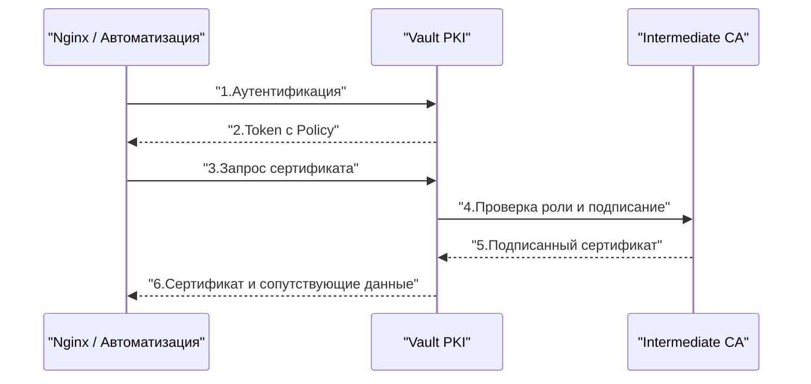

Здесь есть важная тонкость.

При использовании endpoint `pki/issue/...` Vault может сам сгенерировать приватный ключ и вернуть его клиенту вместе с сертификатом.

При использовании схемы CSR клиент генерирует приватный ключ самостоятельно, а Vault подписывает запрос на сертификат. Тогда приватный ключ не требуется передавать в Vault.

Для сервисов с повышенными требованиями к защите приватных ключей CSR-подход часто предпочтительнее.

### 12.3. Что произойдет при недоступности Vault PKI

|Ситуация|Последствие|
|---|---|
|Nginx уже использует действующий сертификат|Продолжает обслуживать TLS-соединения|
|Нужно выпустить новый сертификат|Операция недоступна|
|Сертификат скоро истекает|Автоматизация не сможет обновить его через Vault|
|Клиент проверяет CRL/OCSP, а соответствующая инфраструктура недоступна|Поведение зависит от клиента и настроек проверки|
|Потерян Intermediate CA Private Key|Невозможно продолжать выпуск от имени этого CA без восстановления ключа|

> [!IMPORTANT] Доступность CA и доступность приложений  
> Работающие приложения не должны обращаться к Vault при каждом TLS-handshake только ради использования уже выданного сертификата.
> 
> Сертификаты и ключи должны быть безопасно доставлены и доступны сервису локально либо через подходящий механизм интеграции.

Подробнее PKI будем разбирать в четвертой теме. Связанные криптографические основы — в [[Synced/DevOps/CI-CD, артефакты, тестирование и DevSecOps/5. DevSecOps и безопасность цепочки поставок/9. PKI и криптография в инфраструктуре/1. Основы криптографии.md|Основы криптографии]].

## 13. Архитектура нашего Vault на виртуальной машине

Теперь соберем всё в конкретную схему, которую реализуем во второй заметке.

### 13.1. Предлагаемая топология

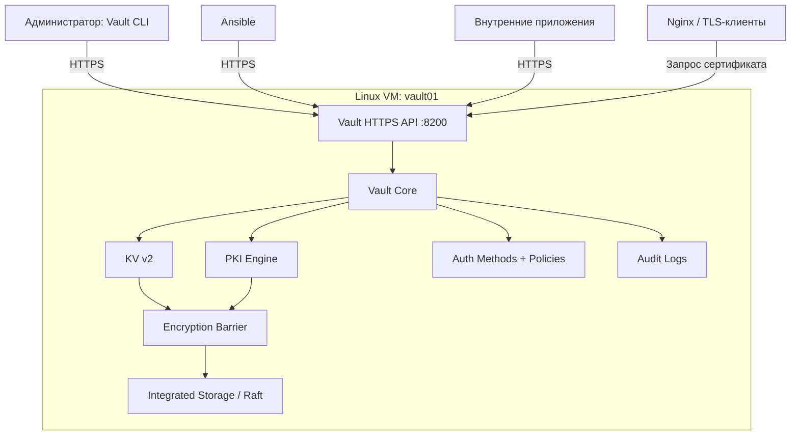

### 13.2. Что будет установлено на VM

|Компонент|Решение|Почему|
|---|---|---|
|ОС|Linux с systemd|Управление сервисом и стандартная эксплуатация|
|Vault|Официальный сервер Vault|Основной сервис|
|Storage|Integrated Storage (Raft)|Без отдельного Consul|
|Seal|Shamir|Изучение жизненного цикла и независимость от KMS|
|API|HTTPS на `8200`|Защита клиентского трафика|
|TLS|Независимый bootstrap-сертификат|Нет циклической зависимости от Vault PKI|
|KV|KV v2|Версионирование статических секретов|
|PKI|Intermediate CA|Выпуск внутренних сертификатов|
|Audit|Файловое audit device|Контроль операций|
|Service Manager|systemd|Автозапуск и управление процессом|

### 13.3. Разделение конфигурации и данных

Рекомендуемая логическая структура файловой системы:

```
/etc/vault.d/
    vault.hcl

/opt/vault/data/
    ... Raft data ...

/var/log/vault/
    ... Audit logs ...
```

Это пример будущей структуры, а не требование Vault.

Конфигурация определяет, как запускается сервер.

Raft Data содержит долговременное защищенное состояние Vault.

Audit Logs содержат записи действий с Vault и требуют отдельного управления доступом и ротацией.

Важно не складывать всё в один каталог и не предоставлять другим пользователям Linux доступ к данным и конфигурации без необходимости.

### 13.4. Что находится в `vault.hcl`, а что — внутри Vault

Это принципиальное различие.

Файл конфигурации Vault задает параметры процесса:

```hcl
ui = true

api_addr = "https://vault.example.internal:8200"

storage "raft" {
  path    = "/opt/vault/data"
  node_id = "vault01"
}

listener "tcp" {
  address         = "0.0.0.0:8200"
  tls_cert_file   = "/etc/vault.d/tls/vault.crt"
  tls_key_file    = "/etc/vault.d/tls/vault.key"
}
```

Это фрагмент для понимания структуры. Полную рабочую конфигурацию, включая кластерный адрес, права доступа, сетевые ограничения и настройки безопасности, составим во второй заметке.

Внутри Vault через API сохраняются:

- включенные Secrets Engines;
- политики;
- Auth Methods и их настройки;
- секреты KV;
- конфигурация PKI;
- другие внутренние данные.

Поэтому замена `vault.hcl` не удаляет автоматически существующие секреты, а удаление каталога Raft может уничтожить всё сохраненное состояние Vault.

> [!WARNING] Vault — stateful-сервис  
> Его нельзя воспринимать как обычное stateless-приложение, которое можно переустановить и получить прежнее состояние только из конфигурационного файла.
> 
> Для восстановления нужны и корректное состояние хранилища, и доступ к необходимым механизмам разблокировки.

### 13.5. Что обязательно продумать до установки

|Вопрос|Наше первоначальное решение|
|---|---|
|Где будет работать Vault?|Отдельная Linux VM|
|Как клиенты будут его находить?|Постоянное DNS-имя|
|Как защитим API?|TLS + firewall|
|Какое хранилище?|Raft|
|Как будем распечатывать?|Shamir|
|Где будут Unseal Shares?|Вне VM, в защищенном месте|
|Где будет Root Token?|Временно и отдельно от Unseal Shares|
|Как будем выдавать права?|Отдельные политики и способы аутентификации|
|Где будут backups?|За пределами VM|
|Что произойдет при отказе?|Временно недоступна выдача секретов и сертификатов|
|Как исключить зависимость Vault от собственного PKI?|Независимый TLS bootstrap|

## 14. Практическая диагностика архитектуры

Даже до установки полезно понимать, какие команды будут помогать разбираться с проблемами.

### 14.1. Проверка состояния Vault

```bash
vault status
```

Показывает, в частности:

- Initialized;
- Sealed;
- Seal Type;
- Storage Type;
- сведения о HA, если применимо.

Пример интерпретации:

```
Initialized    true
Sealed         true
Storage Type   raft
```

Это означает:

- хранилище уже инициализировано;
- выбран Raft;
- Vault пока не распечатан.

Не нужно повторно выполнять `vault operator init`. Нужно разобраться с Unseal.

### 14.2. Проверка служебных API

```bash
curl --cacert /path/to/ca.crt \
  https://vault.example.internal:8200/v1/sys/health
```

Endpoint `/v1/sys/health` возвращает HTTP-код в зависимости от состояния сервера.

Распространенные значения:

|HTTP-код|Типичное значение|
|---|---|
|`200`|Active, готов к обслуживанию|
|`429`|Standby|
|`472`|DR Secondary|
|`473`|Performance Standby|
|`501`|Не инициализирован|
|`503`|Sealed|

Поведение некоторых кодов можно менять параметрами health endpoint. Также код `429` может иметь другое значение в контексте обычных API-запросов.

Поэтому HTTP 503 от Vault не всегда означает, что процесс упал. Он может работать, но находиться в состоянии Sealed.

### 14.3. Проверка systemd

```bash
sudo systemctl status vault
```

Логи процесса:

```bash
sudo journalctl -u vault -n 100 --no-pager
```

Проверка прослушиваемых портов:

```bash
sudo ss -lntp | grep 8200
```

### 14.4. Проверка сертификата Vault

```bash
openssl s_client \
  -connect vault.example.internal:8200 \
  -servername vault.example.internal \
  -verify_return_error \
  -CAfile /path/to/ca.crt
```

Это поможет проверить:

- доступность TLS endpoint;
- предъявляемый сертификат;
- цепочку доверия;
- ошибки проверки.

Для полной проверки соответствия имени сервера можно дополнительно использовать `-verify_hostname vault.example.internal`.

### 14.5. Типовые проблемы

|Симптом|Вероятная причина|Что проверять|
|---|---|---|
|`connection refused`|Vault не слушает адрес или порт|systemd, listener, `ss`|
|`certificate verify failed`|Нет доверия к CA или ошибка сертификата|SAN, цепочка CA, срок действия|
|`Vault is sealed`|Не выполнен Unseal|`vault status`, Seal Type|
|`permission denied`|Нет прав или неверный токен|Policy, Token, путь API|
|`no handler for route`|Неверный mount path или API endpoint|`vault secrets list`, `vault path-help`|
|После перезапуска Vault недоступен|Shamir Seal требует ручного Unseal|`vault status`|
|`storage is not initialized`|Новое или неверное хранилище|Путь Raft, mount диска, конфигурация|
|Vault работает, но не выдает сертификаты|Ошибка PKI Role или CA|Конфигурация PKI, Policy|
|Не создается snapshot|Недостаточно прав или проблемы с файловой системой|ACL, путь, свободное место|

### 14.6. Особо опасная ситуация: Vault неожиданно стал Uninitialized

Допустим, вчера Vault работал, а сегодня показывает:

```
Initialized    false
```

Не выполняй сразу `vault operator init`.

Сначала проверь:

1. Тот ли конфигурационный файл использует systemd?
2. Не изменился ли `storage "raft" { path = ... }`?
3. Смонтирован ли нужный диск?
4. Не запущен ли другой экземпляр Vault?
5. Не заменена ли директория данных пустой?
6. Существуют ли резервные копии?

Повторная инициализация нового пустого хранилища не вернет прежние секреты.

> [!DANGER] Правило восстановления  
> Если Vault неожиданно потерял состояние, сначала устанавливаем причину, сохраняем имеющиеся данные и проверяем конфигурацию. Только после этого принимаем решение о восстановлении из snapshot или создании нового Vault.

## 15. Архитектурные ошибки, которых нужно избегать

|Ошибка|Почему опасна|Как правильно|
|---|---|---|
|Хранить Root Token в приложениях|Компрометация приложения дает административный доступ|Выдавать ограниченные токены|
|Хранить все Unseal Shares на Vault VM|Потеря независимости защиты|Разделять хранение|
|Использовать HTTP без TLS|Возможен перехват токенов и секретов|HTTPS с проверкой сертификата|
|Отключать TLS-проверку|Возможна подмена сервера|Установить доверенный CA|
|Считать Raft на одной VM отказоустойчивым|Нет второго узла для продолжения работы|Backup или HA-кластер|
|Хранить backup только на той же VM|Потеря VM уничтожит и резервную копию|Выносить backup|
|Использовать Vault PKI как единственный источник сертификата для самого Vault|Риск циклической зависимости|Независимый bootstrap TLS|
|Давать приложениям широкие Policies|Увеличение ущерба при компрометации|Least Privilege|
|Не включать аудит|Нет надежной истории действий|Настроить Audit Devices|
|Не проверять восстановление|Backup может оказаться бесполезным|Проводить тестовый restore|
|Полагаться только на шифрование Raft|Не защищает от всех атак на работающий хост|Укреплять ОС, сеть и доступ|

---
## Контрольные вопросы для самопроверки

### Базовые

1. Из каких основных уровней состоит архитектура Vault?
2. Чем Vault Core отличается от Secrets Engine?
3. В чем разница между Auth Method и ACL Policy?
4. Что такое mount path и почему это не обычная директория на диске?
5. Как приложение проходит путь от аутентификации до получения секрета?
6. Зачем нужен Encryption Barrier, если на VM уже используется шифрование диска?
7. Чем отличаются Root Key, Unseal Key и Root Token?
8. Почему `Initialized: true` и `Sealed: true` не противоречат друг другу?
9. Что произойдет с Vault после перезагрузки VM при использовании Shamir Seal?
10. Чем Integrated Storage (Raft) отличается от KV Secrets Engine?
11. Почему кластер из двух Raft-узлов не выдерживает отказ одного узла?
12. Для чего Vault использует порты `8200` и `8201`?
13. Что произойдет, если у приложения истечет TTL динамического секрета?
14. Почему для собственного Vault PKI полезно использовать Intermediate CA?
15. Почему нельзя хранить Root Token и Unseal Shares рядом с данными Raft?

### Продвинутые вопросы

16. ⭐ Злоумышленник скопировал каталог Raft, но не получил Unseal Shares. Какие данные защищены и от чего эта защита не спасает?
17. ⭐ После перезапуска Vault возвращает HTTP 503, хотя systemd показывает `active (running)`. Как определить причину?
18. ⭐ Приложение успешно аутентифицируется через AppRole, но получает `403` при чтении KV v2. Как последовательно диагностировать проблему?
19. ⭐ Почему недоступность Vault не всегда означает немедленную остановку Nginx, использующего сертификат Vault PKI?
20. ⭐ Какие архитектурные изменения нужны, чтобы перейти с одной VM на отказоустойчивый Raft-кластер?
21. ⭐ Что делать, если ранее работавший Vault внезапно показывает `Initialized: false`?
22. ⭐ Почему при Auto Unseal потеря внешнего KMS-ключа может сделать бесполезным даже корректный Raft Snapshot?

---
## Связанные заметки

- [[Synced/DevOps/CI-CD, артефакты, тестирование и DevSecOps/5. DevSecOps и безопасность цепочки поставок/9. PKI и криптография в инфраструктуре/1. Основы криптографии.md|Основы криптографии]]
- [[Synced/DevOps/CI-CD, артефакты, тестирование и DevSecOps/5. DevSecOps и безопасность цепочки поставок/9. PKI и криптография в инфраструктуре/2. Инфраструктура открытых ключей.md|Инфраструктура открытых ключей]]
- [[Synced/DevOps/CI-CD, артефакты, тестирование и DevSecOps/5. DevSecOps и безопасность цепочки поставок/9. PKI и криптография в инфраструктуре/6. Mutual TLS.md|Mutual TLS]]

---

#DevOps #HashiCorpVault #Vault #IAM #SecretsManagement #PKI #Raft #Security #Architecture #Linux