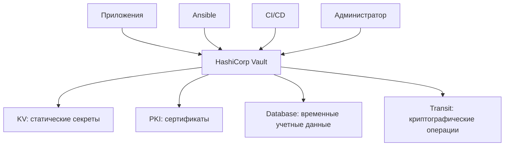
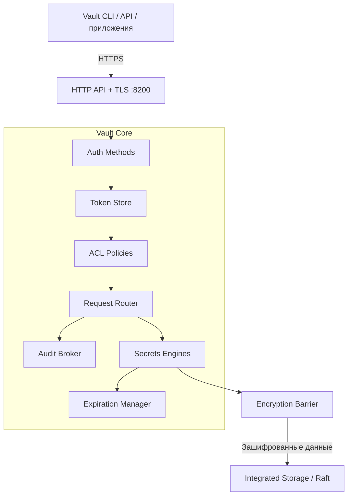
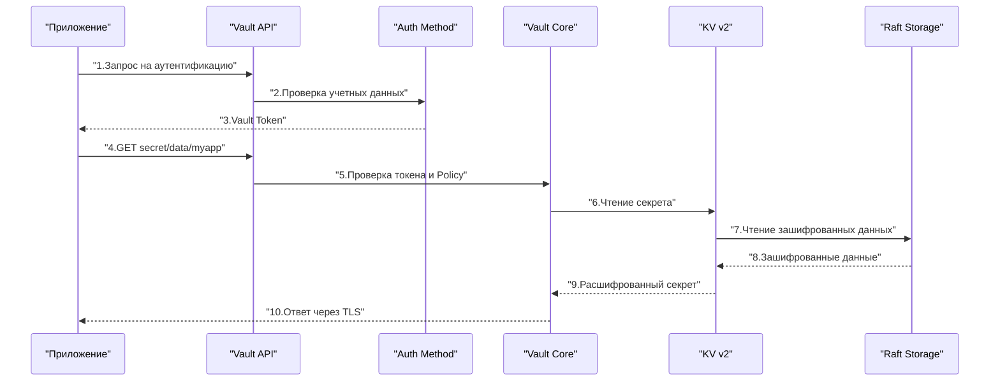

> [!INFO] Цель заметки  
> Понять архитектуру HashiCorp Vault настолько хорошо, чтобы самостоятельно спроектировать его развертывание на Linux VM, объяснить путь запроса к секрету, разобраться с Seal/Unseal, выбрать хранилище и диагностировать базовые проблемы.
> 
> Наш сценарий: один Vault на виртуальной машине, Integrated Storage (Raft), TLS, хранение секретов и выпуск внутренних TLS-сертификатов через PKI Secrets Engine.

## 1. Что такое Vault и какую проблему он решает

HashiCorp Vault — сервис централизованного управления секретами, криптографическими операциями и доступом к ним.

Без Vault секреты часто разбросаны по инфраструктуре:

- Пароли баз данных — в `.env` или переменных CI/CD.
- API-токены — в конфигурациях приложений.
- Приватные ключи — на серверах.
- Сертификаты — создаются вручную и забываются до истечения срока.
- Секреты Ansible — в зашифрованных файлах, которые всё равно необходимо кому-то расшифровывать.э

Vault позволяет организовать единый контролируемый интерфейс для получения и управления этими данными.



Важное различие: Vault — не просто зашифрованная база данных. Это сервис, который принимает решения о доступе. Он должен ответить на несколько вопросов:

1. Кто обращается?
2. Каким способом подтверждена его личность?
3. Что ему разрешено?
4. Какую операцию он хочет выполнить?
5. Нужно ли ограничить срок действия выданного доступа или секрета?
6. Как зафиксировать действие для аудита?

### 1.1. Что Vault умеет, а чего не делает

|Задача|Возможность Vault|
|---|---|
|Хранить пароль PostgreSQL|KV Secrets Engine|
|Выдать временного пользователя PostgreSQL|Database Secrets Engine|
|Выпустить сертификат для Nginx|PKI Secrets Engine|
|Выполнить шифрование без выдачи ключа приложению|Transit Secrets Engine|
|Проверить права приложения|Auth Methods + Policies|
|Записать факт обращения|Audit Devices|
|Обновить секрет в конфигурации приложения|Vault Agent + Templates|
|Автоматически защитить уже скомпрометированный сервер|Нет|

> [!WARNING] Граница безопасности  
> Если злоумышленник получил полный контроль над работающим, распечатанным Vault-сервером, защита секретов становится существенно сложнее. Шифрование данных на диске не означает, что данные недоступны самому работающему Vault или процессам с достаточными привилегиями на хосте.

## 2. Общая архитектура Vault

Архитектуру удобно разделить на пять уровней:

1. Клиенты — приложения, CLI, Terraform, Ansible, CI/CD.
2. API и TLS — точка входа в Vault.
3. Vault Core — аутентификация, авторизация, маршрутизация, жизненный цикл секретов.
4. Encryption Barrier — шифрование и расшифровка сохраняемых данных.
5. Storage Backend — долговременное хранение зашифрованного состояния.



Диаграмма упрощена: например, аудит охватывает разные этапы обработки запроса, а не только маршрутизатор.

### 2.1. Vault Core

Vault Core — основная логика сервера.

Он отвечает за:

- обработку API-запросов;
- проверку клиентских токенов;
- применение политик доступа;
- маршрутизацию запросов к нужным Secrets Engines;
- управление сроком действия токенов и динамических секретов;
- координацию операций хранения;
- аудит;
- внутреннее состояние Vault.

Важно понимать: Vault Core сам по себе не является конкретным хранилищем секретов. Он управляет компонентами, которые выполняют специализированную работу. Например, запрос:

```http
GET /v1/secret/data/production/database
```

направляется к KV v2 Secrets Engine, смонтированному по пути `secret/`.

А запрос:

```http
POST /v1/pki/issue/web-server
```

направляется к PKI Secrets Engine, смонтированному по пути `pki/`.

### 2.2. Secrets Engines

Secrets Engine — компонент, реализующий конкретные операции с секретами.

Он подключается к определенному пути — mount path.

|Mount Path|Engine|Назначение|
|---|---|---|
|`secret/`|KV v2|Статические секреты|
|`pki/`|PKI|Выпуск сертификатов|
|`database/`|Database|Динамические учетные данные|
|`transit/`|Transit|Шифрование, подпись, операции с ключами|

Например:

```
secret/data/myapp
pki/issue/web-server
database/creds/readonly
transit/encrypt/app-key
```

Первый компонент пути определяет, какому движку передать запрос.

У разных движков — разные API и правила работы.

Важно: mount path — это не каталог Linux и не обязательно физический каталог в Raft. Это логический маршрут внутри Vault.

Каждый mount получает изолированное представление своего пространства хранения, поэтому один движок не должен иметь прямого доступа к данным другого.

### 2.3. Auth Methods

Auth Method отвечает на вопрос:

«Как Vault установит, кто перед ним?». Примеры:

|Auth Method|Кто использует|Как подтверждается личность|
|---|---|---|
|Token|Скрипты, администраторы|Предъявление Vault Token|
|Userpass|Пользователи, лаборатория|Логин и пароль|
|AppRole|Сервисы, автоматизация|Role ID + Secret ID|
|Kubernetes|Pods|Kubernetes ServiceAccount JWT|
|JWT/OIDC|CI/CD, пользователи|Проверяемый токен от доверенного провайдера|

После успешной аутентификации Vault обычно выдает клиентский токен, с которым выполняются последующие запросы.

### 2.4. Policies

Policy — набор правил, определяющих разрешенные действия над путями Vault.

Например:

```hcl
path "secret/data/myapp/*" {
  capabilities = ["read"]
}
```

Эта политика разрешает чтение данных KV v2 по указанному шаблону.

Но она не дает права:

- записывать новые значения;
- удалять секреты;
- читать другие пути;
- менять конфигурацию Vault.

Политика не подтверждает личность клиента. Она определяет полномочия уже аутентифицированного клиента.

### 2.5. Audit Devices

Audit Device регистрирует операции с Vault.

Это может быть файловый журнал или другой поддерживаемый механизм аудита.

Он помогает отвечать на вопросы:

- Кто обращался к секрету?
- Когда это произошло?
- К какому пути был запрос?
- Успешно ли выполнена операция?
- С какого клиента пришел запрос?

Vault обычно защищает чувствительные значения в аудит-логах с помощью HMAC, но не следует считать все метаданные безусловно безопасными для публикации.

> [!IMPORTANT] Аудит — не обычный debug-лог  
> Audit Device нужен для отслеживания действий с секретами. Его доступность влияет на обработку запросов: если Vault не может записать событие ни в одно включенное audit device, соответствующий запрос может быть отклонен.
> 
> Поэтому место для audit-логов, права доступа и ротацию файлов нужно продумать до эксплуатации.

## 3. Как Vault обрабатывает запрос

Представим приложение, которому нужно прочитать пароль базы данных.



Здесь опущен Encryption Barrier между движком и физическим хранилищем. Он выполняет расшифровку данных до того, как секрет становится доступен движку.

### 3.1. Аутентификация

Приложение обращается к выбранному Auth Method.

Например, AppRole: