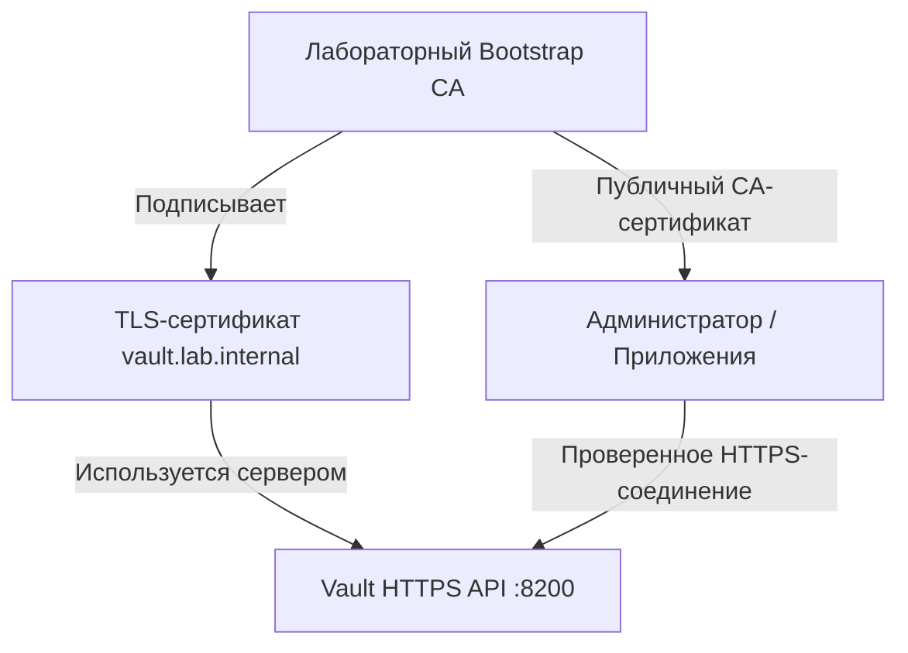
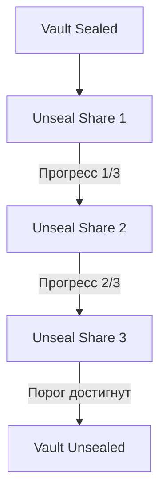
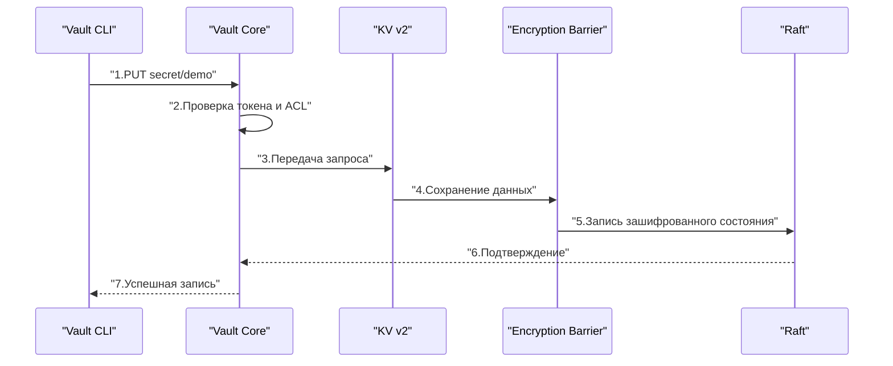

> [!INFO] Цель  
> Развернуть полноценный HashiCorp Vault на отдельной Linux VM, используя Integrated Storage (Raft), HTTPS и systemd.
> 
> В результате получим сервер, готовый к дальнейшей настройке KV Secrets Engine, политик доступа и собственного центра сертификации (PKI).

## Решенные вопросы

1. Как подготовить виртуальную машину и установить Vault?
2. Какие файлы и каталоги нужны Vault и почему?
3. Как организовать HTTPS, если собственного центра сертификации пока нет?
4. Как настроить Integrated Storage (Raft) на одном сервере?
5. Какие параметры `vault.hcl` обязательны и что они означают?
6. Как проверить конфигурацию до первого запуска?
7. Как выполнить Initialize и Unseal без потери критичных ключей?
8. Как безопасно настроить первоначальный административный доступ?
9. Как проверить API, UI, TLS, Raft и аудит?
10. Что произойдет после перезагрузки и как диагностировать основные ошибки?

## 1. Наша лабораторная инфраструктура

В качестве примера используем Ubuntu Server 24.04 LTS. Для Debian команды будут почти идентичными, но порядок подключения официального репозитория может отличаться.

| ОС          | Ubuntu Server 24.04 LTS           |
| ----------- | --------------------------------- |
| Имя сервера | `vault01`                         |
| IP-адрес    | `192.168.56.10`                   |
| DNS-имя     | `vault.lab.internal`              |
| API         | `https://vault.lab.internal:8200` |
| Storage     | Integrated Storage (Raft)         |
| Seal        | Shamir, ручной Unseal             |

Адреса здесь учебные. В реальной инфраструктуре заменяем их на свои.

Для VM достаточно начать с 2 vCPU, 4 ГБ RAM и 30 ГБ диска для лаборатории. Это не универсальные production-требования: объем памяти, диска и IOPS зависят от количества секретов, сертификатов, запросов и характера нагрузки.

**Топология развертывания**

![[загрузка.svg|562]]

> [!WARNING] Ограничение лаборатории  
> Один узел Raft не обеспечивает отказоустойчивость. Если VM выключена, Vault не выдает новые секреты и сертификаты. Поэтому даже в лаборатории полезно заранее предусмотреть резервное копирование.

## 2. Подготовка Linux

### 2.1. Обновление системы

```bash
sudo apt update
sudo apt upgrade -y
```

Проверяем ОС и имя сервера:

```bash
cat /etc/os-release
hostnamectl
```

При необходимости задаем имя:

```bash
sudo hostnamectl set-hostname vault01
```

### 2.2. Настройка DNS

Vault должен иметь стабильное имя, соответствующее его TLS-сертификату. В полноценной инфраструктуре лучше создать DNS-запись:

```bash
vault.lab.internal → 192.168.56.10
```

Для лаборатории можно временно использовать `/etc/hosts` на клиентских машинах:

```
192.168.56.10 vault.lab.internal
```

Проверяем:

```bash
getent hosts vault.lab.internal
```

> [!TIP] Почему DNS важнее, чем кажется  
> TLS-клиент проверяет, что имя сервера соответствует полю SAN сертификата. Если сертификат выпущен для `vault.lab.internal`, а мы подключаемся по IP, проверка может завершиться ошибкой, если IP не включен в SAN.

### 2.3. Синхронизация времени

Корректное системное время важно для проверки TLS-сертификатов и сроков действия токенов.

```bash
timedatectl status
```

При необходимости:

```bash
sudo timedatectl set-ntp true
```

Проверяем:

```bash
timedatectl show -p NTPSynchronized
```

Ожидаем `NTPSynchronized=yes`, если синхронизация работает.

### 2.4. Установка вспомогательных утилит

```bash
sudo apt install -y \
  curl \
  wget \
  gnupg \
  openssl \
  jq \
  ca-certificates
```

`openssl` нужен для первоначального TLS, `jq` — для анализа JSON-ответов Vault API.

## 3. Установка HashiCorp Vault

Для Ubuntu используем официальный APT-репозиторий HashiCorp.

### 3.1. Добавление ключа репозитория

```bash
wget -O- https://apt.releases.hashicorp.com/gpg | \
  sudo gpg --dearmor -o /usr/share/keyrings/hashicorp-archive-keyring.gpg
```

Добавляем репозиторий:

```bash
echo "deb [signed-by=/usr/share/keyrings/hashicorp-archive-keyring.gpg] https://apt.releases.hashicorp.com $(. /etc/os-release && echo "$VERSION_CODENAME") main" | \
  sudo tee /etc/apt/sources.list.d/hashicorp.list
```

Устанавливаем Vault:

```bash
sudo apt update
sudo apt install -y vault
```

Проверяем:

```bash
vault version
```

Должна отобразиться установленная версия Vault.

> [!INFO] Почему не используем `vault server -dev`  
> Dev Mode предназначен для экспериментов. Он использует упрощенную конфигурацию, автоматически инициализирует и распечатывает Vault и обычно не обеспечивает необходимую долговременность и безопасность хранения.
> 
> Нам нужен обычный серверный режим, чтобы изучить настоящие Initialize, Unseal, Raft и TLS.

## 4. Пользователь Vault и структура каталогов

Vault должен работать под отдельной системной учетной записью, а не постоянно от `root`. Официальный пакет обычно создает пользователя `vault`. Проверим:

```bash
id vault
```

Если пользователь отсутствует:

```bash
sudo useradd --system \
  --home /etc/vault.d \
  --shell /usr/sbin/nologin \
  vault
```

### 4.1. Создание каталогов

```bash
sudo install -d -o root -g vault -m 0750 /etc/vault.d
sudo install -d -o vault -g vault -m 0700 /opt/vault/data
sudo install -d -o root -g vault -m 0750 /etc/vault.d/tls
sudo install -d -o vault -g vault -m 0700 /var/log/vault
```

Назначение:

|Каталог|Для чего нужен|Владелец|
|---|---|---|
|`/etc/vault.d/`|Конфигурация сервера|`root:vault`|
|`/etc/vault.d/tls/`|TLS-сертификат и ключ|`root:vault`|
|`/opt/vault/data/`|Данные Raft|`vault:vault`|
|`/var/log/vault/`|Файловый аудит|`vault:vault`|

Почему данные Raft принадлежат пользователю `vault`? Процессу нужно самостоятельно создавать, изменять и удалять внутренние файлы хранилища.

Почему конфигурация принадлежит `root`? Пользователь, под которым работает Vault, должен иметь возможность читать ее, но не обязан изменять.

Проверим:

```bash
ls -ld /etc/vault.d /etc/vault.d/tls /opt/vault/data /var/log/vault
```

> [!WARNING] Отдельный диск для Raft  
> Если `/opt/vault/data` находится на отдельном томе, необходимо убедиться, что том смонтирован до запуска Vault.
> 
> Иначе Vault может увидеть пустую директорию на корневой файловой системе и выглядеть как неинициализированный сервер. В эксплуатационной теме разберем зависимость systemd от mount point.

## 5. Настройка TLS: создаем первоначальный CA

Поскольку мы хотим использовать Vault как центр сертификации, возникает проблема первоначального доверия.

Для безопасного запуска Vault уже нужен TLS-сертификат, но PKI Engine еще не работает.

Поэтому создадим независимый лабораторный Root CA, который подпишет сертификат самого Vault.



Важно: приватный ключ Bootstrap CA должен оставаться вне Vault VM. На Vault-сервер переносим только его собственный TLS-ключ, сертификат и публичный сертификат CA.

### 5.1. Генерация Root CA

Выполняем на отдельной административной Linux-машине, а не на сервере Vault.

Создаем рабочую директорию:

```bash
mkdir -p ~/vault-bootstrap-ca
chmod 700 ~/vault-bootstrap-ca
cd ~/vault-bootstrap-ca
```

Генерируем приватный ключ CA с защитой паролем:

```bash
openssl genpkey \
  -algorithm RSA \
  -pkeyopt rsa_keygen_bits:4096 \
  -aes-256-cbc \
  -out bootstrap-ca.key
```

OpenSSL запросит пароль для ключа. 

Создаем сертификат CA:

```bash
openssl req -x509 \
  -new \
  -sha256 \
  -days 3650 \
  -key bootstrap-ca.key \
  -out bootstrap-ca.crt \
  -subj "/CN=Vault Lab Bootstrap CA" \
  -addext "basicConstraints=critical,CA:TRUE" \
  -addext "keyUsage=critical,keyCertSign,cRLSign"
```

Получили:

```
bootstrap-ca.key    # Приватный ключ CA — строго секретный
bootstrap-ca.crt    # Публичный сертификат CA
```

> [!DANGER] Защита CA  
> Не копируй `bootstrap-ca.key` на Vault VM. Этот ключ позволяет подписывать сертификаты от имени доверенного CA.
> 
> Для реальной инфраструктуры дополнительно нужны политика хранения CA, процедура отзыва, учет серийных номеров и защищенное резервное копирование. Здесь мы создаем минимальный лабораторный CA.

### 5.2. Генерация приватного ключа Vault

На административной машине:

```bash
openssl genpkey \
  -algorithm RSA \
  -pkeyopt rsa_keygen_bits:3072 \
  -out vault.key
```

Этот ключ не защищаем паролем, поскольку systemd-сервис Vault должен автоматически читать его при запуске. Компенсируем это строгими правами на файл и защитой самой VM.

Создадим файл `vault-cert.cnf`:

```ini
[req]
prompt = no
distinguished_name = dn
req_extensions = req_ext

[dn]
CN = vault.lab.internal

[req_ext]
subjectAltName = @alt_names

[alt_names]
DNS.1 = vault.lab.internal
IP.1 = 192.168.56.10
```

Создаем CSR:

```bash
openssl req \
  -new \
  -key vault.key \
  -out vault.csr \
  -config vault-cert.cnf
```

CSR (Certificate Signing Request) — запрос на выпуск сертификата. Он содержит публичный ключ и запрашиваемые идентификаторы, но не содержит приватный ключ.

### 5.3. Подписание сертификата Vault

Создадим файл `vault-cert-ext.cnf`:

```ini
basicConstraints = critical,CA:FALSE
keyUsage = critical,digitalSignature,keyEncipherment
extendedKeyUsage = serverAuth
subjectAltName = @alt_names

[alt_names]
DNS.1 = vault.lab.internal
IP.1 = 192.168.56.10
```

Подписываем:

```bash
openssl x509 \
  -req \
  -in vault.csr \
  -CA bootstrap-ca.crt \
  -CAkey bootstrap-ca.key \
  -CAcreateserial \
  -out vault.crt \
  -days 365 \
  -sha256 \
  -extfile vault-cert-ext.cnf
```

Проверяем:

```bash
openssl verify \
  -CAfile bootstrap-ca.crt \
  -verify_hostname vault.lab.internal \
  -purpose sslserver \
  vault.crt
```

Ожидаемый результат:

```
vault.crt: OK
```

Смотрим SAN:

```bash
openssl x509 \
  -in vault.crt \
  -noout \
  -text
```

В разделе `X509v3 Subject Alternative Name` должны присутствовать DNS-имя и IP-адрес.

### 5.4. Перенос сертификатов на Vault VM

С административной машины:

```bash
scp vault.crt vault.key bootstrap-ca.crt \
  admin@192.168.56.10:/tmp/
```

На Vault VM:

```bash
sudo install -o root -g vault -m 0640 \
  /tmp/vault.key /etc/vault.d/tls/vault.key

sudo install -o root -g vault -m 0644 \
  /tmp/vault.crt /etc/vault.d/tls/vault.crt

sudo install -o root -g vault -m 0644 \
  /tmp/bootstrap-ca.crt /etc/vault.d/tls/bootstrap-ca.crt
```

Удаляем временные копии:

```bash
sudo rm -f /tmp/vault.key /tmp/vault.crt /tmp/bootstrap-ca.crt
```

Удаление обычной командой `rm` не гарантирует физического стирания данных на SSD или виртуальном диске. Поэтому для реальной эксплуатации лучше передавать ключ непосредственно в защищенное конечное расположение.

Проверяем, что пользователь Vault может прочитать ключ:

```bash
sudo -u vault test -r /etc/vault.d/tls/vault.key && echo "TLS key readable"
```

И что обычный пользователь не имеет к нему доступа.

## 6. Настройка Integrated Storage (Raft)

Теперь создадим основной файл конфигурации сервера.

### 6.1. Конфигурация `vault.hcl`

```bash
sudo nano /etc/vault.d/vault.hcl
```

Содержимое:

```hcl
ui = true

api_addr     = "https://vault.lab.internal:8200"
cluster_addr = "https://192.168.56.10:8201"

disable_mlock = true

storage "raft" {
  path    = "/opt/vault/data"
  node_id = "vault01"
}

listener "tcp" {
  address         = "0.0.0.0:8200"
  cluster_address = "192.168.56.10:8201"

  tls_cert_file = "/etc/vault.d/tls/vault.crt"
  tls_key_file  = "/etc/vault.d/tls/vault.key"

  tls_min_version = "tls12"
}
```

Назначаем права:

```bash
sudo chown root:vault /etc/vault.d/vault.hcl
sudo chmod 0640 /etc/vault.d/vault.hcl
```

### 6.2. Разбор параметров

|Параметр|Значение|
|---|---|
|`ui = true`|Включает веб-интерфейс Vault|
|`api_addr`|Адрес Vault, доступный клиентам|
|`cluster_addr`|Адрес для внутреннего взаимодействия узлов|
|`disable_mlock`|Отключает блокировку памяти через `mlock`|
|`storage "raft"`|Выбирает Integrated Storage|
|`path`|Место хранения Raft-данных|
|`node_id`|Идентификатор узла Raft|
|`listener "tcp"`|Сетевой интерфейс API|
|`tls_cert_file`|Сертификат HTTPS|
|`tls_key_file`|Приватный ключ HTTPS|
|`tls_min_version`|Минимальная версия TLS|

### 6.3. Почему указан `cluster_addr`, если у нас одна VM

Vault с Integrated Storage использует кластерные механизмы даже при одном узле.

Мы заранее задаем адрес внутренней коммуникации. Позднее это упростит понимание перехода к нескольким узлам.

При этом порт 8201 не нужно открывать всем клиентам. Для одиночного узла достаточно разрешить API-порт 8200 только доверенным администраторам и приложениям.

### 6.4. Почему `disable_mlock = true`

Обычно `mlock` применяется для предотвращения выгрузки чувствительных страниц памяти процесса в swap.

Но для Vault с Integrated Storage HashiCorp рекомендует отключать `mlock` в стандартной конфигурации, поскольку Raft использует механизм отображения файлов в память и блокировка всех таких страниц может привести к чрезмерному потреблению памяти.

Это не означает, что память больше не требует защиты. Для VM нужно отдельно учитывать:

- swap;
- доступ администратора гипервизора;
- снимки оперативной памяти;
- core dumps;
- права доступа к процессу Vault.

## 7. Настройка systemd

Официальный пакет обычно уже устанавливает unit-файл `vault.service`.

Проверяем:

```bash
systemctl cat vault
```

Ищем команду запуска, похожую на:

```bash
ExecStart=/usr/bin/vault server -config=/etc/vault.d/vault.hcl
```

Не нужно создавать второй unit, если пакет уже предоставил рабочий.

### 7.1. Проверка конфигурации

Перед запуском:

```bash
sudo vault server -config=/etc/vault.d/vault.hcl -verify-only
```

Эта проверка позволяет обнаружить часть ошибок конфигурации до запуска, но не заменяет полноценный тест TLS, прав доступа и состояния хранилища.

### 7.2. Запуск

```bash
sudo systemctl enable --now vault
```

Проверяем:

```bash
sudo systemctl status vault
```

Смотрим логи:

```bash
sudo journalctl -u vault -n 100 --no-pager
```

Проверяем порты:

```bash
sudo ss -tlpn | grep -E ':8200|:8201'
```

### 7.3. Настройка firewall

Если используется UFW:

```bash
sudo ufw allow from 192.168.56.0/24 to any port 8200 proto tcp
```

Не открываем `8200` всему интернету.

Для одиночного узла `8201` не требуется открывать извне.

Если SSH подключение выполняется через эту же VM, перед включением UFW убедись, что SSH разрешен, иначе можно потерять удаленный доступ.

> [!IMPORTANT] Дополнительная защита  
> Vault не следует публиковать напрямую в интернет без отдельного обоснования. Для лаборатории лучше использовать приватную сеть VM, а для удаленного административного доступа — VPN или другой защищенный способ подключения.

## 8. Первое подключение к Vault

На этом этапе процесс Vault уже должен работать, но само хранилище еще не инициализировано.

### 8.1. Настройка Vault CLI

На Vault VM задаем адрес сервера:

```bash
export VAULT_ADDR="https://vault.lab.internal:8200"
```

Указываем сертификат CA, которому должен доверять клиент:

```bash
export VAULT_CACERT="/etc/vault.d/tls/bootstrap-ca.crt"
```

Проверяем:

```bash
vault status
```

Ожидаем состояние примерно такого вида:

```
Initialized    false
Sealed         true
Storage Type   raft
```

Команда может завершиться ненулевым кодом возврата, даже если сервер ответил успешно. Это связано с текущим состоянием Vault.

**Initialized: false** означает, что Raft-хранилище еще не подготовлено для работы Vault.

**Sealed: true** означает, что Vault пока не может выполнять обычные операции с секретами.

### 8.2. Проверка API без Vault CLI

```bash
curl \
  --cacert /etc/vault.d/tls/bootstrap-ca.crt \
  -i \
  https://vault.lab.internal:8200/v1/sys/health
```

До инициализации Vault обычно возвращает HTTP `501`.

Это полезный пример: сервер отвечает по HTTPS, но еще не готов обслуживать приложения.

### 8.3. Проверка TLS

```bash
openssl s_client \
  -connect vault.lab.internal:8200 \
  -servername vault.lab.internal \
  -verify_hostname vault.lab.internal \
  -verify_return_error \
  -CAfile /etc/vault.d/tls/bootstrap-ca.crt
```

Ищем:

```
Verify return code: 0 (ok)
```

Если проверка не проходит, не отключаем проверку сертификата, а выясняем причину.

Чаще всего проблема связана с SAN, неверным CA, DNS или истекшим сертификатом.

## 9. Инициализация Vault

Инициализация (Initialize) — первоначальное создание криптографического состояния Vault.

Выполняется только для нового, еще не инициализированного хранилища.

Во время инициализации Vault создает:

- криптографические ключи;
- части Unseal Key при использовании Shamir Seal;
- первоначальный Root Token;
- внутреннее состояние, необходимое для дальнейшей работы.

### 9.1. Выбор количества Unseal Shares

Для лаборатории используем:

```
Key Shares:     5
Key Threshold:  3
```

Это означает, что создаются пять частей, из которых любые три позволяют распечатать Vault.

Для личной лаборатории можно выбрать более простой вариант, например `3/2`, но для обучения полезно понять модель `5/3`.

> [!IMPORTANT] Важное уточнение  
> Если все пять частей хранит один человек в одном месте, Shamir Secret Sharing практически не обеспечивает организационного разделения доступа.
> 
> В настоящей инфраструктуре части должны распределяться между независимыми ответственными лицами либо защищенными процедурами хранения.

### 9.2. Безопасная инициализация

Выполняем из доверенной административной сессии

```bash
vault operator init \
  -key-shares=5 \
  -key-threshold=3
```

Команда выведет пять Unseal Shares и Initial Root Token.

Не копируй эти значения в заметки Obsidian, shell-скрипты, тикеты, скриншоты или чаты.

**Перед запуском необходимо заранее определить, куда будут сохранены эти данные**. Вывод не должен теряться вместе с закрытием терминала.

Для лаборатории разумно сохранить их в защищенное офлайн-хранилище или менеджер секретов, независимый от самого Vault, с разграничением доступа.

Не используем:

```bash
vault operator init > ~/vault-init.txt
```

Так создается незашифрованный файл с наиболее чувствительными данными Vault.

### 9.3. Что будет, если повторить Initialize

После успешной инициализации:

```bash
vault status
```

Покажет:

```
Initialized    true
Sealed         true
```

Повторный `vault operator init` не должен заново инициализировать то же хранилище.

Если ранее работавший Vault неожиданно показывает `Initialized: false`, это повод проверить путь Raft, монтирование диска и конфигурацию, а не создавать новый набор ключей.

## 10. Распечатывание Vault (Unseal)

После инициализации Vault остается в состоянии `Sealed`.

### 10.1. Выполняем Unseal

```bash
vault operator unseal
```

CLI запросит одну часть ключа:

```
Unseal Key (will be hidden):
```

Вводим первую часть.

Повторяем:

```bash
vault operator unseal
```

Вводим вторую часть.

Еще раз:

```bash
vault operator unseal
```

Вводим третью, отличающуюся от предыдущих часть.

После достижения порога Vault переходит в состояние `Unsealed`.

Проверяем:

```bash
vault status
```

Ожидаем:

```
Initialized    true
Sealed         false
Storage Type   raft
```

### 10.2. Почему Unseal выполняется несколько раз

При Shamir Seal исходный секрет разделен математически.

Отдельная часть не содержит достаточной информации для восстановления ключа.

Когда предъявлено необходимое количество частей, Vault может восстановить доступ к криптографическим материалам, необходимым для работы Encryption Barrier.



### 10.3. Что будет после перезагрузки VM

При выбранном Shamir Seal:

```
Перезагрузка VM
    ↓
systemd запускает Vault
    ↓
Vault обнаруживает существующее Raft-хранилище
    ↓
Initialized = true
Sealed = true
    ↓
Администратор вводит 3 Unseal Shares
    ↓
Vault готов к работе
```

Важно: повторно инициализировать Vault после перезапуска нельзя и не нужно.

## 11. Первоначальный административный доступ

Во время Initialize Vault выдает Initial Root Token.

Этот токен обладает максимальными административными полномочиями в рамках Vault.

### 11.1. Вход через CLI

```bash
vault login
```

CLI запросит токен.

Вводим Initial Root Token интерактивно, не передавая его аргументом командной строки.

Проверяем текущую личность:

```bash
vault token lookup
```

Смотрим включенные движки:

```bash
vault secrets list
```

Смотрим способы аутентификации:

```bash
vault auth list
```

### 11.2. Почему Root Token нельзя использовать постоянно

Root Token нужен для первоначальной административной настройки и отдельных аварийных операций.

Он не должен использоваться:

- приложениями;
- Ansible-плейбуками на постоянной основе;
- CI/CD-пайплайнами;
- Vault Agent;
- обычными пользователями для чтения секретов.

Если такой токен украден, злоумышленник получает чрезвычайно широкие полномочия.

### 11.3. Создаем административную политику

Для лаборатории можно создать отдельную административную роль с широкими правами.

Создаем файл `vault-admin.hcl` на административной машине:

```hcl
path "*" {
  capabilities = ["create", "read", "update", "delete", "list", "sudo"]
}
```

Загружаем политику:

```bash
vault policy write vault-admin vault-admin.hcl
```

> [!WARNING] Это широкая административная политика  
> Она предназначена только для доверенного администратора лаборатории, а не для приложений.
> 
> В production-инфраструктуре лучше разделять административные полномочия по функциям и учитывать операции, которые требуют особого доступа.

### 11.4. Включаем Userpass

Для первой лаборатории используем Userpass, поскольку он позволяет быстро изучить связь между Auth Method и Policy.

```bash
vault auth enable userpass
```

Создаем пользователя `vaultadmin`:

```bash
vault write auth/userpass/users/vaultadmin \
  policies="vault-admin"
```

Команда запросит пароль интерактивно.

Проверяем вход:

```bash
vault login -method=userpass username=vaultadmin
```

После успешной аутентификации Vault выдаст токен с политикой `vault-admin`.

Userpass здесь выбран ради простоты лаборатории. Для production-администраторов обычно предпочтительнее централизованная аутентификация через OIDC/SSO с MFA и управлением жизненным циклом учетных записей.

### 11.5. Что делать с Initial Root Token

После проверки альтернативного административного доступа можно отозвать Initial Root Token.

Но сначала убедись, что:

1. новый администратор действительно может войти;
2. политика дает необходимые права;
3. сохранены Unseal Shares;
4. понятна процедура восстановления административного доступа;
5. не осталось операций первоначальной настройки, требующих Root Token.

Отзыв текущего токена:

```bash
vault token revoke -self
```

> [!DANGER] Не выполняй отзыв без проверки  
> Команда отзывает токен текущей CLI-сессии. Если это единственный рабочий административный доступ, можно создать себе серьезную проблему.
> 
> Для нашей лаборатории сначала завершим первоначальную настройку и проверим независимый административный вход. Затем отзовем Initial Root Token.

## 12. Включение Audit Device

Vault может записывать информацию об обращениях к API и действиях пользователей.

Audit Device — механизм аудита запросов и ответов Vault.

Для нашей VM используем файловый аудит.

### 12.1. Подготовка файла

```bash
sudo install -o vault -g vault -m 0600 \
  /dev/null /var/log/vault/audit.log
```

Проверяем:

```bash
sudo ls -l /var/log/vault/audit.log
```

### 12.2. Включение аудита

Выполняем из административной сессии Vault:

```bash
vault audit enable file \
  file_path=/var/log/vault/audit.log
```

Проверяем:

```bash
vault audit list
```

Теперь Vault будет регистрировать события, относящиеся к обработке запросов.

### 12.3. Проверка журнала

В другом терминале:

```bash
sudo tail -f /var/log/vault/audit.log
```

Выполняем запрос:

```bash
vault token lookup
```

В журнале должны появиться соответствующие записи.

Audit Logs обычно содержат структурированные JSON-события. Часть чувствительных значений защищается с помощью HMAC, но метаданные запросов всё равно требуют защиты.

### 12.4. Почему audit.log нельзя оставлять без контроля

При интенсивной работе Vault журнал может быстро увеличиваться.

Если файловая система заполнится и Vault не сможет записывать аудит ни в одно включенное устройство, операции могут завершаться ошибками.

Поэтому в дальнейшем необходимо настроить:

- ротацию audit.log;
- контроль свободного места;
- мониторинг ошибок записи;
- передачу журналов в централизованную систему;
- права доступа к архивам.

> [!IMPORTANT] Особенность ротации  
> Не следует считать, что обычное переименование audit.log автоматически заставит Vault открыть новый файл. Для файлового Audit Device нужно учитывать механизм переоткрытия файлов, например через `vault audit rotate`.
> 
> Подробную настройку logrotate разберем в эксплуатационной теме.

## 13. Проверяем Raft Storage

### 13.1. Состояние Raft-кластера

Выполняем:

```bash
vault operator raft list-peers
```

Для одиночной установки ожидаем один узел с идентификатором `vault01`.

Он должен быть лидером Raft.

Пример логического состояния:

```
Node       Address                  State     Voter
vault01    192.168.56.10:8201       leader    true
```

Точный формат зависит от версии Vault.

### 13.2. Что происходит при записи секрета

Чтобы проверить не только Raft, но и работу Secrets Engine, создадим тестовое KV-хранилище.

Включаем KV v2:

```bash
vault secrets enable \
  -path=secret \
  -version=2 \
  kv
```

Проверяем:

```bash
vault secrets list
```

Записываем тестовое значение:

```bash
vault kv put secret/demo \
  username="demo-user" \
  password="temporary-lab-value"
```

Здесь используется исключительно вымышленное учебное значение, а не реальный пароль.

Читаем:

```bash
vault kv get secret/demo
```

В результате должны появиться сохраненные поля `username` и `password`.

### 13.3. Что произошло внутри Vault



Таким образом, KV v2 не сохраняет секрет напрямую в произвольный файл Linux. Он работает через внутреннее хранилище Vault.

### 13.4. Проверка версионирования

Изменяем значение:

```bash
vault kv put secret/demo \
  username="demo-user" \
  password="updated-lab-value"
```

Смотрим метаданные:

```bash
vault kv metadata get secret/demo
```

Читаем первую версию:

```bash
vault kv get -version=1 secret/demo
```

Читаем вторую:

```bash
vault kv get -version=2 secret/demo
```

Это демонстрирует одно из преимуществ KV v2 — версионирование.

Но **версионирование не заменяет резервное копирование Raft**.

## 14. Проверка после перезагрузки

Это один из важнейших тестов нашего развертывания.

Мы должны убедиться, что Vault сохраняет состояние, а не работает только до первой перезагрузки.

### 14.1. Перезагружаем VM

Перед этим убедись, что Unseal Shares доступны и не хранятся только в текущей сессии.

```bash
sudo reboot
```

После повторного подключения:

```bash
sudo systemctl status vault
```

Затем:

```bash
vault status
```

Ожидаем:

```
Initialized    true
Sealed         true
```

Это нормальное состояние для Shamir Seal после перезапуска.

### 14.2. Выполняем Unseal

Три раза: