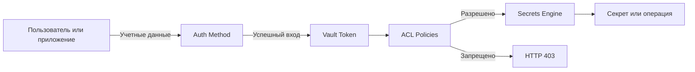
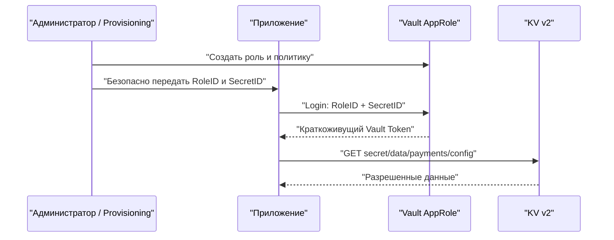
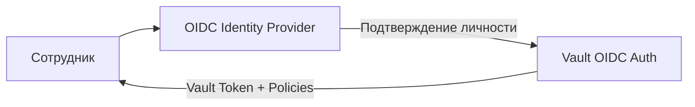

> [!INFO] Цель заметки
> Научиться безопасно выдавать людям и приложениям доступ к HashiCorp Vault: понимать разницу между аутентификацией и авторизацией, создавать политики ACL, работать с KV v2, управлять токенами и настроить AppRole. Практика рассчитана на Vault, развернутый в предыдущей заметке на Linux VM с TLS и Raft.

> [!IMPORTANT] Исходные условия
> Vault доступен по `https://vault.lab.internal:8200`, распечатан (`Sealed: false`), у вас есть административный токен с правами на настройку Auth Methods, Policies и Secrets Engines. Все пароли, токены и идентификаторы в командах ниже — лабораторные; настоящие секреты не сохраняйте в Obsidian, Git и истории терминала.

## 1. Общая схема: кто обращается к Vault и что ему разрешено

**Аутентификация (Authentication)** отвечает на вопрос «Кто ты?». 

**Авторизация (Authorization)** отвечает на вопрос «Что тебе разрешено делать?». 

**Секрет (Secret)** — данные, доступ к которым должен быть ограничен: пароль, API-ключ, сертификат, токен и т. д.



Например, приложение `payments` должно читать только `secret/payments/config`. Оно не должно видеть `secret/hr/*`, создавать новые политики или управлять токенами других сервисов.

**Типовой порядок обработки запроса:** 
1. Клиент аутентифицируется
2. Vault выдает токен
3. Клиент отправляет запрос с токеном
4. Vault сопоставляет путь и действие с политиками
5. Выполняет или отклоняет операцию. 

У токенов также есть срок жизни и возможность отзыва.

### 1.1. Основные сущности

| Сущность | Назначение | Пример |
|---|---|---|
| Auth Method | Проверяет личность | Userpass, AppRole, OIDC, Kubernetes |
| Token | Подтверждает аутентифицированную сессию | Токен, выданный после `vault login` |
| ACL Policy | Определяет разрешенные действия на путях API | Разрешить `read` для `secret/data/payments/config` |
| Secrets Engine | Хранит или генерирует секреты | KV v2, PKI, Database, Transit |
| Identity Entity / Alias | Связывает идентичности из разных Auth Methods | Один сотрудник через OIDC и другой метод |
| Lease / TTL | Ограничивает время жизни выданных данных | Динамический пароль БД на 1 час |

> [!TIP] Не путать два уровня
> Права Linux на `/opt/vault/data` защищают файлы хранилища на VM. Политики Vault регулируют запросы к API. Ошибка `permission denied` в systemd и HTTP `403 permission denied` — разные проблемы.

## 2. Подготовка CLI и безопасная работа

На доверенной административной машине, имеющей доступ к серверу:

```bash
export VAULT_ADDR="https://vault.lab.internal:8200"
export VAULT_CACERT="$HOME/.config/vault/bootstrap-ca.crt"
vault status
vault login
vault token lookup
```

Путь к CA замените на фактический. `vault login` без аргумента запрашивает токен интерактивно; не вставляйте секреты непосредственно в команды. Вход через `vault login` обычно сохраняет токен в `~/.vault-token`: учитывайте права на домашний каталог и очищайте токены на общих машинах.

Проверим существующие компоненты:

```bash
vault auth list
vault secrets list
vault policy list
```

Для примеров ниже используем тестовые пути `secret/`, `payments/`, `team/`. Если в предыдущей практике `secret/` уже включен как KV v2, **не включайте его повторно**.

## 3. KV Secrets Engine версии 2

**KV (Key-Value)** хранит пары «ключ — значение». KV v2 дополнительно поддерживает версии, метаданные, soft delete и уничтожение отдельных версий.

### 3.1. Включение KV v2

Проверка:

```bash
vault secrets list -detailed
```

Если `secret/` отсутствует:

```bash
vault secrets enable -path=secret -version=2 kv
```

Если движок уже есть, используйте существующий; команда включения поверх занятого пути завершится ошибкой.

### 3.2. Запись и чтение

```bash
vault kv put secret/payments/config \
  api_url="https://api.lab.internal" \
  environment="lab"

vault kv get secret/payments/config
vault kv get -field=api_url secret/payments/config
vault kv get -format=json secret/payments/config | jq '.data.data'
```

Здесь значения демонстрационные и не являются паролями. Реальные секреты **не следует передавать аргументами CLI**: они могут попасть в историю команд, журналирование оболочки или список процессов. Для практики с настоящими значениями используйте защищенный файл с ограниченными правами либо автоматизированную безопасную передачу.

### 3.3. Версии и обновление полей

```bash
vault kv put secret/payments/config \
  api_url="https://api-v2.lab.internal" \
  environment="lab"

vault kv metadata get secret/payments/config
vault kv get -version=1 secret/payments/config
vault kv get -version=2 secret/payments/config
```

`vault kv put` записывает **новую полную версию** документа. Поля, не указанные при новой записи, могут исчезнуть из актуальной версии. Чтобы изменить только часть полей, используйте:

```bash
vault kv patch secret/payments/config environment="staging"
```

`patch` полезен для точечного изменения, но его доступность и семантика зависят от возможностей KV v2 и прав токена.

### 3.4. Удаление и восстановление

```bash
# Мягкое удаление актуальной версии
vault kv delete secret/payments/config

# Посмотреть версии
vault kv metadata get secret/payments/config

# Восстановить версию (номер уточнить по metadata)
vault kv undelete -versions=3 secret/payments/config

# Необратимо уничтожить данные конкретной версии
# vault kv destroy -versions=3 secret/payments/config
```

> [!WARNING] `delete`, `destroy` и `metadata delete` — разные действия
> `delete` помечает версию удаленной;
> `undelete` может ее восстановить. 
> `destroy` уничтожает данные указанных версий. 
> 
> `vault kv metadata delete` удаляет метаданные и все версии секрета; это особенно опасная операция. Номер версии в примере (`3`) проверьте через `metadata get`.

### 3.5. Почему путь в CLI и ACL отличается

Команда CLI:

```bash
vault kv get secret/payments/config
```

Для KV v2 обращается к API-пути вида:

```text
GET /v1/secret/data/payments/config
```

А перечисление ключей использует:

```text
LIST /v1/secret/metadata/payments/
```

Поэтому ACL для KV v2 пишутся с сегментами `data/` и `metadata/`. Это одна из самых частых причин HTTP 403.

## 4. ACL Policies: принцип минимальных привилегий

**ACL Policy** — набор правил для API-путей Vault. По умолчанию доступ запрещен, если его не разрешают применимые политики (с учетом специальных правил и административных возможностей).

### 4.1. Возможности

| Возможность | Что позволяет                                                   |
| ----------- | --------------------------------------------------------------- |
| `create`    | Создавать данные на пути                                        |
| `read`      | Читать данные                                                   |
| `update`    | Изменять существующие данные                                    |
| `delete`    | Удалять данные                                                  |
| `list`      | Перечислять элементы, если endpoint поддерживает LIST           |
| `patch`     | Выполнять PATCH там, где поддерживается                         |
| `sudo`      | Выполнять операции на root-protected путях, когда это требуется |
| `deny`      | Явно запрещать доступ; имеет приоритет над разрешениями         |

> [!INFO] Важная тонкость
> `list` — отдельное право. `read` не дает автоматически права перечислять имена секретов. А `sudo` — не Linux sudo: это специальная возможность внутри Vault.

### 4.2. Политика только для чтения одного секрета

Создаем файл `payments-read.hcl` **на административной машине**:

```hcl
path "secret/data/payments/config" {
  capabilities = ["read"]
}
```

Загружаем:

```bash
vault policy write payments-read payments-read.hcl
vault policy read payments-read
```

Теперь токен с этой политикой сможет прочитать конкретный секрет, но не сможет изменить его или просмотреть соседние секреты.

### 4.3. Политика для команды, работающей со своей папкой

Файл `team-kv.hcl`:

```hcl
# Чтение и запись данных команды
path "secret/data/team/*" {
  capabilities = ["create", "read", "update", "patch"]
}

# Просмотр имен секретов в разделе команды
path "secret/metadata/team" {
  capabilities = ["list"]
}

path "secret/metadata/team/*" {
  capabilities = ["read", "list"]
}
```

```bash
vault policy write team-kv team-kv.hcl
```

Это не дает доступ к `secret/data/payments/*`. Удаление специально не разрешено.

> [!WARNING] `list` раскрывает имена
> Даже если содержимое секретов закрыто, названия ключей могут выдавать внутреннюю структуру инфраструктуры. Не предоставляйте `list` шире, чем необходимо.

### 4.4. Проверка эффективных возможностей

Под административным токеном:

```bash
vault token capabilities <TOKEN> secret/data/payments/config
```

Под токеном, который тестируем:

```bash
vault token capabilities secret/data/payments/config
vault token capabilities secret/data/hr/salaries
```

Не вставляйте настоящие токены в текст заметки или команду с аргументом `<TOKEN>` на общей машине: безопаснее выполнить проверку из сессии тестового пользователя. Ожидаем для второго пути `deny`.

### 4.5. Частые ошибки политик

- Пишут `secret/payments/*` вместо `secret/data/payments/*` для KV v2.
- Разрешают `read`, но забывают `list` на `metadata/`.
- Выдают `path "*"` приложению «чтобы заработало».
- Путают `create` и `update` при записи.
- Ожидают, что политика автоматически создаст секрет или пользователя: она лишь задает права.
- Проверяют доступ административным токеном, а не тем, который реально использует приложение.

## 5. Vault Tokens: выдача, TTL и отзыв

Токен — основной способ предъявить Vault подтвержденную идентичность при API-запросе. Токен имеет политики и может иметь TTL, ограничения использования и другие параметры.

### 5.1. Посмотреть сведения о текущем токене

```bash
vault token lookup
```

Обратите внимание на `policies`, `ttl`, `renewable`, `orphan`, `path`.

### 5.2. Создать кратко-живущий токен

Администратор может создать токен с заданной политикой:

```bash
vault token create -policy=payments-read -ttl=30m -explicit-max-ttl=2h
```

**Не копируйте выведенный токен в заметку.** Для рабочих сервисов обычно лучше не создавать токены вручную, а дать сервису безопасный Auth Method.

### 5.3. TTL и продление

- **TTL** — оставшееся время действия токена.
- **Renewable** — возможность продления, если тип токена и настройки позволяют.
- **Max TTL / explicit max TTL** — ограничения, после которых продлить токен уже нельзя.

```bash
vault token lookup
vault token renew
```

Команда `vault token renew` сработает только для продлеваемого токена и в пределах допустимых ограничений. Некоторые токены не подлежат продлению.

### 5.4. Отзыв

```bash
# Отозвать текущий токен — выполнять только в тестовой сессии!
vault token revoke -self
```

Отзыв токена прекращает его дальнейшее использование. Для service-токенов отзыв также связан с отзывом дочерних токенов и принадлежащих им leases, если применимо. Не рассчитывайте, что отзыв одного токена всегда немедленно завершит уже установленные внешние соединения приложения.

### 5.5. Service tokens и batch tokens

**Service token** поддерживает полноценное управление жизненным циклом, lookup, отзыв и, при подходящих настройках, продление. 

**Batch token** легче по ресурсам, но имеет ограничения по управлению, отслеживанию и отдельным операциям. 

Для первой лаборатории используем обычные service-токены.

> [!TIP] Практическое правило
> Не храните один постоянный Vault Token на всех серверах. Предпочитайте краткоживущие токены, выдаваемые конкретному приложению через подходящий метод аутентификации.

## 6. Userpass: простой вход для лаборатории

Userpass проверяет имя пользователя и пароль. Он удобен для обучения, но для корпоративных администраторов чаще лучше OIDC/SSO с MFA.

### 6.1. Включение

```bash
vault auth list
# Если userpass/ еще нет:
vault auth enable userpass
```

### 6.2. Создание пользователя

> [!WARNING] Исправление важного нюанса из предыдущей заметки
> Команда `vault write auth/userpass/users/vaultadmin policies="vault-admin"` **без `password` не является надежным способом создать пользователя с паролем**. Для создания учетной записи пароль нужно задать явно. Не вводите реальный пароль прямо в аргументах командной строки.

Для учебного пользователя можно применить интерактивную запись через stdin, не раскрывая пароль в командной строке:

```bash
read -rsp 'Новый пароль для reader1: ' USERPASS_PASSWORD; echo
printf '%s' "$USERPASS_PASSWORD" | vault write auth/userpass/users/reader1 \
  password=- \
  policies=payments-read
unset USERPASS_PASSWORD
```

В Vault CLI синтаксис `password=-` означает чтение значения со стандартного ввода. Используйте этот прием в интерактивном терминале и не запускайте с `set -x` или другим логированием команд. В некоторых версиях/оболочках удобнее использовать защищенную автоматизацию с передачей через API.

Вход:

```bash
vault login -method=userpass username=reader1
```

CLI запросит пароль. После входа:

```bash
vault token lookup
vault kv get secret/payments/config
vault kv put secret/payments/config environment="should-fail"
```

Последняя команда должна завершиться HTTP 403: у `reader1` только `read`. Если команда успешно записала секрет, проверьте, какой токен фактически используется.

## 7. AppRole: аутентификация машин и сервисов

**AppRole** предназначен для сценариев, где приложение получает доступ через пару идентификаторов:

- **RoleID** — идентификатор роли; сам по себе обычно не считается секретом.
- **SecretID** — секретное подтверждение, которое необходимо защищать.

По RoleID и SecretID приложение выполняет вход и получает Vault Token с ограниченными политиками.



### 7.1. Включение AppRole

```bash
vault auth list
# Если approle/ отсутствует:
vault auth enable approle
```

### 7.2. Создание роли

```bash
vault write auth/approle/role/payments-app \
  token_policies="payments-read" \
  token_ttl="20m" \
  token_max_ttl="1h" \
  secret_id_ttl="30m" \
  secret_id_num_uses=1
```

Эта роль выдает токен только с политикой `payments-read`. SecretID живет до 30 минут и допускает одно использование. Для многократного запуска приложения нужна процедура безопасной выдачи нового SecretID.

### 7.3. Получение RoleID и SecretID

```bash
vault read auth/approle/role/payments-app/role-id
vault write -f auth/approle/role/payments-app/secret-id
```

Вторая команда возвращает **секретный SecretID**. В production его нельзя бездумно распечатывать в логах CI/CD или пересылать в чат.

Для безопасной передачи на другой сервер изучите **response wrapping**: вместо выдачи SecretID получателю напрямую администратор может передать краткоживущий wrapping token, который получатель разворачивает однократно. Например:

```bash
vault write -wrap-ttl=5m -f auth/approle/role/payments-app/secret-id
```

Получатель выполняет `vault unwrap` с переданным wrapping token. Такой механизм уменьшает риск раскрытия исходного SecretID в канале доставки, но сам wrapping token тоже должен передаваться безопасно.

### 7.4. Вход приложения

После безопасного получения обоих значений приложение отправляет их на endpoint:

```text
POST /v1/auth/approle/login
{
  "role_id": "<ROLE_ID>",
  "secret_id": "<SECRET_ID>"
}
```

Vault возвращает токен с разрешенными политиками. В реальном приложении используйте официальный клиент/SDK или Vault Agent, а не самодельный скрипт, записывающий SecretID и токен в открытый текст.

Для лабораторной проверки можно использовать CLI с интерактивным вводом значений:

```bash
read -rp 'RoleID: ' ROLE_ID
read -rsp 'SecretID: ' SECRET_ID; echo
vault write auth/approle/login role_id="$ROLE_ID" secret_id="$SECRET_ID"
unset ROLE_ID SECRET_ID
```

> [!WARNING] Важная оговорка
> Передача `role_id` и `secret_id` в аргументах `vault write` может быть видна в списке процессов в момент запуска. Для production используйте Vault Agent, SDK или передачу тела запроса без секретов в аргументах командной строки. Этот CLI-фрагмент допустим только для изолированной учебной VM.

### 7.5. Ограничения AppRole

Дополнительно можно применять `secret_id_bound_cidrs`, `token_bound_cidrs`, ограничения числа использований и TTL. Однако привязка к IP не заменяет безопасную доставку SecretID, особенно при NAT, прокси и изменяющихся адресах.

**Главная проблема AppRole — первоначальная доставка SecretID.** Если положить его в образ VM, Docker image или Git, то проблема хранения секретов просто переместится в другое место.

## 8. JWT/OIDC: вход через внешний провайдер идентичности

Для администраторов и сотрудников удобнее использовать централизованный IdP (например, Keycloak, Microsoft Entra ID или другой OIDC-провайдер). Vault проверяет удостоверение, выданное IdP, и сопоставляет пользователя с политиками.



Общий план настройки:

1. Зарегистрировать клиент Vault в IdP и настроить допустимые redirect URI.
2. Включить `oidc` Auth Method в Vault.
3. Указать discovery URL, client ID и безопасно передать client secret, если он нужен.
4. Создать роль, связать claims/groups с Vault Identity и политиками.
5. Проверить вход через браузер и ограничения доступа.

Точные команды зависят от конкретного IdP, его URL, claims и модели групп. **Не копируйте произвольную конфигурацию OIDC без проверки issuer, audience и redirect URI.**

### 8.1. Как выбрать Auth Method

| Сценарий | Обычно подходит | Почему |
|---|---|---|
| Ручная лаборатория | Userpass | Минимум внешних зависимостей |
| Администраторы компании | OIDC/SSO | Централизованный вход, MFA, группы |
| Приложение на обычной VM | AppRole + Vault Agent | Машинная аутентификация и обновление токена |
| Pod в Kubernetes | Kubernetes Auth или JWT/OIDC | Привязка к идентичности workload |
| CI/CD с OIDC identity token | JWT/OIDC | Можно отказаться от постоянного секретного токена |

В каждом случае необходимо учитывать возможности конкретной платформы и проверять подлинность identity claims.

## 9. Практическая лаборатория: два пользователя, два уровня доступа

**Задача:** `reader1` читает конфигурацию платежного сервиса, а `team1` может изменять секреты только своей команды.

### Шаг 1. Подготовить тестовые данные

Под административным токеном:

```bash
vault kv put secret/payments/config api_url="https://api.lab.internal"
vault kv put secret/team/app1 mode="test"
```

### Шаг 2. Создать политики

Файл `payments-read.hcl`:

```hcl
path "secret/data/payments/config" {
  capabilities = ["read"]
}
```

Файл `team-kv.hcl`:

```hcl
path "secret/data/team/*" {
  capabilities = ["create", "read", "update", "patch"]
}
path "secret/metadata/team" {
  capabilities = ["list"]
}
path "secret/metadata/team/*" {
  capabilities = ["read", "list"]
}
```

```bash
vault policy write payments-read payments-read.hcl
vault policy write team-kv team-kv.hcl
```

### Шаг 3. Создать пользователей

Включите `userpass/`, если он еще не включен. Создайте `reader1` и `team1`, назначив им соответственно `payments-read` и `team-kv`. Используйте безопасный интерактивный ввод паролей по образцу из раздела 6.

### Шаг 4. Проверить матрицу доступа

| Операция | `reader1` | `team1` |
|---|---|---|
| Читать `secret/payments/config` | Да | Нет |
| Менять `secret/payments/config` | Нет | Нет |
| Читать `secret/team/app1` | Нет | Да |
| Менять `secret/team/app1` | Нет | Да |
| Читать `secret/hr/private` | Нет | Нет |
| Создавать ACL Policy | Нет | Нет |

Проводите проверки **после отдельного входа каждым пользователем**. При использовании одного терминала помните, что `vault login` меняет токен активной сессии.

### Шаг 5. Проверить аудит

На сервере:

```bash
sudo tail -f /var/log/vault/audit.log
```

Выполните разрешенный и запрещенный запрос. В audit log должны появиться события; не отправляйте полный журнал в публичные сервисы.

## 10. Практика безопасности: как не превратить Vault в новую точку утечки

1. **Не используйте Root Token в приложениях.** Root нужен только для особых административных/аварийных операций.
2. **Ограничивайте политики конкретными путями и capabilities.** Избегайте `path "*"` вне строго контролируемых административных ролей.
3. **Сокращайте TTL.** Длительный срок жизни увеличивает последствия утечки токена.
4. **Используйте защищенную аутентификацию workload.** OIDC/JWT, Kubernetes Auth, AppRole с безопасной доставкой SecretID и Vault Agent — в зависимости от среды.
5. **Не храните секреты в Git, Obsidian и CI/CD-логах.** Даже если репозиторий приватный.
6. **Включайте аудит и контролируйте его доступность.** Аудит нужен для расследований и контроля.
7. **Защищайте TLS.** Не используйте `VAULT_SKIP_VERIFY=true` как постоянное решение.
8. **Продумывайте ротацию.** Хранение секрета в Vault само по себе не делает его автоматически ротируемым.
9. **Разделяйте среды.** Тестовые и production-секреты должны иметь разные пути, политики и по возможности отдельные границы доверия.
10. **Проверяйте фактический токен.** Успех запроса с админским токеном не доказывает правильность политики приложения.

## 11. Troubleshooting

### 11.1. `403 permission denied` при `vault kv get`

```bash
vault token lookup
vault token capabilities secret/data/payments/config
vault policy list
```

Проверяем правильность API-пути KV v2, назначенные политики и токен текущей сессии. Для LIST дополнительно смотрим `secret/metadata/...`.

### 11.2. `permission denied` при записи, хотя чтение работает

`read` не включает `create` и `update`. Проверьте capabilities и не добавляйте `sudo` «на всякий случай».

### 11.3. `vault login` работает, но токен быстро истекает

```bash
vault token lookup
```

Проверьте TTL, renewable, max TTL и настройки роли/Auth Method. Если токен нельзя продлить, клиент должен повторно аутентифицироваться безопасным способом.

### 11.4. AppRole: `invalid role or secret ID`

Проверьте, что RoleID соответствует нужной роли, SecretID не истек, не исчерпал число использований и передан без лишних символов. При `secret_id_num_uses=1` повторный login с тем же SecretID должен не сработать.

### 11.5. `no handler for route`

Убедитесь, что Auth Method или Secrets Engine действительно включен на нужном пути:

```bash
vault auth list
vault secrets list
```

Пути `userpass/`, `approle/`, `secret/` могут отличаться, если при включении был задан другой mount path.

### 11.6. Ошибка TLS или `connection refused`

Это проблема соединения, а не ACL. Проверяем DNS, CA, доступность 8200, systemd и состояние Vault:

```bash
getent hosts vault.lab.internal
vault status
sudo systemctl status vault
sudo ss -lntp | grep ':8200'
```

Команды `systemctl` и `ss` выполняются на сервере Vault.

## 12. Контрольные вопросы для самопроверки

1. Чем аутентификация отличается от авторизации?
2. Что такое Auth Method, Vault Token и ACL Policy?
3. Почему KV v2 использует `data/` и `metadata/` в API-путях?
4. В чем разница между `vault kv put` и `vault kv patch`?
5. Чем `delete` отличается от `destroy` в KV v2?
6. Почему `read` не позволяет перечислять имена секретов?
7. Что означает принцип минимальных привилегий?
8. Почему нельзя давать приложению политику `path "*"`?
9. Что такое TTL токена и когда его можно продлить?
10. Что произойдет после отзыва Vault Token?
11. Чем Service Token отличается от Batch Token?
12. Для чего подходит Userpass, а для чего OIDC?
13. Что такое RoleID и SecretID в AppRole?
14. Почему SecretID нельзя просто встроить в Docker image?
15. Как response wrapping помогает передавать SecretID?
16. Почему успешный запрос под Root Token не доказывает корректность политики приложения?
17. Как проверить, что пользователь не может читать соседний раздел KV?
18. Почему имена секретов тоже могут считаться чувствительными метаданными?
19. Как отличить HTTP 403 от проблем TLS и сети?
20. Какие Auth Methods вы выберете для администратора, VM-приложения и CI/CD с OIDC — и почему?

## 13. Официальная документация

- [Vault Authentication](https://developer.hashicorp.com/vault/docs/auth)
- [Vault Policies](https://developer.hashicorp.com/vault/docs/concepts/policies)
- [KV Secrets Engine v2](https://developer.hashicorp.com/vault/docs/secrets/kv/kv-v2)
- [Vault Tokens](https://developer.hashicorp.com/vault/docs/concepts/tokens)
- [AppRole Auth Method](https://developer.hashicorp.com/vault/docs/auth/approle)
- [Userpass Auth Method](https://developer.hashicorp.com/vault/docs/auth/userpass)
- [JWT/OIDC Auth Method](https://developer.hashicorp.com/vault/docs/auth/jwt)
- [Response Wrapping](https://developer.hashicorp.com/vault/docs/concepts/response-wrapping)

---

**Итог:** теперь можно разграничивать доступ к секретам, аутентифицировать пользователей и приложения, контролировать время жизни токенов и диагностировать ошибки прав. Следующая тема — **«4. Vault PKI — собственный центр сертификации»**: Root CA, Intermediate CA, выпуск и отзыв сертификатов, CRL и практическая интеграция с Nginx.

#DevOps #HashiCorpVault #IAM #ACL #KVv2 #AppRole #OIDC #SecretsManagement #Security
