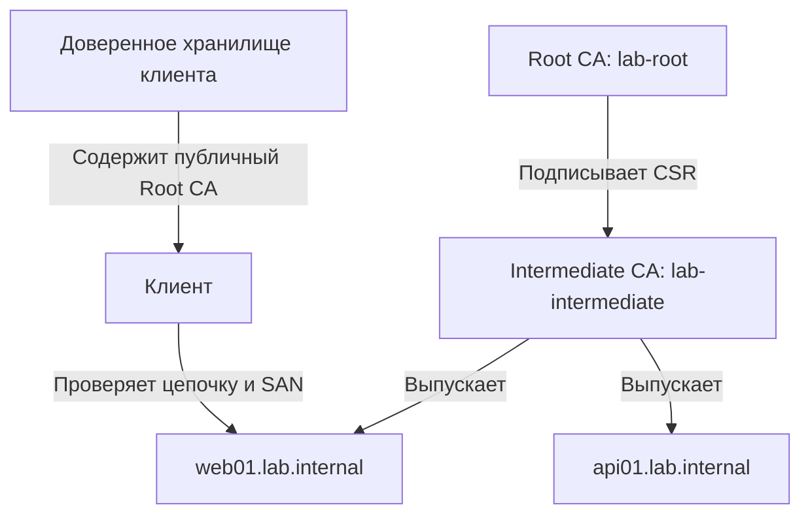
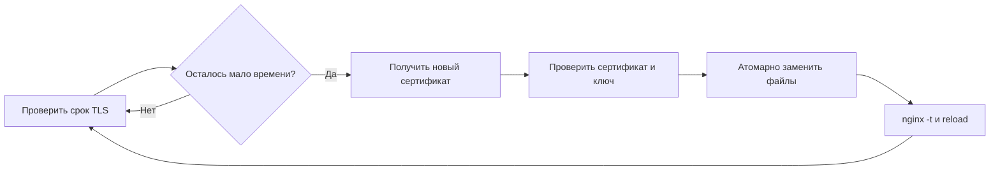

> [!abstract] Цель
> Научиться использовать HashiCorp Vault как внутренний центр сертификации (CA): создать корневой и промежуточный CA, настроить выдачу TLS-сертификатов, подключить сертификат к Nginx, отзывать сертификаты и планировать их обновление. Команды рассчитаны на **учебный стенд**, а опасные для production упрощения отмечены отдельно.

## 1. Зачем нужен PKI

**PKI (Public Key Infrastructure)** — инфраструктура открытых ключей: правила, сертификаты, центры сертификации и механизмы проверки доверия.

**TLS-сертификат** связывает имя сервера (например, `web01.lab.internal`) с его открытым ключом. Клиент проверяет подпись сертификата, срок действия, имя в SAN и цепочку доверия.

**CA (Certificate Authority)** — центр сертификации, подписывающий сертификаты. **Root CA** — корневой доверенный центр; **Intermediate CA** — промежуточный центр, которому Root CA делегировал право выдавать сертификаты.

Пример: Nginx использует сертификат `web01.lab.internal`; браузер доверяет ему, если в хранилище доверенных корневых CA установлен сертификат нашего Root CA и цепочка корректна.

> [!warning] Внутренний CA не становится автоматически доверенным
> На клиентских машинах нужно отдельно распространить **публичный сертификат Root CA**. Приватный ключ Root CA никогда не передают клиентам.

### 1.1. Что делает Vault PKI Secrets Engine

- Создает CA или принимает подготовленный CA/CSR.
- Подписывает CSR и выпускает сертификаты в рамках заданных ролей.
- Ограничивает допустимые DNS-имена и максимальный TTL сертификатов.
- Публикует сертификаты CA, цепочки и списки отзыва (CRL).
- Предоставляет API и CLI для автоматизации.

Vault PKI — это **не** хранилище готовых сертификатов в KV: PKI управляет именно их выпуском, проверяемыми ограничениями и отзывом.

## 2. Архитектура Root CA → Intermediate CA



**Почему два уровня?** Root CA можно держать отдельно и редко использовать; ежедневную выдачу поручить Intermediate CA. Если Intermediate CA скомпрометирован, можно отозвать или заменить его, не меняя корень доверия (хотя потребуется обновить цепочки и конфигурации).

> [!important] Production-архитектура
> Лучший вариант — **офлайн Root CA**, ключ которого не хранится на постоянно работающем Vault. Vault обслуживает только Intermediate CA. Ниже для наглядности оба CA создаются в одном учебном Vault; это **не эталон production**.

## 3. Предварительные требования

- Vault установлен и находится в состоянии **Unsealed**.
- Выполнен вход токеном с административными правами для настройки PKI.
- Настроен TLS на Vault API.
- В примерах: `vault.lab.internal:8200`, `web01.lab.internal`, домен `lab.internal`.
- На машине администратора установлен Vault CLI.

```bash
export VAULT_ADDR="https://vault.lab.internal:8200"
export VAULT_CACERT="$HOME/certs/vault-api-ca.crt"
vault status
vault token lookup
```

> [!note] Два разных TLS-контекста
> Сертификат **Vault API** нужен, чтобы клиент безопасно подключался к самому Vault. Сертификаты **Vault PKI** мы создаем для других сервисов. На учебном стенде это могут быть разные CA.

## 4. Создание Root CA

### 4.1. Включаем отдельный PKI mount

```bash
vault secrets enable -path=pki_root pki
vault secrets tune -max-lease-ttl=87600h pki_root
```

`87600h` — примерно 10 лет. Параметр `max-lease-ttl` ограничивает сроки выдаваемых сертификатов внутри mount; его нужно согласовывать с планируемым сроком CA.

### 4.2. Генерируем корневой CA

```bash
vault write -format=json pki_root/root/generate/internal \
  common_name="Lab Root CA" \
  issuer_name="lab-root" \
  ttl="87600h" \
  key_type="rsa" \
  key_bits=4096 \
  > /tmp/lab-root-response.json
```

Здесь `internal` означает, что приватный ключ создается и хранится внутри Vault; команда **не экспортирует** его. В ответе находятся публичные материалы и метаданные.

Сохраним публичный сертификат Root CA:

```bash
jq -r '.data.certificate' /tmp/lab-root-response.json \
  > lab-root-ca.pem
openssl x509 -in lab-root-ca.pem -noout -subject -issuer -dates
```

> [!warning] Не путать с доверенным CA Vault API
> `lab-root-ca.pem` — новый корневой сертификат **для выпуска внутренних сертификатов**. Он не обязательно совпадает с CA, подписавшим HTTPS-сертификат Vault API.

### 4.3. Публикуем адреса CA и CRL

```bash
vault write pki_root/config/urls \
  issuing_certificates="${VAULT_ADDR}/v1/pki_root/ca" \
  crl_distribution_points="${VAULT_ADDR}/v1/pki_root/crl"
```

Адреса, встраиваемые в сертификаты, должны быть доступны клиентам, которые будут проверять сертификаты. В production предпочтителен стабильный доступный HTTP(S)-адрес публикации CRL/CA, а не внутренний административный endpoint.

## 5. Создание Intermediate CA

### 5.1. Включаем PKI для повседневной выдачи

```bash
vault secrets enable -path=pki_int pki
vault secrets tune -max-lease-ttl=43800h pki_int
```

### 5.2. Создаем ключ и CSR промежуточного CA

```bash
vault write -format=json pki_int/intermediate/generate/internal \
  common_name="Lab Intermediate CA" \
  issuer_name="lab-intermediate" \
  key_type="rsa" \
  key_bits=4096 \
  > /tmp/lab-intermediate-csr.json

jq -r '.data.csr' /tmp/lab-intermediate-csr.json \
  > lab-intermediate.csr
```

**CSR (Certificate Signing Request)** — запрос на сертификат, содержащий открытый ключ и идентификационные сведения. Приватный ключ остается в `pki_int`.

### 5.3. Подписываем CSR корневым CA

```bash
vault write -format=json pki_root/root/sign-intermediate \
  issuer_ref="lab-root" \
  csr=@lab-intermediate.csr \
  format=pem_bundle \
  ttl="43800h" \
  > /tmp/lab-intermediate-signed.json

jq -r '.data.certificate' /tmp/lab-intermediate-signed.json \
  > lab-intermediate-signed.pem
```

В некоторых версиях и конфигурациях Vault ответ содержит `certificate` и `issuing_ca` отдельно; проверьте содержимое JSON перед дальнейшими действиями. `format=pem_bundle` влияет на представление возвращаемой цепочки.

### 5.4. Устанавливаем подписанный сертификат

```bash
vault write pki_int/intermediate/set-signed \
  certificate=@lab-intermediate-signed.pem
```

Проверяем:

```bash
vault read pki_int/cert/ca
vault read pki_int/issuers
```

> [!tip] Если установка не проходит
> Убедитесь, что в `lab-intermediate-signed.pem` находится корректный PEM-сертификат Intermediate CA, подписанный именно Root CA. Не подменяйте его сертификатом Root CA. При необходимости проверьте JSON-ответ и извлеките только нужный PEM-блок.

### 5.5. Настраиваем URL публикации

```bash
vault write pki_int/config/urls \
  issuing_certificates="${VAULT_ADDR}/v1/pki_int/ca" \
  crl_distribution_points="${VAULT_ADDR}/v1/pki_int/crl"
```

## 6. Роли и политики выдачи

**PKI Role** определяет, *какие сертификаты* можно выпускать: DNS-имена, TTL, разрешенные поддомены и другие параметры. **ACL Policy** определяет, *кто вправе обращаться* к endpoint выдачи.

### 6.1. Создаем роль `web-servers`

```bash
vault write pki_int/roles/web-servers \
  issuer_ref="lab-intermediate" \
  allowed_domains="lab.internal" \
  allow_subdomains=true \
  allow_bare_domains=false \
  allow_ip_sans=false \
  server_flag=true \
  client_flag=false \
  key_type="rsa" \
  key_bits=2048 \
  ttl="24h" \
  max_ttl="72h"
```

Эта роль позволяет выдавать серверные сертификаты для поддоменов `lab.internal` на срок до трех суток. В production стоит выбирать срок с учетом надежности автоматизации: слишком короткий TTL без надежного обновления создаст риск простоя.

### 6.2. Ограничиваем права на выдачу

Файл `web-pki.hcl`:

```hcl
path "pki_int/issue/web-servers" {
  capabilities = ["update"]
}

path "pki_int/ca/pem" {
  capabilities = ["read"]
}

path "pki_int/ca_chain" {
  capabilities = ["read"]
}
```

Загрузка:

```bash
vault policy write web-pki web-pki.hcl
```

> [!important] Почему `update`, а не `read`?
> Выпуск сертификата — операция, создающая новый сертификат, поэтому используется право `update` на endpoint `issue`. Политика не дает доступ к Root CA и не позволяет менять PKI Role.

## 7. Выпуск сертификата для Nginx

### 7.1. Получаем сертификат и ключ

```bash
umask 077
vault write -format=json pki_int/issue/web-servers \
  common_name="web01.lab.internal" \
  ttl="24h" \
  > web01-response.json
```

> [!warning] Приватный ключ в ответе API
> Endpoint `issue` может возвращать приватный ключ. Не сохраняйте JSON-ответ в общедоступные каталоги и не включайте его в логи CI/CD. Для более строгой модели безопасности генерируйте ключ на сервере и передавайте в Vault **CSR** через `pki_int/sign/web-servers` (для этого потребуется отдельная ACL Policy).

Извлекаем файлы:

```bash
jq -r '.data.certificate' web01-response.json > web01.crt
jq -r '.data.private_key' web01-response.json > web01.key
jq -r '.data.ca_chain[]' web01-response.json > web01-chain-ca.pem
cat web01.crt web01-chain-ca.pem > web01-fullchain.pem
chmod 600 web01.key
```

**Замечание:** в зависимости от версии и настроек `ca_chain` может содержать Intermediate и Root CA. Обычно серверу достаточно передавать leaf + Intermediate; Root CA клиенты должны получать из своего хранилища доверия. Проверьте порядок сертификатов и удалите лишний корневой сертификат из передаваемой цепочки при необходимости.

Проверяем:

```bash
openssl x509 -in web01.crt -noout -subject -issuer -dates
openssl x509 -in web01.crt -noout -ext subjectAltName
openssl verify -CAfile lab-root-ca.pem \
  -untrusted lab-intermediate-signed.pem web01.crt
```

Для проверки важно, чтобы `lab-intermediate-signed.pem` содержал правильный Intermediate CA и клиент доверял `lab-root-ca.pem`.

### 7.2. Вариант без экспорта приватного ключа из сервера

На Nginx-сервере создайте ключ и CSR локально:

```bash
openssl req -new -newkey rsa:2048 -nodes \
  -keyout web01.key -out web01.csr \
  -subj "/CN=web01.lab.internal" \
  -addext "subjectAltName=DNS:web01.lab.internal"
```

Подпишите CSR:

```bash
vault write -format=json pki_int/sign/web-servers \
  csr=@web01.csr \
  ttl="24h" > web01-signed.json
```

Этот способ предпочтительнее, если нужно, чтобы приватный ключ не покидал Nginx-сервер. Для него ACL должна разрешать `update` на `pki_int/sign/web-servers`.

## 8. Подключение к Nginx

Копируем файлы на Nginx VM по защищенному каналу, затем устанавливаем:

```bash
sudo install -d -m 0755 /etc/nginx/tls
sudo install -m 0644 web01-fullchain.pem /etc/nginx/tls/web01-fullchain.pem
sudo install -m 0600 web01.key /etc/nginx/tls/web01.key
```

Пример `/etc/nginx/conf.d/web01.conf`:

```nginx
server {
    listen 443 ssl;
    server_name web01.lab.internal;

    ssl_certificate     /etc/nginx/tls/web01-fullchain.pem;
    ssl_certificate_key /etc/nginx/tls/web01.key;

    location / {
        return 200 "TLS works\n";
    }
}
```

Проверяем конфигурацию и перезагружаем Nginx:

```bash
sudo nginx -t
sudo systemctl reload nginx
```

Проверяем с клиента:

```bash
curl --cacert lab-root-ca.pem https://web01.lab.internal/
openssl s_client -connect web01.lab.internal:443 \
  -servername web01.lab.internal -showcerts </dev/null
```

Если клиент не доверяет Root CA, он отклонит сертификат даже при корректной конфигурации Nginx. Не используйте `curl -k` как постоянное решение.

## 9. Отзыв сертификатов и CRL

**Отзыв** означает, что CA объявляет сертификат недействительным до окончания его TTL, например при компрометации ключа.

Серийный номер выпуска можно взять из ответа Vault:

```bash
jq -r '.data.serial_number' web01-response.json
```

Отзыв (требуются административные права на endpoint):

```bash
vault write pki_int/revoke serial_number="<SERIAL_NUMBER>"
```

Проверяем CRL:

```bash
vault read -field=certificate pki_int/cert/crl > /tmp/lab-crl.pem
openssl crl -in /tmp/lab-crl.pem -noout -text
```

> [!warning] Отзыв не означает мгновенную блокировку во всех клиентах
> Клиент должен реально проверять CRL или OCSP и получать актуальные данные. Многие TLS-клиенты не проверяют отзыв по умолчанию или ведут себя по-разному при недоступности CRL. Для внутренних сервисов короткие сроки сертификатов часто упрощают управление риском, но не заменяют продуманную политику отзыва.

## 10. Продление и автоматизация

Сертификат обычно **не продлевается на месте**, как Vault Token: выпускается новый сертификат с новым сроком действия и, желательно, новой парой ключей.

Пример цикла:



Для автоматизации можно использовать:

- **Vault Agent Template** — шаблоны и запись материалов, но требуется внимательно настроить жизненный цикл ключей и перезапуск сервиса.
- **Скрипт + systemd timer** — периодическая проверка срока, выпуск по ACL, валидация и атомарная установка.
- **ACME** — если нужна совместимость со стандартными ACME-клиентами; поддержку, API и ограничения конкретной версии Vault нужно проверить отдельно.

> [!important] Не создавайте сертификат при каждом старте без контроля
> Автоматизация должна предотвращать бесконтрольную выдачу, утечки ключей и одновременные перезаписи. Сначала подготовьте новый сертификат, проверьте пару ключ–сертификат и цепочку, затем атомарно замените файлы и выполните `nginx -t`.

### 10.1. Минимальная проверка срока действия

```bash
openssl x509 -in /etc/nginx/tls/web01-fullchain.pem \
  -checkend 86400 -noout
```

Код завершения `0` означает, что сертификат будет действителен еще как минимум 24 часа; ненулевой код — срок истечет раньше либо произошла ошибка чтения.

## 11. Безопасность и эксплуатация

1. **Root CA:** в production — офлайн, отдельное хранение и строгая процедура подписи Intermediate CA.
2. **Intermediate CA:** ограничить права управления PKI и выпуска сертификатов.
3. **ACL:** выдавать сервисам только `update` на нужную роль (`issue` или `sign`), не на весь `pki_int/*`.
4. **SAN:** ограничить домены; не включать без необходимости `allow_any_name=true`.
5. **Приватные ключи:** права `0600`, не печатать в логи, не передавать в чат или репозиторий.
6. **Сроки:** не делать сертификаты слишком долгоживущими; обеспечить надежное обновление до истечения TTL.
7. **Backup:** резервировать Vault storage, конфигурацию, сертификаты CA и процедуры восстановления; тестировать restore.
8. **Мониторинг:** следить за доступностью Vault, сроками CA/leaf-сертификатов, ошибками выдачи, CRL и журналом аудита.
9. **Доступность:** PKI может быть недоступен во время Sealed, но уже выданные сертификаты продолжают работать до истечения срока, если клиенты не зависят от недоступных точек проверки отзыва.

> [!danger] Нельзя терять приватный ключ CA
> Если ключ CA утрачен, выпуск новых сертификатов от его имени невозможен. Если ключ скомпрометирован, придется менять цепочку доверия и перевыпускать сертификаты.

## 12. Troubleshooting

| Симптом | Вероятная причина | Проверка |
|---|---|---|
| `permission denied` при `issue` | Нет `update` на нужном пути | `vault token capabilities pki_int/issue/web-servers` |
| `common name not allowed` | Имя не соответствует PKI Role | `vault read pki_int/roles/web-servers` |
| `requested TTL exceeds...` | TTL больше допустимого | Проверить `ttl`, `max_ttl`, `max-lease-ttl`, срок CA |
| Браузер не доверяет Nginx | Root CA не установлен у клиента | `openssl verify`, доверенное хранилище |
| Ошибка имени хоста | Отсутствует корректный SAN | `openssl x509 -noout -ext subjectAltName` |
| Nginx не запускается | Ключ не соответствует сертификату или ошибка пути | `nginx -t`, права и логи |
| Vault `sealed` | CA недоступен для новых операций | `vault status` |
| Отозванный сертификат все еще принимается | Клиент не проверяет отзыв | Настройка CRL/OCSP у конкретного клиента |

### 12.1. Сверяем открытый ключ сертификата и приватный ключ

```bash
openssl x509 -in web01.crt -pubkey -noout | \
  openssl pkey -pubin -outform DER | sha256sum
openssl pkey -in web01.key -pubout -outform DER | sha256sum
```

Хеши должны совпадать.

### 12.2. Проверяем эффективные права

```bash
vault token capabilities pki_int/issue/web-servers
vault token capabilities pki_int/roles/web-servers
```

Для сервисного токена ожидается `update` на `issue` и отсутствие административных прав на `roles`.

## 13. Лабораторная работа

**Цель:** выпустить внутренний TLS-сертификат для `web01.lab.internal` и проверить доверие к нему.

1. Подготовьте Vault VM и Nginx VM; настройте разрешение имени `web01.lab.internal`.
2. Создайте Root CA и Intermediate CA в Vault.
3. Создайте роль `web-servers` с ограничением домена `lab.internal`.
4. Выпустите сертификат для `web01.lab.internal` на 24 часа.
5. Установите сертификат и ключ на Nginx VM.
6. Выполните `curl --cacert lab-root-ca.pem https://web01.lab.internal/`.
7. Попробуйте запросить сертификат для `example.com` — запрос должен быть отклонен ролью.
8. Проверьте `vault token capabilities` для ограниченного токена.
9. Отзовите учебный сертификат, посмотрите CRL и объясните, почему обычный `curl` может не заметить отзыв.
10. Перевыпустите сертификат и проверьте его новый серийный номер.

**Критерии успеха:** корректная цепочка Root → Intermediate → web01, работающий HTTPS без `-k`, ограниченная роль, понимание срока и отзыва.

## 14. Контрольные вопросы

1. Чем Root CA отличается от Intermediate CA?
2. Почему Root CA лучше хранить офлайн?
3. В чем разница между CSR, сертификатом и приватным ключом?
4. Чем PKI Role отличается от ACL Policy?
5. Почему для `issue` требуется `update`?
6. Что такое SAN и почему одного CN недостаточно?
7. Почему нельзя просто скопировать Root CA на сервер как приватный ключ?
8. Что произойдет с уже выданным сертификатом, если Vault станет Sealed?
9. Почему отзыв сертификата не гарантирует немедленного отказа всех клиентов?
10. В чем преимущества подписи CSR вместо генерации ключа через `issue`?

---

## Термины

- **Root CA** — корневой центр сертификации, якорь доверия.
- **Intermediate CA** — промежуточный центр, подписанный корневым.
- **CSR** — запрос на подпись сертификата.
- **SAN** — расширение сертификата с DNS-именами/IP-адресами.
- **CRL** — список отозванных сертификатов.
- **TTL** — срок действия сертификата или иного объекта.
- **PKI Role** — ограничения на выпускаемые сертификаты.
- **ACL Policy** — права клиента на API-пути Vault.

## Полезные ссылки

- [Vault PKI Secrets Engine — HashiCorp Developer](https://developer.hashicorp.com/vault/docs/secrets/pki)
- [Vault PKI API](https://developer.hashicorp.com/vault/api-docs/secret/pki)
- [Vault Policies](https://developer.hashicorp.com/vault/docs/concepts/policies)
- [OpenSSL documentation](https://docs.openssl.org/)

#Vault #PKI #CA #TLS #Nginx #DevSecOps #Linux #Obsidian
