## Введение

Криптография — это набор механизмов, которые позволяют защищать данные от чтения, незаметного изменения и подделки.

В DevOps криптография встречается практически везде:

- **HTTPS/TLS** — защищает соединения между клиентами, серверами и внутренними сервисами.
- **SSH** — позволяет безопасно подключаться к серверам и подтверждать владение приватным ключом.
- **HashiCorp Vault** — использует криптографические механизмы для защиты секретов.
- **Kubernetes** — может шифровать Secret-объекты при хранении в etcd.
- **CI/CD** — использует цифровые подписи для проверки происхождения и целостности артефактов.
- **Ansible Vault** — шифрует конфиденциальные переменные и файлы конфигурации.

Самая распространенная ошибка при изучении криптографии — воспринимать ее как один универсальный механизм шифрования.

На самом деле здесь решаются разные задачи:

1. **Конфиденциальность**: никто посторонний не должен прочитать данные.
2. **Целостность**: мы должны обнаружить, если данные изменились.
3. **Подлинность**: мы должны убедиться, что взаимодействуем с нужной стороной или что сообщение создано обладателем определенного ключа.
4. **Защита от повторного воспроизведения**: злоумышленник не должен иметь возможности повторно отправить ранее перехваченное корректное сообщение, если протокол этого не допускает.

Для решения этих задач применяются разные инструменты: симметричное шифрование, асимметричная криптография, хеш-функции, MAC, цифровые подписи и протоколы обмена ключами.

> [!IMPORTANT]  
> **Шифрование, хеширование и цифровая подпись** — разные операции. Шифрование скрывает содержимое, хеширование вычисляет отпечаток данных, а цифровая подпись позволяет проверить их происхождение и целостность. Ни один из этих механизмов сам по себе не решает абсолютно все задачи безопасности.

>[!info] Связь с другими темами
>
>- Дальнейшее применение криптографии в инфраструктуре открытых ключей: [[Synced/DevOps/CI-CD, артефакты, тестирование и DevSecOps/5. DevSecOps и безопасность цепочки поставок/9. PKI и криптография в инфраструктуре/2. Инфраструктура открытых ключей.md | Инфраструктура открытых ключей]].
>- Работа с сертификатами и ключами: [[Synced/DevOps/CI-CD, артефакты, тестирование и DevSecOps/5. DevSecOps и безопасность цепочки поставок/9. PKI и криптография в инфраструктуре/3. Форматы сертификатов и ключей.md | Форматы сертификатов и ключей]].
>- Практическое применение криптографии для взаимной аутентификации сервисов: [[Synced/DevOps/CI-CD, артефакты, тестирование и DevSecOps/5. DevSecOps и безопасность цепочки поставок/9. PKI и криптография в инфраструктуре/6. Mutual TLS.md | Mutual TLS]].

## 1. Какие задачи решает криптография

### Четыре основных свойства

| Свойство                             | Что означает                                                                        | Пример из DevOps                                                            |
| ------------------------------------ | ----------------------------------------------------------------------------------- | --------------------------------------------------------------------------- |
| Конфиденциальность                   | Данные невозможно прочитать без соответствующего ключа                              | Шифрование резервной копии PostgreSQL                                       |
| Целостность                          | Можно обнаружить изменение данных                                                   | Проверка SHA-256 скачанного бинарного файла по доверенной контрольной сумме |
| Подлинность                          | Можно проверить, кто владеет ключом или создал сообщение                            | Проверка цифровой подписи релиза                                            |
| Защита от повторного воспроизведения | Старое корректное сообщение нельзя использовать повторно вне разрешенного контекста | Nonce и номера последовательности в защищенных протоколах                   |
Важно понимать разницу между целостностью и подлинностью.

Допустим, вы скачали бинарный файл приложения и вычислили его SHA-256.

Если злоумышленник изменит файл, его хеш почти наверняка изменится. Но если злоумышленник контролирует и файл, и страницу с опубликованным хешем, он может заменить оба.

Поэтому обычный хеш не доказывает, кто создал файл. Для проверки происхождения нужен доверенный источник контрольной суммы, MAC или цифровая подпись — в зависимости от задачи.

## 2. Симметричное шифрование

Симметричное шифрование использует один секретный ключ для шифрования и расшифровки данных.

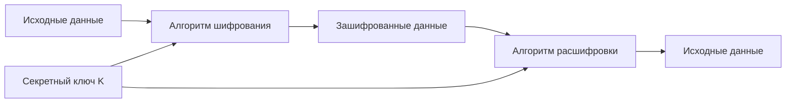

### Как работает механизм

Предположим, у нас есть резервная копия базы данных.

1. Создаем случайный секретный ключ.
2. Передаем исходные данные алгоритму шифрования.
3. Алгоритм преобразует данные с использованием ключа и дополнительных параметров.
4. Получаем зашифрованные данные, которые без ключа невозможно практически восстановить при корректной реализации.
5. При восстановлении используем тот же ключ и необходимые параметры, чтобы получить исходный файл.

Самый известный современный симметричный алгоритм — **AES (Advanced Encryption Standard)**.

AES работает с блоками по 128 бит и поддерживает ключи длиной 128, 192 и 256 бит.

### Почему AES быстрый

AES выполняет последовательность математических преобразований над блоками данных. Он не использует дорогостоящие операции с большими числами, характерные для некоторых асимметричных алгоритмов.

Кроме того, современные процессоры часто поддерживают аппаратное ускорение AES, например инструкции AES-NI на x86.

Поэтому симметричное шифрование хорошо подходит для больших объемов данных: резервных копий, дисков, сетевого трафика.

### Почему одного AES недостаточно

AES — это блочный шифр. Чтобы безопасно шифровать реальные сообщения произвольной длины, необходим подходящий режим работы.

|Режим|Особенности|Применение|
|---|---|---|
|ECB|Одинаковые блоки исходных данных дают одинаковые зашифрованные блоки при одном ключе|Не использовать для обычного шифрования данных|
|CBC|Каждый блок зависит от предыдущего; требует IV и корректной обработки padding|Устаревающие системы и совместимость|
|CTR|Превращает блочный шифр в потоковый; требует уникальных значений счетчика|Отдельные криптографические протоколы|
|GCM|Шифрует данные и одновременно проверяет их целостность и подлинность|TLS, API, защищенное хранение|

Для новых систем часто выбирают **AES-GCM** или **ChaCha20-Poly1305**.

Оба относятся к AEAD — authenticated encryption with associated data.

### Что такое AEAD

Обычное шифрование отвечает на вопрос: «Может ли посторонний прочитать сообщение?»

AEAD дополнительно позволяет обнаружить изменение зашифрованного сообщения.

При шифровании получаются:

- Ciphertext — зашифрованные данные.
- Authentication Tag — тег, необходимый для проверки целостности и подлинности.
- Nonce — значение, используемое для обеспечения уникальности операции шифрования.

При расшифровке система проверяет тег. Если проверка не проходит, сообщение должно быть отклонено, а не передано приложению как корректные данные.

> [!WARNING]  
> Для AES-GCM повторное использование одного и того же nonce с одним и тем же ключом может привести к серьезной компрометации конфиденциальности и целостности данных. Nonce не обязан быть секретным, но его уникальность в рамках ключа критически важна.

## 3. Асимметричная криптография

В асимметричной криптографии используется пара связанных ключей:

- **Public Key** — публичный ключ, который можно распространять.
- **Private Key** — приватный ключ, который должен оставаться секретным.

Операции с этими ключами зависят от конкретного алгоритма.

Например, RSA может использоваться для шифрования и цифровых подписей, а Ed25519 предназначен для цифровых подписей, но не для шифрования.

### Как работает асимметричное шифрование

На примере алгоритма RSA-OAEP:

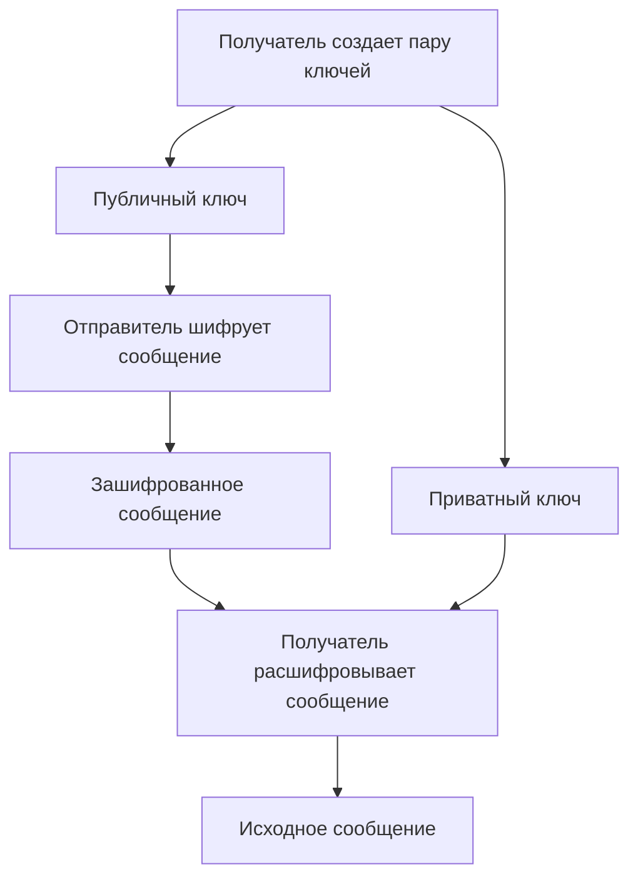

1) Получатель генерирует пару ключей.
2) Публичный ключ передает отправителю.
3) Отправитель шифрует сообщение публичным ключом получателя.
4) Получатель расшифровывает сообщение своим приватным ключом.

При корректной реализации знание публичного ключа не позволяет практически восстановить приватный.

Но важно: **шифрование публичным ключом получателя само по себе не подтверждает личность отправителя,** ведь публичный ключ доступен всем.

### Почему асимметричная криптография медленнее

Асимметричные алгоритмы используют более сложные математические операции. Поэтому шифровать ими большие файлы неэффективно, а некоторые алгоритмы вообще не предназначены для прямого шифрования данных.

В реальных системах применяется гибридная схема:

1. Стороны безопасно согласовывают или передают симметричный ключ.
2. Основные данные шифруются быстрым симметричным алгоритмом.
3. При необходимости ключи обновляются для новых сеансов.

Именно такой общий принцип лежит в основе современных защищенных соединений.

### Сравнение

|Характеристика|Симметричная криптография|Асимметричная криптография|
|---|---|---|
|Ключи|Общий секретный ключ|Публичный и приватный|
|Скорость|Обычно высокая|Обычно ниже|
|Основная задача|Защита больших объемов данных|Обмен ключами, подписи, отдельные схемы шифрования|
|Главная сложность|Безопасно передать и хранить общий ключ|Защитить приватный ключ и проверить подлинность публичного|
|Примеры|AES, ChaCha20|RSA, X25519, Ed25519 — для разных операций|

## 4. Хеширование

Хеш-функция принимает данные произвольной длины и вычисляет результат фиксированной длины.

Например, SHA-256 всегда возвращает 256 бит (32 байта), независимо от того, хешируется слово или многогигабайтный файл.

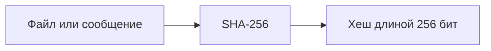

### Ключевые свойства криптографических хеш-функций

1. Детерминированность: одинаковые входные данные всегда дают одинаковый хеш.
2. Устойчивость к нахождению прообраза: по хешу практически невозможно восстановить подходящее исходное сообщение.
3. Устойчивость ко второму прообразу: имея сообщение, практически невозможно подобрать другое с тем же хешем.
4. Устойчивость к коллизиям: практически невозможно найти два разных сообщения с одинаковым хешем.

Коллизии математически существуют, потому что количество возможных сообщений больше количества возможных хешей. Безопасность основана на сложности их поиска.

### Практический пример

Создадим файл и вычислим контрольную сумму:

```bash
printf 'important config\n' > config.txt
sha256sum config.txt
```

Теперь изменим содержимое:

```bash
printf 'modified config\n' > config.txt
sha256sum config.txt
```

Хеш изменится, даже если изменится всего один байт.

### Где применяется хеширование

| Сценарий                        | Зачем                                                                                  |
| ------------------------------- | -------------------------------------------------------------------------------------- |
| Проверка скачанных файлов       | Обнаружить случайное повреждение или подмену при наличии доверенной суммы              |
| Контроль целостности артефактов | Проверить соответствие ожидаемому содержимому                                          |
| Цифровые подписи                | Обычно подписывается хеш сообщения или используется алгоритм с внутренним хешированием |
| Content-addressed storage       | Идентифицировать содержимое по его отпечатку                                           |
| Хранение паролей                | Использовать специальные медленные алгоритмы с солью                                   |

> [!WARNING]  
> **SHA-256 сам по себе не подходит для безопасного хранения паролей.** Он слишком быстрый, что облегчает перебор. Для паролей применяют Argon2id, scrypt, bcrypt или PBKDF2 с правильно подобранными параметрами и уникальной солью.

## 5. HMAC: как проверить сообщение с общим секретом

HMAC — это механизм проверки целостности и подлинности сообщения на основе криптографической хеш-функции и общего секретного ключа.

Он решает проблему, которую обычный SHA-256 не решает: злоумышленник, не знающий секретного ключа, не сможет создать корректный HMAC для измененного сообщения.

**Как работает HMAC**

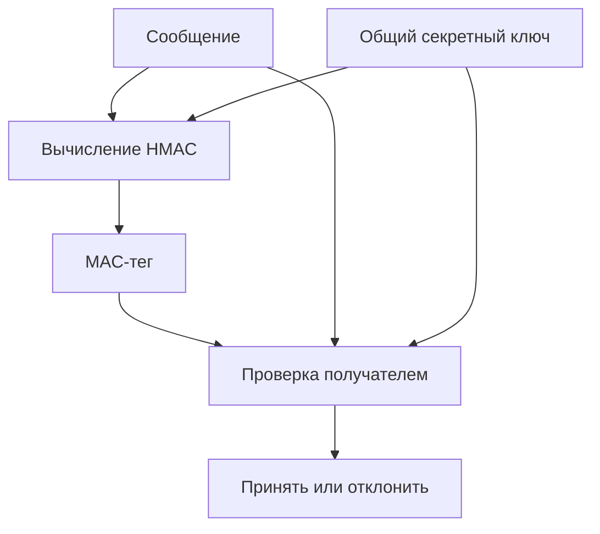

MAC-тег — это «контрольная сумма, заверенная ключом»

1. Отправитель и получатель **заранее** имеют один и тот же секретный ключ.
2. Отправитель вычисляет `HMAC(ключ, сообщение)` → получает **MAC-тег** (например, 32 байта для SHA-256).
3. Отправляет **сообщение + тег**.
4. Получатель **сам** вычисляет HMAC по полученному сообщению и своему ключу.
5. Сравнивает свой результат с полученным тегом **безопасным способом** (за постоянное время, чтобы не дать атакующему угадать тег по таймингам).
6. Совпало → принимаем. Не совпало → отклоняем.

#### timing attack

Наивное сравнение строк/байтов выглядит так:

```c
// ПЛОХО
for (i = 0; i < len; i++) {
    if (a[i] != b[i]) return 0;  // вышли при первом несовпадении
}
return 1;
```

Здесь время работы зависит от того, **насколько рано** нашлось первое несовпадение. Атакующий, который может слать много запросов и замерять время ответа, постепенно подбирает тег **побайтово**:
- угадал первый байт → сравнение идёт чуть дольше → замеряет → фиксирует;
- угадал второй байт → ещё дольше → и т.д.

**Безопасное сравнение** (constant-time) всегда проходит **все** байты, независимо от того, где несовпадение:

```c
// ХОРОШО
diff = 0;
for (i = 0; i < len; i++) {
    diff |= a[i] ^ b[i];  // накапливаем разницу, не выходя досрочно
}
return diff == 0;
```

Время работы одинаковое, утечки по таймингам нет.

#### Где нужен HMAC?

HMAC гарантирует: **сообщение пришло от того, кто знает ключ, и не изменено**. Это применимо везде, где есть недоверенный канал или недоверенная среда:

| Сценарий                      | Что защищает HMAC                                                                     |
| ----------------------------- | ------------------------------------------------------------------------------------- |
| **MITM в сети**               | Изменение/подмену сообщения по пути                                                   |
| **Webhooks** (GitHub, Stripe) | Подделку запроса: злоумышленник не знает секрет, не сможет прислать «валидный» вебхук |
| **JWT (HS256)**               | Подделку токена: нельзя изменить `user_id`/`role` в payload                           |
| **Cookie/сессии**             | Подделку cookie: нельзя вписать чужой `session_id`                                    |
| **API-подпись**               | Повтор/подделку запроса к API                                                         |
| **Хранение конфигов/данных**  | Обнаружение подмены файла на диске (если ключ вне файла)                              |
| **Прошивки/обновления**       | Проверку, что апдейт выпущен вендор                                                   |

Ключевая идея: HMAC нужен **всюду, где сторона-получатель не доверяет каналу/источнику, но доверяет общему ключу**.

## 6. Цифровая подпись

Цифровая подпись позволяет проверить, что сообщение было подписано обладателем соответствующего приватного ключа и не было изменено после подписания.

В отличие от HMAC, для проверки не требуется знать секретный ключ подписанта.

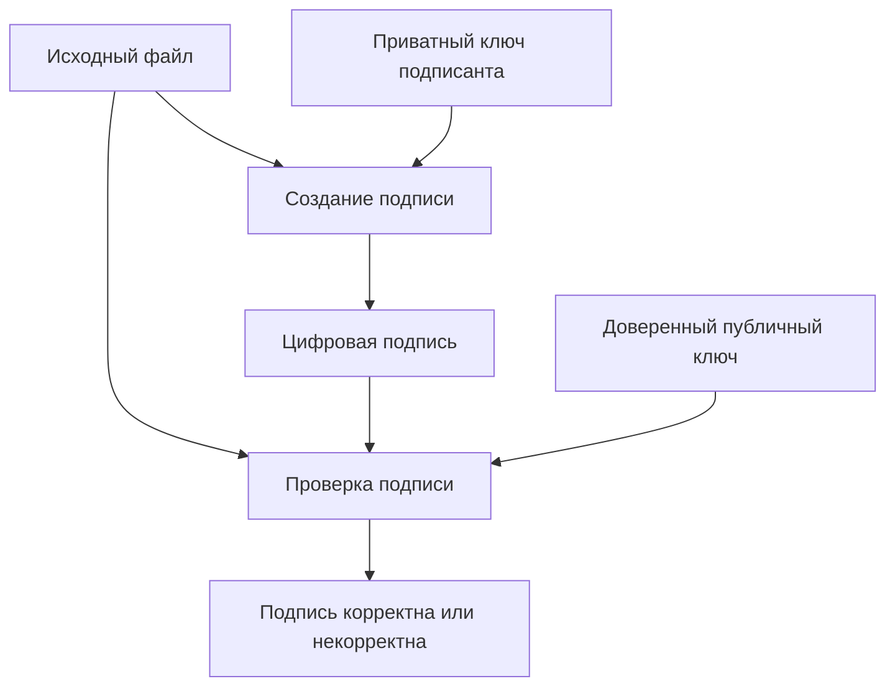

1) Подписант создает цифровую подпись приватным ключом.
2) Передает файл и подпись получателю. 
3) Получатель проверяет подпись публичным ключом.
4) Если файл изменен или подпись неверна, проверка завершается ошибкой.

>[!tip] Ключевой нюанс:
>Корректная подпись подтверждает владение приватным ключом, но не доказывает личность владельца автоматически.
>
>Чтобы связать публичный ключ с конкретной организацией или сервисом, нужен доверенный механизм распространения ключей — например, PKI.

### Пример с OpenSSL

Создадим RSA-ключ и извлечем публичную часть:

```bash
openssl genpkey -algorithm RSA \
  -pkeyopt rsa_keygen_bits:3072 \
  -out private.pem

openssl pkey -in private.pem \
  -pubout -out public.pem
```

Создадим и подпишем файл:

```bash
printf 'release version 1.0\n' > release.txt

openssl dgst -sha256 \
  -sign private.pem \
  -out release.sig \
  release.txt
```

Проверим подпись:

```bash
openssl dgst -sha256 \
  -verify public.pem \
  -signature release.sig \
  release.txt
```

При успешной проверке OpenSSL выводит `Verified OK`.

Это пример RSA-подписи с параметрами по умолчанию для данной команды OpenSSL. Для новых систем следует явно выбирать современную схему, например RSA-PSS или Ed25519, с учетом совместимости.

>[!IMPORTANT]  
>Цифровая подпись не шифрует файл. Подписанный файл остается доступным для чтения. Подпись отвечает за проверку целостности и происхождения, а не за конфиденциальность.

## 7. Обмен ключами: как две стороны договариваются о секрете

Мы разобрали симметричное шифрование, но у него есть серьезная проблема.

Предположим, клиент хочет подключиться к серверу по защищенному соединению. Чтобы использовать AES, обе стороны должны знать один секретный ключ.

Но как передать этот ключ через интернет, если соединение еще не зашифровано?

Если просто отправить ключ по сети, злоумышленник сможет его перехватить и расшифровать дальнейший трафик.

Для решения этой задачи существуют протоколы согласования ключей, например Diffie-Hellman (DH) и Elliptic Curve Diffie-Hellman (ECDH).

### Как работает Diffie-Hellman

Главная идея: две стороны могут вычислить одинаковый общий секрет, не передавая сам секрет по сети.

Упрощенная последовательность:

1. Клиент и сервер согласовывают публичные параметры.
2. Клиент генерирует собственное секретное значение и вычисляет публичное.
3. Сервер делает то же самое.
4. Стороны обмениваются публичными значениями.
5. Клиент объединяет свое секретное значение с публичным значением сервера.
6. Сервер объединяет свое секретное значение с публичным значением клиента.
7. Благодаря математическим свойствам алгоритма обе стороны получают одинаковый общий секрет.

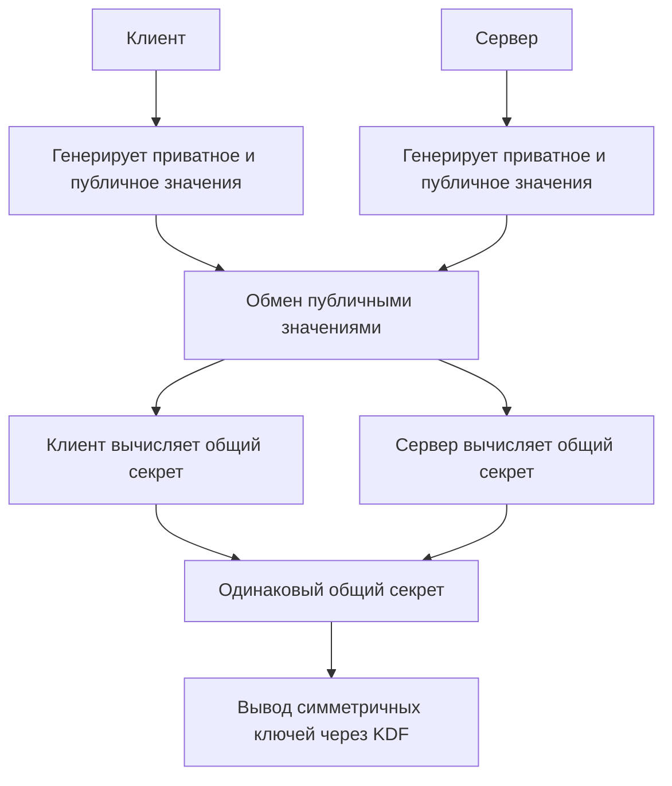

### Почему злоумышленник не может вычислить секрет

Злоумышленник видит публичные параметры и значения, которыми обменялись стороны.

Однако для вычисления общего секрета ему нужно решить математически сложную задачу, например задачу дискретного логарифмирования для классического DH.

При правильно выбранных параметрах и отсутствии практических уязвимостей это вычислительно неосуществимо.

### Что такое ECDH и X25519

ECDH использует математику эллиптических кривых вместо классических групп DH.

X25519 — широко применяемая функция согласования ключей на основе Curve25519.

Она позволяет получить высокую безопасность с относительно небольшими ключами и хорошей производительностью.

|Алгоритм|Назначение|Особенности|
|---|---|---|
|DH|Согласование общего секрета|Использует арифметику конечных полей|
|ECDH|Согласование общего секрета|Использует эллиптические кривые|
|X25519|Согласование общего секрета|Популярный современный вариант на Curve25519|
|RSA|Шифрование или подписи|Не является алгоритмом Diffie-Hellman|
|Ed25519|Цифровая подпись|Не используется для согласования ключей|

### Проблема MITM (Man-in-the-Middle)

Обычный Diffie-Hellman не подтверждает личность участников. Представим, что злоумышленник находится между клиентом и сервером.

1. Клиент отправляет публичное значение.
2. Злоумышленник перехватывает его и подменяет своим.
3. Сервер получает значение злоумышленника и вычисляет общий секрет с ним.
4. Злоумышленник аналогично подменяет значение сервера для клиента.
5. В итоге возникают два разных защищенных соединения: клиент ↔ злоумышленник и злоумышленник ↔ сервер.

Злоумышленник может расшифровывать сообщения одной стороны и повторно шифровать их для другой.

Поэтому согласование ключей должно быть аутентифицированным.

В TLS для этого используется проверка подлинности сервера, обычно через сертификат и криптографическую подпись.

## 8. Как криптография работает в TLS

TLS объединяет несколько механизмов, которые мы разобрали ранее.

В современных конфигурациях TLS 1.3 обычно используются:

- ECDHE для согласования общего секрета.
- Цифровые подписи для аутентификации сервера.
- HKDF для вывода необходимых ключей.
- AES-GCM или ChaCha20-Poly1305 для защиты трафика.

### Что происходит при подключении к HTTPS-серверу

Рассмотрим типичный TLS 1.3 handshake с серверной аутентификацией.

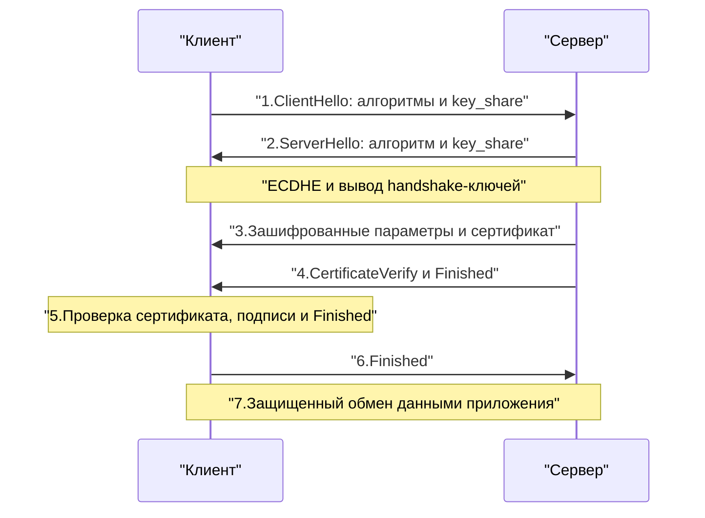
Разберем подробнее:

1. Клиент отправляет `ClientHello`, в котором перечисляет поддерживаемые алгоритмы и обычно передает публичное значение для ECDHE.
2. Сервер выбирает параметры и отправляет `ServerHello` со своим публичным значением.
3. Обе стороны вычисляют общий секрет ECDHE и выводят ключи для защиты сообщений handshake.
4. Сервер отправляет сертификат и доказывает владение соответствующим приватным ключом через `CertificateVerify`.
5. Клиент проверяет сертификат, имя сервера, доверие к цепочке сертификатов, подпись и подтверждение целостности handshake.
6. Стороны завершают handshake и получают ключи для защиты прикладных данных.
7. HTTP-запросы и ответы передаются в зашифрованном виде.

> [!NOTE]  TLS 1.3
> В TLS 1.3 сертификат сервера обычно используется для аутентификации, а не для прямого шифрования всего трафика. Симметричные ключи получаются через механизм согласования ключей и HKDF.

### Что такое Forward Secrecy

Предположим, злоумышленник записал весь зашифрованный HTTPS-трафик за месяц.

Через год ему удалось украсть приватный ключ сертификата сервера. Сможет ли он расшифровать старый трафик?

Если использовался современный TLS с эфемерным ECDHE и временные секреты сеансов не сохранились, одного приватного ключа сертификата недостаточно.

Это свойство называется Forward Secrecy. Причина заключается в том, что:
- Долгосрочный приватный ключ сервера используется для аутентификации.
- Для согласования ключей каждого нового соединения создаются временные секретные значения.
- После завершения соединения эти значения должны быть удалены.
- Старый трафик невозможно расшифровать только по скомпрометированному ключу сертификата.

Forward Secrecy не защищает от компрометации текущих сеансовых ключей, утечки временных секретов или перехвата данных непосредственно на конечных устройствах.

## 9. Nonce, IV, Salt и KDF: почему это разные вещи

Эти понятия часто путают, потому что все они встречаются рядом с ключами и шифрованием.

Но задачи у них разные.

|Механизм|Назначение|Должен быть секретным?|Главное требование|
|---|---|---|---|
|Nonce|Обеспечить уникальность операции или сообщения|Обычно нет|Уникальность в нужном контексте|
|IV (Initialization Vector)|Начальное значение для режима шифрования|Обычно нет|Требования зависят от режима|
|Salt|Сделать вывод ключа или хеширование пароля индивидуальным|Нет|Обычно случайность и уникальность|
|KDF (Key Derivation Function)|Получить криптографические ключи из исходного материала|Сам алгоритм нет|Корректный входной материал и параметры|

### Nonce

Nonce часто означает number used once — значение, используемое однократно в определенном контексте. Например, если AES-GCM использует один ключ для нескольких сообщений, повторение nonce с тем же ключом опасно.

Поэтому система должна гарантировать, что сочетание ключа и nonce не повторяется. Nonce может быть счетчиком или случайным значением, если способ генерации обеспечивает необходимые гарантии.

### IV

IV — начальный вектор, который используется конкретным режимом шифрования.

В AES-CBC IV должен быть непредсказуемым для безопасного шифрования. В AES-GCM IV фактически используется как nonce, и критически важна уникальность при одном ключе.

Таким образом, требования к IV нельзя определить без знания режима шифрования.

### Salt

Salt особенно важен при работе с паролями.

Допустим, два пользователя выбрали одинаковый пароль.

Если просто вычислить SHA-256, оба получат одинаковый результат.

При использовании разных случайных salt и специализированной функции хеширования паролей результаты будут различаться.

Это мешает эффективному применению заранее вычисленных таблиц и массовому перебору одинаковых паролей.

Но salt не заменяет сложный пароль и не делает быстрый SHA-256 подходящим для хранения паролей.

### KDF

KDF используется для получения одного или нескольких ключей из исходного секрета.

Например, после ECDHE обе стороны получают общий секрет, но не используют его напрямую как AES-ключ.

В TLS 1.3 применяется HKDF, который с учетом дополнительных данных выводит отдельные ключи и секреты для разных этапов и направлений соединения.

Это важно, потому что один и тот же ключ не должен без необходимости использоваться для разных криптографических задач.

Для получения ключей из пользовательских паролей используют другие подходы — например, Argon2id или scrypt, специально рассчитанные на замедление перебора.

## 10. Генерация ключей и криптографическая случайность

Криптографическая безопасность зависит не только от выбранного алгоритма, но и от качества ключей.

Например, AES-256 предполагает пространство из \(2^{256}\) возможных ключей.

Но если администратор выбирает ключ из десяти распространенных паролей, реальная сложность подбора будет определяться этими десятью вариантами, а не длиной ключа AES.

### Энтропия

Энтропия в контексте генерации ключей характеризует неопределенность значения для атакующего.

Если ключ генерируется равномерно из 256 случайных бит, его угадывание прямым перебором практически невозможно.

Но ключ, полученный из предсказуемого времени запуска процесса или слабого генератора случайных чисел, может быть уязвимым.

### CSPRNG

CSPRNG — криптографически стойкий генератор псевдослучайных чисел.

В Linux приложения обычно получают криптографически безопасные случайные данные через системные механизмы, например `getrandom()`.

Для обычных задач генерации ключей следует использовать криптографические библиотеки и системный генератор, а не самостоятельно реализованный алгоритм.

### Практика с OpenSSL

Сгенерировать 32 случайных байта:

```bash
openssl rand -hex 32
```

Результат будет представлен в виде 64 шестнадцатеричных символов.

Это 256 бит случайных данных, если генератор работает корректно.

Сгенерировать случайный ключ для демонстрационного AES-256-GCM:

```bash
openssl rand -out aes.key 32
```

> [!WARNING]  
> Не следует генерировать ключи через `$RANDOM`, текущее время, UUID неподходящего типа или самодельные функции на основе SHA-256. Для production-секретов используйте проверенный CSPRNG.

## 11. Практическое применение в DevOps

### 11.1. Шифрование резервных копий

Допустим, PostgreSQL создает резервную копию, которая затем отправляется в объектное хранилище.

Если злоумышленник получит доступ к хранилищу, он не должен автоматически получить доступ к содержимому базы.

Правильная архитектура может выглядеть так:

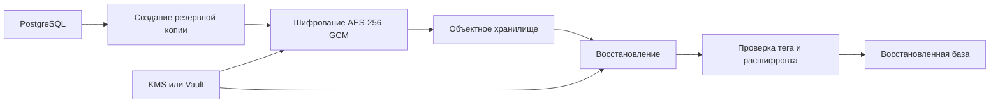
Здесь необходимо учитывать несколько моментов.

1. Резервная копия шифруется до отправки в хранилище.
2. Ключи должны храниться отдельно от зашифрованных данных.
3. Для каждого шифрования необходимо корректно генерировать nonce.
4. При восстановлении обязательно проверяется authentication tag.
5. Нужно резервировать или обеспечивать восстановление доступа к ключам: потеря ключа делает зашифрованную копию бесполезной.
6. Необходимо регулярно тестировать восстановление, а не только создание резервной копии.
### 11.2. Подписание артефактов в CI/CD

Предположим, pipeline собирает Docker-образ.

Обычный процесс:

1. Runner получает исходный код.
2. Собирает контейнерный образ.
3. Публикует образ в registry.
4. Kubernetes скачивает и запускает образ.

Но что произойдет, если злоумышленник получит возможность заменить образ в registry?

Хеш образа позволяет идентифицировать содержимое, но сам по себе не подтверждает, что именно доверенный pipeline выпустил этот образ.

Поэтому применяется цифровая подпись.

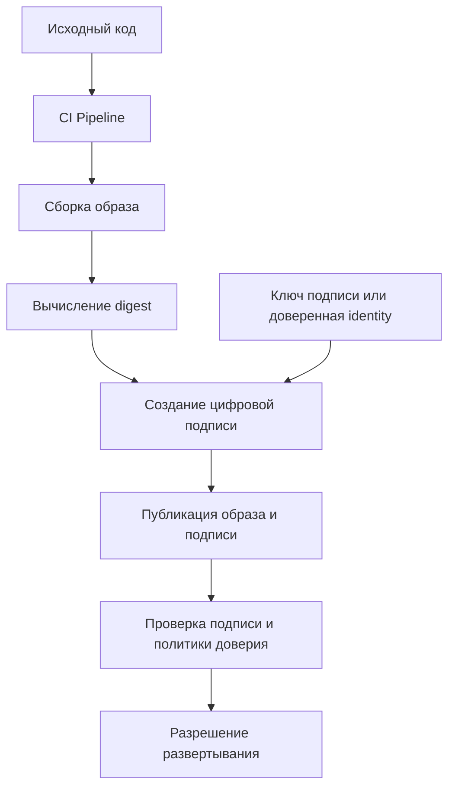

Для этой задачи могут применяться инструменты вроде Sigstore Cosign.

При этом проверка должна учитывать не только математическую корректность подписи, но и доверие к подписанту, допустимый репозиторий и другие требования политики.

### 11.3. Защита секретов в Ansible

Ansible Vault позволяет хранить зашифрованные переменные и файлы рядом с инфраструктурным кодом.

Например:

```bash
ansible-vault encrypt group_vars/production/secrets.yml
```

После шифрования файл можно хранить в Git без раскрытия исходных значений при условии защиты пароля Vault.

Однако это не означает, что вся дальнейшая работа с секретами автоматически безопасна.

После расшифровки секреты могут попасть в:

- Логи выполнения playbook.
- Временные файлы на управляемом хосте.
- Вывод задач без `no_log: true`.
- Память процессов или диагностические дампы.

Поэтому шифрование файла защищает данные при хранении, но не заменяет контроль доступа и безопасную обработку секретов во время выполнения.

### 11.4. Шифрование Kubernetes Secret

Kubernetes Secret — это объект для хранения конфиденциальных данных.

Но значение в YAML обычно представляется в Base64.

Например:

```bash
printf 'supersecret' | base64
```

Base64 — это кодирование, а не шифрование. Любой, кто получит закодированное значение, сможет восстановить исходные данные.

Для защиты Secret-объектов при хранении в etcd Kubernetes поддерживает encryption at rest.

В production можно использовать соответствующий encryption provider, включая интеграцию с KMS.

При этом нужно понимать границы защиты:

|Угроза|Помогает encryption at rest?|
|---|---|
|Кража незащищенной копии etcd без ключей|Да, для зашифрованных ресурсов|
|Перехват API-трафика|Нет, для этого нужен TLS|
|Пользователь с разрешением читать Secret через API|Нет|
|Компрометация Pod, которому доступен Secret|Обычно нет|
|Утечка ключей шифрования|Защита может быть скомпрометирована|

Это хороший пример того, почему криптография не заменяет RBAC, сетевую изоляцию и управление секретами.

## 12. Управление ключами: главная проблема криптографии в production

Можно использовать AES-256, правильно настроить TLS и выбрать современные алгоритмы, но вся защита потеряет смысл, если приватный ключ окажется доступен злоумышленнику.

Поэтому управление ключами — отдельная задача.

### Жизненный цикл ключа

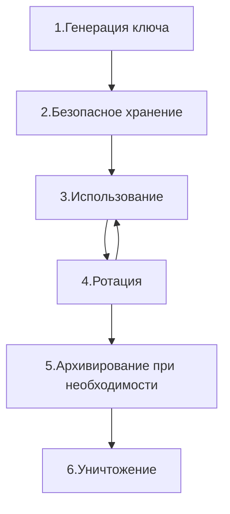

### Где хранить ключи

|Способ|Преимущества|Ограничения|
|---|---|---|
|Файл с ограниченными правами|Просто настроить|Риск кражи при компрометации сервера|
|Переменные окружения|Удобно для приложений|Возможны утечки через процессы, логи и диагностику|
|HashiCorp Vault|Централизованное управление доступом и аудит|Требует надежной инфраструктуры Vault|
|Cloud KMS|Централизованные криптографические операции и контроль доступа|Зависимость от облачного провайдера и доступности API|
|HSM|Аппаратная защита ключевого материала|Стоимость и сложность эксплуатации|

### Что такое Envelope Encryption

В больших системах неудобно шифровать все данные непосредственно одним главным ключом.

Поэтому часто применяется Envelope Encryption — шифрование ключей.

Используются два уровня:

- DEK (Data Encryption Key) — ключ, которым непосредственно шифруются данные.
- KEK (Key Encryption Key) — ключ, которым защищается DEK.

Порядок работы:

1. Создается случайный DEK.
2. Данные шифруются с помощью DEK.
3. DEK шифруется с помощью KEK, например через KMS.
4. Рядом с данными хранится зашифрованный DEK.
5. Для расшифровки система сначала получает DEK через разрешенную операцию KMS, а затем расшифровывает данные.

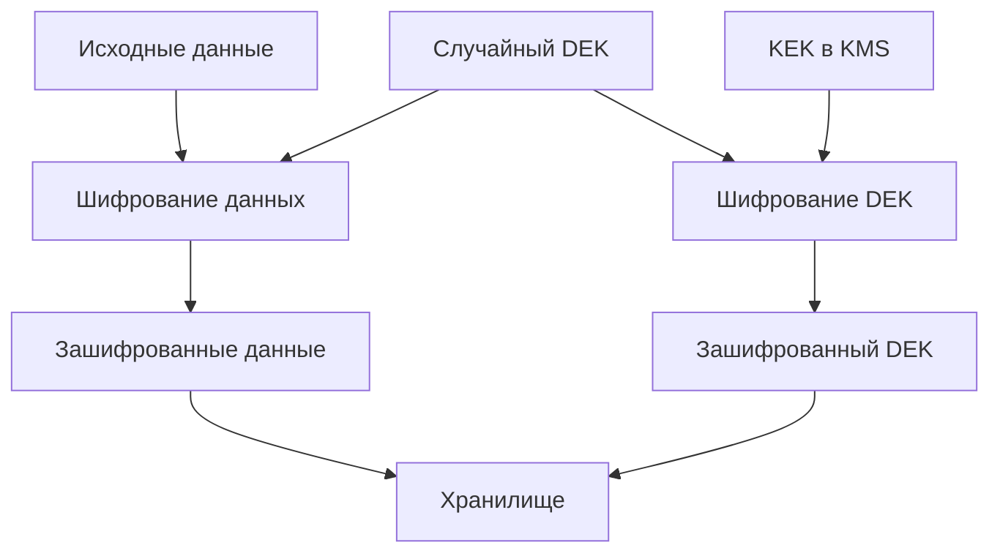

Почему это удобно?

Не нужно передавать весь объем данных через KMS. Основное шифрование выполняется локально быстрым симметричным алгоритмом, а KMS защищает ключевой материал.

Кроме того, в некоторых архитектурах можно менять KEK и повторно защищать DEK, не перешифровывая весь объем данных.

Однако при компрометации DEK необходимо учитывать, что данные, защищенные этим DEK, могли быть раскрыты. Простая замена KEK проблему не исправит.

## 13. Типичные проблемы и их решение (Troubleshooting)

|Симптом|Вероятная причина|Как диагностировать и исправить|
|---|---|---|
|OpenSSL сообщает `bad decrypt`|Неверный ключ, пароль, параметры или поврежденные данные|Проверить алгоритм, формат файла, KDF, salt и параметры шифрования|
|AES-GCM возвращает ошибку аутентификации|Неверный ключ, nonce, AAD, тег или измененные данные|Сравнить параметры на обеих сторонах. Не использовать данные, если тег не прошел проверку|
|Цифровая подпись не проходит проверку|Файл изменен, выбран неверный публичный ключ или параметры подписи|Проверить хеш, ключ, алгоритм и формат подписи|
|TLS handshake завершается ошибкой|Несовместимые алгоритмы, проблемы сертификата или проверки подписи|Использовать `openssl s_client`, проверить версию TLS и сообщения об ошибках|
|После ротации ключа старые данные перестали расшифровываться|Старый ключ удален до перешифрования или восстановления DEK|Восстановить доступ к предыдущей версии ключа, проверить процедуру ротации|
|Два сервиса получают разные ключи после ECDH|Несовпадающие параметры, ошибки сериализации или вывода ключей|Проверить публичные значения, выбранную группу, контекст KDF|
|Секрет обнаружен в логах CI/CD|Приложение или скрипт вывели расшифрованное значение|Отозвать секрет, устранить утечку, настроить маскирование и ограничения логирования|

### Полезные команды OpenSSL

Проверить версию и возможности OpenSSL:

```bash
openssl version -a
```

Посмотреть поддерживаемые алгоритмы шифрования:

```bash
openssl list -cipher-algorithms
```

Посмотреть поддерживаемые алгоритмы цифровой подписи:

```bash
openssl list -signature-algorithms
```

Проверить SHA-256 файла:

```bash
openssl dgst -sha256 artifact.tar.gz
```

Проверить публичную часть приватного ключа:

```bash
openssl pkey -in private.pem -pubout
```

Проверить защищенное соединение с сервером:

```bash
openssl s_client \
  -connect example.com:443 \
  -servername example.com \
  -tls1_3 \
  -verify_return_error
```

Эта команда помогает проверить TLS-соединение, увидеть сертификаты и диагностировать ошибки handshake. Для полноценной проверки доверия также важно использовать корректное хранилище доверенных сертификатов и проверку имени сервера.

Например:

```bash
openssl s_client \
  -connect example.com:443 \
  -servername example.com \
  -verify_hostname example.com \
  -verify_return_error
```

## 14. Как выбрать криптографический механизм под задачу

Это самая полезная часть для практической работы: сначала определяем, что именно требуется защитить, и только затем выбираем инструмент.

|Задача|Подходящий механизм|Почему|
|---|---|---|
|Зашифровать резервную копию|AES-256-GCM|Конфиденциальность и проверка целостности|
|Проверить контрольную сумму файла|SHA-256|Обнаружение изменения содержимого при доверенном эталоне|
|Проверить webhook с общим секретом|HMAC-SHA256|Проверка целостности и знания общего секрета|
|Подписать программный релиз|Ed25519 или RSA-PSS|Проверка подписи публичным ключом|
|Согласовать ключи TLS-соединения|ECDHE, например X25519|Безопасное согласование общего секрета|
|Получить несколько ключей из общего секрета|HKDF|Разделение ключевого материала по назначениям|
|Хранить пароли пользователей|Argon2id|Усложнение массового перебора|
|Централизованно защищать ключи|KMS, Vault или HSM|Контроль доступа, аудит и управление жизненным циклом|
|Защитить данные в объектном хранилище|Envelope Encryption|Разделение шифрования данных и защиты ключей|

> [!IMPORTANT]  
> Не следует самостоятельно разрабатывать криптографические протоколы или комбинировать алгоритмы без четкой спецификации. Даже безопасные алгоритмы можно объединить небезопасным способом. В production предпочтительнее использовать проверенные библиотеки, протоколы и готовые механизмы управления ключами.

---

## Контрольные вопросы для самопроверки

1. Какие задачи решает криптография? Чем конфиденциальность отличается от целостности и подлинности?
2. Чем симметричное шифрование отличается от асимметричного? Почему для больших объемов данных обычно используют симметричные алгоритмы?
3. Как работает AES и почему важен режим шифрования? Чем AES-GCM отличается от AES-CBC и ECB?
4. Что такое AEAD? Зачем нужен authentication tag и что происходит при ошибке его проверки?
5. Что такое публичный и приватный ключ? Почему знание публичного ключа не должно позволять восстановить приватный?
6. Чем хеширование отличается от шифрования? Почему SHA-256 не доказывает происхождение файла?
7. Что такое HMAC и чем он отличается от обычного хеша и цифровой подписи?
8. Как работает цифровая подпись? Почему корректная подпись сама по себе не доказывает личность владельца ключа?
9. Как Diffie-Hellman позволяет двум сторонам согласовать общий секрет, не передавая его по сети?
10. Почему обычный Diffie-Hellman уязвим к MITM и как TLS решает проблему аутентификации?
11. Какие криптографические механизмы используются в TLS 1.3 и какую задачу выполняет каждый из них?
12. Что такое Forward Secrecy? Почему компрометация приватного ключа сертификата не обязательно позволяет расшифровать старый TLS-трафик?
13. Чем отличаются nonce, IV и salt? Почему повторное использование nonce с одним AES-GCM ключом опасно?
14. Что такое KDF? Чем HKDF отличается по назначению от Argon2id?
15. Почему для генерации криптографических ключей необходим CSPRNG?
16. Как защитить резервную копию базы данных, если она хранится во внешнем объектном хранилище?
17. Почему Base64 в Kubernetes Secret не является шифрованием? От каких угроз защищает encryption at rest?
18. Как цифровые подписи помогают защищать контейнерные образы в CI/CD?
19. Какие риски остаются при использовании Ansible Vault?
20. Что такое DEK, KEK и Envelope Encryption? Почему ротация KEK не всегда требует повторного шифрования всех данных?

---
## Вопросы со звездочкой (*) для глубокого понимания

1. Повторное использование nonce в AES-GCM: Почему повторение nonce при одном ключе может привести не только к раскрытию информации, но и к возможности подделки сообщений? Почему простое увеличение длины ключа AES не решает проблему?
2. Forward Secrecy и компрометация сервера: Если злоумышленник получил приватный ключ TLS-сертификата, но не временные секреты ECDHE, почему он не сможет расшифровать ранее записанные соединения? А что изменится, если он получит контроль над сервером во время активного соединения?
3. MITM и проверка публичных ключей: Почему криптографически корректный обмен ECDHE не защищает от злоумышленника посередине? Каким образом аутентификация в TLS связывает согласованный ключ с проверяемым сервером?
4. Envelope Encryption и ротация: Почему замена KEK может не требовать повторного шифрования большого объема данных, но компрометация DEK уже требует других действий? Какие последствия возникают, если старые версии KEK удаляются до завершения миграции?
5. Цифровая подпись в Supply Chain: Злоумышленник получил доступ к CI runner, который имеет право подписывать релизы. Все опубликованные им вредоносные образы обладают корректными цифровыми подписями. Почему проверка подписи не обнаружит такую компрометацию? Какие дополнительные меры должны защищать процесс сборки и выпуска артефактов?
6. Защита от Replay Attack: Почему корректные HMAC или цифровая подпись не препятствуют повторной отправке ранее подписанного сообщения? Как timestamp, nonce и серверное хранение использованных идентификаторов помогают решить эту проблему?

---

#devops #cryptography #security #pki #tls #aes #rsa #ecc #hashing #sha256 #hmac #digital-signature #key-management #encryption #openssl #devsecops #troubleshooting