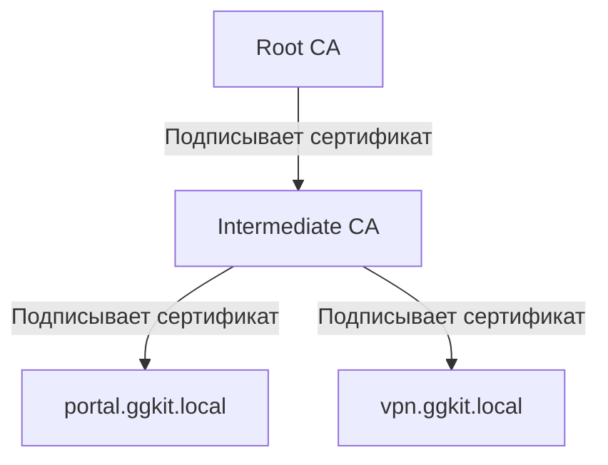
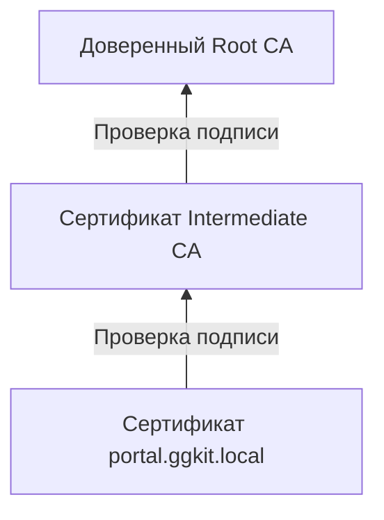

## 1. Зачем нужна PKI

При открытии `https://portal.ggkit.local` браузеру необходимо не только зашифровать соединение, но и убедиться, что он подключился именно к нужному серверу.

**PKI (Public Key Infrastructure)** — система выпуска и проверки цифровых сертификатов. Она позволяет подтверждать принадлежность открытых ключей серверам, пользователям и устройствам.

## 2. Ключи и сертификаты

| Понятие | Назначение |
|---|---|
| Приватный ключ | Секретный ключ владельца. Позволяет создавать цифровые подписи. |
| Открытый ключ | Позволяет проверять подписи владельца. |
| Сертификат | Содержит открытый ключ, имя владельца, срок действия и подпись CA. |
| CA | Удостоверяющий центр, который проверяет заявки и подписывает сертификаты. |

Например, веб-сервер хранит `portal.key` и `portal.crt`. Первый файл секретный, второй можно передавать клиентам. Сертификат не содержит приватного ключа.

CA своей подписью подтверждает связь имени `portal.ggkit.local` с открытым ключом сервера. При TLS-подключении сервер дополнительно доказывает, что владеет соответствующим приватным ключом.

> [!INFO]
> Сертификат сам по себе не шифрует трафик. TLS использует сертификат для проверки подлинности сервера, а для шифрования данных согласует отдельные ключи соединения.

## 3. Архитектура PKI



- Root CA — корневой удостоверяющий центр. В двухуровневой схеме подписывает сертификаты промежуточных CA.
- Intermediate CA — промежуточный центр. Выпускает сертификаты сервисов.
- Сертификаты сервисов — используются конечными приложениями.

Стрелки показывают, кто подписывает сертификат. Приватные ключи между участниками не передаются. У каждого своя пара ключей.

Root CA обычно отключён от сети, а Intermediate CA работает постоянно. Подробнее: [[Synced/DevOps/CI-CD, артефакты, тестирование и DevSecOps/5. DevSecOps и безопасность цепочки поставок/9. PKI и криптография в инфраструктуре/2. Инфраструктура открытых ключей/2. Root CA и Intermediate CA.md|Root CA и Intermediate CA]].

## 4. Как появляется сертификат

1. Сервер создаёт приватный и открытый ключи.
2. Сервер формирует запрос на сертификат (CSR).
3. CA проверяет заявку и подписывает сертификат.
4. Сервер получает сертификат и использует его вместе со своим приватным ключом.

Команды и файлы этого процесса: [[Synced/DevOps/CI-CD, артефакты, тестирование и DevSecOps/5. DevSecOps и безопасность цепочки поставок/9. PKI и криптография в инфраструктуре/2. Инфраструктура открытых ключей/3. Создание и подписание сертификатов.md|Создание и подписание сертификатов]].

## 5. Как клиент проверяет доверие



Браузер получает сертификат портала и промежуточный сертификат от веб-сервера. Затем проверяет подписи до корневого сертификата, которому уже доверяет.

Кроме подписей проверяются имя сервера, срок действия и допустимое назначение сертификата. Подробнее о полях: [[Synced/DevOps/CI-CD, артефакты, тестирование и DevSecOps/5. DevSecOps и безопасность цепочки поставок/9. PKI и криптография в инфраструктуре/2. Инфраструктура открытых ключей/4. X.509, Extensions и Certificate Policies.md|X.509, Extensions и Certificate Policies]].

> [!WARNING]
> Самоподписанный корневой сертификат не становится доверенным автоматически. Его необходимо заранее установить в доверенное хранилище клиента.

## 6. Какие файлы где находятся

| Машина | Файлы |
|---|---|
| Root CA | `root.crt`, `root.key` |
| Intermediate CA | `root.crt`, `intermediate.crt`, `intermediate.key` |
| Веб-сервер | `portal.key`, `portal.crt`, `intermediate.crt` |
| Клиент | Доверенный `root.crt` |

Веб-сервер обычно передаёт свой сертификат и промежуточный сертификат. Корневой сертификат клиент получает заранее по доверенному каналу. Приватные ключи CA не устанавливаются на клиентские машины.

## 7. Публичная и внутренняя PKI

Публичным CA уже доверяют многие браузеры и ОС. Внутренний CA создаётся организацией для собственных сервисов, например `portal.ggkit.local`. Его корневой сертификат необходимо распространить на управляемые устройства.

На Ubuntu доверенный корень можно установить так (после проверки его происхождения):

```bash
sudo cp root.crt /usr/local/share/ca-certificates/ggkit-root.crt
sudo update-ca-certificates
```

Первая команда копирует сертификат в каталог локальных доверенных CA, вторая обновляет системное хранилище. Некоторые приложения используют отдельное хранилище.

## 8. Что ещё входит в PKI

- Отзыв скомпрометированных сертификатов: [[Synced/DevOps/CI-CD, артефакты, тестирование и DevSecOps/5. DevSecOps и безопасность цепочки поставок/9. PKI и криптография в инфраструктуре/2. Инфраструктура открытых ключей/5. CRL и OCSP.md|CRL и OCSP]].
- Защита приватных ключей: [[Synced/DevOps/CI-CD, артефакты, тестирование и DevSecOps/5. DevSecOps и безопасность цепочки поставок/9. PKI и криптография в инфраструктуре/2. Инфраструктура открытых ключей/6. Защита ключей CA и HSM.md|Защита ключей CA и HSM]].
- Восстановление CA: [[Synced/DevOps/CI-CD, артефакты, тестирование и DevSecOps/5. DevSecOps и безопасность цепочки поставок/9. PKI и криптография в инфраструктуре/2. Инфраструктура открытых ключей/7. Резервное копирование и восстановление CA.md|Резервное копирование и восстановление CA]].
- Планирование инфраструктуры: [[Synced/DevOps/CI-CD, артефакты, тестирование и DevSecOps/5. DevSecOps и безопасность цепочки поставок/9. PKI и криптография в инфраструктуре/2. Инфраструктура открытых ключей/8. Проектирование корпоративной PKI.md|Проектирование корпоративной PKI]].

## Вопросы для самопроверки

1. Чем сертификат отличается от приватного ключа?
2. Кто подписывает сертификат портала?
3. Почему клиенту нужен доверенный корень?
4. Какие файлы передаёт веб-сервер браузеру?

## Итоги — что было разобрано

PKI подтверждает принадлежность открытых ключей. Root CA формирует основу доверия, Intermediate CA выпускает сертификаты, а клиент проверяет цепочку и имя сервера.

## Связанные заметки

- [[Synced/DevOps/CI-CD, артефакты, тестирование и DevSecOps/5. DevSecOps и безопасность цепочки поставок/9. PKI и криптография в инфраструктуре/2. Инфраструктура открытых ключей/2. Root CA и Intermediate CA.md|Root CA и Intermediate CA]]
- [[Synced/DevOps/CI-CD, артефакты, тестирование и DevSecOps/5. DevSecOps и безопасность цепочки поставок/9. PKI и криптография в инфраструктуре/2. Инфраструктура открытых ключей/3. Создание и подписание сертификатов.md|Создание и подписание сертификатов]]
- [[Synced/DevOps/CI-CD, артефакты, тестирование и DevSecOps/5. DevSecOps и безопасность цепочки поставок/9. PKI и криптография в инфраструктуре/2. Инфраструктура открытых ключей/4. X.509, Extensions и Certificate Policies.md|X.509, Extensions и Certificate Policies]]
- [[Synced/DevOps/CI-CD, артефакты, тестирование и DevSecOps/5. DevSecOps и безопасность цепочки поставок/9. PKI и криптография в инфраструктуре/2. Инфраструктура открытых ключей/5. CRL и OCSP.md|CRL и OCSP]]
- [[Synced/DevOps/CI-CD, артефакты, тестирование и DevSecOps/5. DevSecOps и безопасность цепочки поставок/9. PKI и криптография в инфраструктуре/2. Инфраструктура открытых ключей/6. Защита ключей CA и HSM.md|Защита ключей CA и HSM]]
- [[Synced/DevOps/CI-CD, артефакты, тестирование и DevSecOps/5. DevSecOps и безопасность цепочки поставок/9. PKI и криптография в инфраструктуре/2. Инфраструктура открытых ключей/8. Проектирование корпоративной PKI.md|Проектирование корпоративной PKI]]

---

## Теги

#PKI #TLS #RootCA #IntermediateCA #Сертификаты #ЦепочкаДоверия #TrustStore
