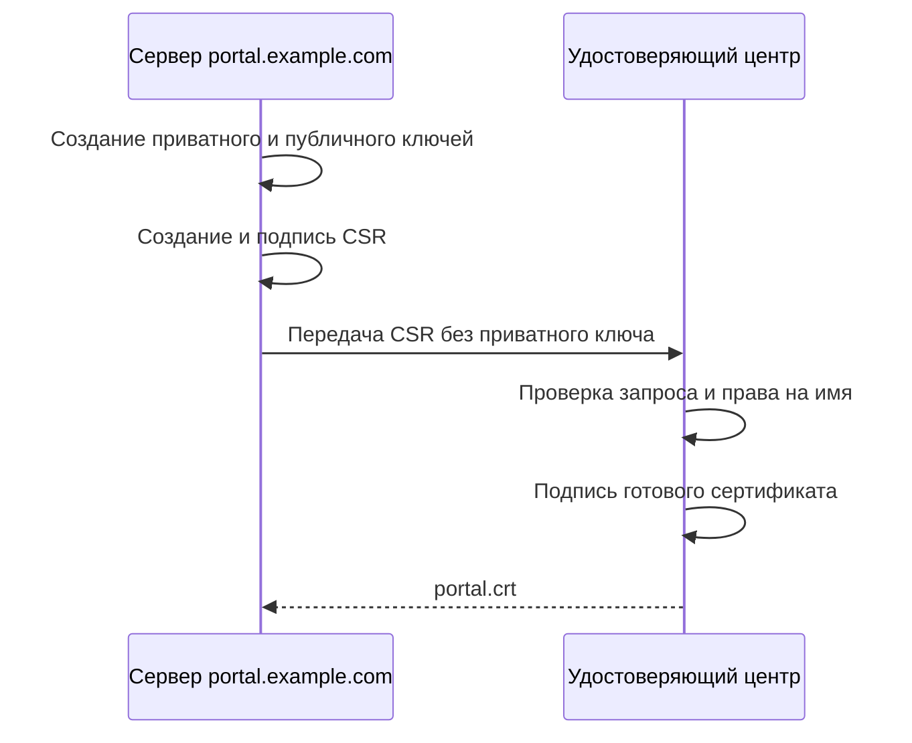
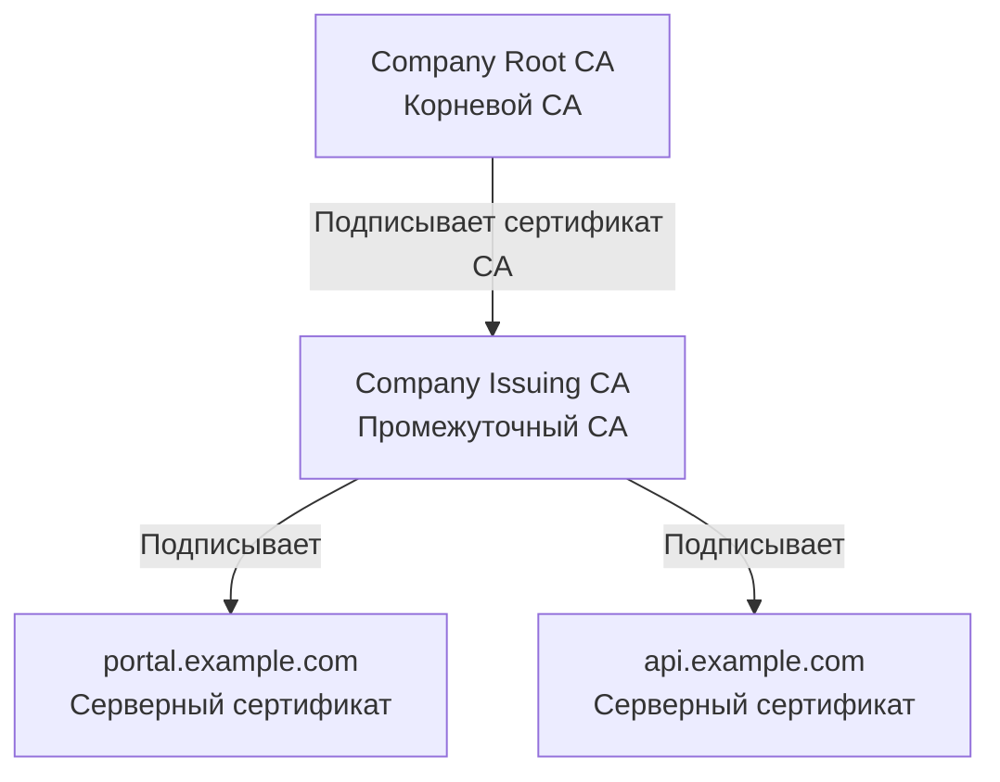
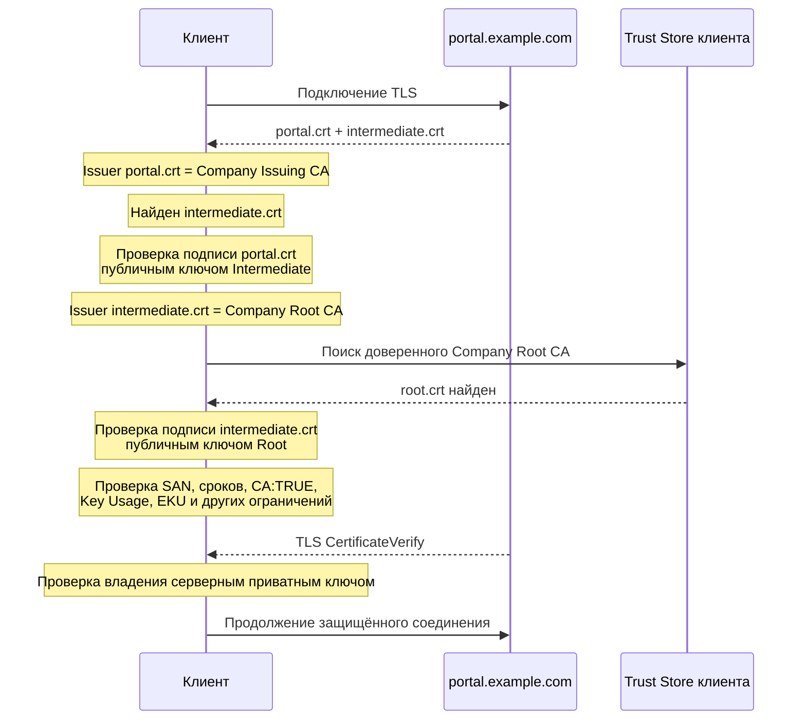
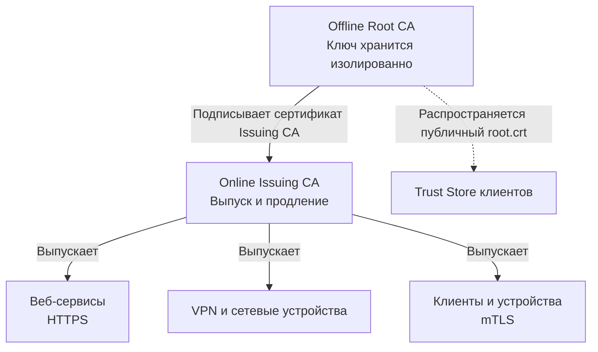

## 1. Зачем нужна PKI

При открытии `https://portal.example.com` клиент должен убедиться, что подключился к нужному серверу, а не к злоумышленнику. **Одного шифрования недостаточно**: можно установить зашифрованное соединение с подставным сервером.

**PKI (Public Key Infrastructure)** — инфраструктура, которая связывает публичные ключи с именами и субъектами с помощью цифровых сертификатов, обеспечивает их выпуск, проверку, распространение и отзыв.

**Основная задача PKI:** дать клиенту возможность проверить, почему определённому публичному ключу можно доверять при подключении к конкретной службе.

## 2. Ключи и сертификаты: основные понятия

### 2.1. Приватный ключ

**Private Key** — секретный криптографический ключ, принадлежащий владельцу. Например, сервер использует его для создания подписи в TLS-рукопожатии.

- Хранится отдельно от сертификата, например в `portal.key`.
- Не должен передаваться клиентам.
- В обычном процессе выдачи по CSR не передаётся удостоверяющему центру.
- При компрометации требуется замена ключа и перевыпуск сертификата.

### 2.2. Публичный ключ

**Public Key** — открытая часть пары. Он может распространяться без сохранения секретности.

Публичный ключ позволяет проверять подписи, созданные соответствующим приватным ключом. В сертификате содержится именно **публичный**, а не приватный ключ.

**Проблема:** любой злоумышленник может создать собственную пару ключей и заявить, что его публичный ключ принадлежит `portal.example.com`. Поэтому необходимо подтверждение связи ключа с именем сервера.

### 2.3. Цифровой сертификат X.509

**Сертификат** — подписанный документ, связывающий публичный ключ с идентификационными данными субъекта.

Упрощённый пример:

```text
Certificate:
  Subject: CN=portal.example.com
  Issuer: CN=Company Issuing CA
  Validity:
    Not Before: 2026-01-01
    Not After: 2026-12-31
  Public Key: ...
  Extensions:
    Subject Alternative Name: DNS:portal.example.com
    Basic Constraints: CA:FALSE
    Key Usage: Digital Signature
    Extended Key Usage: TLS Web Server Authentication
    Authority Key Identifier: ...
  Signature Algorithm: ...
  Signature Value: ...
```

| Поле | Назначение |
|---|---|
| `Subject` | Кому выдан сертификат |
| `Issuer` | Кто выпустил сертификат |
| `Public Key` | Публичный ключ субъекта |
| `Not Before / Not After` | Период действия |
| `Serial Number` | Номер сертификата у издателя |
| `SAN` | DNS-имена и IP-адреса, для которых предназначен сертификат |
| `Basic Constraints` | Является ли субъект удостоверяющим центром |
| `Key Usage` | Разрешённые криптографические операции |
| `Extended Key Usage` | Назначение, например `serverAuth` |
| `Signature Value` | Подпись издателя над подписываемой частью сертификата |

> [!IMPORTANT] Поле Issuer не доказывает подлинность
> Написать `Issuer: Company Root CA` может кто угодно. Клиент должен **найти сертификат издателя и проверить цифровую подпись**, а затем проверить доверие к самому издателю.

### 2.4. Что подписывает удостоверяющий центр

CA подписывает часть сертификата **TBSCertificate** своим приватным ключом. Клиент проверяет подпись публичным ключом CA.

Если проверка успешна, это означает, что подписанные данные соответствуют подписи издателя. Но **само по себе это ещё не означает доверия**.

> [!INFO] Уточнение о цифровой подписи
> Подпись не всегда является «зашифрованным хешем»: реализация зависит от алгоритма RSA, ECDSA, EdDSA и других. Главное — проверка подписи публичным ключом издателя.

## 3. Расширения сертификатов

### 3.1. SAN

**Subject Alternative Name (SAN)** — список имён, на которые распространяется сертификат:

```text
DNS:portal.example.com
DNS:api.example.com
IP:192.0.2.10
```

При открытии `https://portal.example.com` клиент должен проверить соответствие этому имени. Современным HTTPS-клиентам необходим корректный SAN; одного `CN` недостаточно.

### 3.2. Basic Constraints

- `CA:FALSE` — конечный сертификат сервера, пользователя или устройства.
- `CA:TRUE` — сертификат может участвовать в выдаче других сертификатов при выполнении дополнительных условий.

`pathlen:0` у Intermediate CA означает, что ниже него не допускаются обычные дополнительные промежуточные CA, но могут находиться конечные сертификаты. Ограничение относится к числу нижестоящих не самовыданных CA.

### 3.3. Key Usage и Extended Key Usage

**Key Usage:**

- `digitalSignature` — создание цифровых подписей;
- `keyCertSign` — подпись сертификатов удостоверяющим центром;
- `cRLSign` — подпись списков отзыва;
- `keyEncipherment` — операция с ключевым материалом в схемах, где она используется.

**Extended Key Usage (EKU):**

- `serverAuth` — сертификат TLS-сервера;
- `clientAuth` — сертификат TLS-клиента;
- `codeSigning` — подпись кода.

> [!WARNING] CA:TRUE недостаточно
> Чтобы промежуточный сертификат можно было использовать как CA, клиент проверяет также `keyCertSign`, ограничения пути и другие правила. Серверный сертификат с `CA:FALSE` не превращается в CA только потому, что его владелец способен создавать подписи.

### 3.4. SKI и AKI

**Subject Key Identifier (SKI)** — идентификатор публичного ключа самого сертификата.

**Authority Key Identifier (AKI)** — идентификатор ключа издателя.

Они помогают клиенту выбрать подходящий сертификат издателя, особенно если существуют несколько сертификатов CA с похожими именами. **AKI/SKI не заменяют криптографическую проверку подписи.**

## 4. CSR — как запрашивают сертификат

**CSR (Certificate Signing Request)** — запрос, который содержит публичный ключ, сведения о субъекте и подпись заявителя.

Важно различать:

1. **Подпись CSR** подтверждает, что заявитель владеет соответствующим приватным ключом.
2. **Проверка домена** подтверждает, что заявитель управляет требуемым DNS-именем или выполняет другие установленные требования.
3. **Подпись сертификата CA** подтверждает, что CA выпустил сертификат с указанными данными.

Подпись CSR **сама по себе не доказывает право на домен**.



**Пояснение к диаграмме:**

1. Ключи генерируются у владельца сервера.
2. В CSR включается публичный ключ; приватный остаётся у сервера.
3. CA проверяет не только подпись CSR, но и право на запрашиваемое имя.
4. CA возвращает подписанный сертификат, который устанавливается вместе с соответствующим приватным ключом.

### 4.1. Проверка домена через ACME

**DNS-01:** CA требует разместить проверочную TXT-запись в DNS, например `_acme-challenge.portal.example.com`.

**HTTP-01:** CA требует разместить проверочный ответ по адресу `http://portal.example.com/.well-known/acme-challenge/...`.

Эти проверки подтверждают **контроль над требуемым ресурсом**, а не юридическое владение организацией.

### 4.2. Минимальный пример OpenSSL

Создание ключа:

```bash
openssl genpkey -algorithm RSA -pkeyopt rsa_keygen_bits:3072 -out portal.key
```

Создание CSR с SAN:

```bash
openssl req -new -key portal.key -out portal.csr   -subj "/CN=portal.example.com"   -addext "subjectAltName=DNS:portal.example.com"
```

Просмотр запроса:

```bash
openssl req -in portal.csr -noout -text
```

**Результат:** созданы ключ и запрос, но ещё **не** выдан сертификат.

## 5. Архитектура PKI: Root CA, Intermediate CA, Leaf

### 5.1. Root CA — корневой удостоверяющий центр

**Root CA** — верхний центр в иерархии. Его сертификат обычно самоподписан.

Корневой CA может стать **якорем доверия (Trust Anchor)**, если клиент заранее разрешил ему доверять, например через системное хранилище доверенных корней.

> [!IMPORTANT] Самоподпись не создаёт доверие
> Любой человек может создать самоподписанный сертификат. Клиент доверяет Root CA **не потому, что он подписал себя**, а потому, что этот корень **уже находится в доверенной конфигурации клиента**.

В корпоративной PKI приватный ключ Root CA часто хранится офлайн, чтобы снизить риск компрометации.

### 5.2. Intermediate CA — промежуточный удостоверяющий центр

**Intermediate CA** — центр, сертификат которого подписан вышестоящим CA. Он может выпускать сертификаты серверов и устройств.

Зачем нужен:

- Не требуется постоянно использовать приватный ключ Root CA.
- Можно разделить выпуск сертификатов по назначению.
- При компрометации промежуточного CA его можно заменить, не меняя корневой якорь.

**Важно:** при компрометации Intermediate CA затронутые конечные сертификаты обычно требуется перевыпустить через новый CA.

### 5.3. Leaf — конечный сертификат

**End-Entity (Leaf) Certificate** — сертификат сервера, пользователя или устройства.

Например, сертификат `portal.example.com` предназначен для подтверждения личности веб-сервера и **не предназначен для выпуска других сертификатов**.

### 5.4. Пример архитектуры



**Пояснение к диаграмме:** стрелки означают, **чьим приватным ключом подписан сертификат нижестоящего субъекта**. Это не сетевые соединения и не маршрут HTTPS-трафика.

## 6. Что такое цепочка доверия

**Цепочка доверия (Certificate Chain)** — последовательность сертификатов от конечного сертификата до доверенного якоря, в которой подпись каждого нижестоящего сертификата проверяется публичным ключом его издателя.

Для нашего примера:

| Сертификат | Subject | Issuer | Ключ, которым создана подпись |
|---|---|---|---|
| `portal.crt` | `portal.example.com` | `Company Issuing CA` | Приватный ключ Intermediate CA |
| `intermediate.crt` | `Company Issuing CA` | `Company Root CA` | Приватный ключ Root CA |
| `root.crt` | `Company Root CA` | `Company Root CA` | Приватный ключ Root CA |

**Почему нужна цепочка?**

Клиент не обязан заранее знать каждый Intermediate CA и каждый сервер. Достаточно иметь заранее доверенный Root CA, а затем **проверить путь подписей** от сервера к этому корню.

Но здесь есть две отдельные задачи:

- **Построение цепочки:** найти подходящие сертификаты издателей.
- **Проверка цепочки:** убедиться, что подписи верны, ограничения соблюдены, а путь заканчивается доверенным якорем.

Найденная цепочка может оказаться недействительной.

## 7. Как клиент строит и проверяет цепочку: пошаговый разбор

**Исходные данные:**

- Пользователь открывает `https://portal.example.com`.
- Сервер отправляет `portal.crt` и `intermediate.crt`.
- У клиента в Trust Store уже есть `root.crt`.
- Клиент **не имеет** приватных ключей CA, они ему не нужны.

### Шаг 1. Получение сертификатов

Во время TLS-рукопожатия сервер передаёт:

```text
portal.crt
intermediate.crt
```

Корневой сертификат обычно не передают: он уже должен быть доверен клиенту.

### Шаг 2. Поиск издателя серверного сертификата

Клиент читает:

```text
portal.crt:
  Subject = portal.example.com
  Issuer  = Company Issuing CA
```

Теперь он ищет сертификат с подходящим `Subject`:

```text
intermediate.crt:
  Subject = Company Issuing CA
  Issuer  = Company Root CA
```

Клиент может учитывать AKI/SKI для выбора кандидата.

**Совпадение имён — только подсказка.** Оно ещё не доказывает, что этот Intermediate действительно подписал `portal.crt`.

### Шаг 3. Проверка подписи серверного сертификата

Клиент берёт:

1. Подписанную часть `portal.crt`.
2. Подпись `portal.crt`.
3. **Публичный ключ из `intermediate.crt`.**

Затем проверяет цифровую подпись.

Если проверка успешна, клиент установил, что `portal.crt` был подписан ключом, соответствующим публичному ключу Intermediate CA.

**Но доверие ещё не установлено:** пока не доказано, что самому Intermediate CA можно доверять.

### Шаг 4. Поиск издателя Intermediate CA

Клиент читает:

```text
intermediate.crt:
  Issuer = Company Root CA
```

Находит в доверенном хранилище:

```text
root.crt:
  Subject = Company Root CA
```

И проверяет подпись `intermediate.crt` **публичным ключом из `root.crt`**.

Теперь подтверждены две криптографические связи:

- Root CA подписал сертификат Intermediate CA.
- Intermediate CA подписал сертификат сервера.

### Шаг 5. Проверка доверенного корня

Клиент определяет, разрешён ли найденный Root CA как **Trust Anchor**.

Если `root.crt` **есть в доверенном хранилище** и разрешён политикой клиента, путь может быть доверенным.

Если `root.crt` **нет**, правильные подписи не помогут: путь не заканчивается доверенным якорем.

> [!IMPORTANT] Почему клиент доверяет корню
> Корневой сертификат доверен **не из-за своей самоподписи**, а из-за предварительной настройки доверия в ОС, браузере или приложении.

### Шаг 6. Проверка правил и ограничений

Клиент проверяет не только подписи:

- **Сроки действия** сертификатов.
- **SAN** — сертификат сервера должен соответствовать `portal.example.com`.
- **Basic Constraints** — промежуточный сертификат должен быть допустимым CA.
- **Key Usage** — CA должен иметь право подписывать сертификаты (`keyCertSign`).
- **Extended Key Usage** — сертификат сервера должен подходить для TLS-сервера.
- **Path Length** — число уровней CA не должно превышать ограничение.
- **Другие ограничения** — например, Name Constraints и политики сертификатов.
- **Статус отзыва**, если этого требует политика проверки и поддерживает реализация.

### Шаг 7. Проверка владения приватным ключом сервером

Сертификат публичен, его может скопировать кто угодно.

Поэтому в TLS 1.3 сервер отправляет сообщение **CertificateVerify**, содержащее подпись данных рукопожатия приватным ключом серверного сертификата.

Клиент проверяет её **публичным ключом из `portal.crt`**.

Таким образом клиент убеждается, что участник соединения владеет приватным ключом, соответствующим предъявленному сертификату.

### 7.1. Полная схема проверки



**Пояснение к диаграмме:**

1. Сервер передаёт публичные сертификаты, не приватные ключи.
2. Клиент проверяет серверный сертификат публичным ключом Intermediate CA.
3. Затем проверяет Intermediate CA публичным ключом Root CA.
4. Корневое доверие берётся из **собственного** Trust Store клиента.
5. Проверяются ограничения сертификатов и соответствие имени сервера.
6. Сервер отдельно доказывает владение приватным ключом.

## 8. Откуда берутся сертификаты для построения цепочки

Клиент может получить сертификаты издателей:

1. Из TLS-сообщения сервера.
2. Из локального хранилища или кэша.
3. В некоторых реализациях — загрузить по ссылке **AIA (Authority Information Access)**, если такая загрузка разрешена.

**AIA помогает найти сертификат, но не делает его доверенным.**

### 8.1. Сервер отправляет только `portal.crt`

Клиент видит `Issuer = Company Issuing CA`, но не имеет `intermediate.crt` и не может найти его другим способом.

**Результат:** путь до доверенного корня построить не удаётся.

### 8.2. Сервер отправляет `portal.crt` + `intermediate.crt`

Клиент имеет нужное промежуточное звено и может проверить цепочку до Root CA в своём хранилище.

### 8.3. Сервер отправляет ещё и `root.crt`

Передача корневого сертификата **не делает его доверенным**. Если клиент заранее не доверяет этому корню, соединение остаётся недоверенным.

### 8.4. Что такое `fullchain.pem`

Обычно файл содержит:

```text
fullchain.pem:
  portal.crt
  intermediate.crt
```

Если промежуточных CA несколько, включают необходимые промежуточные сертификаты. Root CA обычно не включают.

**`fullchain.pem` — набор сертификатов для построения цепочки, а не готовое доказательство доверия.**

## 9. Почему цепочка может не пройти проверку

| Ситуация | Причина отказа |
|---|---|
| Неизвестный Root CA | Нет доверенного якоря |
| Отсутствует Intermediate CA | Невозможно построить путь |
| Неверная подпись | Криптографическая связь не подтверждена |
| Истёк срок сертификата | Нарушены временные ограничения |
| В SAN другое имя | Сертификат не соответствует запрошенному серверу |
| Intermediate имеет `CA:FALSE` | Не разрешено выступать CA |
| Нет `keyCertSign` у CA | Ключ не предназначен для подписи сертификатов |
| Нарушен `pathLen` | Превышена разрешённая глубина CA |
| Сертификат отозван | Может быть отклонён по политике проверки отзыва |
| Сервер не владеет приватным ключом | Не проходит подтверждение владения ключом |

**Пример:** сертификат `portal.example.com` подписан правильным Intermediate CA, а тот — доверенным Root CA. Но в SAN указан только `api.example.com`. **Результат — ошибка имени**, несмотря на правильную цепочку подписей.

## 10. Как PKI участвует в TLS

PKI обеспечивает **доверие к ключу сервера**. TLS использует сертификат для аутентификации и создаёт ключи защиты трафика.

Упрощённый порядок полного TLS 1.3-рукопожатия:

1. `ClientHello` — параметры TLS и данные обмена ключами.
2. `ServerHello` — выбор параметров и ответные данные обмена ключами.
3. Стороны вычисляют общий секрет и производные ключи для защиты рукопожатия.
4. `Certificate` — сервер отправляет свой сертификат и промежуточные сертификаты.
5. `CertificateVerify` — сервер подписывает данные рукопожатия приватным ключом сертификата.
6. `Finished` — проверка целостности рукопожатия.
7. Передача данных приложения с симметричным шифрованием.

> [!INFO] Не путать роли ключей
> В современном TLS 1.3 публичный ключ сертификата **не шифрует весь HTTPS-трафик**. Сертификат подтверждает личность сервера; ключи для шифрования трафика обычно выводятся из обмена (EC)DHE.

## 11. Trust Store — кто назначает доверие

**Trust Store** — хранилище доверенных корневых сертификатов и якорей доверия.

Публичные ОС и браузеры содержат наборы корней, выбранные соответствующими программами доверия.

Для собственного корпоративного Root CA необходимо **заранее распространить его публичный сертификат** среди клиентов, например через:

- GPO для управляемых Windows-компьютеров;
- системные механизмы доверия Linux;
- настройки контейнеров;
- отдельные CA-bundle приложений.

Не все приложения используют одно и то же хранилище.

> [!WARNING] Установка корневого CA — решение о доверии
> Не следует импортировать неизвестный корневой сертификат только ради устранения предупреждения браузера. Это может разрешить неизвестному CA удостоверять серверы.

## 12. Отзыв сертификатов: CRL и OCSP

**Отзыв** позволяет объявить сертификат недействительным до истечения его срока, например при компрометации приватного ключа.

**CRL (Certificate Revocation List)** — подписанный CA список отозванных сертификатов.

**OCSP (Online Certificate Status Protocol)** — механизм получения статуса сертификата от респондера (`good`, `revoked`, `unknown`).

Проверка отзыва зависит от приложения и политики. **Не каждый браузер при каждом подключении обязательно скачивает CRL или делает OCSP-запрос.**

Для корпоративной PKI важно обеспечить доступность сведений об отзыве и определить, как клиент действует при невозможности их проверить.

## 13. Проверка сертификатов через OpenSSL

Предположим, есть файлы:

```text
portal.crt        — сертификат сервера
intermediate.crt  — промежуточный CA
root.crt          — доверенный корень
```

### 13.1. Просмотр сертификата

```bash
openssl x509 -in portal.crt -noout -text
```

### 13.2. Проверка цепочки и имени

```bash
openssl verify   -CAfile root.crt   -untrusted intermediate.crt   -purpose sslserver   -verify_hostname portal.example.com   portal.crt
```

**Параметры:**

- `-CAfile root.crt` — корень, которому доверяем при этой проверке.
- `-untrusted intermediate.crt` — сертификат издателя, используемый для построения пути, **но не назначенный доверенным корнем**.
- `-purpose sslserver` — проверка назначения для TLS-сервера.
- `-verify_hostname` — проверка имени.
- `portal.crt` — проверяемый сертификат.

При успехе обычно выводится:

```text
portal.crt: OK
```

**Ограничение:** `OK` не доказывает, что работающий сервер владеет приватным ключом. Проверка статуса отзыва также требует отдельной настройки.

### 13.3. Что будет без Intermediate

```bash
openssl verify -CAfile root.crt portal.crt
```

Если промежуточный сертификат недоступен и OpenSSL не может найти его другим разрешённым способом, построение цепочки завершится ошибкой.

### 13.4. Какие сертификаты реально передаёт сервер

```bash
openssl s_client   -connect portal.example.com:443   -servername portal.example.com   -showcerts
```

Для проверки имени и цепочки с указанным корнем:

```bash
openssl s_client   -connect portal.example.com:443   -servername portal.example.com   -CAfile root.crt   -verify_hostname portal.example.com   -verify_return_error
```

## 14. Архитектура собственной корпоративной PKI

Типовая схема для инфраструктуры с большим числом сервисов:



**Пояснение к диаграмме:**

1. Root CA хранится изолированно и редко используется.
2. Issuing CA регулярно выпускает конечные сертификаты.
3. Клиенты получают **публичный сертификат** Root CA в доверенное хранилище.
4. Приватный ключ Root CA не передаётся ни клиентам, ни Issuing CA.
5. Клиенты проверяют цепочки сертификатов до доверенного корня.

### 14.1. Почему разделяют Root CA и Issuing CA

При компрометации постоянно работающего Issuing CA можно отозвать его сертификат и создать новый Intermediate, сохранив корневой якорь доверия.

**Однако** сертификаты, выданные скомпрометированным CA, обычно потребуется перевыпустить.

### 14.2. Что автоматизировать

- Выпуск и продление сертификатов.
- Контроль сроков действия.
- Доставку сертификатов сервисам.
- Учёт владельцев сертификатов.
- Защиту приватных ключей.
- Отзыв и распространение статуса.

Конкретные инструменты и развёртывание CA рассматриваются в отдельных заметках.

## 15. Частые ошибки понимания

**«Сертификат подписан — значит, доверен».** Нет. Требуется путь до доверенного якоря и проверка ограничений.

**«Корень доверен, потому что сам себя подписал».** Нет. Доверие назначено клиентом заранее.

**«Issuer совпадает с Subject другого сертификата — значит, цепочка правильная».** Нет. Нужна криптографическая проверка подписи.

**«Сервер обязан передавать Root CA».** Обычно нет. Корень должен быть в Trust Store клиента.

**«CSR доказывает право на домен».** Нет. Он доказывает владение соответствующим приватным ключом; право на домен проверяется отдельно.

**«Сертификат шифрует весь HTTPS-трафик».** Нет. В TLS 1.3 сертификат используется для аутентификации, а данные шифруются симметричными ключами сеанса.

**«Если Intermediate CA отозван, ранее выданные сертификаты продолжают работать без изменений».** Не следует на это рассчитывать: затронутые сертификаты нужно перевыпускать.

## Вопросы для самопроверки

1. Почему публичного ключа недостаточно для подтверждения личности сервера?
2. Чем CSR отличается от сертификата?
3. Кто подписывает CSR и кто подписывает сертификат?
4. Что означает поле Issuer?
5. Почему совпадения Subject и Issuer недостаточно?
6. Каким ключом проверяется подпись серверного сертификата?
7. Каким ключом проверяется подпись Intermediate CA?
8. Почему самоподписанный Root CA не становится автоматически доверенным?
9. Откуда клиент получает Intermediate CA?
10. Что произойдёт, если Root CA отсутствует в Trust Store?
11. Чем построение цепочки отличается от её проверки?
12. Почему `fullchain.pem` не гарантирует доверие?
13. Какие ограничения проверяются помимо подписей?
14. Зачем TLS-сервер подтверждает владение приватным ключом?
15. Что происходит при компрометации Intermediate CA?

## Итоги — что было разобрано

- Сертификат связывает публичный ключ с именем или субъектом.
- CSR и сертификат имеют разные назначения и разные подписи.
- Root CA, Intermediate CA и конечный сертификат образуют иерархию.
- Клиент **строит цепочку**, находя сертификаты издателей, и **проверяет её**, последовательно проверяя подписи и ограничения.
- Доверие к корню определяется Trust Store, а не самоподписью.
- Сервер дополнительно подтверждает владение приватным ключом в TLS.
- PKI требует управления сроками действия, отзывом и безопасностью ключей.

---

## Теги

#PKI #Криптография #X509 #ЦифровыеСертификаты #CertificateChain #ChainOfTrust #TrustAnchor #RootCA #IntermediateCA #CSR #SAN #TLS #HTTPS #OpenSSL #CRL #OCSP #DevSecOps
