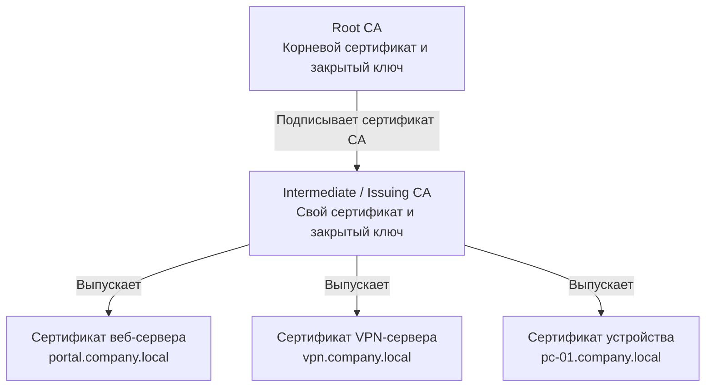
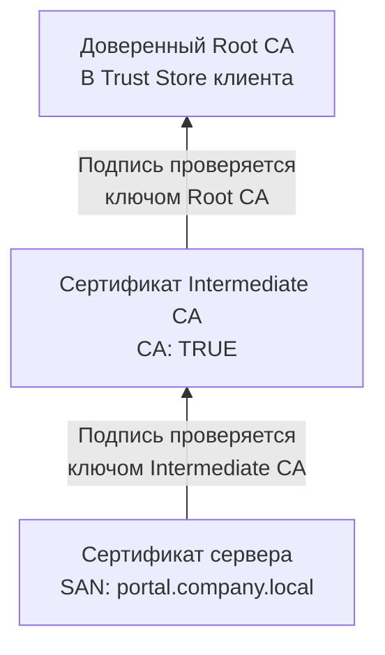
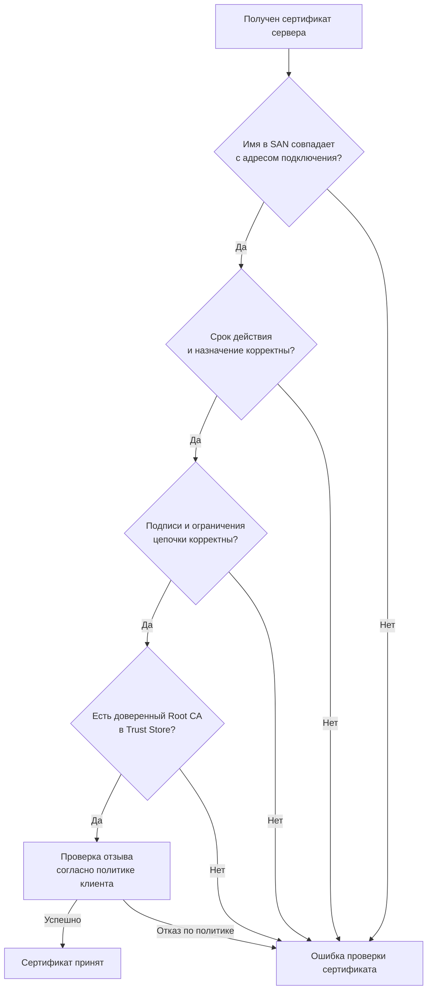
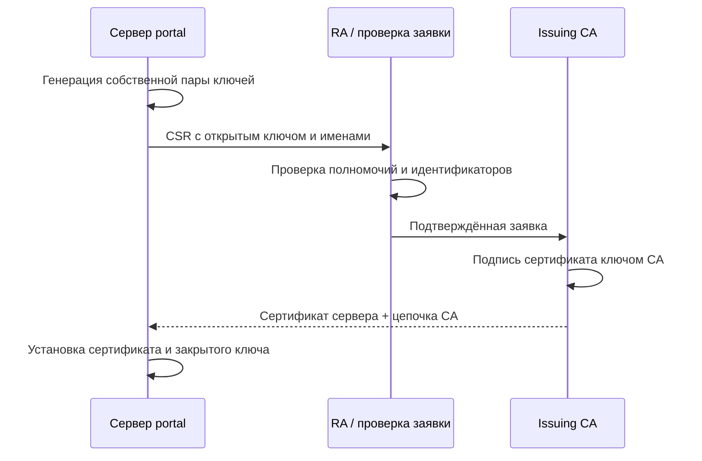
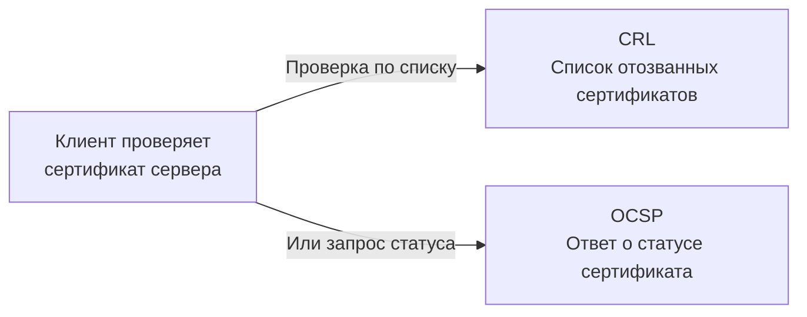
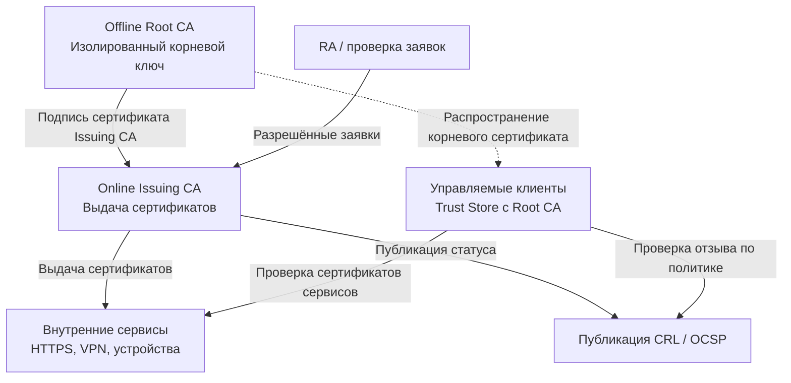

## 1. Что такое PKI и какую задачу она решает

**PKI (Public Key Infrastructure, инфраструктура открытых ключей)** — совокупность удостоверяющих центров, сертификатов, ключей, правил и процессов, позволяющая проверять, кому принадлежит открытый ключ и можно ли ему доверять.

Пример: сотрудник открывает `https://portal.company.local`. Сервер предъявляет сертификат, а браузер проверяет, что сертификат относится к этому имени, действителен и выдан удостоверяющим центром, которому браузер доверяет.

PKI **не шифрует весь трафик сама по себе**. Она обеспечивает основу доверия к ключам. Например, TLS использует сертификаты для аутентификации сервера, а затем устанавливает защищённое соединение.

> [!INFO] Основной вопрос PKI
> Не просто «какой открытый ключ использовать?», а **«почему можно считать, что этот открытый ключ действительно принадлежит нужному серверу или пользователю?»**

## 2. Открытый и закрытый ключи

При асимметричной криптографии используется пара ключей:

- **Закрытый ключ (private key)** — хранится в секрете у владельца. В типичном сценарии TLS сервер использует его для доказательства владения ключом.
- **Открытый ключ (public key)** — может передаваться другим сторонам. Он помещается в сертификат.

Сертификат не содержит закрытый ключ. Если закрытый ключ сервера украден, злоумышленник может попытаться выдать себя за этот сервер даже при наличии корректного сертификата.

### 2.1. Почему недостаточно просто опубликовать открытый ключ

Представим, что клиент получает открытый ключ от неизвестного источника. Он не знает, принадлежит ли этот ключ настоящему `portal.company.local` или злоумышленнику.

**Цифровой сертификат** связывает идентификатор владельца (например, DNS-имя) с открытым ключом. Удостоверяющий центр (CA) подписывает сертификат своим закрытым ключом. Клиент проверяет подпись с помощью открытого ключа CA.

> [!IMPORTANT] Подпись не означает, что сервер безопасен
> Сертификат подтверждает определённую привязку ключа к идентификатору согласно правилам выпуска. Он не гарантирует отсутствие уязвимостей, вредоносного кода или правильность настроек приложения.

## 3. Основные компоненты PKI

| Компонент | Назначение |
|---|---|
| **Root CA** | Корневой удостоверяющий центр, верхняя точка доверия |
| **Intermediate CA** | Промежуточный CA, которому Root CA разрешил выпускать сертификаты в установленных пределах |
| **Issuing CA** | CA, непосредственно выпускающий сертификаты конечным субъектам; часто является Intermediate CA |
| **End-entity certificate** | Сертификат сервера, пользователя или устройства |
| **Trust Store** | Хранилище доверенных корневых сертификатов клиента |
| **CSR** | Certificate Signing Request — запрос на выпуск сертификата |
| **RA** | Registration Authority — компонент или процедура проверки заявителя перед выпуском |
| **CRL / OCSP** | Механизмы получения информации об отзыве сертификатов |
| **HSM** | Аппаратный модуль для защищённого хранения и использования криптографических ключей |

**CA — не обязательно отдельный физический сервер.** Это роль и набор криптографических функций. Но для защиты ключей и разграничения ответственности удостоверяющие центры часто размещают отдельно.

## 4. Архитектура Root CA и Intermediate CA

В инфраструктуре организации обычно используют **двухуровневую PKI**:

1. **Root CA** — создаёт корневой сертификат и подписывает сертификаты промежуточных CA.
2. **Issuing / Intermediate CA** — подписывает сертификаты серверов, пользователей и устройств.



**Как читать диаграмму:**

1. Корневой CA не должен подписывать каждый серверный сертификат непосредственно.
2. Он подписывает сертификат промежуточного CA, тем самым делегируя ему право выпуска сертификатов в рамках ограничений.
3. Промежуточный CA подписывает сертификаты конкретных серверов и устройств.
4. Стрелки означают **криптографическую подпись сертификата**, а не передачу закрытого ключа: закрытый ключ Root CA остаётся у Root CA, а ключ Intermediate CA — у Intermediate CA.

### 4.1. Почему Root CA часто держат Offline

**Offline Root CA** — корневой CA, который в обычном режиме выключен и изолирован от сети. Его включают для ограниченного набора операций, например выпуска или обновления промежуточного CA и публикации необходимых данных об отзыве.

Преимущества:

- меньше возможностей украсть корневой закрытый ключ через сеть;
- повседневная выдача сертификатов не требует доступа к Root CA;
- компрометация Intermediate CA не обязательно означает компрометацию корневого ключа.

Но Offline Root CA **не освобождает** от резервного копирования ключей, контроля доступа, процедур восстановления и своевременной публикации CRL, если она используется.

## 5. Что находится в сертификате X.509

Сертификат X.509 обычно содержит:

| Поле | Что означает |
|---|---|
| **Subject** | Сведения о субъекте сертификата |
| **Subject Alternative Name (SAN)** | Имена DNS, IP-адреса или другие идентификаторы, для которых действует сертификат |
| **Issuer** | Кто выпустил сертификат |
| **Public Key** | Открытый ключ субъекта |
| **Not Before / Not After** | Период действия |
| **Serial Number** | Серийный номер, назначенный CA |
| **Basic Constraints** | Может ли субъект выступать в роли CA |
| **Key Usage** | Разрешённые криптографические назначения ключа |
| **Extended Key Usage (EKU)** | Назначения сертификата, например TLS Server Authentication |
| **Signature** | Подпись сертификата ключом издателя |

Для современного TLS-сервера имя `portal.company.local` должно присутствовать в **SAN**. Наличие похожего имени только в `Subject CN` не следует считать достаточным.

> [!WARNING] Не путать ключи и сертификаты
> У Root CA, Intermediate CA и веб-сервера **разные пары ключей**. CA подписывает сертификат сервера **своим** закрытым ключом, но не получает и не должен хранить закрытый ключ веб-сервера при обычной генерации CSR на стороне сервера.

## 6. Цепочка доверия: что именно проверяет клиент

Предположим, браузер открывает `https://portal.company.local`.

Сервер предъявляет свой сертификат и обычно промежуточные сертификаты. Корневой сертификат заранее находится в доверенном хранилище клиента.



**Как читать диаграмму:**

1. Клиент начинает с сертификата сервера.
2. Проверяет подпись серверного сертификата открытым ключом Intermediate CA.
3. Затем проверяет подпись сертификата Intermediate CA открытым ключом Root CA.
4. Убеждается, что Root CA является **доверенным якорем** (trust anchor) в его хранилище доверия.
5. Проверка подписи — только часть проверки: отдельно оцениваются имя сервера, срок действия, назначения ключей, ограничения CA и применимая политика отзыва.

**Важное различие:** Root CA не становится доверенным только потому, что он подписал сам себя. **Самоподписанный сертификат Root CA должен быть явно принят клиентом как доверенный** — например, установлен администратором в корпоративное хранилище.

### 6.1. Как клиент принимает решение



**Пояснение:** схема показывает **логические условия**, а не точный порядок внутренних функций каждого браузера. Проверка отзыва может отличаться между клиентами и конфигурациями: некоторые допускают продолжение работы, если сведения об отзыве недоступны, другие запрещают.

### 6.2. Что происходит при отсутствии Intermediate CA

Если сервер передаёт только собственный сертификат, а клиент не имеет сертификата промежуточного CA, он может не суметь построить цепочку доверия. Некоторые клиенты умеют получать недостающий сертификат по AIA, но **полагаться на это нельзя**.

Практическое правило: серверу обычно следует передавать **сертификат сервера вместе с необходимыми промежуточными сертификатами**, а не только один leaf-сертификат. Корневой сертификат обычно не требуется отправлять сервером.

## 7. Как выпускается сертификат

Предположим, администратору нужен TLS-сертификат для `portal.company.local`.



**Пояснение:**

1. Сервер генерирует закрытый и открытый ключи.
2. В CSR передаётся **открытый**, а не закрытый ключ; запрос обычно подписывается ключом заявителя.
3. RA или соответствующий процесс проверяет, разрешено ли заявителю получить сертификат для данного имени.
4. Issuing CA подписывает сертификат и возвращает его.
5. Сервер устанавливает сертификат вместе со **своим исходным закрытым ключом**.
6. Клиенты смогут доверять сертификату, только если цепочка ведёт к доверенному для них Root CA и проходит необходимые проверки.

> [!IMPORTANT] CSR не является сертификатом
> CSR — запрос на выпуск. Он сам по себе не подтверждает, что имя принадлежит заявителю. Проверка прав на имя и политика выпуска — ответственность инфраструктуры CA/RA.

## 8. Корпоративная и публичная PKI

**Публичная PKI** использует CA, корневые сертификаты которых уже включены в доверенные хранилища распространённых браузеров и операционных систем.

**Частная PKI** создаётся организацией. Её корневой сертификат необходимо доставить на устройства, которым следует доверять внутренним сервисам.

Пример:

- `portal.company.local` использует сертификат от корпоративного Intermediate CA;
- корпоративные компьютеры доверяют Root CA через управляемое хранилище;
- личный ноутбук без установленного корпоративного Root CA не будет автоматически доверять сертификату.

**Установка корневого сертификата — серьёзное действие:** такой Root CA может стать доверенным издателем для множества имён и служб в пределах правил клиентской платформы. Поэтому распространение доверия должно быть контролируемым.

## 9. Отзыв сертификатов: зачем он нужен

Сертификат может оставаться формально действительным по дате, хотя его закрытый ключ уже скомпрометирован. В этом случае сертификат необходимо **отозвать**.

Основные механизмы:

- **CRL (Certificate Revocation List)** — подписанный CA список отозванных сертификатов.
- **OCSP (Online Certificate Status Protocol)** — запрос статуса отдельного сертификата у соответствующего ответчика.



**Пояснение:** это **альтернативные механизмы получения сведений**, а не обязательное последовательное обращение сначала к CRL, затем к OCSP. Конкретное поведение зависит от клиента, сертификата и политики проверки.

> [!WARNING] Отзыв не равен удалению сертификата
> Удаление файла сертификата с одного сервера не сообщает другим клиентам, что сертификат больше нельзя принимать. Для этого требуется механизм распространения статуса отзыва и его проверка клиентами.

## 10. Сроки действия и обновление сертификатов

Сертификаты имеют ограниченный срок действия. В инфраструктуре нужно отдельно планировать:

- выпуск и обновление серверных сертификатов;
- обновление сертификатов Intermediate CA;
- обновление Root CA и распространение доверия;
- контроль сроков действия и уведомления;
- процедуру отзыва при компрометации ключей.

**Обновление сертификата не обязательно означает смену ключевой пары**, но регулярная ротация ключей может требоваться политикой безопасности. Следует различать перевыпуск сертификата, смену ключа и замену удостоверяющего центра.

## 11. Типичные архитектурные ошибки

| Ошибка | Почему это проблема |
|---|---|
| Root CA постоянно доступен по сети | Увеличивается поверхность атаки на самый важный закрытый ключ |
| Root CA выпускает все серверные сертификаты напрямую | Сложнее изолировать корневой ключ и делегировать выпуск |
| Один закрытый ключ используется на множестве несвязанных серверов | Компрометация одного сервера затрагивает другие |
| Веб-сервер не отправляет Intermediate CA | Клиент может не построить цепочку |
| Корневой сертификат не установлен у клиентов | Цепочка не завершается доверенным якорем |
| В сертификате нет нужного SAN | Проверка имени сервера завершается ошибкой |
| Нет контроля CRL/OCSP и сроков действия | Отозванные или просроченные сертификаты могут создавать сбои и риски |
| Закрытые ключи CA хранятся без защиты и резервирования | Возможны компрометация и невосстановимая потеря инфраструктуры |

## 12. Базовая проверка сертификата OpenSSL

Просмотр сертификата в файле:

```bash
openssl x509 -in server.crt -noout -text
```

Проверка дат:

```bash
openssl x509 -in server.crt -noout -dates
```

Просмотр SAN:

```bash
openssl x509 -in server.crt -noout -ext subjectAltName
```

Просмотр сертификатов, которые отдаёт TLS-сервер:

```bash
openssl s_client -connect portal.company.local:443 \
  -servername portal.company.local -showcerts
```

**Важно:** `-showcerts` показывает предоставленные сервером сертификаты, но **не гарантирует**, что проверка имени и цепочки завершилась успешно. Для строгой проверки следует явно задать доверенный CA и проверку имени, например:

```bash
openssl s_client -connect portal.company.local:443 \
  -servername portal.company.local \
  -CAfile root-ca.crt \
  -verify_hostname portal.company.local \
  -verify_return_error
```

В примере `root-ca.crt` — доверенный корневой сертификат организации, а не закрытый ключ. Проверка отзыва требует дополнительных параметров и инфраструктуры; приведённая команда не гарантирует проверку CRL/OCSP.

## 13. Пример целевой архитектуры внутренней PKI

Для организации с внутренними веб-сервисами, VPN и устройствами разумна следующая базовая схема:

- **Offline Root CA** — изолирован, используется редко.
- **Online Issuing CA** — выпускает сертификаты по утверждённой политике.
- **RA / механизм проверки заявок** — проверяет полномочия на получение сертификатов.
- **Хранилища доверия клиентов** — содержат корпоративный корневой сертификат.
- **Публикация CRL / OCSP** — обеспечивает доступность информации об отзыве согласно принятой политике.
- **Мониторинг** — контролирует сроки действия сертификатов, доступность CA и публикацию статусов отзыва.



**Пояснение к диаграмме:**

1. Root CA выдаёт сертификат промежуточному CA и не участвует в обычных TLS-соединениях.
2. RA проверяет заявки; Issuing CA выпускает сертификаты.
3. Сервисы устанавливают свои сертификаты и собственные закрытые ключи.
4. Клиенты доверяют корневому сертификату, доставленному управляемым способом.
5. Клиенты проверяют сертификаты сервисов и, если предусмотрено политикой, обращаются к информации об отзыве.
6. Пунктирная стрелка означает **доставку публичного корневого сертификата**, а не передачу закрытого ключа Root CA.

## Вопросы для самопроверки

1. Какую проблему решает PKI, если открытый ключ и так можно передать по сети?
2. Чем сертификат отличается от закрытого ключа?
3. Почему самоподписанный Root CA не становится автоматически доверенным?
4. Зачем отделять Root CA от Issuing CA?
5. Как клиент проверяет подпись серверного сертификата?
6. Почему сертификат с корректной подписью всё ещё может быть отклонён?
7. Что такое SAN и зачем он нужен?
8. Почему серверу обычно нужно передавать Intermediate CA?
9. Что содержится в CSR и что должен проверить RA?
10. Чем CRL отличается от OCSP?
11. Почему отзыв сертификата не равен удалению его файла?
12. Почему установка корпоративного Root CA на клиент — действие с последствиями для безопасности?

## Итоги — что было разобрано

- PKI связывает открытые ключи с проверяемыми идентификаторами.
- Root CA выступает доверенным якорем, Intermediate CA выпускает сертификаты служб.
- Цепочка доверия строится через проверку подписей и завершается доверенным корнем.
- Клиент дополнительно проверяет имя, срок, назначение и другие ограничения сертификата.
- CSR используется для запроса сертификата; закрытый ключ сервера обычно остаётся на сервере.
- CRL и OCSP позволяют получать сведения об отзыве.
- Внутренняя PKI требует защищённых ключей CA, распространения доверия, контроля выпуска и мониторинга.

## Связанные заметки

Связанные заметки по криптографии, TLS, сертификатам и управлению CA следует добавить после подтверждения их точных путей в актуальной структуре базы знаний.

---

## Теги

#PKI #Криптография #X509 #RootCA #IntermediateCA #IssuingCA #ЦепочкаДоверия #TrustStore #CSR #SAN #CRL #OCSP #TLS #DevSecOps #ИнфраструктураОткрытыхКлючей
