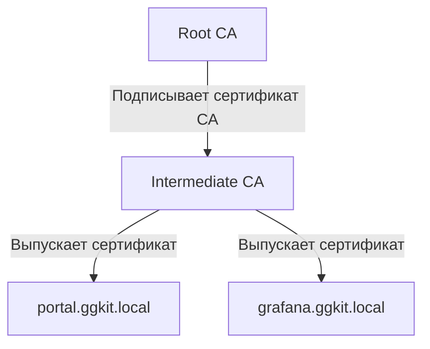
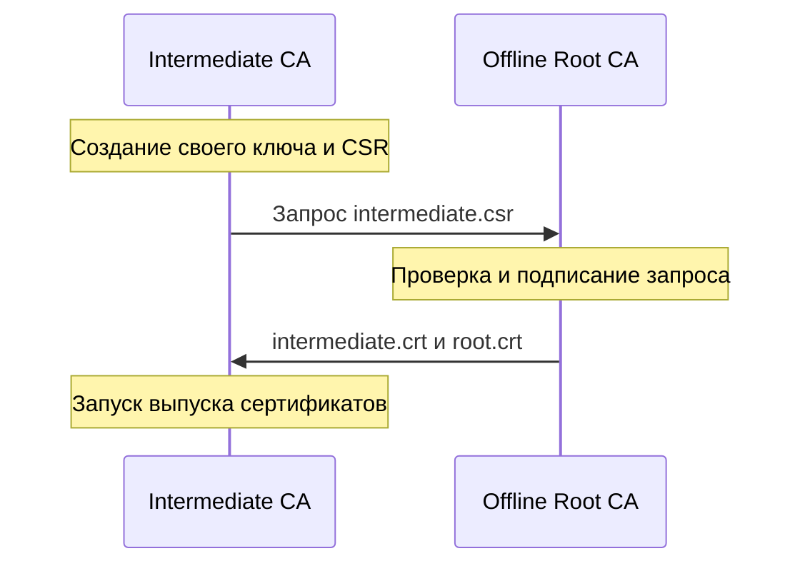
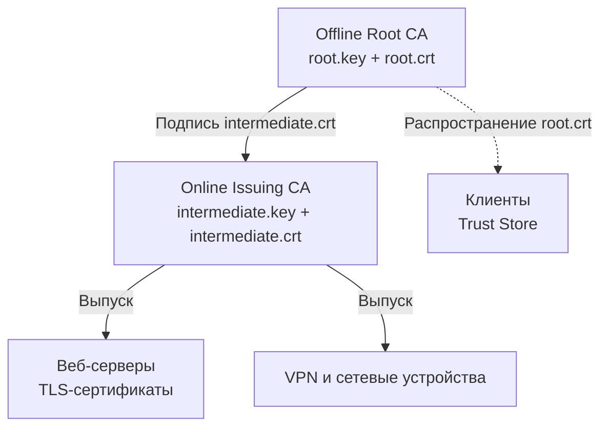
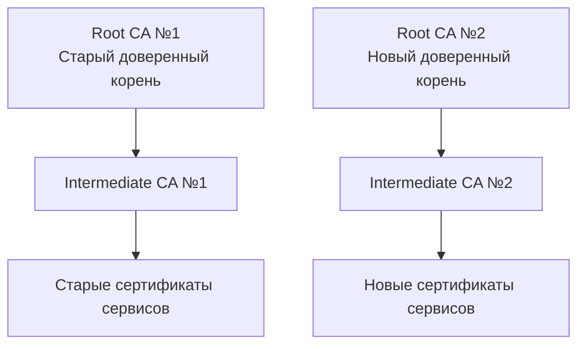

## 1. Зачем нужны два удостоверяющих центра

**Root CA** — корневой удостоверяющий центр. **Intermediate CA** — промежуточный удостоверяющий центр, которому Root CA разрешил выпускать сертификаты.

Технически можно выпускать все сертификаты одним Root CA. Но тогда его приватный ключ приходится регулярно использовать на работающем сервере. Если этот ключ украдут, под угрозой окажется вся система доверия.

Поэтому в организации обычно разделяют две роли: Root CA подписывает сертификат Intermediate CA, а Intermediate CA выпускает сертификаты сервисов.



Стрелки показывают, кто подписывает сертификаты. Они не означают постоянное сетевое соединение. Проверка подписей клиентом рассмотрена в [[Synced/DevOps/CI-CD, артефакты, тестирование и DevSecOps/5. DevSecOps и безопасность цепочки поставок/9. PKI и криптография в инфраструктуре/2. Инфраструктура открытых ключей/1. Архитектура PKI и цепочка доверия.md|Архитектура PKI и цепочка доверия]].

## 2. Root CA

Root CA имеет собственный приватный ключ и корневой сертификат. Корневой сертификат обычно подписан собственным ключом Root CA. Чтобы ему доверяли компьютеры, его необходимо заранее установить в список доверенных сертификатов.

Основные задачи Root CA:

- подписание сертификатов Intermediate CA;
- замена Intermediate CA при истечении срока или компрометации ключа;
- выпуск сведений об отзыве подчинённых CA, если это предусмотрено системой PKI.

**Root CA не обязан подписывать каждый серверный сертификат.** В многоуровневой архитектуре этим занимается Intermediate CA.

### 2.1. Offline Root CA

**Offline Root CA** — корневой CA, который не подключён к рабочей сети и используется только для отдельных операций.

После подписания Intermediate CA корневой центр можно выключить. Выпуск обычных сертификатов продолжится без него. Однако Root CA необходимо периодически включать для запланированных операций, например обновления CRL, если используется этот механизм ([[Synced/DevOps/CI-CD, артефакты, тестирование и DevSecOps/5. DevSecOps и безопасность цепочки поставок/9. PKI и криптография в инфраструктуре/2. Инфраструктура открытых ключей/5. CRL и OCSP.md|CRL и OCSP]]).

Приватный ключ хранится в защищённом месте. Способы защиты и резервирования: [[Synced/DevOps/CI-CD, артефакты, тестирование и DevSecOps/5. DevSecOps и безопасность цепочки поставок/9. PKI и криптография в инфраструктуре/2. Инфраструктура открытых ключей/6. Защита ключей CA и HSM.md|Защита ключей CA и HSM]] и [[Synced/DevOps/CI-CD, артефакты, тестирование и DevSecOps/5. DevSecOps и безопасность цепочки поставок/9. PKI и криптография в инфраструктуре/2. Инфраструктура открытых ключей/7. Резервное копирование и восстановление CA.md|Резервное копирование и восстановление CA]].

## 3. Intermediate CA

Intermediate CA имеет собственный приватный ключ. Его сертификат подписан Root CA. Это позволяет ему выпускать сертификаты, которым доверяют клиенты с установленным корневым сертификатом.

**Issuing CA** — CA, непосредственно выпускающий сертификаты сервисов. В двухуровневой PKI это обычно тот же Intermediate CA, а не дополнительный сервер.

Intermediate CA обычно работает постоянно, чтобы приложения могли получать и обновлять сертификаты автоматически.

| Характеристика | Root CA | Intermediate CA |
|---|---|---|
| Кто подписывает его сертификат | Сам Root CA | Root CA |
| Что подписывает | Сертификаты подчинённых CA | Сертификаты сервисов |
| Работа в сети | Обычно отключён | Обычно постоянно доступен |
| Приватный ключ | Собственный | Собственный |
| Кому передаётся сертификат | Клиентам и сервисам | Сервисам для формирования цепочки |

## 4. Как создаётся Intermediate CA



CSR — запрос на сертификат. Он содержит публичный ключ и сведения о будущем CA. Приватный ключ Intermediate CA остаётся у него. Root CA подписывает сертификат своим ключом и возвращает только открытые файлы.

| Файл | Где хранится | Назначение |
|---|---|---|
| `root.key` | Root CA | Подписание сертификатов CA |
| `root.crt` | Root CA, Intermediate CA, клиенты | Доверенный корневой сертификат |
| `intermediate.key` | Intermediate CA | Подписание сертификатов сервисов |
| `intermediate.csr` | Intermediate CA и Root CA во время подписания | Запрос на сертификат CA |
| `intermediate.crt` | Intermediate CA и сервисы | Подтверждение права выпуска сертификатов |

> [!WARNING]
> Приватные ключи двух CA не должны передаваться друг другу. Для выпуска сертификатов сервисов Intermediate CA не нужен `root.key`.

Практическое развёртывание: [[Synced/DevOps/CI-CD, артефакты, тестирование и DevSecOps/5. DevSecOps и безопасность цепочки поставок/9. PKI и криптография в инфраструктуре/5. Автоматизация PKI/2. Smallstep step-ca — архитектура и установка.md|Smallstep step-ca]]. Общий принцип подписания запросов: [[Synced/DevOps/CI-CD, артефакты, тестирование и DevSecOps/5. DevSecOps и безопасность цепочки поставок/9. PKI и криптография в инфраструктуре/2. Инфраструктура открытых ключей/3. Создание и подписание сертификатов.md|Создание и подписание сертификатов]].

## 5. Ограничения Intermediate CA

Не каждый сертификат может использоваться для выпуска других сертификатов. В сертификате CA должно быть указано `CA:TRUE` (Basic Constraints). Для Intermediate CA, который выпускает только конечные сертификаты, можно установить `pathlen:0` — запрет на дальнейшее расширение иерархии CA при обычной проверке цепочки.

Подробное назначение этих полей: [[Synced/DevOps/CI-CD, артефакты, тестирование и DevSecOps/5. DevSecOps и безопасность цепочки поставок/9. PKI и криптография в инфраструктуре/2. Инфраструктура открытых ключей/4. X.509, Extensions и Certificate Policies.md|X.509, Extensions и Certificate Policies]].

## 6. Как устроена двухуровневая PKI



**Пояснение к схеме:**

1. Root CA подписывает сертификат Issuing CA, а не каждый серверный сертификат.
2. Issuing CA подписывает конечные сертификаты веб-серверов, VPN и устройств.
3. Клиенты получают публичный `root.crt` через доверенный административный канал.
4. Приватные ключи `root.key` и `intermediate.key` остаются у соответствующих CA.
5. При подключении к сервису клиент проверяет цепочку до своего доверенного корня. Сам процесс проверки вынесен в [[Synced/DevOps/CI-CD, артефакты, тестирование и DevSecOps/5. DevSecOps и безопасность цепочки поставок/9. PKI и криптография в инфраструктуре/2. Инфраструктура открытых ключей/1. Архитектура PKI и цепочка доверия.md|Архитектура PKI и цепочка доверия]].

## 8. Что происходит при компрометации ключей

### 8.1. Компрометация ключа сервера

Если украден `portal.key`, злоумышленник может выдавать себя за этот сервер в соответствующих сценариях.

Необходимые действия: прекратить использование ключа, отозвать сертификат при наличии механизма отзыва, создать новую ключевую пару и выпустить новый сертификат.

### 8.2. Компрометация Intermediate CA

Если украден `intermediate.key`, злоумышленник может подписывать поддельные сертификаты от имени этого CA.

Последовательность реагирования:

1. Остановить выпуск сертификатов с компрометированного CA.
2. Через Root CA отозвать сертификат Intermediate CA.
3. Обеспечить распространение информации об отзыве.
4. Создать новый Intermediate CA с новой парой ключей.
5. **Перевыпустить затронутые конечные сертификаты** через новый CA.
6. Проверить настройки клиентов и фактическое прекращение доверия старым цепочкам.

> [!IMPORTANT] Почему недостаточно просто заменить Intermediate CA
> Старые серверные сертификаты подписаны старым ключом CA. Новый Intermediate CA с другой парой ключей **не становится их издателем автоматически**. Такие сертификаты необходимо перевыпустить.

### 8.3. Компрометация Root CA

Это более серьёзный случай: под угрозой весь набор подчинённых CA и выпущенных ими сертификатов.

Обычно требуется создание новой корневой иерархии, управляемое распространение нового доверенного корня, замена промежуточных и конечных сертификатов и удаление доверия к старому корню.

## 9. Сроки действия и замена CA

Пример сроков для внутренней PKI (не обязательный стандарт):

| Сертификат | Срок | Когда начать подготовку к замене |
|---|---|---|
| Root CA | 15–20 лет | За 3–5 лет |
| Intermediate CA | 5 лет | За 12–18 месяцев |
| Веб-сервис | 90 дней | Автоматически до истечения срока |

Сроки подбираются так, чтобы новые сертификаты не выходили за срок действия подписывающего CA. Иначе цепочка перестанет нормально проверяться раньше, чем истечёт конечный сертификат.

### 9.1. Замена Intermediate CA

Предположим, инфраструктура выглядит так:

```
Root CA          2026–2046
    |
Intermediate CA  2026–2031
    |
Сертификаты серверов
```

В 2031 году заканчивается срок действия `Intermediate CA`.

**Не нужно заменять Root CA, переустанавливать корневой сертификат на всех компьютерах или останавливать все сервисы.**

Нужно заранее подготовить новый Intermediate CA и постепенно перевести выпуск сертификатов на него.

При этом существуют два разных подхода:

1. **Обновление сертификата Intermediate CA с сохранением прежнего ключа.** Создаётся новый сертификат CA для того же публичного ключа. Старый и новый сертификаты могут некоторое время сосуществовать.
2. **Замена Intermediate CA с генерацией новой ключевой пары.** Создаётся новый сертификат и новый приватный ключ. Это более предпочтительный вариант для плановой ротации после нескольких лет эксплуатации.

Второй вариант обычно проще с точки зрения управления жизненным циклом: старый CA обслуживает ранее выданные сертификаты, а новый выпускает новые.

Рассмотрим конкретный пример.

Плановая ротация Intermediate CA

Условный пример: новый Intermediate CA вводится до истечения срока старого. Период их совместной работы позволяет выполнить миграцию без остановки сервисов.

Порядок действий:
1. **В 2030 году:** создание новой ключевой пары и нового Intermediate CA, подписанного действующим Root CA.
2. **Настройка выпуска:** новые заявки на сертификаты направляются в Intermediate CA №2.
3. **Обновление сервисов:** действующие сертификаты серверов постепенно перевыпускаются через CA №2. При автоматическом продлении на 90 дней миграция может пройти за несколько месяцев.
4. **Проверка:** все сервисы передают корректную цепочку с новым Intermediate CA.
5. **Завершение:** старый CA больше не выпускает сертификаты. Его сертификат и необходимые данные для проверки отзыва сохраняются доступными, пока это требуется для проверки ранее выданных сертификатов.

Старый Intermediate CA не следует отзывать только потому, что появился новый. Если его ключ не скомпрометирован, оба CA могут работать параллельно.

**Важное условие:** нужно прекратить выдачу сертификатов старым CA достаточно рано, чтобы ранее выданные сертификаты успели истечь или быть заменены до окончания срока старого CA. На практике также учитывают время распространения изменений и работу CRL/OCSP.

### 9.2. Замена Root CA

Это более серьёзная операция, потому что Root CA является якорем доверия.

Допустим:
- Root CA №1: 2026–2046.
- Intermediate CA №1: 2026–2031.
- Intermediate CA №2: 2030–2035.

В 2041–2043 годах желательно уже начинать переход к следующему корню.

Здесь тоже два варианта.

#### Вариант 1. Перевыпуск Root CA с прежним ключом

Создаётся новый корневой сертификат с тем же публичным ключом, но новым сроком действия.

Плюс — некоторые цепочки могут продолжить проверяться через обновлённый корневой сертификат без замены ключей промежуточных CA.

Минусы — сохраняется прежний ключ, а клиенты должны получить новый корневой сертификат и корректно выбирать путь. Совместимость зависит от реализаций, идентификаторов ключей и параметров сертификатов.

#### Вариант 2. Новый Root CA с новым ключом

Это предпочтительный подход для плановой долгосрочной ротации.



**Пояснение:** старый и новый корни существуют параллельно. Клиенты временно доверяют обоим, пока сервисы переходят на сертификаты от нового CA. После завершения миграции и истечения зависимости от старых сертификатов старый корень можно исключить из доверенных.

Правильный порядок:

1. Создать новый Root CA с новой ключевой парой.
2. Распространить новый корневой сертификат во все необходимые Trust Store.
3. Проверить, что клиенты доверяют новому корню.
4. Создать новый Intermediate CA под новым Root CA.
5. Перевести выпуск и обновление конечных сертификатов на новый Intermediate CA.
6. Проверить все сервисы и устройства.
7. После завершения переходного периода вывести старый Root CA из эксплуатации.

**Нельзя сначала удалить старый корень из Trust Store, а потом перевыпускать сертификаты.** Сервисы со старыми цепочками перестанут проходить проверку.


## Вопросы для самопроверки

1. Почему Root CA можно выключить после создания Intermediate CA?
2. Какой ключ подписывает сертификат веб-сервера?
3. Какие файлы передаются между двумя CA?
4. Нужно ли менять доверенный корень при плановой замене Intermediate CA?
5. Почему компрометация Root CA опаснее компрометации ключа сервиса?

## Итоги — что было разобрано

Root CA отвечает за доверие к иерархии, Intermediate CA — за повседневный выпуск сертификатов. Каждый имеет собственный ключ. Разделение позволяет хранить корневой ключ вне рабочей сети и упрощает замену промежуточного центра.

## Связанные заметки

- [[Synced/DevOps/CI-CD, артефакты, тестирование и DevSecOps/5. DevSecOps и безопасность цепочки поставок/9. PKI и криптография в инфраструктуре/2. Инфраструктура открытых ключей/1. Архитектура PKI и цепочка доверия.md|Архитектура PKI и цепочка доверия]]
- [[Synced/DevOps/CI-CD, артефакты, тестирование и DevSecOps/5. DevSecOps и безопасность цепочки поставок/9. PKI и криптография в инфраструктуре/2. Инфраструктура открытых ключей/3. Создание и подписание сертификатов.md|Создание и подписание сертификатов]]
- [[Synced/DevOps/CI-CD, артефакты, тестирование и DevSecOps/5. DevSecOps и безопасность цепочки поставок/9. PKI и криптография в инфраструктуре/2. Инфраструктура открытых ключей/4. X.509, Extensions и Certificate Policies.md|X.509, Extensions и Certificate Policies]]
- [[Synced/DevOps/CI-CD, артефакты, тестирование и DevSecOps/5. DevSecOps и безопасность цепочки поставок/9. PKI и криптография в инфраструктуре/2. Инфраструктура открытых ключей/5. CRL и OCSP.md|CRL и OCSP]]
- [[Synced/DevOps/CI-CD, артефакты, тестирование и DevSecOps/5. DevSecOps и безопасность цепочки поставок/9. PKI и криптография в инфраструктуре/2. Инфраструктура открытых ключей/6. Защита ключей CA и HSM.md|Защита ключей CA и HSM]]
- [[Synced/DevOps/CI-CD, артефакты, тестирование и DevSecOps/5. DevSecOps и безопасность цепочки поставок/9. PKI и криптография в инфраструктуре/2. Инфраструктура открытых ключей/7. Резервное копирование и восстановление CA.md|Резервное копирование и восстановление CA]]
- [[Synced/DevOps/CI-CD, артефакты, тестирование и DevSecOps/5. DevSecOps и безопасность цепочки поставок/9. PKI и криптография в инфраструктуре/2. Инфраструктура открытых ключей/8. Проектирование корпоративной PKI.md|Проектирование корпоративной PKI]]

---

## Теги

#PKI #RootCA #IntermediateCA #IssuingCA #OfflineCA #Сертификаты #Ключи #ЦепочкаДоверия #Ротация #DevSecOps
