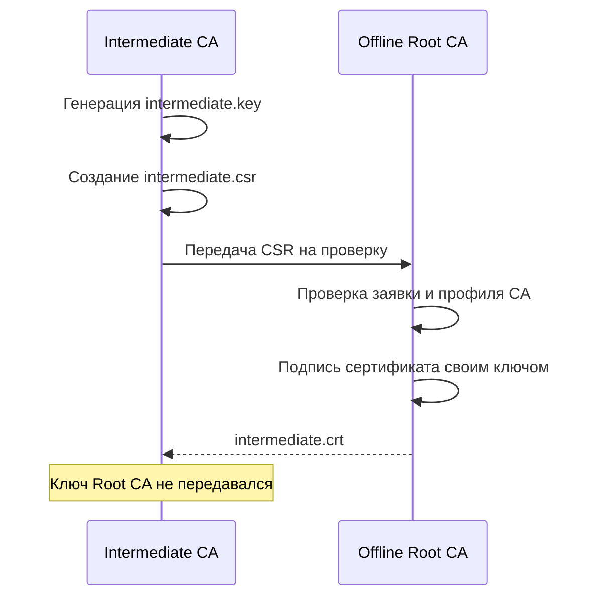
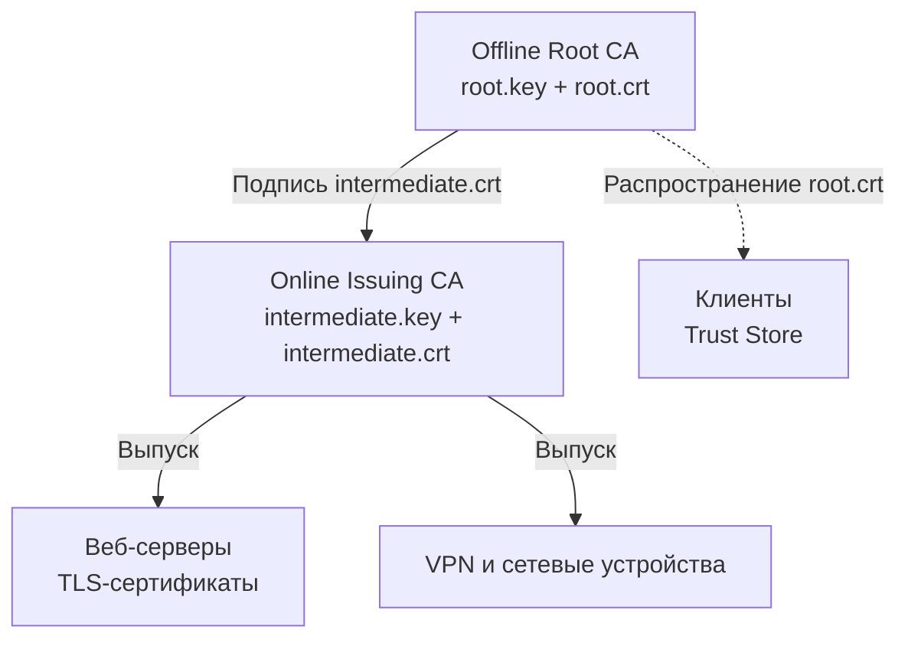
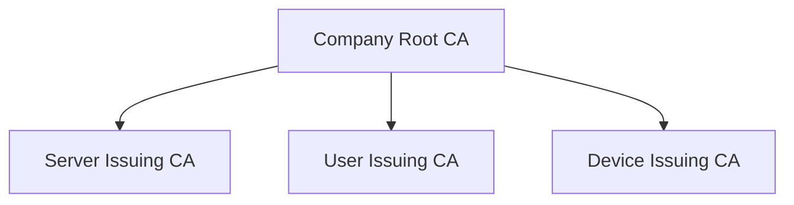

## 1. Назначение удостоверяющих центров

**Удостоверяющий центр (Certificate Authority, CA)** — компонент PKI, который проверяет заявки и выпускает сертификаты, подписывая их своим приватным ключом.

В предыдущей теме — [[Synced/DevOps/CI-CD, артефакты, тестирование и DevSecOps/5. DevSecOps и безопасность цепочки поставок/9. PKI и криптография в инфраструктуре/2. Инфраструктура открытых ключей/1. Архитектура PKI и цепочка доверия.md|Архитектура PKI и цепочка доверия]] — рассмотрено, как клиент строит и проверяет цепочку сертификатов. Здесь основной вопрос другой: **как организовать сами удостоверяющие центры, чтобы безопасно выдавать и сопровождать сертификаты**.

В инфраструктуре обычно выделяют два уровня:

- **Root CA** — корневой удостоверяющий центр, которому доверяют клиенты.
- **Intermediate CA** — промежуточный центр, которому Root CA делегирует выпуск сертификатов.

Промежуточный CA, который непосредственно выдаёт сертификаты сервисам, также называют **Issuing CA**. Это роль, а не обязательно отдельный третий уровень иерархии.

## 2. Root CA — корневой удостоверяющий центр

### 2.1. Что хранит Root CA

Root CA имеет собственную пару ключей:

- **Приватный ключ Root CA** — секрет, которым подписывают сертификаты подчинённых CA и, при необходимости, списки отзыва.
- **Публичный ключ Root CA** — содержится в корневом сертификате и позволяет проверять подписи, созданные соответствующим приватным ключом.

Корневой сертификат обычно **самоподписанный**. Это означает, что его подпись создана приватным ключом самого Root CA.

Однако клиент доверяет Root CA **не из-за самоподписи**, а потому, что этот корень заранее установлен как доверенный. Механизм доверенного хранилища и проверка пути описаны в заметке [[Synced/DevOps/CI-CD, артефакты, тестирование и DevSecOps/5. DevSecOps и безопасность цепочки поставок/9. PKI и криптография в инфраструктуре/2. Инфраструктура открытых ключей/1. Архитектура PKI и цепочка доверия.md|Архитектура PKI и цепочка доверия]].

### 2.2. Какие операции выполняет Root CA

Основные задачи:

1. Создание корневой ключевой пары и сертификата.
2. Подписание сертификатов промежуточных CA.
3. Продление или замена промежуточных CA по установленной процедуре.
4. Отзыв сертификатов подчинённых CA при необходимости.
5. Защита корневого ключа и ведение учёта операций.

**Root CA не обязан подписывать каждый серверный сертификат.** В многоуровневой архитектуре этим занимается Intermediate CA.

### 2.3. Почему Root CA часто делают Offline

**Offline Root CA** — корневой CA, приватный ключ которого не находится на постоянно доступном сетевом сервере.

Причина: компрометация корневого ключа ставит под угрозу всю иерархию, построенную на этом корне. Злоумышленник сможет создавать подчинённые CA и сертификаты, которые могут проходить проверку у доверяющих корню клиентов.

Поэтому для Root CA часто предусматривают:

- изолированную систему, включаемую только для утверждённых операций;
- шифрование и защищённое хранение ключа, при необходимости HSM;
- ограниченный физический и административный доступ;
- резервную копию ключевого материала с контролируемым восстановлением;
- документированную процедуру подписания и отзыва.

> [!IMPORTANT] Offline — не то же самое, что «один раз выключили и забыли»
> Root CA периодически нужен для подписания новых промежуточных CA, публикации обновлённых CRL и других предусмотренных операций. Для офлайн-центра необходимо заранее определить, **как часто и каким образом** выполняются эти действия.

## 3. Intermediate CA — промежуточный удостоверяющий центр

### 3.1. Как появляется Intermediate CA

Intermediate CA создаёт **собственную** пару ключей и формирует CSR. Затем Root CA проверяет заявку и подписывает сертификат Intermediate CA.

В результате:

- `intermediate.key` — приватный ключ промежуточного CA;
- `intermediate.crt` — сертификат промежуточного CA, подписанный Root CA;
- `root.crt` — корневой сертификат, публичный и заранее распространяемый клиентам.

**Root CA не передаёт Intermediate CA свой приватный ключ.** У каждого центра собственная пара ключей.



**Пояснение:** Intermediate CA создаёт свой ключ самостоятельно; Root CA получает только запрос и после проверки возвращает сертификат. Подпись связывает публичный ключ Intermediate CA с полномочиями, заданными в выданном сертификате.

### 3.2. Что делает Issuing CA

Рабочий Issuing CA обычно:

1. Принимает заявки на сертификаты.
2. Проверяет полномочия заявителя по принятой политике.
3. Выбирает профиль сертификата — сервер, пользователь, устройство и т. д.
4. Выпускает сертификат, подписывая его своим приватным ключом.
5. Ведёт журнал выданных сертификатов и их серийных номеров.
6. Обеспечивает процессы продления и отзыва.

Способы проверки заявок, формирование CSR и работа с SAN подробно рассмотрены в [[Synced/DevOps/CI-CD, артефакты, тестирование и DevSecOps/5. DevSecOps и безопасность цепочки поставок/9. PKI и криптография в инфраструктуре/2. Инфраструктура открытых ключей/1. Архитектура PKI и цепочка доверия.md|Архитектура PKI и цепочка доверия]]. Здесь важно, что **правила выдачи определяются политикой CA**, а не произвольными пожеланиями из CSR.

### 3.3. Почему Issuing CA обычно работает онлайн

Если сертификаты нужно регулярно выдавать и обновлять автоматически, CA должен принимать запросы от сервисов или от управляющей системы.

Поэтому Issuing CA нередко работает постоянно. Это повышает удобство, но увеличивает поверхность атаки. Для него важны разграничение доступа, аудит, защита ключа, резервирование и мониторинг.

## 4. Как Root CA ограничивает полномочия Intermediate CA

Root CA не просто подписывает сертификат Intermediate CA. Он задаёт ограничения его использования.

Пример расширений сертификата промежуточного CA:

```ini
basicConstraints = critical, CA:TRUE, pathlen:0
keyUsage = critical, keyCertSign, cRLSign
subjectKeyIdentifier = hash
authorityKeyIdentifier = keyid,issuer
```

| Параметр | Назначение |
|---|---|
| `CA:TRUE` | Сертификат может использоваться как сертификат CA |
| `keyCertSign` | Разрешает использовать ключ для подписи сертификатов |
| `cRLSign` | Разрешает подпись списков отзыва |
| `pathlen:0` | Запрещает обычные дополнительные уровни промежуточных CA ниже этого CA |
| `SKI / AKI` | Помогают найти нужного издателя при построении цепочки |

**`pathlen:0` не запрещает выпуск серверных сертификатов.** Он ограничивает дальнейшее создание подчинённых CA.

Дополнительно могут применяться **Name Constraints** и политики сертификатов. Они позволяют сузить допустимые области выдачи, но их эффективность зависит от правильной настройки и поддержки клиентами.

> [!WARNING] Ограничения не заменяют защиту ключа
> Даже если Intermediate CA имеет `pathlen:0`, компрометация его приватного ключа позволяет злоумышленнику создавать поддельные конечные сертификаты в пределах того, что смогут принять клиенты.

## 5. Как устроена двухуровневая PKI



**Пояснение к схеме:**

1. Root CA подписывает сертификат Issuing CA, а не каждый серверный сертификат.
2. Issuing CA подписывает конечные сертификаты веб-серверов, VPN и устройств.
3. Клиенты получают публичный `root.crt` через доверенный административный канал.
4. Приватные ключи `root.key` и `intermediate.key` остаются у соответствующих CA.
5. При подключении к сервису клиент проверяет цепочку до своего доверенного корня. Сам процесс проверки вынесен в [[Synced/DevOps/CI-CD, артефакты, тестирование и DevSecOps/5. DevSecOps и безопасность цепочки поставок/9. PKI и криптография в инфраструктуре/2. Инфраструктура открытых ключей/1. Архитектура PKI и цепочка доверия.md|Архитектура PKI и цепочка доверия]].

### 5.1. Почему не использовать только один Root CA

В одноуровневой PKI Root CA подписывает конечные сертификаты напрямую. Это возможно технически, но если выпуск происходит часто, корневой ключ приходится использовать значительно чаще.

Двухуровневая архитектура позволяет оставить Root CA изолированным, а повседневный выпуск поручить отдельному Issuing CA.

**Одноуровневая схема не является автоматически «сломанная» или недействительной.** Она может подходить для ограниченной тестовой среды, но требует оценки рисков и процедур защиты ключа.

## 6. Несколько промежуточных CA: зачем разделять роли

В большой организации могут работать несколько Issuing CA:



**Пояснение:** Root CA подписывает три независимых промежуточных CA. Каждый обслуживает свой класс заявок. Это позволяет разделить процессы выдачи, административные права и риски компрометации.

Например:

- **Server Issuing CA** — сертификаты HTTPS-сервисов.
- **User Issuing CA** — сертификаты сотрудников для клиентской аутентификации.
- **Device Issuing CA** — сертификаты рабочих станций и сетевых устройств.

При этом названия CA сами по себе **не обеспечивают криптографического ограничения**. Нужны корректные профили, политики и, где применимо, ограничения в сертификатах CA.

## 7. Что происходит при компрометации ключей

### 7.1. Компрометация ключа сервера

Если украден `portal.key`, злоумышленник может выдавать себя за этот сервер в соответствующих сценариях.

Необходимые действия: прекратить использование ключа, отозвать сертификат при наличии механизма отзыва, создать новую ключевую пару и выпустить новый сертификат.

### 7.2. Компрометация Intermediate CA

Если украден `intermediate.key`, злоумышленник может подписывать поддельные сертификаты от имени этого CA.

Последовательность реагирования:

1. Остановить выпуск сертификатов с компрометированного CA.
2. Через Root CA отозвать сертификат Intermediate CA.
3. Обеспечить распространение информации об отзыве.
4. Создать новый Intermediate CA с новой парой ключей.
5. **Перевыпустить затронутые конечные сертификаты** через новый CA.
6. Проверить настройки клиентов и фактическое прекращение доверия старым цепочкам.

> [!IMPORTANT] Почему недостаточно просто заменить Intermediate CA
> Старые серверные сертификаты подписаны старым ключом CA. Новый Intermediate CA с другой парой ключей **не становится их издателем автоматически**. Такие сертификаты необходимо перевыпустить.

### 7.3. Компрометация Root CA

Это более серьёзный случай: под угрозой весь набор подчинённых CA и выпущенных ими сертификатов.

Обычно требуется создание новой корневой иерархии, управляемое распространение нового доверенного корня, замена промежуточных и конечных сертификатов и удаление доверия к старому корню.

## 8. Сроки действия и обновление CA

У корневого и промежуточного CA есть сроки действия сертификатов. Сертификат конечного сервиса также имеет собственный срок.

В типовой иерархии срок действия сертификата подчинённого CA выбирают так, чтобы он укладывался в жизненный цикл вышестоящего CA. Аналогично срок конечного сертификата должен учитывать срок и состояние Issuing CA.

При планировании обновления необходимо заранее определить:

- когда создавать новую пару ключей CA;
- будет ли продлеваться сертификат с тем же ключом или выполняться смена ключа;
- как будут сосуществовать старые и новые цепочки;
- как распространить новые промежуточные сертификаты;
- как не допустить остановки сервисов при окончании срока старого CA.

**Замена сертификата CA и смена его ключа — разные операции.** Если ключ изменён, ранее выданные сертификаты не начинают автоматически проверяться новым ключом.

## 9. Хранение ключей и разграничение доступа

| Объект | Где хранить | Кто должен иметь доступ |
|---|---|---|
| `root.key` | Изолированная система или HSM | Строго ограниченный круг уполномоченных лиц |
| `root.crt` | Доверенные хранилища клиентов | Публичный сертификат |
| `intermediate.key` | Защищённый сервер CA или HSM | Служба подписи и уполномоченные администраторы |
| `intermediate.crt` | Серверы и каталоги сертификатов | Публичный сертификат |
| Приватный ключ сервиса | Соответствующий сервис / защищённое хранилище | Только нужный процесс и администраторы |

Для обоих CA важны резервные копии, проверка восстановления, аудит операций и разделение административных полномочий.

**HSM (Hardware Security Module)** — устройство для защищённого хранения ключей и выполнения криптографических операций. Его применение снижает риск извлечения ключа, но не отменяет контроль полномочий на подпись.

## 10. Проверка сертификатов CA через OpenSSL

Для просмотра сертификата Root CA:

```bash
openssl x509 -in root.crt -noout -text
```

Для просмотра сертификата Intermediate CA:

```bash
openssl x509 -in intermediate.crt -noout -text
```

Проверить, что Intermediate CA имеет допустимую цепочку к указанному Root CA:

```bash
openssl verify -CAfile root.crt intermediate.crt
```

При успешной проверке:

```text
intermediate.crt: OK
```

**Что проверять в выводе:** `Subject`, `Issuer`, `Basic Constraints`, `Key Usage`, `Not Before`, `Not After` и сведения о подписи.

> [!INFO] Ограничение проверки
> `openssl verify` проверяет сертификат в заданном контексте, но не заменяет аудит защищённости самого CA, его политик выдачи, приватного ключа и журналов операций. Подробная проверка серверной цепочки разобрана в [[Synced/DevOps/CI-CD, артефакты, тестирование и DevSecOps/5. DevSecOps и безопасность цепочки поставок/9. PKI и криптография в инфраструктуре/2. Инфраструктура открытых ключей/1. Архитектура PKI и цепочка доверия.md|Архитектура PKI и цепочка доверия]].

## 11. Типичные ошибки проектирования

**Root CA работает постоянно в сети без необходимости.** Увеличивается поверхность атаки на самый критичный ключ.

**Приватный ключ Root CA копируют на сервер Issuing CA.** Это разрушает смысл разделения ролей и создаёт дополнительную точку компрометации.

**Intermediate CA выдают сертификат с `CA:FALSE`.** Такой сертификат нельзя корректно использовать как CA в стандартной цепочке.

**Нет процедур отзыва Intermediate CA.** При компрометации невозможно своевременно донести до клиентов сведения о недействительности CA.

**Нет резервной копии CA и плана восстановления.** Потеря ключа CA может сделать невозможным продолжение прежней схемы выпуска и сопровождения сертификатов.

**Новый Intermediate CA выпускают, но не перевыпускают старые конечные сертификаты.** Старые сертификаты остаются подписанными прежним ключом.

## Вопросы для самопроверки

1. Чем Root CA отличается от Intermediate CA?
2. Почему самоподписанный Root CA не становится автоматически доверенным?
3. Зачем приватный ключ Root CA хранят офлайн?
4. Что именно Root CA подписывает при создании Intermediate CA?
5. Передаёт ли Root CA свой приватный ключ промежуточному центру?
6. Чем Intermediate CA отличается от Issuing CA?
7. Для чего нужны `CA:TRUE`, `keyCertSign` и `pathlen:0`?
8. Зачем в организации может быть несколько Issuing CA?
9. Почему компрометация Intermediate CA требует перевыпуска конечных сертификатов?
10. Что происходит при компрометации Root CA?
11. Почему замена сертификата CA не всегда означает замену ключа?
12. Какие файлы CA можно распространять публично, а какие нельзя?

## Итоги — что было разобрано

- Root CA — основа доверенной иерархии и источник подписи для подчинённых CA.
- Intermediate CA — отдельный центр со своей парой ключей, которому делегирован выпуск сертификатов.
- Offline Root CA уменьшает риск компрометации корневого ключа.
- Полномочия Intermediate CA ограничиваются расширениями сертификата и политиками выдачи.
- Разделение Issuing CA помогает управлять разными классами сертификатов.
- Компрометация Intermediate CA и Root CA требует разных процедур восстановления.
- Защита ключей, отзыв, резервное копирование и плановая ротация необходимы для устойчивой PKI.

## Связанные заметки

- [[Synced/DevOps/CI-CD, артефакты, тестирование и DevSecOps/5. DevSecOps и безопасность цепочки поставок/9. PKI и криптография в инфраструктуре/2. Инфраструктура открытых ключей/1. Архитектура PKI и цепочка доверия.md|Архитектура PKI и цепочка доверия]]

---

## Теги

#PKI #RootCA #IntermediateCA #IssuingCA #OfflineCA #CertificateAuthority #X509 #Криптография #DevSecOps #УправлениеКлючами #CertificateLifecycle #OpenSSL #TrustAnchor
