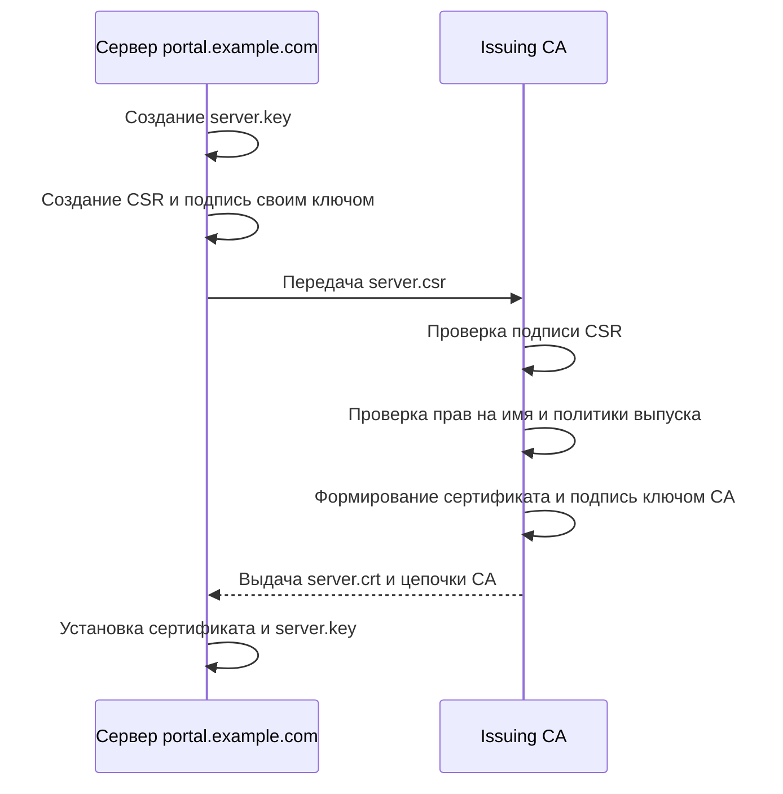

## 1. Как появляется сертификат

**Выпуск сертификата** — процесс, в ходе которого удостоверяющий центр (CA) связывает публичный ключ с именем сервера, пользователя или устройства и подтверждает эту связь цифровой подписью.

Для получения серверного сертификата обычно выполняются пять действий:

1. Генерация пары ключей владельцем сервера.
2. Создание запроса на сертификат (CSR).
3. Проверка заявки удостоверяющим центром.
4. Формирование и подписание сертификата CA.
5. Установка сертификата и соответствующего приватного ключа на сервер.

> [!IMPORTANT] Два разных доказательства
> **Подпись CSR** показывает, что заявитель располагает приватным ключом, соответствующим публичному ключу в запросе. **Проверка домена** показывает, что заявитель вправе получить сертификат для указанного DNS-имени. Одно не заменяет другое.

Общая структура PKI и проверка цепочки доверия рассмотрены в [[Synced/DevOps/CI-CD, артефакты, тестирование и DevSecOps/5. DevSecOps и безопасность цепочки поставок/9. PKI и криптография в инфраструктуре/2. Инфраструктура открытых ключей/1. Архитектура PKI и цепочка доверия.md|«Архитектура PKI и цепочка доверия»]].

## 2. Какие файлы участвуют в выпуске

| Файл | Содержимое | Секретный? |
|---|---|---|
| `server.key` | Приватный ключ сервера | **Да** |
| `server.csr` | Запрос с публичным ключом и сведениями о субъекте | Нет |
| `server.crt` | Сертификат сервера, подписанный CA | Нет |
| `intermediate.crt` | Сертификат промежуточного CA | Нет |
| `root.crt` | Сертификат корневого CA | Нет |
| `fullchain.pem` | Серверный и необходимые промежуточные сертификаты | Нет |

Расширения `.crt`, `.cer`, `.pem`, `.key` сами по себе не определяют содержимое. Например, PEM — способ текстового представления криптографических данных; `.p12`/`.pfx` могут содержать сертификат и приватный ключ, поэтому такой контейнер требует защиты.

**Приватный ключ не нужно отправлять в CA.** В обычном процессе CA получает CSR и возвращает подписанный сертификат.

## 3. Генерация приватного ключа

Для примера используется сервер `portal.example.com` и OpenSSL.

Создание RSA-ключа:

```bash
openssl genpkey -algorithm RSA -pkeyopt rsa_keygen_bits:3072 -out server.key
```

**Разбор:**

- `genpkey` — создание приватного ключа;
- `-algorithm RSA` — выбор алгоритма;
- `rsa_keygen_bits:3072` — длина ключа;
- `-out server.key` — файл результата.

Ограничение доступа к файлу в Linux:

```bash
chmod 600 server.key
```

Проверка ключа без вывода его секретного содержимого:

```bash
openssl pkey -in server.key -check -noout
```

Извлечение публичного ключа:

```bash
openssl pkey -in server.key -pubout -out server.pub
```

Публичный ключ можно распространять. Приватный — хранить защищённо, резервировать по утверждённой политике и не помещать в репозиторий.

> [!INFO] Выбор алгоритма
> Для новых систем могут использоваться RSA или ключи на эллиптических кривых. Конкретный алгоритм определяется совместимостью клиентов и политикой безопасности. В этой лекции RSA выбран для понятного примера команд, а не как обязательный вариант для всех систем.

## 4. Создание CSR

**CSR (Certificate Signing Request)** — запрос, содержащий сведения о заявителе, публичный ключ и подпись заявителя.

Создание запроса:

```bash
openssl req -new -key server.key -out server.csr \
  -subj "/CN=portal.example.com" \
  -addext "subjectAltName=DNS:portal.example.com,DNS:api.example.com"
```

**Разбор:**

- `req -new` — создание нового запроса;
- `-key server.key` — использование приватного ключа для подписи CSR;
- `-out server.csr` — файл запроса;
- `-subj` — имя субъекта;
- `-addext` — запрашиваемое расширение SAN.

Просмотр запроса:

```bash
openssl req -in server.csr -noout -text
```

Проверка подписи CSR:

```bash
openssl req -in server.csr -noout -verify
```

При успешной проверке OpenSSL подтверждает корректность подписи запроса. **Это не доказывает право на домен** и не означает, что CA уже выпустил сертификат.

### 4.1. Почему SAN важнее CN

**SAN (Subject Alternative Name)** — перечень DNS-имён и IP-адресов, для которых запрашивается сертификат. Современные HTTPS-клиенты проверяют имя сервера по SAN; полагаться только на `CN` нельзя.

В примере выше сертификат запрашивается для двух имён:

```text
portal.example.com
api.example.com
```

Если клиент обращается по другому имени, сертификат может быть отклонён, даже когда его подпись и цепочка доверия корректны.

Детальные правила X.509, Key Usage, EKU и Certificate Policies рассматриваются в [[Synced/DevOps/CI-CD, артефакты, тестирование и DevSecOps/5. DevSecOps и безопасность цепочки поставок/9. PKI и криптография в инфраструктуре/2. Инфраструктура открытых ключей/4. X.509, Extensions и Certificate Policies.md|«X.509, Extensions и Certificate Policies»]]. Здесь достаточно понимать, что **CA принимает окончательное решение о содержимом выданного сертификата** и не обязан автоматически копировать все расширения из CSR.

## 5. Проверка заявки удостоверяющим центром

После получения CSR CA должен проверить, можно ли выпускать сертификат с запрошенными данными.

Для публичных HTTPS-сертификатов обычно проверяется контроль над доменным именем. Для внутренней PKI проверка может опираться на учётную запись сервиса, инвентаризацию, согласование администратора или автоматизированную политику.

### 5.1. DNS-01

CA выдаёт проверочное значение, которое заявитель должен разместить в TXT-записи DNS:

```text
_acme-challenge.portal.example.com. IN TXT "значение-от-CA"
```

CA проверяет запись и убеждается, что заявитель смог выполнить требуемое изменение DNS.

### 5.2. HTTP-01

CA предлагает разместить проверочный ответ по пути:

```text
http://portal.example.com/.well-known/acme-challenge/<token>
```

Затем CA обращается по этому адресу и проверяет ответ.

> [!NOTE] Проверка контроля
> DNS-01 и HTTP-01 подтверждают выполнение установленной проверки контроля над доменом или его ресурсом. Они не подтверждают сами по себе юридическую личность владельца организации.

### 5.3. Что проверяет внутренний CA

Для корпоративной PKI могут применяться правила:

- Кто вправе запрашивать сертификат.
- Для каких DNS-имён или устройств разрешён выпуск.
- Какой срок действия допускается.
- Какие назначения и расширения разрешены.
- Требуется ли ручное согласование.

Эти проверки определяются **политикой выпуска**. Без них любой пользователь, имеющий доступ к API CA, мог бы попытаться запросить сертификат для чужого сервиса.

## 6. Как CA подписывает сертификат

После проверки заявки CA создаёт **новый сертификат**. Он включает утверждённые данные субъекта и публичный ключ из CSR, задаёт издателя, серийный номер, срок действия и разрешённые расширения.

Затем CA подписывает часть сертификата `TBSCertificate` **своим приватным ключом**.



**Как читать диаграмму:** сервер создаёт ключ и CSR локально. CA получает только запрос, проверяет его и подписывает **сертификат**, а не просто возвращает исходный CSR с новой подписью. Приватный ключ сервера не покидает сервер.

**Ключевое различие:**

- CSR подписан **ключом заявителя**.
- Выданный сертификат подписан **ключом CA**.
- В TLS сервер позднее подтверждает владение **своим** приватным ключом.

### 6.1. Кто именно подписывает серверный сертификат

В иерархической PKI серверные сертификаты обычно выпускает **Intermediate / Issuing CA**, а не Offline Root CA. Это позволяет держать корневой приватный ключ изолированно.

Устройство и сроки жизни CA подробно рассматриваются в [[Synced/DevOps/CI-CD, артефакты, тестирование и DevSecOps/5. DevSecOps и безопасность цепочки поставок/9. PKI и криптография в инфраструктуре/2. Инфраструктура открытых ключей/2. Root CA и Intermediate CA.md|«Root CA и Intermediate CA»]].

## 7. Пример подписания CSR собственным Issuing CA

Ниже — **учебный пример** при условии, что CA уже развёрнут и доступны:

```text
intermediate.crt — сертификат Issuing CA
intermediate.key — его приватный ключ
server.csr       — запрос сервера
```

> [!WARNING] Не использовать как готовый промышленный CA
> Команда `openssl x509 -req` удобна для понимания подписи, но сама по себе не заменяет полноценное управление CA: учёт выданных сертификатов, уникальные серийные номера, защиту ключей, отзыв, аудит и автоматизацию. В рабочей PKI выпуск должен выполняться управляемой службой CA.

### 7.1. Настройка расширений будущего сертификата

Создание файла `server.ext`:

```ini
basicConstraints = critical,CA:FALSE
keyUsage = critical,digitalSignature
extendedKeyUsage = serverAuth
subjectAltName = DNS:portal.example.com,DNS:api.example.com
```

**Смысл:** выдать конечный серверный сертификат, пригодный для аутентификации TLS-сервера, с двумя разрешёнными DNS-именами.

### 7.2. Подпись CSR

```bash
openssl x509 -req -in server.csr \
  -CA intermediate.crt -CAkey intermediate.key \
  -CAcreateserial -out server.crt \
  -days 90 -sha256 -extfile server.ext
```

**Разбор:**

- `-req -in server.csr` — входной CSR;
- `-CA intermediate.crt` — сертификат издателя;
- `-CAkey intermediate.key` — приватный ключ издателя, создающий подпись;
- `-CAcreateserial` — управление серийным номером для этого упрощённого примера;
- `-out server.crt` — новый сертификат;
- `-days 90` — срок действия;
- `-extfile server.ext` — утверждённые расширения.

В результате сервер получает `server.crt`. **Файл `server.key` остаётся тем же**, потому что сертификат содержит публичный ключ, соответствующий ранее созданной паре.

### 7.3. Просмотр выданного сертификата

```bash
openssl x509 -in server.crt -noout -text
```

Проверка соответствия приватного ключа и сертификата через сравнение публичных ключей:

```bash
openssl pkey -in server.key -pubout -outform DER | openssl dgst -sha256
openssl x509 -in server.crt -pubkey -noout | openssl pkey -pubin -outform DER | openssl dgst -sha256
```

Одинаковые значения SHA-256 означают, что из ключа и сертификата извлечён один и тот же публичный ключ.

## 8. Установка сертификата на сервер

Для работы HTTPS серверу обычно нужны:

- `server.key` — приватный ключ;
- `server.crt` — его сертификат;
- `intermediate.crt` — промежуточный сертификат, необходимый клиентам для построения цепочки.

Создание файла цепочки:

```bash
cat server.crt intermediate.crt > fullchain.pem
```

Пример настройки Nginx:

```nginx
ssl_certificate     /etc/nginx/tls/fullchain.pem;
ssl_certificate_key /etc/nginx/tls/server.key;
```

**`fullchain.pem` обычно содержит серверный сертификат и необходимые промежуточные сертификаты, но не корневой сертификат.** Клиент должен доверять Root CA независимо от того, что прислал сервер.

Процесс построения и проверки цепочки клиентом разобран в [[Synced/DevOps/CI-CD, артефакты, тестирование и DevSecOps/5. DevSecOps и безопасность цепочки поставок/9. PKI и криптография в инфраструктуре/2. Инфраструктура открытых ключей/1. Архитектура PKI и цепочка доверия.md|разборе проверки цепочки доверия]].

> [!IMPORTANT] Разделение файлов
> Публичный сертификат можно передавать клиентам. Приватный ключ `server.key` должен быть доступен только серверу и уполномоченным процессам.

## 9. Проверка результата

### 9.1. Проверка сертификата с доверенным корнем

При наличии `root.crt` и `intermediate.crt`:

```bash
openssl verify \
  -CAfile root.crt \
  -untrusted intermediate.crt \
  -purpose sslserver \
  -verify_hostname portal.example.com \
  server.crt
```

**Разбор:**

- `-CAfile` — явно доверенный корень;
- `-untrusted` — сертификат издателя для построения цепочки, но не новый доверенный корень;
- `-purpose sslserver` — назначение сертификата;
- `-verify_hostname` — проверка DNS-имени.

При успешной проверке:

```text
server.crt: OK
```

Это проверка файлов сертификатов. Она **не подтверждает**, что работающий сервер сейчас располагает приватным ключом, и не означает автоматическую проверку отзыва.

### 9.2. Проверка реального HTTPS-сервера

```bash
openssl s_client \
  -connect portal.example.com:443 \
  -servername portal.example.com \
  -showcerts
```

Команда показывает сертификаты, переданные сервером. Для строгой проверки с указанным доверенным корнем:

```bash
openssl s_client \
  -connect portal.example.com:443 \
  -servername portal.example.com \
  -CAfile root.crt \
  -verify_hostname portal.example.com \
  -verify_return_error
```

## 10. Перевыпуск, продление и замена ключа

**Сертификат нельзя продлить простым изменением даты**: срок действия находится в подписанной части сертификата. Изменение даты нарушит подпись.

Поэтому «продление» на практике означает **выпуск нового сертификата**.

| Сценарий | Новый сертификат | Новый приватный ключ |
|---|---|---|
| Обновление с прежней парой ключей | Да | Нет |
| Ротация ключей | Да | Да |
| Смена Issuing CA | Да | По выбранной политике |

Для регулярно обновляемых серверных сертификатов рекомендуется автоматизация и, когда это допускается инфраструктурой, периодическая ротация ключей.

**Важное ограничение:** новый серверный сертификат должен быть пригоден к проверке через действующий Issuing CA. Если срок действия CA заканчивается, нельзя рассчитывать, что серверный сертификат продолжит успешно проверяться через просроченный CA.

Подробнее о сроках жизни и плановой замене CA — в [[Synced/DevOps/CI-CD, артефакты, тестирование и DevSecOps/5. DevSecOps и безопасность цепочки поставок/9. PKI и криптография в инфраструктуре/2. Инфраструктура открытых ключей/2. Root CA и Intermediate CA.md|заметке о Root CA и Intermediate CA]].

## 11. Распространённые ошибки

**Передача приватного ключа в CA.** Для обычного выпуска по CSR это не требуется и создаёт риск компрометации.

**CSR без SAN.** Современные HTTPS-клиенты проверяют DNS-имя по SAN; одного CN недостаточно.

**Автоматическое копирование всех расширений из CSR.** CA должен применять собственную политику выпуска и проверять допустимость запрошенных имён и назначений.

**Подпись сертификата Root CA вместо Issuing CA.** Для регулярного выпуска в иерархической PKI обычно используется промежуточный CA.

**Отсутствие Intermediate CA в настройке веб-сервера.** Клиент может не суметь построить цепочку.

**Путаница между CSR и сертификатом.** CSR — заявка; сертификат — подписанный CA результат.

**Проверка только даты действия.** Для HTTPS также важны имя, назначение, цепочка доверия и подтверждение владения приватным ключом.

## Вопросы для самопроверки

1. Почему приватный ключ сервера не требуется передавать в CA?
2. Какие сведения содержит CSR?
3. Чем подпись CSR отличается от подписи готового сертификата?
4. Почему корректная подпись CSR не доказывает право на DNS-имя?
5. Для чего используется SAN?
6. Кто определяет окончательные расширения сертификата?
7. Каким ключом Issuing CA подписывает серверный сертификат?
8. Что обычно содержит `fullchain.pem`?
9. Почему серверу нужен приватный ключ после получения сертификата?
10. Чем перевыпуск сертификата отличается от замены ключевой пары?
11. Что проверяет `openssl verify` и чего эта команда не подтверждает?

## Итоги — что было разобрано

- Выпуск сертификата начинается с генерации ключа и создания CSR.
- CSR содержит публичный ключ и подпись заявителя, но не доказывает контроль над доменом.
- CA проверяет заявку, формирует сертификат и подписывает его своим приватным ключом.
- В иерархической PKI серверные сертификаты обычно подписывает Issuing CA.
- Сервер устанавливает сертификат, необходимые промежуточные сертификаты и собственный приватный ключ.
- Продление срока действия означает выпуск нового сертификата; замена ключа — отдельное решение.

## Связанные заметки

- [[Synced/DevOps/CI-CD, артефакты, тестирование и DevSecOps/5. DevSecOps и безопасность цепочки поставок/9. PKI и криптография в инфраструктуре/2. Инфраструктура открытых ключей/1. Архитектура PKI и цепочка доверия.md|Архитектура PKI и цепочка доверия]]
- [[Synced/DevOps/CI-CD, артефакты, тестирование и DevSecOps/5. DevSecOps и безопасность цепочки поставок/9. PKI и криптография в инфраструктуре/2. Инфраструктура открытых ключей/2. Root CA и Intermediate CA.md|Root CA и Intermediate CA]]
- [[Synced/DevOps/CI-CD, артефакты, тестирование и DevSecOps/5. DevSecOps и безопасность цепочки поставок/9. PKI и криптография в инфраструктуре/2. Инфраструктура открытых ключей/4. X.509, Extensions и Certificate Policies.md|X.509, Extensions и Certificate Policies]]

---

## Теги

#PKI #X509 #CSR #CertificateSigningRequest #CertificateAuthority #IssuingCA #OpenSSL #Сертификаты #ВыпускСертификатов #ПодписьСертификатов #SAN #TLS #HTTPS #DevSecOps #CertificateLifecycle
