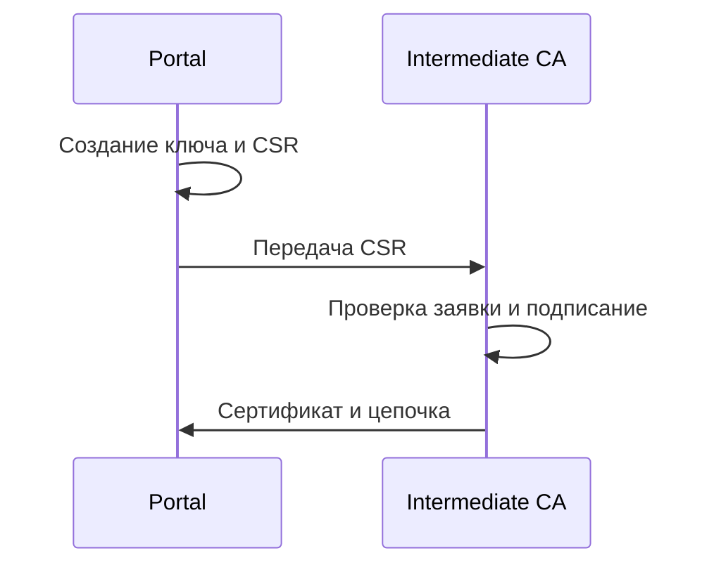

## 1. Что необходимо для выпуска сертификата

В примере используется уже созданный Root CA и Intermediate CA. Их настройка описана в [[Synced/DevOps/CI-CD, артефакты, тестирование и DevSecOps/5. DevSecOps и безопасность цепочки поставок/9. PKI и криптография в инфраструктуре/2. Инфраструктура открытых ключей/2. Root CA и Intermediate CA.md|Root CA и Intermediate CA]]. Выпуск выполняется вручную через OpenSSL, чтобы понять сам процесс; для регулярного выпуска удобнее автоматизация.

| Файл | Назначение |
|---|---|
| `portal.key` | Приватный ключ портала |
| `portal.csr` | Запрос на сертификат |
| `portal.crt` | Готовый сертификат |
| `intermediate.crt` | Сертификат подписывающего CA |
| `intermediate.key` | Приватный ключ CA |
| `root.crt` | Доверенный корень |



Приватный ключ портала остаётся на портале. CA получает только запрос. Root CA в этом процессе не участвует.

## 2. Создание приватного ключа

**Место выполнения: Portal.**

```bash
umask 077
openssl genpkey -algorithm RSA -out portal.key -pkeyopt rsa_keygen_bits:3072
```

`umask 077` ограничивает права новых файлов текущего пользователя. `genpkey` создаёт приватный ключ RSA, `-out` задаёт имя файла, `rsa_keygen_bits:3072` — размер ключа.

Ключ в этом примере не защищён паролем, чтобы веб-сервер мог запускаться автоматически. Поэтому особенно важны права доступа: [[Synced/DevOps/CI-CD, артефакты, тестирование и DevSecOps/5. DevSecOps и безопасность цепочки поставок/9. PKI и криптография в инфраструктуре/2. Инфраструктура открытых ключей/6. Защита ключей CA и HSM.md|Защита ключей CA и HSM]].

## 3. Создание запроса CSR

**Место выполнения: Portal.**

```bash
openssl req -new -key portal.key -out portal.csr \
  -subj "/CN=portal.ggkit.local" \
  -addext "subjectAltName=DNS:portal.ggkit.local"
```

- `req -new` — создание запроса.
- `-key` — ключ, которым подписывается запрос.
- `-out` — имя файла запроса.
- `-subj` — имя владельца.
- `-addext` — запрашиваемое DNS-имя (SAN).

CSR содержит открытый ключ и сведения о будущем сертификате, но не приватный ключ. Сам CSR ещё не сертификат.

```bash
openssl req -in portal.csr -noout -text
```

Команда показывает содержимое запроса. `-noout` скрывает исходное PEM-представление, `-text` выводит читаемые поля.

## 4. Передача и проверка запроса

**Место выполнения: Portal.**

```bash
scp portal.csr admin@ca.ggkit.local:~/
```

Передача CSR на Intermediate CA через SSH. Здесь `admin` — пример существующей учётной записи, `ca.ggkit.local` — адрес CA.

**Место выполнения: Intermediate CA.**

```bash
openssl req -in portal.csr -noout -verify
```

Проверка подписи CSR. Она подтверждает владение соответствующим приватным ключом, но не право на DNS-имя. Администратор CA отдельно проверяет, разрешено ли заявителю получать сертификат портала.


Для публичных HTTPS-сертификатов обычно проверяется контроль над доменным именем. Для внутренней PKI проверка может опираться на учётную запись сервиса, инвентаризацию, согласование администратора или автоматизированную политику.

### 4.1. DNS-01

CA выдаёт проверочное значение, которое заявитель должен разместить в TXT-записи DNS:

```text
_acme-challenge.portal.example.com. IN TXT "значение-от-CA"
```

CA проверяет запись и убеждается, что заявитель смог выполнить требуемое изменение DNS.

### 4.2. HTTP-01

CA предлагает разместить проверочный ответ по пути:

```text
http://portal.example.com/.well-known/acme-challenge/<token>
```

Затем CA обращается по этому адресу и проверяет ответ.

> [!NOTE] Проверка контроля
> DNS-01 и HTTP-01 подтверждают выполнение установленной проверки контроля над доменом или его ресурсом. Они не подтверждают сами по себе юридическую личность владельца организации.


## 5. Подписание сертификата

**Место выполнения: Intermediate CA.** В текущем каталоге предполагаются `intermediate.crt`, `intermediate.key` и полученный CSR.

Создание файла `portal.ext` с разрешёнными параметрами сертификата:

```ini
basicConstraints = critical,CA:FALSE
keyUsage = critical,digitalSignature,keyEncipherment
extendedKeyUsage = serverAuth
subjectAltName = DNS:portal.ggkit.local
```

CA явно задаёт разрешённое имя и назначение сертификата. Значения полей разобраны в [[Synced/DevOps/CI-CD, артефакты, тестирование и DevSecOps/5. DevSecOps и безопасность цепочки поставок/9. PKI и криптография в инфраструктуре/2. Инфраструктура открытых ключей/4. X.509, Extensions и Certificate Policies.md|X.509, Extensions и Certificate Policies]].

```bash
openssl x509 -req -in portal.csr \
  -CA intermediate.crt -CAkey intermediate.key \
  -CAcreateserial -days 90 -sha256 \
  -extfile portal.ext -out portal.crt
```

| Параметр | Назначение |
|---|---|
| `-req -in` | Подписать запрос из указанного файла |
| `-CA`, `-CAkey` | Сертификат и приватный ключ подписывающего CA |
| `-CAcreateserial` | Создать файл серийных номеров при его отсутствии |
| `-days 90` | Срок действия 90 дней |
| `-sha256` | Хеш-функция для подписи |
| `-extfile` | Разрешённые расширения |
| `-out` | Готовый сертификат |

> [!WARNING]
> Это учебный ручной выпуск. `openssl x509 -req` не ведёт полноценный реестр выпущенных и отозванных сертификатов. Для действующего CA следует использовать его штатный механизм выпуска, например step-ca, а не подписывать сертификаты в обход него.

## 6. Получение и проверка сертификата

**Место выполнения: Portal.**

```bash
scp admin@ca.ggkit.local:~/portal.crt .
scp admin@ca.ggkit.local:~/intermediate.crt .
```

Корневой `root.crt` необходимо получить отдельно по доверенному каналу. Проверка цепочки и имени:

```bash
openssl verify -CAfile root.crt -untrusted intermediate.crt \
  -purpose sslserver -verify_hostname portal.ggkit.local portal.crt
```

`-CAfile` задаёт доверенный корень, `-untrusted` — промежуточный сертификат для построения цепочки, `-purpose` — назначение, `-verify_hostname` — ожидаемое имя. Результат при успехе: `portal.crt: OK`.

Проверка соответствия сертификата ключу:

```bash
openssl pkey -in portal.key -pubout | openssl sha256
openssl x509 -in portal.crt -pubkey -noout | openssl sha256
```

Обе команды извлекают открытый ключ и вычисляют его хеш. Значения должны совпадать.

## 7. Подготовка файлов для веб-сервера

**Место выполнения: Portal.**

```bash
cat portal.crt intermediate.crt > fullchain.pem
```

Объединение сертификата портала и промежуточного CA в правильном порядке. Для Nginx используются директивы:

```nginx
ssl_certificate /etc/nginx/tls/fullchain.pem;
ssl_certificate_key /etc/nginx/tls/portal.key;
```

Это фрагмент HTTPS-конфигурации, а не полный виртуальный хост. Файлы необходимо разместить по указанным путям и ограничить доступ к ключу. Корень в `fullchain.pem` обычно не включается.

## Вопросы для самопроверки

1. Что передаётся CA для подписания?
2. Почему CA не должен получать ключ портала?
3. Чем CSR отличается от готового сертификата?
4. Для чего нужен fullchain.pem?

## Итоги — что было разобрано

Ключ создаётся на сервере, CSR передаётся CA, CA проверяет заявку и подписывает сертификат. После получения проверяются цепочка, имя и соответствие ключу.

## Связанные заметки

- [[Synced/DevOps/CI-CD, артефакты, тестирование и DevSecOps/5. DevSecOps и безопасность цепочки поставок/9. PKI и криптография в инфраструктуре/2. Инфраструктура открытых ключей/1. Архитектура PKI и цепочка доверия.md|Архитектура PKI и цепочка доверия]]
- [[Synced/DevOps/CI-CD, артефакты, тестирование и DevSecOps/5. DevSecOps и безопасность цепочки поставок/9. PKI и криптография в инфраструктуре/2. Инфраструктура открытых ключей/2. Root CA и Intermediate CA.md|Root CA и Intermediate CA]]
- [[Synced/DevOps/CI-CD, артефакты, тестирование и DevSecOps/5. DevSecOps и безопасность цепочки поставок/9. PKI и криптография в инфраструктуре/2. Инфраструктура открытых ключей/4. X.509, Extensions и Certificate Policies.md|X.509, Extensions и Certificate Policies]]
- [[Synced/DevOps/CI-CD, артефакты, тестирование и DevSecOps/5. DevSecOps и безопасность цепочки поставок/9. PKI и криптография в инфраструктуре/2. Инфраструктура открытых ключей/6. Защита ключей CA и HSM.md|Защита ключей CA и HSM]]

---

## Теги

#OpenSSL #CSR #PKI #TLS #Сертификаты #Fullchain #Подписание
