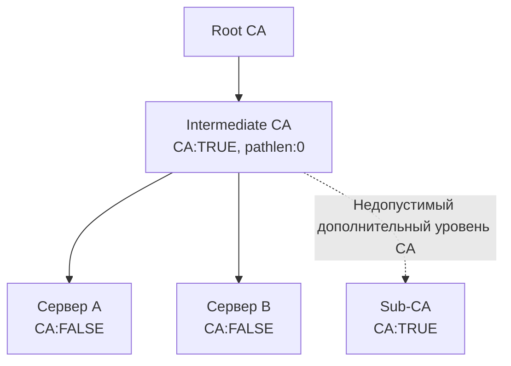
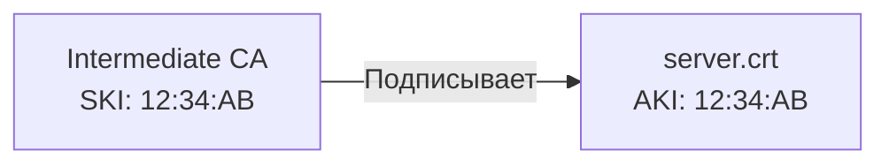
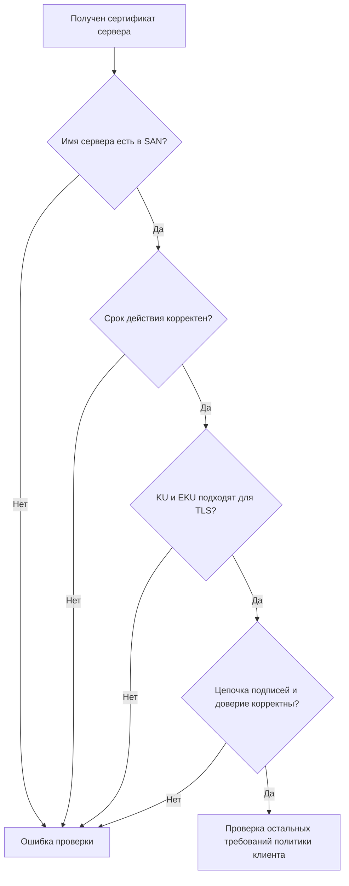

## 1. Назначение X.509

**X.509** — стандарт формата цифровых сертификатов. Сертификат связывает открытый ключ с определённым субъектом (сервером, пользователем, устройством или удостоверяющим центром) и содержит цифровую подпись издателя.

Сертификат не содержит приватный ключ. Приватный ключ хранится отдельно и не должен передаваться клиентам.

Общий процесс получения сертификата рассмотрен в [[Synced/DevOps/CI-CD, артефакты, тестирование и DevSecOps/5. DevSecOps и безопасность цепочки поставок/9. PKI и криптография в инфраструктуре/2. Инфраструктура открытых ключей/3. Создание и подписание сертификатов.md|создании и подписании сертификатов]]. Здесь основное внимание уделено **содержимому сертификата** и правилам, которые ограничивают его применение.

## 2. Основные поля сертификата

| Поле | Назначение |
|---|---|
| `Version` | Версия формата; современные сертификаты обычно используют X.509 v3 |
| `Serial Number` | Уникальный номер сертификата в пределах конкретного CA |
| `Signature Algorithm` | Алгоритм подписи сертификата издателем |
| `Issuer` | Имя CA, выпустившего сертификат |
| `Validity` | Период действия: `Not Before` и `Not After` |
| `Subject` | Имя субъекта, которому выдан сертификат |
| `Subject Public Key Info` | Открытый ключ и его алгоритм |
| `Extensions` | Дополнительные правила и идентификаторы |
| `Signature Value` | Цифровая подпись издателя |

> [!INFO] Важно
> Поле `Subject` не гарантирует, что сертификат подходит для конкретного домена. Для проверки имени TLS-сервера обычно используется расширение `Subject Alternative Name` (SAN).

### 2.1. Просмотр сертификата

```bash
openssl x509 -in server.crt -noout -text
```

- `x509` — работа с сертификатами X.509;
- `-in` — путь к сертификату;
- `-noout` — не выводить исходное PEM-представление;
- `-text` — показать поля в читаемом виде.

Краткая проверка основных сведений:

```bash
openssl x509 -in server.crt -noout -subject -issuer -dates
```

## 3. Что такое Extensions

**Extensions (расширения)** — дополнительные поля X.509 v3, определяющие, для чего сертификат можно использовать, какие имена он подтверждает и какие ограничения должны учитывать проверяющие программы.

У расширения есть идентификатор (OID), значение и признак `critical`.

- **Некритическое расширение:** программа, не понимающая его, может проигнорировать его.
- **Критическое расширение:** если программа не умеет его обрабатывать, сертификат должен быть отвергнут при проверке пути.

`critical` **не означает «более важное»** и не заставляет приложение использовать сертификат для указанной цели. Это требование к обработке неизвестного расширения.

## 4. Subject Alternative Name (SAN)

**SAN** содержит имена, с которыми разрешено сопоставлять сертификат. Для HTTPS это обычно DNS-имена или IP-адреса.

Пример:

```text
X509v3 Subject Alternative Name:
    DNS:portal.example.com, DNS:files.example.com,
    IP Address:10.28.250.20
```

Такой сертификат может подходить для `portal.example.com`, `files.example.com` и указанного IP-адреса — при условии успешной проверки остальных требований.

- `DNS:portal.example.com` — сопоставление с DNS-именем.
- `IP Address:10.28.250.20` — сопоставление с IP-адресом; запись IP как DNS-имени не эквивалентна IP SAN.
- `DNS:*.example.com` — wildcard для соответствующих имён одного уровня, например `app.example.com`, но не `example.com` и не `a.b.example.com`.

> [!WARNING] Типичная ошибка
> Сертификат с `CN=portal.example.com`, но без нужного SAN, нельзя считать корректным современным TLS-сертификатом для этого имени. Не следует рассчитывать на устаревшую проверку имени через CN.

## 5. Basic Constraints — является ли сертификат CA

Расширение `Basic Constraints` определяет, может ли сертификат выступать в роли удостоверяющего центра.

**Серверный сертификат:**

```text
X509v3 Basic Constraints: critical
    CA:FALSE
```

**Сертификат Intermediate CA:**

```text
X509v3 Basic Constraints: critical
    CA:TRUE, pathlen:0
```

- `CA:FALSE` — сертификат не предназначен для подписания других сертификатов в качестве CA.
- `CA:TRUE` — сертификат может использоваться как CA при выполнении остальных условий.
- `pathlen:0` — ниже этого CA в проверяемой цепочке не допускаются дополнительные **не самовыданные** промежуточные CA; конечные сертификаты выпускать можно.

`pathlen` ограничивает число подчинённых CA, а **не количество серверных сертификатов**.

Пример цепочки:



**Пояснение:** сплошные стрелки показывают допустимую выдачу конечных сертификатов; пунктир — попытку создать ещё один подчинённый CA, запрещённую ограничением `pathlen:0`. Дополнительные нюансы построения и проверки цепочек разобраны в [[Synced/DevOps/CI-CD, артефакты, тестирование и DevSecOps/5. DevSecOps и безопасность цепочки поставок/9. PKI и криптография в инфраструктуре/2. Инфраструктура открытых ключей/1. Архитектура PKI и цепочка доверия.md|архитектуре PKI и цепочке доверия]].

## 6. Key Usage — разрешённые криптографические операции

**Key Usage (KU)** ограничивает допустимое использование ключа, указанного в сертификате.

| Значение | Для чего используется |
|---|---|
| `digitalSignature` | Проверка цифровых подписей, например при аутентификации в TLS |
| `keyEncipherment` | Шифрование или обёртывание ключевого материала; встречается в конфигурациях с RSA |
| `keyAgreement` | Согласование ключей в схемах, где это предусмотрено |
| `keyCertSign` | Проверка подписей сертификатов, выпущенных CA |
| `cRLSign` | Проверка подписей списков отзыва CRL |

Пример для Intermediate CA:

```text
X509v3 Key Usage: critical
    Certificate Sign, CRL Sign
```

Пример для TLS-сервера с современным согласованием ключей:

```text
X509v3 Key Usage: critical
    Digital Signature
```

Для CA одного `CA:TRUE` недостаточно: если расширение KU присутствует, для подписи сертификатов необходим `keyCertSign`.

## 7. Extended Key Usage — назначение сертификата

**Extended Key Usage (EKU)** уточняет прикладное назначение сертификата.

| EKU | Назначение |
|---|---|
| `serverAuth` | Аутентификация TLS-сервера |
| `clientAuth` | Аутентификация TLS-клиента |
| `codeSigning` | Подпись программного кода |
| `emailProtection` | Защита электронной почты |
| `timeStamping` | Подпись меток времени |

Пример:

```text
X509v3 Extended Key Usage:
    TLS Web Server Authentication
```

Для клиентского сертификата mTLS обычно требуется `clientAuth`; для HTTPS-сервера — `serverAuth`. Конкретные правила зависят от приложения и профиля сертификата.

### 7.1. KU и EKU — не одно и то же

- **KU:** какие криптографические действия допускаются с ключом.
- **EKU:** для какой прикладной задачи предназначен сертификат.

Например, TLS-сертификат может иметь `digitalSignature` в KU и `serverAuth` в EKU. Проверяющая программа учитывает оба ограничения.

## 8. SKI и AKI — идентификаторы ключей CA

- **Subject Key Identifier (SKI)** — идентификатор открытого ключа самого сертификата.
- **Authority Key Identifier (AKI)** — подсказка, какой ключ издателя использовался для подписи.

Обычно AKI дочернего сертификата помогает найти сертификат CA с соответствующим SKI.



**Пояснение:** значения SKI и AKI помогают программе выбрать возможный сертификат издателя. Однако **совпадение идентификаторов не подтверждает доверие**: всё равно требуется криптографическая проверка подписи и всей цепочки.

## 9. AIA и CRL Distribution Points

Эти расширения помогают находить сведения об издателе и отзыве сертификата.

**Authority Information Access (AIA)** может содержать:

- `CA Issuers` — адрес для получения сертификата CA;
- `OCSP` — адрес службы проверки статуса сертификата.

**CRL Distribution Points (CDP)** указывает, где может быть опубликован список отозванных сертификатов.

```text
Authority Information Access:
    CA Issuers - URI:http://pki.example.com/ca/intermediate.crt
    OCSP - URI:http://ocsp.example.com

CRL Distribution Points:
    URI:http://pki.example.com/crl/intermediate.crl
```

Наличие адреса **не гарантирует**, что клиент автоматически скачает сертификат CA или проверит отзыв. Поведение зависит от приложения и его политики.

Подробности публикации и проверки статуса отзыва относятся к отдельным материалам по CRL и OCSP; здесь достаточно понимать назначение полей.

## 10. Certificate Policies — политики выдачи сертификатов

**Certificate Policies** — расширение, в котором CA указывает идентификаторы политик (OID), по которым выдан сертификат.

Политика описывает правила выпуска и применения сертификатов: какие проверки проводятся, кто может получить сертификат, как защищаются ключи и какие обязательства принимает CA. Сами подробные правила обычно изложены в документах **Certificate Policy (CP)** и **Certification Practice Statement (CPS)**.

Пример условного расширения:

```text
X509v3 Certificate Policies:
    Policy: 1.3.6.1.4.1.55555.1.1
```

Здесь OID **вымышленный** и используется только как иллюстрация формата; в реальной PKI необходимо применять собственные корректно назначенные идентификаторы.

> [!INFO] Различие
> **Certificate Policy (CP)** — какие требования предъявляются к сертификатам и их выпуску.
>
> **Certification Practice Statement (CPS)** — как удостоверяющий центр реализует эти требования на практике.

Например, внутренняя PKI может предусматривать разные политики для:

1. Серверных сертификатов — подтверждение владения внутренним DNS-именем.
2. Пользовательских сертификатов — подтверждение личности по корпоративной учётной записи.
3. Сертификатов устройств — регистрация устройства администратором.

Наличие OID само по себе не заставляет браузер или приложение выполнять требования политики. Приложение должно явно учитывать соответствующую политику при проверке, если она необходима.

## 11. Name Constraints — ограничение пространства имён

**Name Constraints** позволяет ограничить, для каких имён подчинённый CA вправе выпускать сертификаты.

Пример условного ограничения:

```text
X509v3 Name Constraints: critical
    Permitted:
      DNS:.example.com
```

В такой конфигурации подчинённый CA ограничен разрешённым DNS-пространством, с учётом точных правил сопоставления имён. Значение `.example.com` относится к поддоменам, а не автоматически к самому `example.com`.

Это ограничение особенно полезно, когда отдельный Intermediate CA обслуживает определённую область инфраструктуры. Но поддержка и корректность обработки Name Constraints должны быть проверены на целевых клиентах.

## 12. Профили сертификатов

**Профиль сертификата** — набор требований к полям и расширениям, которые CA применяет при выпуске определённого типа сертификата.

| Профиль | Basic Constraints | Key Usage | Extended Key Usage | SAN |
|---|---|---|---|---|
| TLS-сервер | `CA:FALSE` | `digitalSignature` | `serverAuth` | DNS/IP сервера |
| TLS-клиент | `CA:FALSE` | `digitalSignature` | `clientAuth` | По требованиям приложения |
| Intermediate CA | `CA:TRUE` | `keyCertSign`, `cRLSign` | Зависит от политики | Обычно не требуется |

Это **упрощённые примеры**, а не универсальные готовые профили для любой PKI. Конкретные настройки определяются алгоритмами, клиентами и политикой CA.

Профили удобно задавать централизованно, чтобы администратор не вводил все расширения вручную при каждом выпуске. Практическая настройка будет рассмотрена в [[Synced/DevOps/CI-CD, артефакты, тестирование и DevSecOps/5. DevSecOps и безопасность цепочки поставок/9. PKI и криптография в инфраструктуре/5. Автоматизация PKI/3. Smallstep step CLI — управление сертификатами|Smallstep step-ca]].

## 13. Пример: проверка сертификата веб-сервера

Пусть сервер `portal.example.com` предъявляет сертификат. Для успешной проверки недостаточно одного совпадения имени.



**Пояснение:** схема показывает несколько основных проверок. В реальности клиент может выполнять их в другом порядке и проверять дополнительные ограничения, включая отзыв, алгоритмы и TLS-доказательство владения приватным ключом. Стрелка «Нет» ведёт к отказу; «Да» — к следующей проверке. Полная проверка цепочки описана в [[Synced/DevOps/CI-CD, артефакты, тестирование и DevSecOps/5. DevSecOps и безопасность цепочки поставок/9. PKI и криптография в инфраструктуре/2. Инфраструктура открытых ключей/1. Архитектура PKI и цепочка доверия.md|отдельной лекции о цепочке доверия]].

## 14. Практические команды просмотра расширений

**Просмотр SAN:**

```bash
openssl x509 -in server.crt -noout -ext subjectAltName
```

**Просмотр Basic Constraints:**

```bash
openssl x509 -in server.crt -noout -ext basicConstraints
```

**Просмотр Key Usage и Extended Key Usage:**

```bash
openssl x509 -in server.crt -noout -ext keyUsage -ext extendedKeyUsage
```

**Просмотр Certificate Policies:**

```bash
openssl x509 -in server.crt -noout -ext certificatePolicies
```

**Просмотр всех расширений:**

```bash
openssl x509 -in server.crt -noout -text
```

> [!TIP] Удобная практика
> Для повседневной выдачи и продления сертификатов лучше применять готовые профили и автоматизированные инструменты, а OpenSSL оставить для просмотра и диагностики. Подходы к автоматизации рассмотрены в [[Synced/DevOps/CI-CD, артефакты, тестирование и DevSecOps/5. DevSecOps и безопасность цепочки поставок/9. PKI и криптография в инфраструктуре/5. Автоматизация PKI/3. Smallstep step CLI — управление сертификатами.md|Smallstep step CLI]] и [[Synced/DevOps/CI-CD, артефакты, тестирование и DevSecOps/5. DevSecOps и безопасность цепочки поставок/9. PKI и криптография в инфраструктуре/5. Автоматизация PKI/4. ACME — автоматическая выдача сертификатов.md|ACME]].

## Вопросы для самопроверки

1. Почему сертификат X.509 не должен содержать приватный ключ?
2. Чем SAN отличается от Subject/CN?
3. Что означает `critical` у расширения?
4. Почему `CA:TRUE` и `keyCertSign` рассматриваются совместно?
5. Чем отличаются Key Usage и Extended Key Usage?
6. Что запрещает `pathlen:0`?
7. Для чего нужны SKI и AKI и почему их совпадения недостаточно?
8. Чем CP отличается от CPS?
9. Какую задачу решает Name Constraints?
10. Почему наличие адреса OCSP не означает обязательную проверку отзыва клиентом?

## Итоги — что было разобрано

- Структура сертификата X.509 и назначение его основных полей.
- Расширения SAN, Basic Constraints, KU, EKU, SKI, AKI, AIA, CDP и Name Constraints.
- Certificate Policies, CP и CPS.
- Различия профилей серверных, клиентских и CA-сертификатов.
- Базовые команды OpenSSL для чтения расширений.

## Связанные заметки

- [[Synced/DevOps/CI-CD, артефакты, тестирование и DevSecOps/5. DevSecOps и безопасность цепочки поставок/9. PKI и криптография в инфраструктуре/2. Инфраструктура открытых ключей/1. Архитектура PKI и цепочка доверия.md|Архитектура PKI и цепочка доверия]]
- [[Synced/DevOps/CI-CD, артефакты, тестирование и DevSecOps/5. DevSecOps и безопасность цепочки поставок/9. PKI и криптография в инфраструктуре/2. Инфраструктура открытых ключей/3. Создание и подписание сертификатов.md|Создание и подписание сертификатов]]
- [[Synced/DevOps/CI-CD, артефакты, тестирование и DevSecOps/5. DevSecOps и безопасность цепочки поставок/9. PKI и криптография в инфраструктуре/5. Автоматизация PKI/3. Smallstep step CLI — управление сертификатами|Smallstep step-ca — архитектура и установка]]
- [[Synced/DevOps/CI-CD, артефакты, тестирование и DevSecOps/5. DevSecOps и безопасность цепочки поставок/9. PKI и криптография в инфраструктуре/5. Автоматизация PKI/3. Smallstep step CLI — управление сертификатами.md|Smallstep step CLI — управление сертификатами]]

---
## Теги

#pki #x509 #certificates #certificate-extensions #san #key-usage #extended-key-usage #basic-constraints #certificate-policies #name-constraints #openssl #devsecops #tls
