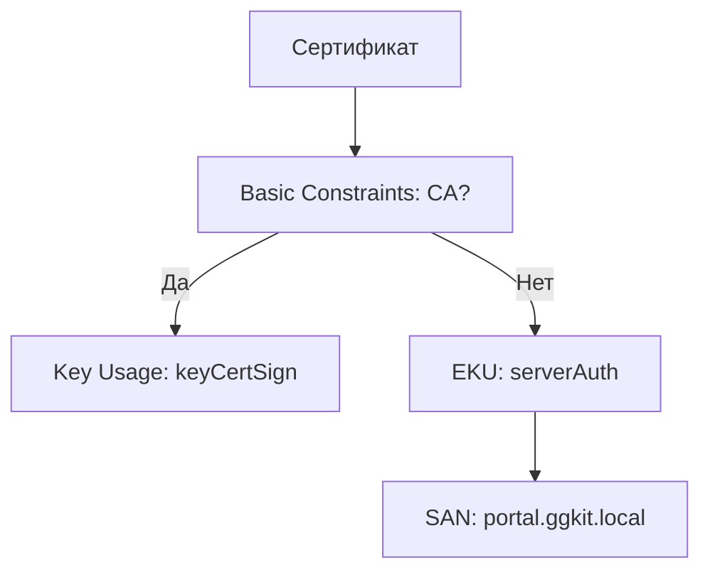

## 1. Что такое X.509

**X.509** — стандарт, определяющий содержимое цифрового сертификата. Он описывает, какие сведения можно записать в сертификат и как удостоверяющий центр подтверждает их подписью.

X.509 не следует путать с PEM: X.509 определяет структуру сертификата, а PEM — способ представления данных в файле.

## 2. Основные поля сертификата

Пример сертификата `portal.ggkit.local`:

| Поле | Пример | Назначение |
|---|---|---|
| Subject | CN=portal.ggkit.local | Кому выдан |
| Issuer | GGKIT Intermediate CA | Кто выдал |
| Serial Number | 01A2 | Номер сертификата у данного CA |
| Validity | 90 дней | Начало и конец действия |
| Public Key | RSA | Открытый ключ владельца |
| Signature | SHA-256 with RSA | Подпись CA и её алгоритм |

Подпись защищает содержимое сертификата от незаметного изменения. Проверка цепочки описана в [[Synced/DevOps/CI-CD, артефакты, тестирование и DevSecOps/5. DevSecOps и безопасность цепочки поставок/9. PKI и криптография в инфраструктуре/2. Инфраструктура открытых ключей/1. Архитектура PKI и цепочка доверия.md|Архитектура PKI и цепочка доверия]].

## 3. Расширения сертификата (Extensions)

Расширения — дополнительные поля, определяющие имена, разрешённое использование и ограничения сертификата.

### 3.1. Subject Alternative Name (SAN)

Список имён и IP-адресов, для которых действителен сертификат.

```ini
subjectAltName = DNS:portal.ggkit.local,DNS:api.ggkit.local
```

Современные HTTPS-клиенты проверяют DNS-имя по SAN. Если подключение выполняется по IP, этот IP должен быть указан как `IP:`, а не `DNS:`. CN не заменяет SAN.

### 3.2. Basic Constraints

Определяет, является ли сертификат сертификатом CA.

```ini
basicConstraints = critical,CA:FALSE
```

`CA:FALSE` — обычный сертификат сервера. `CA:TRUE` — сертификат удостоверяющего центра. Для промежуточного CA значение `pathlen:0` запрещает наличие нижестоящих несамовыданных промежуточных CA в проверяемой цепочке, но разрешает выпуск конечных сертификатов.

### 3.3. Key Usage (KU)

Определяет разрешённые операции с ключом.

| Значение | Назначение |
|---|---|
| digitalSignature | Создание и проверка цифровых подписей |
| keyEncipherment | Шифрование ключевого материала, например в старых RSA-режимах TLS |
| keyCertSign | Подписание сертификатов CA |
| cRLSign | Подписание списков отозванных сертификатов |

### 3.4. Extended Key Usage (EKU)

Уточняет назначение сертификата на уровне приложений.

| Значение | Назначение |
|---|---|
| serverAuth | TLS-сервер |
| clientAuth | TLS-клиент |
| codeSigning | Подписание программного кода |

Например, `serverAuth` используется для HTTPS. Для взаимной TLS-аутентификации клиенту обычно нужен `clientAuth`.

### 3.5. Critical

Пометка `critical` означает, что клиент обязан понимать и учитывать это расширение. Если критическое расширение неизвестно клиенту, сертификат должен быть отклонён при проверке.

## 4. Сравнение сертификатов

| Поле | Intermediate CA | HTTPS-сервер |
|---|---|---|
| Basic Constraints | CA:TRUE | CA:FALSE |
| Key Usage | keyCertSign, cRLSign | digitalSignature (для современного TLS) |
| EKU | Обычно отсутствует | serverAuth |
| SAN | Обычно не нужен | DNS-имя сервера |



Схема показывает типичные различия, а не полный алгоритм проверки. Одного поля CA:TRUE недостаточно, чтобы сертификату доверяли.

## 5. Другие расширения

- SKI — идентификатор открытого ключа сертификата.
- AKI — помогает найти ключ CA, которым подписан сертификат.
- CRL Distribution Points и AIA — могут содержать адреса для получения списка отзыва, промежуточного сертификата или проверки OCSP. Подробнее: [[Synced/DevOps/CI-CD, артефакты, тестирование и DevSecOps/5. DevSecOps и безопасность цепочки поставок/9. PKI и криптография в инфраструктуре/2. Инфраструктура открытых ключей/5. CRL и OCSP.md|CRL и OCSP]].

## 6. Certificate Policies

Certificate Policies — поле с идентификаторами правил, по которым CA выпустил сертификат. Идентификатор называется OID и имеет вид последовательности чисел через точки.

Например, организация может определить отдельные правила выпуска для сотрудников и устройств. Само наличие OID не обеспечивает соблюдение этих правил: их должен выполнять CA, а при необходимости проверять приложение.

Для простой внутренней PKI собственные политики в сертификатах обычно не требуются, если приложения их не используют. Планирование: [[Synced/DevOps/CI-CD, артефакты, тестирование и DevSecOps/5. DevSecOps и безопасность цепочки поставок/9. PKI и криптография в инфраструктуре/2. Инфраструктура открытых ключей/8. Проектирование корпоративной PKI.md|Проектирование корпоративной PKI]].

## 7. Просмотр сертификата через OpenSSL

```bash
openssl x509 -in portal.crt -noout -text
```

`x509` — работа с сертификатом, `-in` — входной файл, `-noout` — не выводить исходный PEM, `-text` — показать читаемое содержимое.

Вывод только имени владельца, издателя и срока:

```bash
openssl x509 -in portal.crt -noout -subject -issuer -dates
```

Вывод только основных расширений:

```bash
openssl x509 -in portal.crt -noout -ext subjectAltName,basicConstraints,keyUsage,extendedKeyUsage
```

Эти команды показывают содержимое, но не подтверждают доверие. Проверка подписи и цепочки выполняется отдельно: [[Synced/DevOps/CI-CD, артефакты, тестирование и DevSecOps/5. DevSecOps и безопасность цепочки поставок/9. PKI и криптография в инфраструктуре/2. Инфраструктура открытых ключей/3. Создание и подписание сертификатов.md|Создание и подписание сертификатов]].

## Вопросы для самопроверки

1. Какое поле содержит DNS-имя сервера?
2. Чем CA:TRUE отличается от CA:FALSE?
3. Чем KU отличается от EKU?
4. Что означает critical?

## Итоги — что было разобрано

X.509 определяет структуру сертификата. SAN задаёт имена, Basic Constraints — роль CA, KU — операции с ключом, EKU — назначение в приложениях.

## Связанные заметки

- [[Synced/DevOps/CI-CD, артефакты, тестирование и DevSecOps/5. DevSecOps и безопасность цепочки поставок/9. PKI и криптография в инфраструктуре/2. Инфраструктура открытых ключей/1. Архитектура PKI и цепочка доверия.md|Архитектура PKI и цепочка доверия]]
- [[Synced/DevOps/CI-CD, артефакты, тестирование и DevSecOps/5. DevSecOps и безопасность цепочки поставок/9. PKI и криптография в инфраструктуре/2. Инфраструктура открытых ключей/3. Создание и подписание сертификатов.md|Создание и подписание сертификатов]]
- [[Synced/DevOps/CI-CD, артефакты, тестирование и DevSecOps/5. DevSecOps и безопасность цепочки поставок/9. PKI и криптография в инфраструктуре/2. Инфраструктура открытых ключей/5. CRL и OCSP.md|CRL и OCSP]]
- [[Synced/DevOps/CI-CD, артефакты, тестирование и DevSecOps/5. DevSecOps и безопасность цепочки поставок/9. PKI и криптография в инфраструктуре/2. Инфраструктура открытых ключей/8. Проектирование корпоративной PKI.md|Проектирование корпоративной PKI]]

---

## Теги

#X509 #SAN #KeyUsage #EKU #BasicConstraints #OID #CertificatePolicies #OpenSSL
