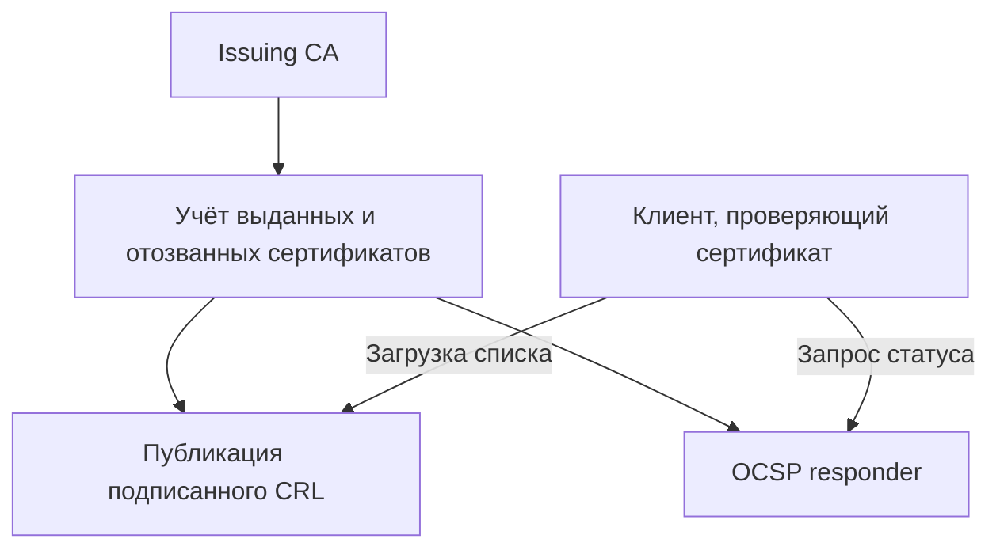
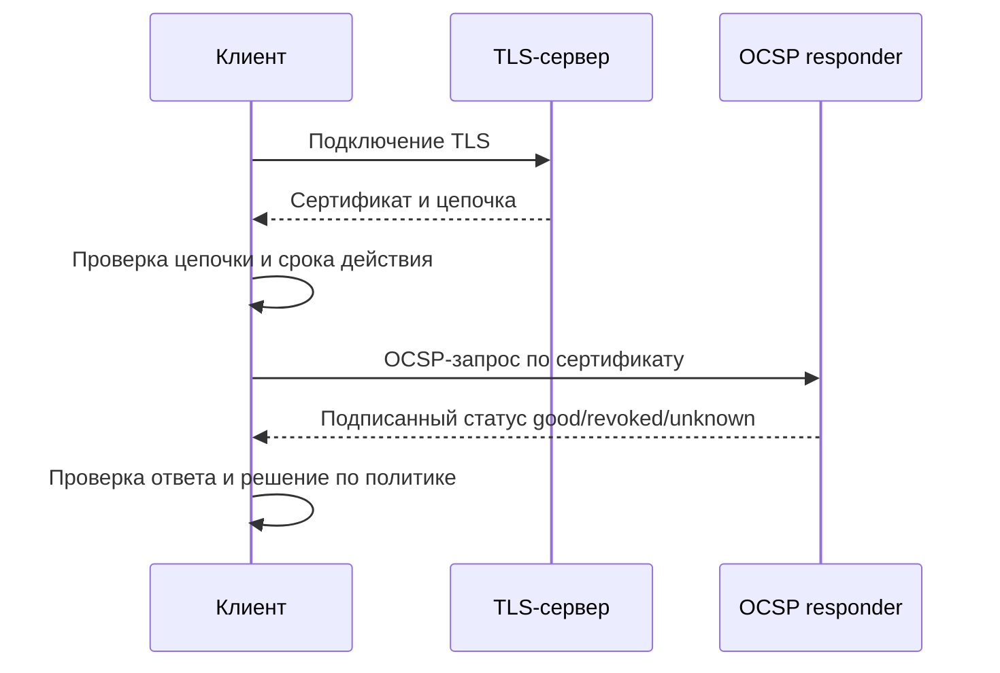
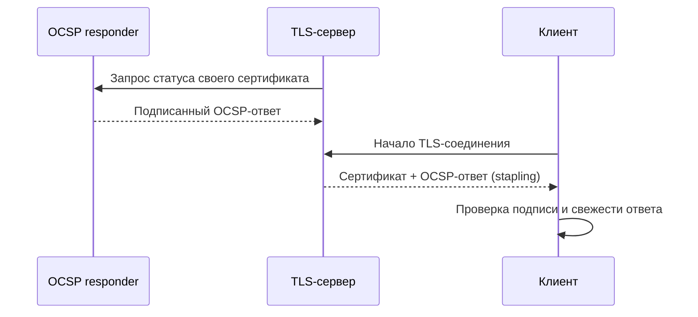

## 1. Зачем нужен отзыв сертификатов

Сертификат X.509 содержит период действия (`Not Before` и `Not After`). Однако сертификат иногда необходимо признать недействительным **до окончания этого периода**.

**Отзыв сертификата (revocation)** — публикация удостоверяющим центром информации о том, что выданному сертификату больше нельзя доверять.

Типичные причины:

- Утечка приватного ключа сервера или пользователя.
- Утрата устройства с ключом.
- Ошибочная выдача сертификата.
- Изменение полномочий владельца сертификата.
- Прекращение работы удостоверяющего центра.

> [!INFO] Важное различие
> Истечение срока действия и отзыв — разные механизмы. Истёкший сертификат не требует отзыва: он уже не проходит проверку срока. Отзыв нужен прежде всего для досрочного прекращения доверия.

Саму цепочку доверия и проверку подписей подробно рассматривает [[Synced/DevOps/CI-CD, артефакты, тестирование и DevSecOps/5. DevSecOps и безопасность цепочки поставок/9. PKI и криптография в инфраструктуре/2. Инфраструктура открытых ключей/1. Архитектура PKI и цепочка доверия.md|Архитектура PKI и цепочка доверия]]. Здесь рассматривается только проверка **статуса отзыва**.

## 2. Где находится информация об отзыве

CA ведёт учёт выданных сертификатов и их статусов. При отзыве CA фиксирует как минимум серийный номер сертификата, дату отзыва и, при необходимости, причину.

Для передачи этой информации клиентам используются два распространённых механизма:

- **CRL (Certificate Revocation List)** — подписанный список отозванных сертификатов.
- **OCSP (Online Certificate Status Protocol)** — запрос статуса отдельного сертификата к специальному серверу.

Оба механизма связаны с CA, который выпустил проверяемый сертификат.



**Как читать схему:** CA учитывает изменения статуса сертификатов. CRL публикует периодически обновляемый список; OCSP отвечает на запросы об отдельных сертификатах. Клиент использует механизм, который поддерживает и который предусмотрен его политикой проверки.

## 3. CRL — список отозванных сертификатов

**CRL** — подписанный удостоверяющим центром документ, содержащий сведения об отозванных сертификатах.

Основные поля CRL:

| Поле | Назначение |
|---|---|
| `Issuer` | CA, выпустивший список |
| `This Update` | Время выпуска данного списка |
| `Next Update` | Время, к которому ожидается следующий список |
| `Revoked Certificates` | Записи об отозванных сертификатах |
| `Serial Number` | Серийный номер отозванного сертификата |
| `Revocation Date` | Дата отзыва |
| `Signature Algorithm` | Алгоритм подписи CRL |

**Порядок проверки через CRL:**

1. Определение CA, выдавшего проверяемый сертификат.
2. Получение актуального CRL этого CA.
3. Проверка цифровой подписи CRL и допустимости его использования.
4. Проверка времени действия CRL (`thisUpdate`, `nextUpdate`).
5. Поиск серийного номера проверяемого сертификата в списке.
6. Принятие решения согласно политике проверки.

Если серийный номер найден в действительном CRL, сертификат считается отозванным. Если номер отсутствует, это означает лишь, что **данный CRL не сообщает об отзыве**: отдельно должны быть выполнены остальные проверки сертификата.

### 3.1. CRL Distribution Points

В сертификате может находиться расширение **CRL Distribution Points (CDP)** — адреса, по которым можно получить список отзыва.

Пример условного значения:

```text
X509v3 CRL Distribution Points:
    Full Name:
      URI:http://pki.example.internal/crl/issuing-ca.crl
```

Ссылка не содержит сам список. Она указывает, **где его получить**.

> [!WARNING] Доступность CRL
> Если внутренний CRL размещён только в закрытой сети, внешние клиенты могут не суметь проверить отзыв. Адрес публикации необходимо выбирать с учётом расположения всех клиентов, которые должны проверять сертификаты.

### 3.2. Публикация и обновление CRL

CRL не обновляется автоматически в момент каждого запроса клиента. CA или связанный с ним процесс должен регулярно **генерировать и публиковать** новый список.

Например:

- CRL выпускается каждые 12 часов.
- Поле `Next Update` устанавливается с запасом, согласованным с политикой CA.
- Система мониторинга проверяет, что новый файл действительно опубликован.

Это **пример политики**, а не обязательный интервал. Чем реже обновление, тем дольше клиенты могут не узнавать об отзыве; чем чаще — тем выше требования к публикации и доступности.

## 4. OCSP — проверка статуса отдельного сертификата

**OCSP** позволяет запросить статус конкретного сертификата у OCSP responder — сервиса, предоставляющего подписанные ответы о статусе.

Основные статусы ответа:

| Статус | Значение |
|---|---|
| `good` | Responder не сообщает об отзыве; это **не доказательство**, что сертификат во всём остальном действителен |
| `revoked` | Сертификат отозван |
| `unknown` | Responder не располагает сведениями о сертификате |

Клиент также проверяет подпись OCSP-ответа, полномочия подписанта, соответствие ответа запрошенному сертификату и временные поля ответа.



**Как читать схему:** после получения сертификата клиент может обратиться к responder. Подписанный ответ сообщает статус, но не заменяет проверку имени сервера, срока действия, подписи сертификата и полномочий CA. На практике клиент может использовать кэш, OCSP stapling либо вообще не выполнять прямой запрос — это зависит от реализации.

### 4.1. Authority Information Access

Адрес OCSP responder обычно указывается в расширении **Authority Information Access (AIA)** сертификата.

```text
Authority Information Access:
    OCSP - URI:http://ocsp.example.internal
```

AIA может также содержать ссылку на сертификат выдавшего CA (`CA Issuers`). Это **разные назначения** одного расширения.

## 5. OCSP stapling

При обычном OCSP клиент самостоятельно обращается к responder. При **OCSP stapling** TLS-сервер заранее получает OCSP-ответ и передаёт его клиенту во время TLS-соединения.



**Как читать схему:** TLS-сервер получает ответ заранее и прикладывает его к соединению. Клиенту не требуется отдельный сетевой запрос к OCSP responder, если предоставленный ответ подходит и принимается его реализацией.

Преимущества:

- Меньше дополнительных запросов со стороны клиентов.
- Меньше раскрытия responder сведений о посещаемых клиентом сайтах.
- Возможность ускорить проверку при поддержке механизма клиентом.

**Ограничение:** наличие stapling не означает, что каждый клиент обязательно проверит отзыв. Поддержка и политика проверки различаются.

## 6. Что происходит при недоступности CRL или OCSP

Существует два принципиальных подхода:

- **Fail-open (soft-fail)** — продолжение соединения, если статус отзыва получить не удалось.
- **Fail-closed (hard-fail)** — отклонение сертификата, если требуемую проверку выполнить невозможно.

| Ситуация | Возможное поведение |
|---|---|
| CRL недоступен | Продолжение либо отказ, в зависимости от политики |
| OCSP responder не отвечает | Продолжение либо отказ, в зависимости от политики |
| Подписанный ответ сообщает `revoked` | Отклонение сертификата при выполнении проверки |
| Ответ `unknown` | Не считать равнозначным `good`; дальнейшее решение определяется политикой |

> [!WARNING] Распространённая ошибка
> Нельзя утверждать, что «браузер всегда проверяет OCSP» или «при недоступности OCSP TLS всегда блокируется». Реализации используют разные политики, кэши и механизмы проверки отзыва.

Для критичных внутренних сервисов политика проверки отзыва должна быть определена явно, а доступность CRL/OCSP — контролироваться.

## 7. CRL и OCSP — сравнение

| Критерий | CRL | OCSP |
|---|---|---|
| Что передаётся | Список отозванных сертификатов | Статус одного сертификата |
| Подпись | Подписанный CA список | Подписанный responder ответ |
| Сетевая нагрузка | Загрузка списка, затем локальная проверка | Запросы или кэшированные ответы |
| Задержка сведений об отзыве | Зависит от периодичности публикации | Зависит от актуальности данных и ответов |
| Работа без доступа к CA | Возможна с актуальным кэшированным CRL | Возможна с действительным кэшированным ответом |
| Типичная проблема | Устаревший или недоступный список | Недоступный responder или просроченный ответ |

**Выбор не обязательно исключающий:** CA может публиковать CRL и одновременно предоставлять OCSP.

## 8. Что именно отзывать при компрометации

### 8.1. Утечка ключа серверного сертификата

1. Генерация новой ключевой пары.
2. Выпуск нового сертификата.
3. Установка нового сертификата на сервер.
4. Отзыв скомпрометированного сертификата.
5. Проверка публикации статуса отзыва и работы сервиса.

При подтверждённой компрометации ключа порядок и срочность операций определяются планом реагирования: старый ключ следует вывести из использования как можно быстрее.

### 8.2. Утечка ключа Intermediate CA

Компрометация ключа Intermediate CA существенно опаснее: злоумышленник потенциально способен подписывать новые сертификаты от имени этого CA.

Требуются отзыв скомпрометированного CA-сертификата вышестоящим CA, создание нового Intermediate CA и замена зависимых сертификатов и цепочек. Одного перевыпуска серверного сертификата через **тот же скомпрометированный CA** недостаточно.

Подробное разделение ролей CA: [[Synced/DevOps/CI-CD, артефакты, тестирование и DevSecOps/5. DevSecOps и безопасность цепочки поставок/9. PKI и криптография в инфраструктуре/2. Инфраструктура открытых ключей/2. Root CA и Intermediate CA.md|Root CA и Intermediate CA]].

### 8.3. Утечка ключа Root CA

Это нарушение основного якоря доверия. Необходима замена доверенного корня и миграция зависимых CA и сертификатов. Обычный CRL, выпущенный скомпрометированным корнем, не может служить надёжным способом восстановления доверия к этому корню.

## 9. Проверка CRL и OCSP с помощью OpenSSL

Команды ниже предназначены для диагностики, а не для развёртывания собственного CA. Пути и адреса условные.

### 9.1. Просмотр адресов CRL и OCSP в сертификате

```bash
openssl x509 -in server.crt -noout -text
```

В выводе поиск разделов `CRL Distribution Points` и `Authority Information Access`.

### 9.2. Просмотр локального CRL

```bash
openssl crl -in issuing-ca.crl -noout -text
```

Если файл CRL получен в DER, необходимо указать формат:

```bash
openssl crl -inform DER -in issuing-ca.crl -noout -text
```

Команда показывает содержимое CRL. **Просмотр файла не равнозначен криптографической проверке его подлинности.**

### 9.3. Проверка статуса через OCSP

```bash
openssl ocsp \
  -issuer issuing-ca.crt \
  -cert server.crt \
  -url http://ocsp.example.internal \
  -CAfile root-ca.crt
```

Параметры:

- `-issuer` — сертификат CA, выдавшего проверяемый сертификат.
- `-cert` — проверяемый сертификат.
- `-url` — адрес responder.
- `-CAfile` — доверенный сертификат для проверки цепочки ответа.

> [!WARNING] Проверка результата
> Для корректной проверки подписи OCSP-ответа может потребоваться передача полной цепочки сертификатов responder и дополнительные параметры в зависимости от конфигурации PKI. Не следует интерпретировать вывод без анализа ошибок проверки.

### 9.4. Проверка цепочки с учётом CRL

```bash
openssl verify \
  -CAfile root-ca.crt \
  -untrusted issuing-ca.crt \
  -CRLfile issuing-ca.crl \
  -crl_check \
  server.crt
```

`-crl_check` требует CRL для проверки конечного сертификата. Для проверки отзыва сертификатов на всех уровнях цепочки существует `-crl_check_all`, но тогда нужны соответствующие CRL для проверяемых CA, а не только для сервера.

Важное условие: корректная проверка должна также учитывать назначение сертификата и имя сервера; команда выше сосредоточена на механизме CRL.

## 10. Организация отзыва во внутренней PKI

Для внутренней инфраструктуры полезно предусмотреть:

1. **Единый учёт** выданных сертификатов, их серийных номеров и владельцев.
2. **Процедуру отзыва** при утрате ключа, выводе устройства из эксплуатации и компрометации CA.
3. **Публикацию CRL** по устойчивому адресу, доступному всем нужным клиентам.
4. **Мониторинг публикации:** дата последнего CRL, `Next Update`, доступность URL, успешная проверка подписи.
5. **OCSP responder**, если он действительно требуется используемыми клиентами и политиками.
6. **Проверку поведения клиентов** при `revoked`, `unknown` и недоступном responder.
7. **Документированную процедуру аварийного перевыпуска** сертификатов.

Автоматизацию операций выпуска и обновления сертификатов следует изучать отдельно: [[Synced/DevOps/CI-CD, артефакты, тестирование и DevSecOps/5. DevSecOps и безопасность цепочки поставок/9. PKI и криптография в инфраструктуре/5. Автоматизация PKI/6. Автоматическое обновление и ротация сертификатов.md|Автоматическое обновление и ротация сертификатов]].

Мониторинг сроков действия и доступности механизмов PKI: [[Synced/DevOps/CI-CD, артефакты, тестирование и DevSecOps/5. DevSecOps и безопасность цепочки поставок/9. PKI и криптография в инфраструктуре/5. Автоматизация PKI/7. Мониторинг сроков действия и состояния сертификатов.md|Мониторинг сроков действия и состояния сертификатов]].

## Вопросы для самопроверки

1. Зачем отзывать сертификат, срок действия которого ещё не закончился?
2. Чем CRL отличается от OCSP?
3. Что означает статус OCSP `good` и чего он **не** гарантирует?
4. Для чего служат расширения CDP и AIA?
5. Почему отсутствие серийного номера в устаревшем CRL не гарантирует безопасность?
6. В чём разница между fail-open и fail-closed?
7. Как работает OCSP stapling?
8. Почему компрометация Intermediate CA требует более масштабных действий, чем утечка ключа одного сервера?

## Итоги — что было разобрано

- Отзыв позволяет досрочно прекратить доверие к сертификату.
- CRL публикует подписанный список отозванных сертификатов; OCSP предоставляет подписанный статус отдельного сертификата.
- CDP и AIA помогают найти источники сведений об отзыве.
- OCSP stapling позволяет TLS-серверу передавать клиенту заранее полученный ответ.
- Реальная проверка отзыва зависит от возможностей и политики клиента.
- Для внутренней PKI необходимы публикация статусов, мониторинг и процедура реагирования на компрометацию.

## Связанные заметки

- [[Synced/DevOps/CI-CD, артефакты, тестирование и DevSecOps/5. DevSecOps и безопасность цепочки поставок/9. PKI и криптография в инфраструктуре/2. Инфраструктура открытых ключей/1. Архитектура PKI и цепочка доверия.md|Архитектура PKI и цепочка доверия]]
- [[Synced/DevOps/CI-CD, артефакты, тестирование и DevSecOps/5. DevSecOps и безопасность цепочки поставок/9. PKI и криптография в инфраструктуре/2. Инфраструктура открытых ключей/2. Root CA и Intermediate CA.md|Root CA и Intermediate CA]]
- [[Synced/DevOps/CI-CD, артефакты, тестирование и DevSecOps/5. DevSecOps и безопасность цепочки поставок/9. PKI и криптография в инфраструктуре/5. Автоматизация PKI/6. Автоматическое обновление и ротация сертификатов.md|Автоматическое обновление и ротация сертификатов]]
- [[Synced/DevOps/CI-CD, артефакты, тестирование и DevSecOps/5. DevSecOps и безопасность цепочки поставок/9. PKI и криптография в инфраструктуре/5. Автоматизация PKI/7. Мониторинг сроков действия и состояния сертификатов.md|Мониторинг сроков действия и состояния сертификатов]]

---

## Теги

#PKI #X509 #CRL #OCSP #OCSPStapling #CertificateRevocation #CertificateAuthority #TLS #DevSecOps #CertificateLifecycle #OpenSSL #Security
