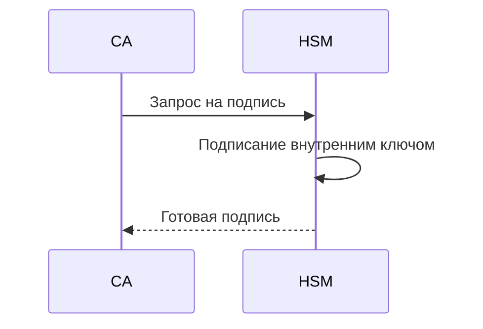

## 1. Почему ключи CA необходимо защищать

Приватный ключ CA используется для подписания сертификатов. Если злоумышленник получит доступ к нему, он сможет выпускать сертификаты от имени этого CA в пределах его полномочий.

| Ключ | Последствия компрометации |
|---|---|
| Ключ сервера | Возможность выдавать себя за этот сервер |
| Ключ Intermediate CA | Возможность выпускать поддельные сертификаты в пределах полномочий CA |
| Ключ Root CA | Нарушение доверия ко всей подчинённой инфраструктуре |

При компрометации необходимо заменить ключи и сертификаты, а также прекратить доверие к скомпрометированному CA или сертификату. Подробнее: [[Synced/DevOps/CI-CD, артефакты, тестирование и DevSecOps/5. DevSecOps и безопасность цепочки поставок/9. PKI и криптография в инфраструктуре/2. Инфраструктура открытых ключей/5. CRL и OCSP.md|CRL и OCSP]].

## 2. Раздельное хранение ключей


Root CA хранится отдельно и включается только для необходимых операций. Intermediate CA работает постоянно. Ключи остаются у своих владельцев; стрелки показывают передачу подписанных сертификатов, а не ключей.

Подробнее об архитектуре: [[Synced/DevOps/CI-CD, артефакты, тестирование и DevSecOps/5. DevSecOps и безопасность цепочки поставок/9. PKI и криптография в инфраструктуре/2. Инфраструктура открытых ключей/2. Root CA и Intermediate CA.md|Root CA и Intermediate CA]].

## 3. Защита ключа в файле

### 3.1. Права доступа

Если CA работает под отдельной учётной записью `step-ca`, доступ к ключу можно ограничить этой записью. Пример для существующего сервиса и файла:

```bash
sudo chown step-ca:step-ca /etc/step-ca/secrets/intermediate_ca_key
sudo chmod 600 /etc/step-ca/secrets/intermediate_ca_key
```

`chown` назначает владельца и группу, `chmod 600` разрешает чтение и запись только владельцу. Родительские каталоги также должны иметь ограниченный доступ. Реальные путь и пользователь зависят от установки CA.

Проверка:

```bash
ls -l /etc/step-ca/secrets/intermediate_ca_key
```

Ожидаемые права: `-rw-------`.

### 3.2. Шифрование приватного ключа

Приватный ключ можно хранить в зашифрованном виде. Для использования потребуется пароль.

Пример создания нового зашифрованного RSA-ключа (не замена ключа существующего CA):

```bash
umask 077
openssl genpkey -algorithm RSA -aes-256-cbc \
  -pkeyopt rsa_keygen_bits:3072 -out example.key
```

`-aes-256-cbc` включает шифрование файла, `-pkeyopt` задаёт размер ключа, `-out` — имя файла. OpenSSL запросит пароль.

> [!WARNING]
> Шифрование файла защищает ключ при его хранении, но не гарантирует защиту на взломанном работающем сервере. Если сервис автоматически читает пароль из файла, этот файл также необходимо защищать.

## 4. Что такое HSM

**HSM (Hardware Security Module)** — аппаратное устройство, предназначенное для защищённого хранения и использования криптографических ключей.

При обычном хранении CA читает ключ из файла. При использовании HSM ключ может создаваться внутри устройства и оставаться там, а CA передаёт устройству запрос на создание подписи.



CA получает подпись, а не приватный ключ. Для этого ключ должен быть создан или импортирован с соответствующим запретом экспорта.

HSM не защищает от всех атак: если злоумышленник управляет авторизованным CA, он может попытаться использовать HSM для незаконного подписания. Поэтому необходимы контроль доступа и правила выпуска.

## 5. Способы хранения ключей

| Способ | Особенность |
|---|---|
| Файл с ограниченными правами | Просто настроить, ключ доступен процессу CA |
| Зашифрованный файл | Для открытия требуется пароль |
| TPM | Аппаратная защита ключей на конкретном компьютере, если ПО поддерживает её |
| HSM | Специализированное устройство для криптографических операций |

PKCS#11 — распространённый программный интерфейс, через который приложения могут обращаться к HSM. Поддержка конкретного устройства зависит от программного обеспечения CA. SoftHSM реализует подобный интерфейс программно, но не обеспечивает аппаратную защиту.

## 6. Что выбрать для внутренней PKI

Для небольшой инфраструктуры разумная отправная точка — изолированный Root CA с зашифрованным ключом, отдельный Intermediate CA, ограниченные права доступа и защищённые резервные копии. HSM имеет смысл при повышенных требованиях к защите ключей или наличии подходящего оборудования.

Резервное копирование и восстановление: [[Synced/DevOps/CI-CD, артефакты, тестирование и DevSecOps/5. DevSecOps и безопасность цепочки поставок/9. PKI и криптография в инфраструктуре/2. Инфраструктура открытых ключей/7. Резервное копирование и восстановление CA.md|Резервное копирование и восстановление CA]]. Выбор архитектуры и требований: [[Synced/DevOps/CI-CD, артефакты, тестирование и DevSecOps/5. DevSecOps и безопасность цепочки поставок/9. PKI и криптография в инфраструктуре/2. Инфраструктура открытых ключей/8. Проектирование корпоративной PKI.md|Проектирование корпоративной PKI]].

## Вопросы для самопроверки

1. Почему ключ Root CA важнее ключа отдельного сервера?
2. Что защищает chmod 600?
3. От чего защищает шифрование файла ключа?
4. Чем HSM отличается от обычного файла?

## Итоги — что было разобрано

Ключи CA необходимо изолировать и ограничивать доступ к ним. HSM позволяет выполнять подписи без выдачи приватного ключа приложению, но не заменяет контроль выпуска сертификатов.

## Связанные заметки

- [[Synced/DevOps/CI-CD, артефакты, тестирование и DevSecOps/5. DevSecOps и безопасность цепочки поставок/9. PKI и криптография в инфраструктуре/2. Инфраструктура открытых ключей/1. Архитектура PKI и цепочка доверия.md|Архитектура PKI и цепочка доверия]]
- [[Synced/DevOps/CI-CD, артефакты, тестирование и DevSecOps/5. DevSecOps и безопасность цепочки поставок/9. PKI и криптография в инфраструктуре/2. Инфраструктура открытых ключей/2. Root CA и Intermediate CA.md|Root CA и Intermediate CA]]
- [[Synced/DevOps/CI-CD, артефакты, тестирование и DevSecOps/5. DevSecOps и безопасность цепочки поставок/9. PKI и криптография в инфраструктуре/2. Инфраструктура открытых ключей/5. CRL и OCSP.md|CRL и OCSP]]
- [[Synced/DevOps/CI-CD, артефакты, тестирование и DevSecOps/5. DevSecOps и безопасность цепочки поставок/9. PKI и криптография в инфраструктуре/2. Инфраструктура открытых ключей/7. Резервное копирование и восстановление CA.md|Резервное копирование и восстановление CA]]
- [[Synced/DevOps/CI-CD, артефакты, тестирование и DevSecOps/5. DevSecOps и безопасность цепочки поставок/9. PKI и криптография в инфраструктуре/2. Инфраструктура открытых ключей/8. Проектирование корпоративной PKI.md|Проектирование корпоративной PKI]]

---

## Теги

#PKI #HSM #TPM #PKCS11 #PrivateKey #RootCA #ЗащитаКлючей #OpenSSL
