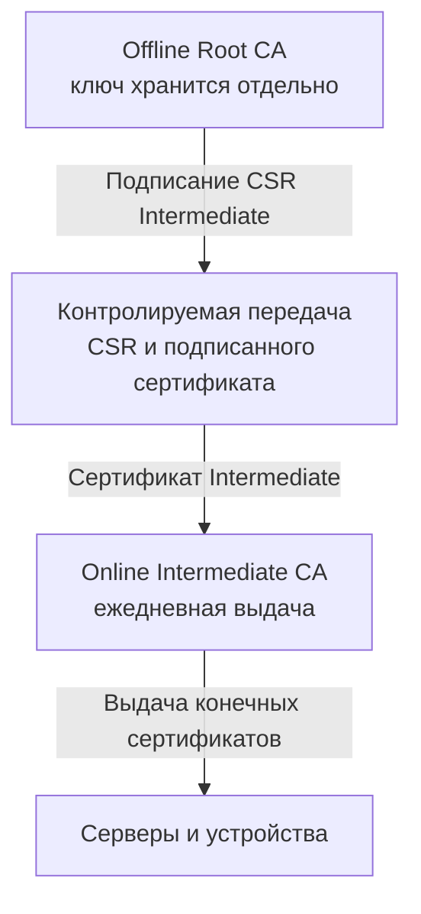
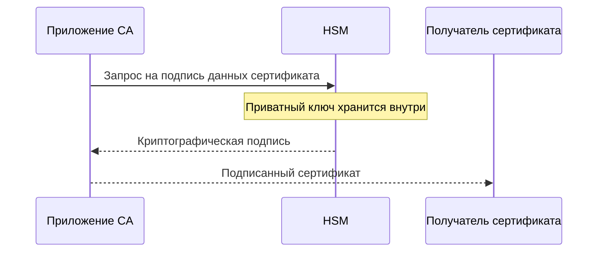

## 1. Почему защита ключей CA важнее защиты обычного сертификата

**Приватный ключ CA** используется для подписания сертификатов и, в зависимости от архитектуры, списков отзыва. Тот, кто получает доступ к этому ключу, может выпускать сертификаты, которые выглядят подписанными данным удостоверяющим центром.

Утечка ключа веб-сервера затрагивает прежде всего этот сервер. Утечка ключа **Intermediate CA** может затронуть все сертификаты, выданные им. Утечка ключа **Root CA** ставит под угрозу всю цепочку доверия, построенную на этом корне.

Устройство Root CA, Intermediate CA и их роли рассмотрены в [[Synced/DevOps/CI-CD, артефакты, тестирование и DevSecOps/5. DevSecOps и безопасность цепочки поставок/9. PKI и криптография в инфраструктуре/2. Инфраструктура открытых ключей/2. Root CA и Intermediate CA.md|Root CA и Intermediate CA]]. Здесь основное внимание уделено **хранению ключей, контролю доступа и восстановлению**.

> [!IMPORTANT] Главное правило
> Сертификат CA (`.crt`) — публичный документ. Его можно распространять. Приватный ключ CA (`.key`) — секрет, который нельзя передавать клиентам, помещать в публичные репозитории или копировать на серверы без необходимости.

## 2. Какие угрозы необходимо учитывать

| Угроза | Что может произойти | Основная мера |
|---|---|---|
| Кража файла приватного ключа | Злоумышленник подписывает сертификаты | Шифрование, ограничение доступа, HSM |
| Компрометация ОС CA | Использование ключа через работающий сервис | Изоляция, обновления, минимальные привилегии |
| Ошибка администратора | Удаление или раскрытие ключа | Резервные копии, разделение ролей |
| Кража резервной копии | Получение ключа из бэкапа | Шифрование и отдельное хранение |
| Потеря ключа | Невозможность подписывать новые сертификаты и выполнять часть операций CA | Проверенное восстановление или план замены CA |
| Злоупотребление правами | Выпуск несанкционированного сертификата | Аудит, согласование операций, политики выдачи |

**Шифрование файла ключа не защищает от всех угроз.** Если CA запущен и уже получил доступ к ключу, злоумышленник с достаточными правами на сервере может попытаться использовать его для подписи.

## 3. Offline Root CA

**Offline Root CA** — корневой удостоверяющий центр, который не подключён постоянно к рабочей сети.

Обычно он нужен только для редких операций:

- выпуск или замена сертификата Intermediate CA;
- публикация нового корневого CRL, если применяется отзыв;
- плановая ротация корневого CA;
- восстановление после аварии.



**Пояснение схемы.** Root CA не обслуживает ежедневные заявки. Intermediate CA формирует CSR, который передаётся в изолированную среду. После проверки Root CA подписывает заявку. Обратно возвращается сертификат Intermediate CA, **не приватный ключ Root CA**. Далее Intermediate CA самостоятельно выдаёт сертификаты сервисам.

> [!WARNING] Изоляция не равна безопасности автоматически
> Даже отключённый от сети компьютер может быть скомпрометирован через носитель, резервную копию или действия администратора. Нужны проверка носителей, контроль физического доступа и журналирование операций.

## 4. Online Intermediate CA

**Online Intermediate CA** доступен для автоматической выдачи сертификатов, поэтому его защита строится иначе: нельзя просто постоянно выключать сервер.

Рекомендуемые меры:

1. Выделенная VM или отдельный защищённый сервер для CA.
2. Минимальное количество администраторов и сервисов на хосте.
3. Ограничение входящих соединений только необходимыми портами.
4. Отдельная учётная запись службы без избыточных прав.
5. Аудит выпуска, отзыва и изменения конфигурации.
6. Резервное копирование ключа и базы CA по утверждённой процедуре.
7. Мониторинг доступности и подозрительных операций.

Автоматизированное управление CA через Smallstep рассматривается отдельно в [[Synced/DevOps/CI-CD, артефакты, тестирование и DevSecOps/5. DevSecOps и безопасность цепочки поставок/9. PKI и криптография в инфраструктуре/5. Автоматизация PKI/2. Smallstep step-ca — архитектура и установка.md|Smallstep step-ca]].

## 5. Хранение ключа в файле

Простой вариант — хранение приватного ключа CA в зашифрованном файле на диске.

Например, генерация зашифрованного RSA-ключа:

```bash
openssl genpkey -algorithm RSA -aes-256-cbc -out ca.key -pkeyopt rsa_keygen_bits:4096
```

- `genpkey` — создание приватного ключа;
- `-algorithm RSA` — выбор алгоритма;
- `-aes-256-cbc` — шифрование файла паролем;
- `-out ca.key` — путь к файлу;
- `rsa_keygen_bits:4096` — длина ключа RSA.

Ограничение прав на файл:

```bash
chmod 600 ca.key
```

`600` означает чтение и запись только владельцем. Это защищает от обычных пользователей системы, **но не от root и не от полной компрометации ОС**.

Проверка сведений о ключе без вывода приватного содержимого:

```bash
openssl pkey -in ca.key -noout -text_pub
```

> [!TIP] Для конспекта
> Пароль на ключ, права доступа к файлу и шифрование диска решают разные задачи. Они дополняют друг друга, но не заменяют изоляцию CA.

## 6. Что такое HSM

**HSM (Hardware Security Module)** — специализированное аппаратное устройство или сервис, предназначенный для защищённого хранения криптографических ключей и выполнения криптографических операций.

Главное отличие от обычного файла: **ключ может создаваться внутри HSM и не покидать его в открытом виде**. CA передаёт устройству запрос на подпись, а HSM возвращает результат.



**Пояснение схемы.** Приложение CA готовит данные сертификата и обращается к HSM. Подпись создаётся внутри защищённого устройства. Приложение получает подпись и формирует сертификат; извлечение приватного ключа для этого не требуется.

HSM **не проверяет автоматически**, имеет ли заявитель право на сертификат. Проверка заявки, политики выдачи и аутентификация остаются задачами CA.

## 7. HSM, TPM и программное хранение: различия

| Способ | Где находится ключ | Типичное применение |
|---|---|---|
| Зашифрованный файл | На диске, доступен ОС после разблокировки | Лаборатории, небольшие внутренние CA |
| TPM | В аппаратном модуле конкретного компьютера либо защищён им | Ключи устройства, привязка к хосту |
| HSM | В специализированном криптографическом модуле | Ключи CA и операции высокой важности |
| Облачный HSM | В управляемом аппаратном модуле провайдера | PKI в облачной инфраструктуре |

**TPM не является прямой заменой HSM для любого CA.** Поддерживаемые алгоритмы, производительность, механизмы доступа и интеграции отличаются.

Для интеграции приложений с HSM часто применяются интерфейсы **PKCS#11**, а также специфичные API поставщиков.

## 8. Что такое PKCS#11

**PKCS#11** — стандартный интерфейс, через который программа может работать с криптографическими токенами и HSM.

Приложение может запросить:

- создание ключа;
- поиск ключа по идентификатору;
- выполнение операции подписи;
- получение публичного ключа или сертификата.

Приватный ключ при этом может оставаться внутри устройства.


**Пояснение схемы.** CA использует программную библиотеку PKCS#11, которая переводит запросы приложения в операции поддерживаемого устройства. Возможность такой интеграции зависит от конкретного CA, HSM и драйвера.

## 9. Контроль доступа и разделение обязанностей

Недостаточно защитить файл ключа. Важно ограничить, **кто может инициировать подпись**.

Полезно разделить роли:

| Роль | Полномочия |
|---|---|
| Администратор платформы | Обслуживание ОС и оборудования |
| Оператор CA | Выпуск сертификатов по утверждённой политике |
| Ответственный за безопасность | Утверждение чувствительных операций, аудит |
| Ответственный за резервное копирование | Контролируемое сохранение и восстановление |

Для Root CA особенно важен принцип **двух лиц**: критическая операция требует участия или подтверждения двух уполномоченных сотрудников. Некоторые HSM поддерживают техническое разделение доступа между несколькими держателями ключевых компонентов.

Важно учитывать, что роли в маленькой организации могут совмещаться. В таком случае компенсирующими мерами становятся независимый аудит и документированная процедура.

## 10. Резервное копирование ключей CA

**Потеря приватного ключа CA не означает, что уже выданные сертификаты немедленно перестанут проверяться.** Однако CA не сможет выполнять новые операции подписи этим ключом, а дальнейшее обслуживание PKI может оказаться затруднено.

Резервная копия должна учитывать:

1. **Ключ CA** — зашифрованная копия или поддерживаемый HSM механизм резервирования.
2. **Сертификат и цепочку CA** — публичные сертификаты.
3. **Базу CA** — учёт выданных сертификатов, серийные номера, сведения об отзыве.
4. **Конфигурацию и политики** — параметры выдачи и интеграций.
5. **Пароли и процедуры восстановления** — хранение отдельно от самой копии.

Для некоторых HSM **экспорт ключа запрещён**, и обычное копирование файла невозможно. Тогда резервирование организуется средствами производителя: защищённый backup-токен, кластер или процедура восстановления ключевого материала.

> [!WARNING] Проверка восстановления
> Резервная копия считается пригодной только после успешного тестового восстановления в изолированной среде. Не следует проверять её впервые во время аварии.

## 11. Компрометация ключа CA

**Компрометация** — ситуация, когда есть основания считать, что приватный ключ стал доступен постороннему или используется без разрешения.

При компрометации Intermediate CA:

1. Остановить несанкционированный выпуск сертификатов.
2. Изолировать затронутую систему и сохранить данные для расследования.
3. Отозвать сертификат скомпрометированного Intermediate CA, если это предусмотрено инфраструктурой.
4. Создать новый Intermediate CA с новым ключом.
5. Перевыпустить сертификаты, зависящие от скомпрометированного CA.
6. Обеспечить распространение актуальной информации об отзыве и проверить клиентов.

При компрометации Root CA может потребоваться **создать новый корень и заново распространить доверие**. Это значительно сложнее, чем обычная плановая ротация Intermediate CA.

Механизмы CRL и OCSP подробно рассмотрены в [[Synced/DevOps/CI-CD, артефакты, тестирование и DevSecOps/5. DevSecOps и безопасность цепочки поставок/9. PKI и криптография в инфраструктуре/2. Инфраструктура открытых ключей/5. CRL и OCSP.md|CRL и OCSP]].

> [!IMPORTANT] Ограничение отзыва
> Отзыв не гарантирует немедленное прекращение доверия у всех клиентов: поведение зависит от проверки CRL/OCSP и её доступности. Для критических инцидентов может потребоваться изменение доверенных корней и промежуточных CA на конечных устройствах.

## 12. Выбор решения для внутренней PKI

Для небольшой учебной или корпоративной инфраструктуры разумна поэтапная схема:

- **Root CA:** изолированная система, шифрование ключа, редкие контролируемые операции, отдельные резервные копии.
- **Intermediate CA:** выделенный сервер с ограниченным доступом, аудитом и резервированием.
- **HSM:** рассмотреть при повышенных требованиях к защите ключей, наличии бюджета и совместимого CA.
- **Автоматическая выдача:** применять CA-сервис и ACME вместо ручной подписи каждого серверного сертификата.

Протокол ACME и его применение рассмотрены в [[Synced/DevOps/CI-CD, артефакты, тестирование и DevSecOps/5. DevSecOps и безопасность цепочки поставок/9. PKI и криптография в инфраструктуре/5. Автоматизация PKI/1. ACME — архитектура и принципы работы.md|архитектуре ACME]] и [[Synced/DevOps/CI-CD, артефакты, тестирование и DevSecOps/5. DevSecOps и безопасность цепочки поставок/9. PKI и криптография в инфраструктуре/5. Автоматизация PKI/4. ACME — автоматическая выдача сертификатов.md|автоматической выдаче сертификатов]].

**HSM не является обязательным условием существования PKI.** Но если требования к защите ключей высоки, его использование значительно уменьшает риск извлечения приватного ключа из обычной файловой системы. При этом безопасность всей PKI всё равно зависит от политик выдачи, доступа к CA и защиты сервера.

## Вопросы для самопроверки

1. Почему компрометация ключа CA опаснее утечки ключа обычного сервера?
2. Чем Offline Root CA отличается от Online Intermediate CA?
3. Почему шифрование файла ключа не защищает от полной компрометации работающего CA?
4. Что делает HSM при подписании сертификата?
5. Чем HSM отличается от TPM?
6. Для чего нужен PKCS#11?
7. Какие данные, кроме приватного ключа, необходимо резервировать для восстановления CA?
8. Почему отзыв скомпрометированного CA не всегда приводит к немедленному прекращению доверия?

## Итоги — что было разобрано

- Приватный ключ CA — наиболее критичный секрет PKI.
- Offline Root CA снижает число ситуаций, в которых корневой ключ подвергается риску.
- Online Intermediate CA требует защиты ОС, учётных записей, операций подписи и журналов.
- HSM позволяет выполнять криптографические операции без извлечения приватного ключа в приложение.
- Резервное копирование, проверка восстановления и план реагирования на компрометацию обязательны для устойчивой эксплуатации CA.

## Связанные заметки

- [[Synced/DevOps/CI-CD, артефакты, тестирование и DevSecOps/5. DevSecOps и безопасность цепочки поставок/9. PKI и криптография в инфраструктуре/2. Инфраструктура открытых ключей/2. Root CA и Intermediate CA.md|Root CA и Intermediate CA]]
- [[Synced/DevOps/CI-CD, артефакты, тестирование и DevSecOps/5. DevSecOps и безопасность цепочки поставок/9. PKI и криптография в инфраструктуре/2. Инфраструктура открытых ключей/5. CRL и OCSP.md|CRL и OCSP]]
- [[Synced/DevOps/CI-CD, артефакты, тестирование и DevSecOps/5. DevSecOps и безопасность цепочки поставок/9. PKI и криптография в инфраструктуре/5. Автоматизация PKI/2. Smallstep step-ca — архитектура и установка.md|Smallstep step-ca — архитектура и установка]]
- [[Synced/DevOps/CI-CD, артефакты, тестирование и DevSecOps/5. DevSecOps и безопасность цепочки поставок/9. PKI и криптография в инфраструктуре/5. Автоматизация PKI/1. ACME — архитектура и принципы работы.md|ACME — архитектура и принципы работы]]

---

## Теги

#PKI #CA #RootCA #IntermediateCA #HSM #PKCS11 #TPM #Cryptography #KeyManagement #PrivateKey #OfflineCA #DevSecOps #CertificateSecurity #Backup #IncidentResponse
