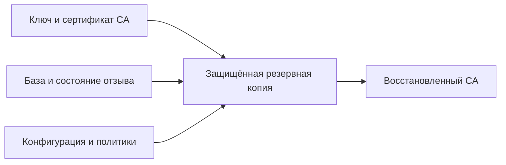
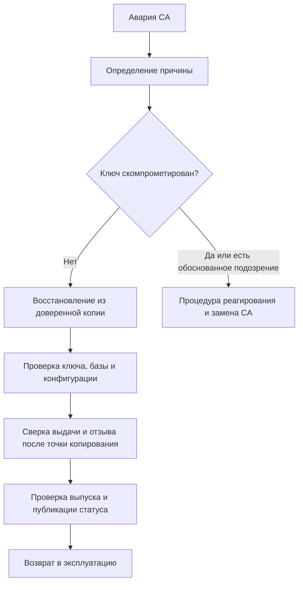

## 1. Назначение резервного копирования CA

Резервное копирование удостоверяющего центра — сохранение ключей, сертификатов, состояния и конфигурации, необходимых для восстановления его работы.

При выходе из строя сервера CA уже выданные сертификаты не перестают действовать автоматически. Клиенты могут продолжать проверять их подписи. Однако выпуск новых сертификатов, продление и публикация актуальных сведений об отзыве могут стать недоступными.

Восстановление прежнего CA отличается от создания нового CA: при восстановлении сохраняется прежняя криптографическая идентичность центра и его административное состояние.

> [!IMPORTANT]
> Потеря приватного ключа CA без возможности восстановления означает потерю возможности подписывать новые сертификаты этим ключом. Публичный сертификат не позволяет восстановить приватный ключ.

## 2. Состав резервной копии

| Компонент | Назначение |
|---|---|
| Приватный ключ CA | Подписание сертификатов и, в соответствующей конфигурации, CRL |
| Сертификат CA и цепочка | Идентификация центра и построение цепочки доверия |
| База выданных сертификатов | Учёт выдачи, серийных номеров и статусов |
| Сведения об отзыве | Восстановление корректного состояния отзыва |
| Конфигурация и политики | Сохранение правил выпуска и ограничений |
| Учётные данные и настройки интеграций | Восстановление API, ACME, доступа к БД и внешним сервисам |
| Журналы аудита | Расследование инцидентов и проверка истории операций |

Конкретный состав зависит от реализации CA. Например, OpenSSL использует файловую базу, а серверные реализации могут использовать отдельную СУБД.



Стрелки показывают, какие компоненты необходимо сохранить и затем восстановить. Копирование только ключа не восстанавливает историю выдачи и отзыва.

## 3. Резервное копирование Root CA

Корневой центр обычно используется редко: для подписания промежуточных CA и публикации корневого CRL, если это предусмотрено архитектурой.

Для Offline Root CA резервная копия создаётся после первоначальной настройки и после каждого изменения состояния: выпуска или отзыва Intermediate CA, изменения конфигурации, обновления CRL и других операций.

Рекомендуется хранить минимум две независимые защищённые копии в разных физических местах. Носители не должны постоянно оставаться подключёнными к рабочим системам. Пароли расшифрования и средства доступа хранятся отдельно с контролируемой процедурой получения.

Защита ключей и аппаратное хранение рассмотрены в [[Synced/DevOps/CI-CD, артефакты, тестирование и DevSecOps/5. DevSecOps и безопасность цепочки поставок/9. PKI и криптография в инфраструктуре/2. Инфраструктура открытых ключей/6. Защита ключей CA и HSM.md|Защита ключей CA и HSM]].

## 4. Резервное копирование Intermediate CA

Онлайн CA постоянно изменяет состояние при выпуске и отзыве сертификатов. Поэтому однократной копии после установки недостаточно.

Необходимо сохранять согласованное состояние базы данных, конфигурации и ключевого материала. Для внешней СУБД используется поддерживаемый механизм резервного копирования этой СУБД. Простое копирование файлов работающей базы может привести к неконсистентной копии.

При использовании HSM ключ может быть неэкспортируемым. В этом случае применяется поддерживаемый производителем механизм резервирования, репликации или восстановления ключей. Обычный снимок виртуальной машины ключ внутри HSM не сохраняет.

## 5. RPO и RTO

**RPO (Recovery Point Objective)** — допустимый объём потери данных, выраженный временем между последним доступным состоянием и аварией.

**RTO (Recovery Time Objective)** — допустимое время восстановления сервиса.

Например, ежедневное резервное копирование может означать потерю до суток записей о выпуске и отзыве. Для CA это существенно: отозванный после создания копии сертификат может ошибочно оказаться неотозванным в восстановленной базе.

| Компонент | Пример политики |
|---|---|
| Offline Root CA | Копирование после каждой операции |
| База онлайн CA | Ежедневная полная копия и более частое сохранение изменений, если поддерживается |
| Конфигурация | После каждого изменения |
| Проверка восстановления | Ежеквартально и после существенных изменений |

Это пример, а не обязательные интервалы. Для критичной PKI RPO базы следует выбирать с учётом риска потери записей об отзыве; при необходимости применять журналирование транзакций и восстановление на момент времени.

## 6. Пример файлового CA на OpenSSL

Рассмотрим условную структуру CA, использующего команду `openssl ca`:

```text
/srv/pki/issuing-ca/
    openssl.cnf
    private/ca.key
    certs/ca.crt
    index.txt
    serial
    crlnumber
    newcerts/
    crl/
```

- `index.txt` — база состояния выданных сертификатов.
- `serial` — следующий серийный номер при последовательной нумерации.
- `crlnumber` — следующий номер CRL, если настроен.
- `newcerts/` — сохранённые экземпляры выданных сертификатов.

Расположение определяется параметрами `openssl.cnf`. Если конфигурация ссылается на файлы вне каталога, их также необходимо сохранить.

### 6.1. Создание копии

Перед копированием необходимо остановить операции выпуска и отзыва, чтобы файлы соответствовали одному моменту времени.

```bash
sudo tar -C /srv/pki -czf /root/issuing-ca.tar.gz issuing-ca
```

Команда создаёт архив каталога CA. Сам архив **не зашифрован**. Для хранения вне защищённой системы необходимо использовать шифрование, например age с заранее подготовленным ключом получателя:

```bash
sudo age -r "$BACKUP_RECIPIENT" -o /root/issuing-ca.tar.gz.age /root/issuing-ca.tar.gz
```

`BACKUP_RECIPIENT` — публичный ключ получателя резервной копии. Приватный ключ расшифрования должен быть доступен уполномоченным администраторам независимо от аварийного сервера. После проверки зашифрованной копии незашифрованный временный архив не следует оставлять на диске. Предпочтительно создавать зашифрованный архив потоково, без промежуточного файла.

### 6.2. Проверка копии

Проверка возможности расшифрования и чтения архива в изолированной среде:

```bash
age -d -i backup-identity.txt issuing-ca.tar.gz.age | tar -tzf -
```

Команда выводит содержимое архива. Успешное чтение ещё не доказывает работоспособность CA: необходимо отдельно проверить восстановление базы, ключа и операций.

## 7. Порядок восстановления после аварии



Ветви диаграммы различают техническую аварию и инцидент безопасности. При компрометации восстановление того же ключа не устраняет угрозу.

### 7.1. Восстановление среды

Подготовка изолированного сервера с совместимой версией программного обеспечения. Восстановление файлов, базы, прав доступа и необходимых секретов. Проверка сетевых адресов, DNS, URL CRL и OCSP, времени системы.

### 7.2. Проверка соответствия ключа сертификату

Получение отпечатка публичного ключа из приватного ключа:

```bash
openssl pkey -in private/ca.key -pubout -outform DER | sha256sum
```

Получение отпечатка публичного ключа из сертификата:

```bash
openssl x509 -in certs/ca.crt -pubkey -noout | openssl pkey -pubin -outform DER | sha256sum
```

При успешном выполнении обеих команд значения должны совпадать. Это подтверждает соответствие ключевой пары, но не проверяет всю цепочку доверия.

### 7.3. Проверка состояния выдачи и отзыва

Сверка базы с журналами, опубликованными CRL и другими достоверными источниками. Необходимо исключить повторное использование серийных номеров в рамках одного издателя и потерю сведений об отзыве. При невозможности достоверно восстановить состояние следует приостановить выпуск и оценить необходимость замены CA или затронутых сертификатов.

Подробности механизмов отзыва: [[Synced/DevOps/CI-CD, артефакты, тестирование и DevSecOps/5. DevSecOps и безопасность цепочки поставок/9. PKI и криптография в инфраструктуре/2. Инфраструктура открытых ключей/5. CRL и OCSP.md|CRL и OCSP]].

### 7.4. Возврат в эксплуатацию

Проверка выпуска тестового сертификата в контролируемой среде, корректности цепочки, доступности CRL/OCSP (если используются), API и автоматизированного обновления. Перед включением восстановленного экземпляра необходимо исключить параллельную работу старого экземпляра с независимой базой.

## 8. Восстановление и замена CA

| Ситуация | Действие |
|---|---|
| Потеря сервера, ключ и актуальная база сохранены | Восстановление прежнего CA |
| Потеря базы, ключ сохранён | Восстановление и сверка состояния; выпуск приостановить до проверки |
| Потеря ключа Intermediate CA без копии | Создание нового Intermediate CA и миграция сертификатов |
| Потеря ключа Root CA без копии | Планирование нового корня и распространение доверия |
| Компрометация ключа | Реагирование на инцидент, замена затронутого CA и сертификатов |

Потеря ключа не равнозначна его компрометации. При потере ключа ранее созданные подписи остаются проверяемыми, пока выполняются остальные условия доверия. Однако дальнейший выпуск и обслуживание отзыва могут стать невозможными.

Порядок плановой замены центров рассмотрен в [[Synced/DevOps/CI-CD, артефакты, тестирование и DevSecOps/5. DevSecOps и безопасность цепочки поставок/9. PKI и криптография в инфраструктуре/2. Инфраструктура открытых ключей/2. Root CA и Intermediate CA.md|Root CA и Intermediate CA]].

## 9. Резервное копирование виртуальной машины CA

Резервная копия VM позволяет восстановить ОС, приложения и виртуальные диски. Она полезна, но не заменяет согласованную копию состояния приложения.

Например, в Proxmox VE можно использовать Proxmox Backup Server для копирования VM с CA. Дополнительно необходимо обеспечить согласованность базы, сохранение внешних зависимостей и защищённое хранение ключей. Снимок VM не является независимой резервной копией, если хранится на том же массиве.

Доступ к резервным копиям CA должен быть ограничен: администратор, способный извлечь незашифрованный приватный ключ из архива VM, потенциально способен подписывать сертификаты от имени CA.

## 10. Проверка готовности к восстановлению

Резервная копия считается пригодной только после успешной проверки восстановления. Необходимо документировать версию ПО, расположение файлов, порядок восстановления, доступ к ключам расшифрования, ответственных лиц и результаты проверок.

Проверка проводится в изолированной среде. Тестовый экземпляр не должен принимать реальные заявки или публиковать CRL в рабочей инфраструктуре. Для проверки операций выпуска предпочтительно использовать отдельную тестовую PKI; при проверке восстановленного рабочего CA требуется контролируемая процедура, исключающая утечку ключей и конфликт состояния.

## Вопросы для самопроверки

1. Почему копии приватного ключа недостаточно для восстановления CA?
2. Чем отличается RPO от RTO?
3. Почему опасно восстанавливать устаревшую базу отзыва?
4. В каких случаях необходимо заменить CA вместо восстановления?
5. Почему резервная копия VM не гарантирует восстановление ключа HSM?

## Итоги — что было разобрано

Резервное копирование ключей, сертификатов, базы и конфигурации CA; различия между резервированием Root и Intermediate CA; согласованность данных; порядок восстановления и проверка готовности к авариям.

## Связанные заметки

- [[Synced/DevOps/CI-CD, артефакты, тестирование и DevSecOps/5. DevSecOps и безопасность цепочки поставок/9. PKI и криптография в инфраструктуре/2. Инфраструктура открытых ключей/2. Root CA и Intermediate CA.md|Root CA и Intermediate CA]]
- [[Synced/DevOps/CI-CD, артефакты, тестирование и DevSecOps/5. DevSecOps и безопасность цепочки поставок/9. PKI и криптография в инфраструктуре/2. Инфраструктура открытых ключей/5. CRL и OCSP.md|CRL и OCSP]]
- [[Synced/DevOps/CI-CD, артефакты, тестирование и DevSecOps/5. DevSecOps и безопасность цепочки поставок/9. PKI и криптография в инфраструктуре/2. Инфраструктура открытых ключей/6. Защита ключей CA и HSM.md|Защита ключей CA и HSM]]

---

## Теги

#PKI #CA #RootCA #IntermediateCA #Backup #DisasterRecovery #RPO #RTO #OpenSSL #HSM #CRL #OCSP #X509 #DevSecOps #Криптография #РезервноеКопирование #Восстановление
