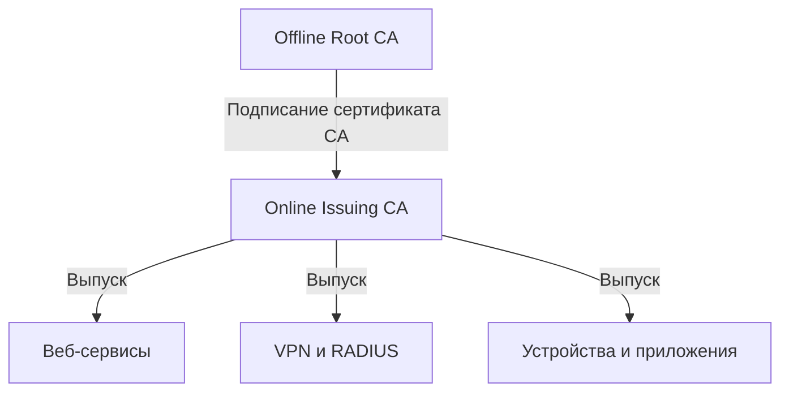
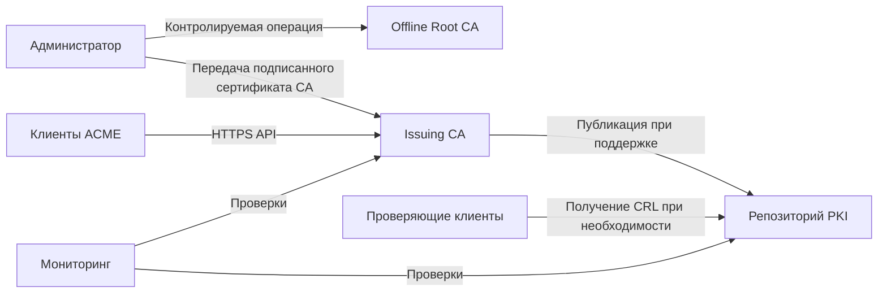
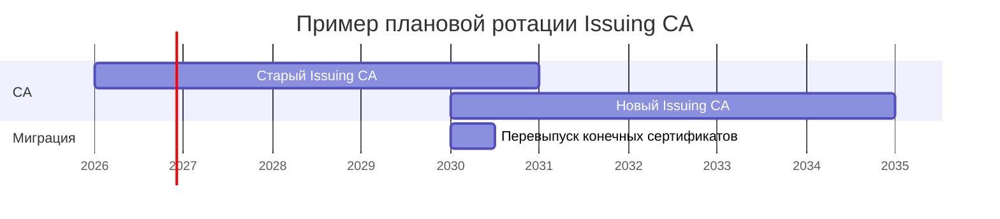
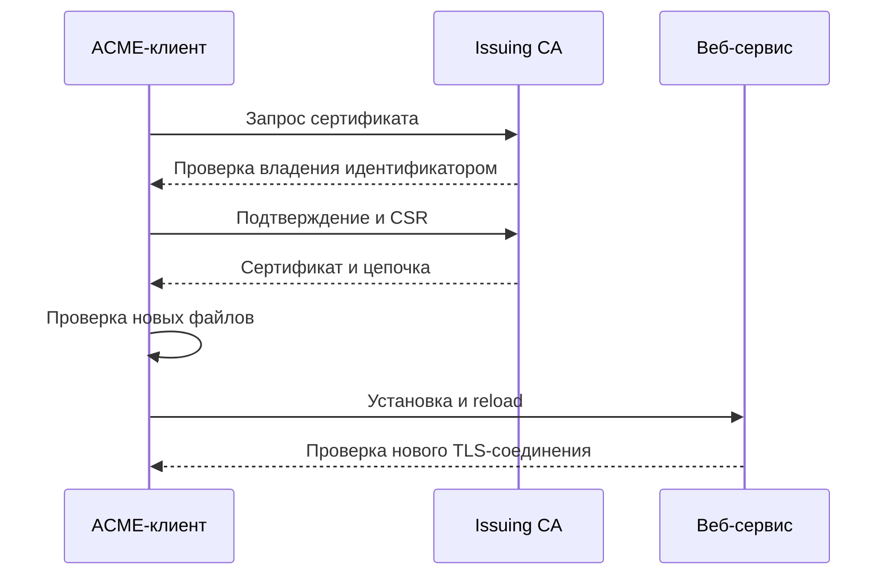

# 8. Проектирование корпоративной PKI

## 1. Определение требований

Проектирование PKI — определение архитектуры удостоверяющих центров и правил управления сертификатами до начала их эксплуатации. Задача состоит не только в выпуске сертификатов, но и в обеспечении доверия к ним на протяжении всего жизненного цикла.

Перед выбором программного обеспечения необходимо определить потребителей сертификатов.

| Потребитель | Назначение | Особенности |
|---|---|---|
| Внутренние веб-сервисы | HTTPS | DNS-имена в SAN, автоматическое обновление |
| VPN | Аутентификация сервера и клиентов | Зависимость от протокола VPN |
| Рабочие станции | Аутентификация устройств | Централизованное распространение доверия |
| RADIUS | EAP-TLS, защита соединения | Проверка назначения сертификатов |
| Внутренние API | TLS и mTLS | Раздельные серверные и клиентские профили |

Необходимо определить число потребителей, максимальный срок сертификата, допустимое время восстановления, способы аутентификации заявителей и возможность автоматического обновления.

> [!INFO]
> Не каждый сервис требует сертификата X.509. Например, WireGuard использует собственные ключевые пары, а не сертификаты корпоративной PKI.

## 2. Выбор архитектуры

Для организации среднего размера подходит двухуровневая иерархия: один офлайн Root CA и один или несколько онлайн Intermediate CA. Подробное устройство центров: [[Synced/DevOps/CI-CD, артефакты, тестирование и DevSecOps/5. DevSecOps и безопасность цепочки поставок/9. PKI и криптография в инфраструктуре/2. Инфраструктура открытых ключей/2. Root CA и Intermediate CA.md|Root CA и Intermediate CA]].



Стрелки обозначают отношения выпуска и подписания сертификатов, а не постоянные сетевые соединения. Root CA не обязан быть доступен по сети при выпуске конечных сертификатов. Issuing CA использует собственный приватный ключ.

Один Issuing CA упрощает эксплуатацию. Несколько независимых Issuing CA целесообразны при разных требованиях к доступу, алгоритмам, срокам или изоляции рисков. Например, отдельный CA для устройств позволяет ограничить последствия компрометации его ключа. Однако такое разделение требует дополнительных политик проверки: само наличие двух CA не запрещает клиенту принимать сертификаты обоих.

## 3. Размещение компонентов

Пример логической схемы для внутреннего домена `ggkit.local`. Имена и адреса ниже являются проектными примерами, а не обязательными параметрами.

| Компонент | Размещение | Назначение |
|---|---|---|
| Root CA | Изолированная система без постоянного сетевого подключения | Подписание CA и публикация данных об отзыве |
| Issuing CA | Выделенная защищённая ВМ | Выпуск конечных сертификатов |
| `ca.ggkit.local` | Внутренний DNS | Стабильная точка доступа к API и ACME |
| `pki.ggkit.local` | Внутренний HTTP-сервис | Публикация сертификатов CA и CRL при поддержке выбранной PKI |
| AD и средства управления Linux | Существующая инфраструктура | Распространение доверенных корней |
| Мониторинг | Отдельная система | Проверка доступности, сроков и ошибок |



Root CA не участвует в сетевом обмене с клиентами. Администратор переносит CSR и подписанный сертификат между изолированной системой и Issuing CA контролируемым способом. Репозиторий публикации не должен содержать приватные ключи. Стабильные DNS-имена позволяют менять адреса серверов без изменения URL, уже записанных в сертификатах.

## 4. Политики выдачи сертификатов

Профиль сертификата определяет допустимые имена, расширения, алгоритмы, срок действия и способ авторизации заявки. Расширения подробно рассмотрены в [[Synced/DevOps/CI-CD, артефакты, тестирование и DevSecOps/5. DevSecOps и безопасность цепочки поставок/9. PKI и криптография в инфраструктуре/2. Инфраструктура открытых ключей/4. X.509, Extensions и Certificate Policies.md|X.509, Extensions и Certificate Policies]].

| Профиль | EKU | Пример срока |
|---|---|---|
| Web Server | serverAuth | 90 дней |
| API Client | clientAuth | 30–90 дней |
| Device | clientAuth | 90–365 дней |
| VPN Server | serverAuth, если требуется реализацией | 90 дней |

Для конечных сертификатов устанавливается `CA:FALSE`. Key Usage выбирается с учётом алгоритма ключа и протокола. Не следует автоматически добавлять все возможные EKU.

Право доступа к API CA не означает право получить сертификат на любое имя. Например, сервису `portal.ggkit.local` разрешается запрашивать только предусмотренные политикой имена. Запрос SAN проверяется независимо от подписи CSR.

Для административных операций необходимы отдельные учётные данные, аудит и минимально необходимые полномочия. Приватный ключ конечного сервиса желательно создавать непосредственно на потребителе.

## 5. Планирование сроков и ротации

Пример политики частной PKI: Root CA — 20 лет, Issuing CA — 5 лет, серверный сертификат — 90 дней. Это проектные ориентиры, а не требования X.509. Сроки выбираются с учётом алгоритмов, защищённости ключей и возможностей обновления.



Период перекрытия позволяет заменить конечные сертификаты до окончания старого CA. Новый CA подписывается тем же доверенным Root CA, а сервисы начинают передавать новую цепочку. Старый CA прекращает выпуск, но данные для проверки ранее выданных сертификатов остаются доступны в течение необходимого периода.

При замене Root CA новый корень сначала распространяется на клиентов, затем начинается миграция сервисов. Старый корень удаляется только после проверки отсутствия зависимостей. Подробности автоматизации: [[Synced/DevOps/CI-CD, артефакты, тестирование и DevSecOps/5. DevSecOps и безопасность цепочки поставок/9. PKI и криптография в инфраструктуре/5. Автоматизация PKI/6. Автоматическое обновление и ротация сертификатов.md|Автоматическое обновление и ротация сертификатов]].

## 6. Распространение доверия

Корневой сертификат является публичным документом. Его необходимо доставлять по аутентифицированному каналу и проверять отпечаток из независимого доверенного источника. Приватный ключ Root CA никогда не распространяется на клиенты.

Для Windows в домене применяется групповая политика импорта корневого сертификата в Trusted Root Certification Authorities. Для Linux возможна централизованная установка через Ansible. Пример для Ubuntu:

```bash
sudo cp root-ca.crt /usr/local/share/ca-certificates/ggkit-root.crt
sudo update-ca-certificates
```

Первая команда помещает PEM-сертификат с расширением `.crt` в каталог локальных доверенных CA. Вторая обновляет системное хранилище.

Отдельно проверяются Java, контейнеры, браузеры, приложения со своим Trust Store и сетевое оборудование. Доверие хоста не обязательно наследуется контейнером. Промежуточный сертификат обычно передаётся сервером вместе с конечным, а не устанавливается как самостоятельный якорь доверия. Подробнее: [[Synced/DevOps/CI-CD, артефакты, тестирование и DevSecOps/5. DevSecOps и безопасность цепочки поставок/9. PKI и криптография в инфраструктуре/2. Инфраструктура открытых ключей/1. Архитектура PKI и цепочка доверия.md|Архитектура PKI и цепочка доверия]].

## 7. Выбор программного обеспечения

| Инструмент | Роль |
|---|---|
| OpenSSL | Низкоуровневые операции, диагностика, ручное создание CA |
| XCA | Графическое управление ключами и сертификатами |
| Smallstep step-ca | Онлайн CA и автоматизированный выпуск |
| step CLI | Удобная работа с сертификатами и CA |
| Certbot, acme.sh | Клиенты ACME |

Для новой внутренней PKI можно рассмотреть step-ca с внешним офлайн корнем. Перед внедрением необходимо проверить поддержку необходимых профилей, механизмов авторизации, отзыва и высокой доступности в выбранной версии. Не следует предполагать, что любой CA поддерживает CRL, OCSP, SCEP и EST одновременно.

Развёртывание CA рассматривается в [[Synced/DevOps/CI-CD, артефакты, тестирование и DevSecOps/5. DevSecOps и безопасность цепочки поставок/9. PKI и криптография в инфраструктуре/5. Автоматизация PKI/2. Smallstep step-ca — архитектура и установка.md|Smallstep step-ca — архитектура и установка]], а работа с клиентской утилитой — в [[Synced/DevOps/CI-CD, артефакты, тестирование и DevSecOps/5. DevSecOps и безопасность цепочки поставок/9. PKI и криптография в инфраструктуре/5. Автоматизация PKI/3. Smallstep step CLI — управление сертификатами.md|Smallstep step CLI — управление сертификатами]].

## 8. Автоматизация жизненного цикла



Клиент получает сертификат после предусмотренной протоколом проверки. Затем проверяет соответствие ключа, имён и цепочки, устанавливает комплект файлов и инициирует поддерживаемую сервисом перезагрузку конфигурации. ACME сам по себе не гарантирует корректную установку сертификата или отсутствие простоя.

Для Nginx, например, перед reload выполняется проверка конфигурации:

```bash
sudo nginx -t
sudo systemctl reload nginx
```

Новый сертификат и ключ необходимо устанавливать согласованно, с сохранением предыдущего рабочего комплекта для отката. После reload следует проверить сертификат, фактически отдаваемый по сети. Подробнее о протоколе: [[Synced/DevOps/CI-CD, артефакты, тестирование и DevSecOps/5. DevSecOps и безопасность цепочки поставок/9. PKI и криптография в инфраструктуре/5. Автоматизация PKI/1. ACME — архитектура и принципы работы.md|ACME — архитектура и принципы работы]].

## 9. Отзыв и публикация данных PKI

При проектировании необходимо определить, как клиенты узнают об отзыве сертификата. CRL и OCSP рассматриваются в [[Synced/DevOps/CI-CD, артефакты, тестирование и DevSecOps/5. DevSecOps и безопасность цепочки поставок/9. PKI и криптография в инфраструктуре/2. Инфраструктура открытых ключей/5. CRL и OCSP.md|CRL и OCSP]].

Если используется CRL, URL публикации должен оставаться доступным для проверяющих клиентов. Необходимо контролировать `nextUpdate` и своевременно публиковать новый подписанный список. Для OCSP требуется поддерживаемый CA механизм выдачи ответов и доступность responder.

Короткоживущие сертификаты уменьшают период риска, но не являются мгновенным отзывом. Если клиент не проверяет отзыв, необходимо предусмотреть дополнительные меры: блокировку учётных данных, отключение доступа и замену скомпрометированных ключей.

## 10. Защита и восстановление

Root CA хранится офлайн, его ключ защищается шифрованием или подходящим аппаратным устройством. Доступ к Issuing CA ограничивается административной сетью и необходимыми API. Подробнее: [[Synced/DevOps/CI-CD, артефакты, тестирование и DevSecOps/5. DevSecOps и безопасность цепочки поставок/9. PKI и криптография в инфраструктуре/2. Инфраструктура открытых ключей/6. Защита ключей CA и HSM.md|Защита ключей CA и HSM]].

Резервное копирование включает ключи либо поддерживаемые HSM средства восстановления, сертификаты, базу выдачи и отзыва, политики, конфигурацию и данные авторизации. Копии шифруются и хранятся отдельно от основной системы. Восстановление проверяется в изолированной среде. Подробнее: [[Synced/DevOps/CI-CD, артефакты, тестирование и DevSecOps/5. DevSecOps и безопасность цепочки поставок/9. PKI и криптография в инфраструктуре/2. Инфраструктура открытых ключей/7. Резервное копирование и восстановление CA.md|Резервное копирование и восстановление CA]].

Недоступность Issuing CA обычно не прекращает уже работающие TLS-соединения и не мешает новым соединениям с действующими сертификатами, если все необходимые проверки доступны. Однако выпуск и продление останавливаются. Недоступность CRL/OCSP может отдельно влиять на клиентов в зависимости от их политики.

Для высокой доступности нельзя просто клонировать работающий CA с локальной базой и запускать независимые экземпляры. Необходимо использовать поддерживаемую продуктом схему согласованного хранения состояния, управления ключами и балансировки либо заранее подготовленное аварийное восстановление.

## 11. Мониторинг и эксплуатация

| Объект контроля | Что проверять |
|---|---|
| Root CA | Остаток срока и дата начала миграции |
| Issuing CA | Срок, доступность API, ошибки выдачи |
| Конечные сертификаты | Срок, SAN, цепочка, фактический сертификат сервиса |
| CRL/OCSP | Доступность и актуальность, если используются |
| Резервные копии | Успешность и результаты тестового восстановления |
| Автоматизация | Ошибки продления и установки |

Для сертификатов на 90 дней можно начинать обновление за 30 дней, предупреждать об ошибках сразу, а при остатке 14 и 7 дней повышать уровень оповещения. Для CA предупреждения задаются за месяцы или годы согласно плану ротации. Подробнее: [[Synced/DevOps/CI-CD, артефакты, тестирование и DevSecOps/5. DevSecOps и безопасность цепочки поставок/9. PKI и криптография в инфраструктуре/5. Автоматизация PKI/7. Мониторинг сроков действия и состояния сертификатов.md|Мониторинг сроков действия и состояния сертификатов]].

## 12. Порядок внедрения

1. Инвентаризация сервисов, клиентов и способов проверки доверия.
2. Определение профилей, правил авторизации, сроков и требований восстановления.
3. Создание офлайн Root CA и онлайн Issuing CA.
4. Настройка DNS, публикации данных PKI и защищённого доступа.
5. Распространение корня на тестовую группу клиентов.
6. Выпуск тестовых сертификатов и проверка цепочки, имён и назначения.
7. Проверка отказов: недоступность CA, неправильный SAN, истечение срока, отзыв при поддержке.
8. Настройка автоматического обновления и мониторинга.
9. Проверка восстановления и пробной ротации CA в тестовой среде.
10. Поэтапный перевод сервисов в эксплуатацию.

> [!TIP]
> Начинать лучше с одного некритичного веб-сервиса. После проверки полного цикла выдачи, обновления и восстановления подключать остальные потребители.

## 13. Критерии готовности PKI

PKI готова к эксплуатации, когда известны владельцы CA, защищены ключи, клиенты доверяют правильному корню, выдача ограничена политиками, сертификаты автоматически обновляются либо имеют документированный ручной процесс, а резервное восстановление и ротация проверены. Должны быть определены действия при компрометации и ответственные за оповещения.

## Вопросы для самопроверки

- Почему Root CA не требуется для ежедневного выпуска сертификатов?
- Когда необходимо разделять Issuing CA?
- Почему успешная авторизация в CA не должна разрешать любой SAN?
- Как заменить Intermediate CA без изменения доверенного корня?
- Почему установка сертификата в системный Trust Store не гарантирует доверие всех приложений?
- Какие последствия имеет недоступность CA и чем они отличаются от компрометации ключа?

## Итоги — что было разобрано

Проектирование корпоративной PKI объединяет архитектуру CA, политики выпуска, распространение доверия, автоматизацию, защиту ключей, отзыв, резервное восстановление и мониторинг. Выбор инструмента выполняется после определения требований, а не вместо него.

## Связанные заметки

- [[Synced/DevOps/CI-CD, артефакты, тестирование и DevSecOps/5. DevSecOps и безопасность цепочки поставок/9. PKI и криптография в инфраструктуре/2. Инфраструктура открытых ключей/1. Архитектура PKI и цепочка доверия.md|Архитектура PKI и цепочка доверия]]
- [[Synced/DevOps/CI-CD, артефакты, тестирование и DevSecOps/5. DevSecOps и безопасность цепочки поставок/9. PKI и криптография в инфраструктуре/2. Инфраструктура открытых ключей/2. Root CA и Intermediate CA.md|Root CA и Intermediate CA]]
- [[Synced/DevOps/CI-CD, артефакты, тестирование и DevSecOps/5. DevSecOps и безопасность цепочки поставок/9. PKI и криптография в инфраструктуре/2. Инфраструктура открытых ключей/4. X.509, Extensions и Certificate Policies.md|X.509, Extensions и Certificate Policies]]
- [[Synced/DevOps/CI-CD, артефакты, тестирование и DevSecOps/5. DevSecOps и безопасность цепочки поставок/9. PKI и криптография в инфраструктуре/2. Инфраструктура открытых ключей/5. CRL и OCSP.md|CRL и OCSP]]
- [[Synced/DevOps/CI-CD, артефакты, тестирование и DevSecOps/5. DevSecOps и безопасность цепочки поставок/9. PKI и криптография в инфраструктуре/2. Инфраструктура открытых ключей/6. Защита ключей CA и HSM.md|Защита ключей CA и HSM]]
- [[Synced/DevOps/CI-CD, артефакты, тестирование и DevSecOps/5. DevSecOps и безопасность цепочки поставок/9. PKI и криптография в инфраструктуре/2. Инфраструктура открытых ключей/7. Резервное копирование и восстановление CA.md|Резервное копирование и восстановление CA]]
- [[Synced/DevOps/CI-CD, артефакты, тестирование и DevSecOps/5. DevSecOps и безопасность цепочки поставок/9. PKI и криптография в инфраструктуре/5. Автоматизация PKI/2. Smallstep step-ca — архитектура и установка.md|Smallstep step-ca — архитектура и установка]]
- [[Synced/DevOps/CI-CD, артефакты, тестирование и DevSecOps/5. DevSecOps и безопасность цепочки поставок/9. PKI и криптография в инфраструктуре/5. Автоматизация PKI/6. Автоматическое обновление и ротация сертификатов.md|Автоматическое обновление и ротация сертификатов]]
- [[Synced/DevOps/CI-CD, артефакты, тестирование и DevSecOps/5. DevSecOps и безопасность цепочки поставок/9. PKI и криптография в инфраструктуре/5. Автоматизация PKI/7. Мониторинг сроков действия и состояния сертификатов.md|Мониторинг сроков действия и состояния сертификатов]]

---

## Теги

#PKI #X509 #RootCA #IntermediateCA #IssuingCA #TLS #mTLS #ACME #step-ca #TrustStore #CRL #OCSP #HSM #CertificateLifecycle #DevSecOps #Infrastructure #Security #DisasterRecovery
