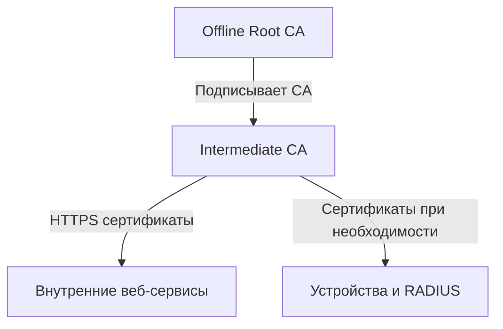
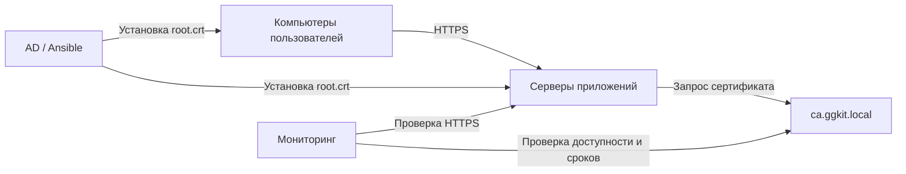

## 1. С чего начать проектирование

Проектирование PKI — определение того, какие сервисы нуждаются в сертификатах, кто будет их выпускать и как компьютеры будут им доверять.

Сначала составляется список потребителей. Пример для внутренней инфраструктуры `ggkit.local`:

| Сервис | Для чего нужен сертификат |
|---|---|
| Proxmox, Grafana, Nextcloud | HTTPS для веб-интерфейсов |
| Keycloak | HTTPS для входа и работы приложений |
| FreeRADIUS | Защита EAP-соединений, при EAP-TLS — сертификаты клиентов |
| Внутренние API | HTTPS, при необходимости взаимная проверка сертификатов (mTLS) |
| Рабочие станции | Аутентификация устройств, если она предусмотрена |

WireGuard не требует сертификатов X.509: он использует собственные ключевые пары.

Для каждого потребителя необходимо определить имя, назначение сертификата, способ получения и обновления, а также ответственного за обслуживание.

## 2. Выбор архитектуры

Для небольшой или средней организации разумно начать с одного Offline Root CA и одного постоянно работающего Intermediate CA. Назначение и устройство этих центров: [[Synced/DevOps/CI-CD, артефакты, тестирование и DevSecOps/5. DevSecOps и безопасность цепочки поставок/9. PKI и криптография в инфраструктуре/2. Инфраструктура открытых ключей/2. Root CA и Intermediate CA.md|Root CA и Intermediate CA]].

Стрелки показывают выпуск сертификатов, а не сетевые подключения. Корневой CA не участвует в ежедневной работе приложений.

Отдельные Intermediate CA стоит вводить, если необходимо разделить администрирование или правила выпуска, например для серверов и устройств. Само наличие нескольких CA не запрещает клиентам доверять сертификатам каждого из них: для этого нужны соответствующие ограничения и настройки проверки.

## 3. Размещение компонентов

Пример проектной схемы, а не описание уже развёрнутой инфраструктуры:

| Компонент | Размещение | Назначение |
|---|---|---|
| Root CA | Изолированная машина | Подписание Intermediate CA |
| `ca.ggkit.local` | Выделенная ВМ | Работа Intermediate CA, выпуск сертификатов |
| `pki.ggkit.local` | Внутренний веб-сервис при необходимости | Публикация открытых сертификатов CA и CRL, если поддерживается |
| DNS | Существующая инфраструктура | Разрешение имён сервисов |
| Samba AD и Ansible | Существующая или планируемая инфраструктура | Распространение доверенного корня |
| Мониторинг и резервное копирование | Отдельные системы | Контроль сроков и восстановление |

Серверы обращаются к CA для выпуска и обновления сертификатов. Пользователи подключаются непосредственно к приложениям. Для обычного HTTPS-подключения не требуется обращаться к API CA, хотя проверка отзыва может требовать отдельного сетевого доступа.

Доступ к административным операциям CA необходимо ограничить. API выпуска должен быть доступен только предусмотренным потребителям. Root CA не подключается к этой сети.

## 4. Правила выпуска сертификатов

Для разных задач задаются разные правила: допустимые имена, назначение сертификата, срок действия и способ проверки заявки.

| Тип сертификата | Назначение | Пример срока |
|---|---|---|
| Веб-сервер | `serverAuth` | 90 дней |
| Клиент API | `clientAuth` | 30–90 дней |
| Устройство | `clientAuth` | 90–365 дней |

Это примеры, а не универсальные сроки. Значения `serverAuth` и `clientAuth` указывают назначение сертификата; подробнее в [[Synced/DevOps/CI-CD, артефакты, тестирование и DevSecOps/5. DevSecOps и безопасность цепочки поставок/9. PKI и криптография в инфраструктуре/2. Инфраструктура открытых ключей/4. X.509, Extensions и Certificate Policies.md|X.509, Extensions и Certificate Policies]].

Например, серверу `portal.ggkit.local` не следует разрешать произвольно получать сертификат для `keycloak.ggkit.local`. CA должен проверять право на запрошенное имя, а не просто наличие доступа к API.

Приватный ключ сервиса создаётся на самом сервисе, когда это возможно. Принцип выпуска через CSR: [[Synced/DevOps/CI-CD, артефакты, тестирование и DevSecOps/5. DevSecOps и безопасность цепочки поставок/9. PKI и криптография в инфраструктуре/2. Инфраструктура открытых ключей/3. Создание и подписание сертификатов.md|Создание и подписание сертификатов]].

## 5. Распространение доверия

Внутренний Root CA не входит автоматически в список доверенных корней операционных систем. Его сертификат необходимо установить на все устройства, которые должны проверять внутренние сертификаты.

| Устройства | Способ распространения |
|---|---|
| Windows в домене | Групповая политика (GPO) |
| Ubuntu и другие Linux | Ansible, системное хранилище сертификатов |
| Контейнеры | Добавление корня в хранилище внутри образа или контейнера |
| Java и другие приложения с отдельным хранилищем | Настройка хранилища приложения |

> [!WARNING]
> Распространяется только открытый корневой сертификат. Приватный ключ Root CA никогда не устанавливается на клиентские компьютеры. Перед распространением необходимо проверить подлинность корневого сертификата по доверенному источнику.

Для сервисов, доступных внешним пользователям без корпоративного корня, обычно используется публичный CA и публичное доменное имя, например `portal.ggkit.ru`. Публичный CA не выдаёт сертификаты для внутренних имён `.local`.

## 6. Выбор инструментов и автоматизация

| Инструмент | Роль |
|---|---|
| OpenSSL | Ручные операции с ключами, запросами и сертификатами, диагностика |
| Smallstep step-ca | Работа внутреннего CA и автоматизированный выпуск |
| step CLI | Управление сертификатами и настройка Smallstep |
| Certbot / acme.sh | Получение и обновление сертификатов через ACME |
| Ansible | Распространение доверия и настройка сервисов |

Для рассматриваемого примера можно выбрать [[Synced/DevOps/CI-CD, артефакты, тестирование и DevSecOps/5. DevSecOps и безопасность цепочки поставок/9. PKI и криптография в инфраструктуре/5. Автоматизация PKI/2. Smallstep step-ca — архитектура и установка.md|Smallstep step-ca]] в качестве внутреннего CA. [[Synced/DevOps/CI-CD, артефакты, тестирование и DevSecOps/5. DevSecOps и безопасность цепочки поставок/9. PKI и криптография в инфраструктуре/5. Автоматизация PKI/1. ACME — архитектура и принципы работы.md|ACME]] позволяет сервисам получать сертификаты автоматически.

Типичный порядок: сервис запрашивает сертификат, CA проверяет право на имя, подписывает сертификат, клиент устанавливает его и при необходимости перезагружает конфигурацию приложения. До истечения срока процесс повторяется.

При выборе CA необходимо отдельно проверить поддержку нужных механизмов отзыва, способов авторизации и восстановления. Наличие ACME само по себе не гарантирует поддержку CRL или OCSP. Подробнее: [[Synced/DevOps/CI-CD, артефакты, тестирование и DevSecOps/5. DevSecOps и безопасность цепочки поставок/9. PKI и криптография в инфраструктуре/2. Инфраструктура открытых ключей/5. CRL и OCSP.md|CRL и OCSP]].

## 7. Эксплуатация и восстановление

До запуска PKI необходимо определить, кто отвечает за выпуск, обновление и восстановление сертификатов.

| Что контролировать | Что делать |
|---|---|
| Сроки сертификатов CA и сервисов | Настроить предупреждения заранее |
| Доступность CA | Проверять API и ошибки выпуска |
| Автоматическое обновление | Проверять успешный выпуск и установку нового сертификата |
| Защита ключей | Ограничить доступ и хранить Root CA вне сети |
| Резервные копии | Сохранять ключи, конфигурацию и данные CA в защищённом виде; проверять восстановление |
| Компрометация | Иметь порядок остановки выпуска, отзыва и замены ключей |

Подробные процедуры вынесены в [[Synced/DevOps/CI-CD, артефакты, тестирование и DevSecOps/5. DevSecOps и безопасность цепочки поставок/9. PKI и криптография в инфраструктуре/2. Инфраструктура открытых ключей/6. Защита ключей CA и HSM.md|Защита ключей CA и HSM]], [[Synced/DevOps/CI-CD, артефакты, тестирование и DevSecOps/5. DevSecOps и безопасность цепочки поставок/9. PKI и криптография в инфраструктуре/2. Инфраструктура открытых ключей/7. Резервное копирование и восстановление CA.md|Резервное копирование и восстановление CA]] и [[Synced/DevOps/CI-CD, артефакты, тестирование и DevSecOps/5. DevSecOps и безопасность цепочки поставок/9. PKI и криптография в инфраструктуре/4. Управление жизненным циклом.md|Управление жизненным циклом]].

Если Intermediate CA временно недоступен, уже выданные сертификаты обычно продолжают работать до окончания срока при наличии корректной цепочки и выполнении требований проверки. Но получить новые сертификаты или обновить старые в это время нельзя. Поэтому время восстановления должно быть меньше оставшегося запаса до истечения сертификатов.

## 8. Порядок внедрения

1. Составление списка сервисов и правил выпуска.
2. Создание Offline Root CA и Intermediate CA.
3. Настройка DNS, доступа к CA и резервного копирования.
4. Распространение корневого сертификата на тестовые компьютеры.
5. Выпуск первого сертификата для `portal.ggkit.local` и проверка HTTPS без отключения проверки доверия.
6. Настройка автоматического обновления и проверка, что приложение использует новый сертификат.
7. Подключение мониторинга и проверка восстановления.
8. Подключение остальных сервисов и распространение доверия на рабочие устройства.

> [!TIP]
> Не обязательно сразу подключать все сервисы. Один работающий веб-сервис позволяет проверить цепочку доверия, выпуск, установку и обновление до масштабирования PKI.

## 9. Критерии готовности

- [ ] Root CA изолирован, приватный ключ защищён.
- [ ] Intermediate CA выпускает сертификаты только по установленным правилам.
- [ ] Клиенты доверяют внутренним сертификатам без ручного игнорирования ошибок TLS.
- [ ] Автоматическое обновление проверено на тестовом сервисе.
- [ ] Настроены мониторинг сроков и предупреждения об ошибках.
- [ ] Проверено восстановление CA из резервной копии.
- [ ] Определён порядок замены CA и действий при компрометации.

## Вопросы для самопроверки

1. Почему проектирование начинается со списка сервисов, а не с установки CA?
2. Как распространять доверие на Windows, Linux и контейнеры?
3. Зачем ограничивать допустимые имена в запросах сертификатов?
4. Что произойдёт с уже выданными сертификатами при остановке CA?
5. Как проверить готовность PKI перед подключением всех сервисов?

## Итоги — что было разобрано

Корпоративная PKI включает не только CA, но и правила выпуска, распространение доверия, автоматическое обновление, мониторинг и восстановление. Для начала достаточно простой двухуровневой архитектуры с одним работающим Intermediate CA и одним изолированным Root CA.

## Связанные заметки

- [[Synced/DevOps/CI-CD, артефакты, тестирование и DevSecOps/5. DevSecOps и безопасность цепочки поставок/9. PKI и криптография в инфраструктуре/2. Инфраструктура открытых ключей/1. Архитектура PKI и цепочка доверия.md|Архитектура PKI и цепочка доверия]]
- [[Synced/DevOps/CI-CD, артефакты, тестирование и DevSecOps/5. DevSecOps и безопасность цепочки поставок/9. PKI и криптография в инфраструктуре/2. Инфраструктура открытых ключей/2. Root CA и Intermediate CA.md|Root CA и Intermediate CA]]
- [[Synced/DevOps/CI-CD, артефакты, тестирование и DevSecOps/5. DevSecOps и безопасность цепочки поставок/9. PKI и криптография в инфраструктуре/2. Инфраструктура открытых ключей/3. Создание и подписание сертификатов.md|Создание и подписание сертификатов]]
- [[Synced/DevOps/CI-CD, артефакты, тестирование и DevSecOps/5. DevSecOps и безопасность цепочки поставок/9. PKI и криптография в инфраструктуре/2. Инфраструктура открытых ключей/4. X.509, Extensions и Certificate Policies.md|X.509, Extensions и Certificate Policies]]
- [[Synced/DevOps/CI-CD, артефакты, тестирование и DevSecOps/5. DevSecOps и безопасность цепочки поставок/9. PKI и криптография в инфраструктуре/2. Инфраструктура открытых ключей/5. CRL и OCSP.md|CRL и OCSP]]
- [[Synced/DevOps/CI-CD, артефакты, тестирование и DevSecOps/5. DevSecOps и безопасность цепочки поставок/9. PKI и криптография в инфраструктуре/2. Инфраструктура открытых ключей/6. Защита ключей CA и HSM.md|Защита ключей CA и HSM]]
- [[Synced/DevOps/CI-CD, артефакты, тестирование и DevSecOps/5. DevSecOps и безопасность цепочки поставок/9. PKI и криптография в инфраструктуре/2. Инфраструктура открытых ключей/7. Резервное копирование и восстановление CA.md|Резервное копирование и восстановление CA]]

---

## Теги

#PKI #Проектирование #КорпоративнаяPKI #RootCA #IntermediateCA #TLS #ACME #Smallstep #Автоматизация #Мониторинг #РезервноеКопирование #DevSecOps
