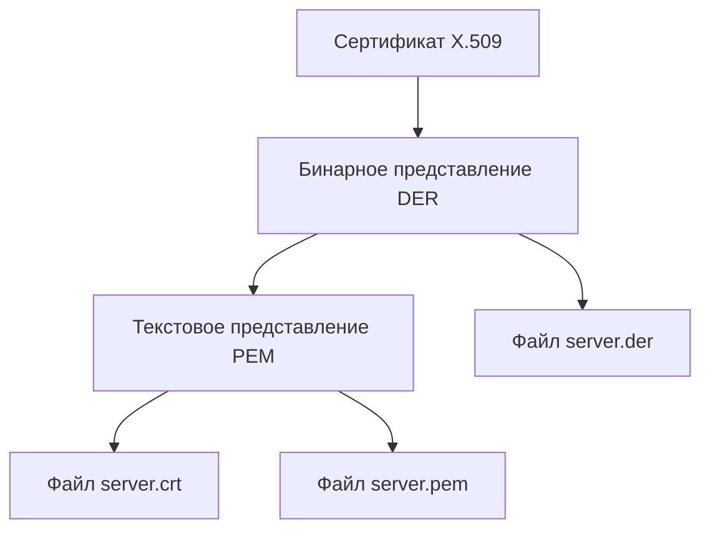
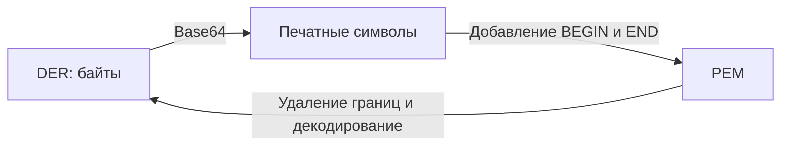
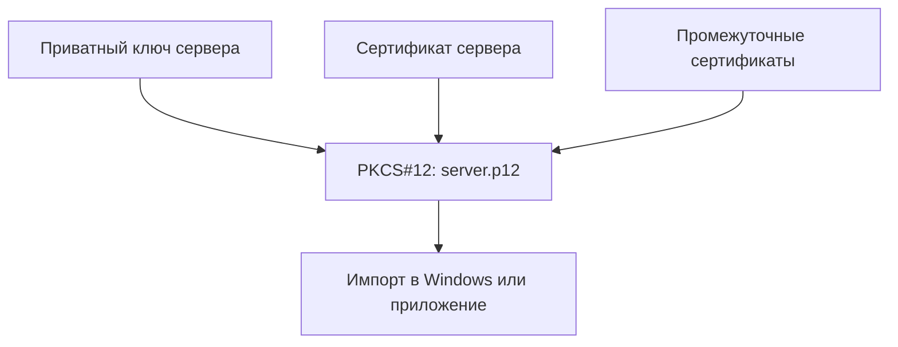

## 1. Криптографические объекты и форматы хранения

При работе с PKI необходимо различать три вещи:

- **Объект** — то, что хранится: сертификат, приватный ключ, публичный ключ или CSR.
- **Формат и кодировка** — правила организации данных и их представления в файле.
- **Расширение файла** — часть имени, которая помогает определить предполагаемое содержимое.

Например, `server.crt` и `server.pem` могут содержать один и тот же сертификат X.509. При этом `server.pem` также может содержать приватный ключ или несколько сертификатов.

Структура самого сертификата рассмотрена в [[Synced/DevOps/CI-CD, артефакты, тестирование и DevSecOps/5. DevSecOps и безопасность цепочки поставок/9. PKI и криптография в инфраструктуре/2. Инфраструктура открытых ключей/4. X.509, Extensions и Certificate Policies.md|X.509, Extensions и Certificate Policies]], а процесс получения сертификата — в [[Synced/DevOps/CI-CD, артефакты, тестирование и DevSecOps/5. DevSecOps и безопасность цепочки поставок/9. PKI и криптография в инфраструктуре/2. Инфраструктура открытых ключей/3. Создание и подписание сертификатов.md|создании и подписании сертификатов]]. Здесь рассматривается хранение и преобразование уже существующих объектов.



Стрелки показывают способы представления одного сертификата. При преобразовании DER в PEM поля сертификата, публичный ключ, подпись и срок действия не изменяются. Расширения `.crt` и `.pem` в данном примере обозначают файлы с одинаковым содержимым.

## 2. ASN.1, DER и PEM

### 2.1. ASN.1

**ASN.1 (Abstract Syntax Notation One)** — язык описания структуры данных. Он определяет, какие поля существуют в объекте, их типы и взаимное расположение.

Например, сертификат содержит серийный номер, имя издателя, срок действия, публичный ключ и подпись. ASN.1 позволяет формально описать эту структуру, но сам по себе не определяет единственное представление в байтах.

### 2.2. DER

**DER (Distinguished Encoding Rules)** — правила однозначного бинарного кодирования ASN.1. Для одного и того же ASN.1-значения получается определённая последовательность байтов.

DER используется для кодирования сертификатов X.509, запросов PKCS#10 и различных структур ключей.

Файл DER неудобно читать обычным текстовым редактором. Для просмотра сертификата:

```bash
openssl x509 -inform DER -in server.der -noout -text
```

- `-inform DER` — входные данные в бинарной кодировке DER;
- `-in` — входной файл;
- `-noout -text` — вывод полей вместо исходного сертификата.

### 2.3. PEM

**PEM** — текстовое представление криптографических объектов. Обычно бинарные данные DER кодируются в Base64 и помещаются между строками BEGIN и END.

```text
-----BEGIN CERTIFICATE-----
MIID... (условный фрагмент Base64)
-----END CERTIFICATE-----
```

Base64 преобразует бинарные данные в печатные символы. Это удобно для конфигурационных файлов, передачи и хранения сертификатов.

> [!WARNING]
> Base64 не является шифрованием. Приватный ключ в PEM может быть как зашифрованным, так и незашифрованным. Само наличие BEGIN и END не защищает его.



Диаграмма показывает обратимое преобразование представления. Для сертификата не требуется повторная подпись CA.

## 3. Расширения файлов

| Расширение | Типичное содержимое | Представление |
|---|---|---|
| `.crt`, `.cer` | Сертификат X.509 | PEM или DER |
| `.pem` | Сертификаты, ключи, CSR | PEM |
| `.der` | Сертификат или другой ASN.1-объект | DER |
| `.key` | Приватный ключ | Обычно PEM, иногда DER |
| `.pub` | Публичный ключ | Зависит от инструмента |
| `.csr` | Запрос PKCS#10 | PEM или DER |
| `.p7b`, `.p7c` | Набор сертификатов PKCS#7 | PEM или DER |
| `.p12`, `.pfx` | Контейнер PKCS#12 | Бинарное |
| `.jks` | Java KeyStore | Бинарное |

Расширение — соглашение, а не гарантия содержимого. Переименование `server.der` в `server.pem` не выполняет преобразование.

## 4. Определение содержимого PEM

Просмотр только границ блоков без вывода приватного ключа:

```bash
grep -E '^-----BEGIN ' server.pem
```

| Заголовок | Содержимое |
|---|---|
| `BEGIN CERTIFICATE` | Сертификат X.509 |
| `BEGIN CERTIFICATE REQUEST` | CSR PKCS#10 |
| `BEGIN PUBLIC KEY` | Публичный ключ SubjectPublicKeyInfo |
| `BEGIN RSA PUBLIC KEY` | Публичный RSA-ключ PKCS#1 |
| `BEGIN PRIVATE KEY` | Незашифрованный ключ PKCS#8 |
| `BEGIN ENCRYPTED PRIVATE KEY` | Зашифрованный ключ PKCS#8 |
| `BEGIN RSA PRIVATE KEY` | Приватный RSA-ключ PKCS#1 |
| `BEGIN EC PRIVATE KEY` | Приватный EC-ключ SEC1 |
| `BEGIN PKCS7` | Структура PKCS#7 |

У старых PEM-ключей PKCS#1 и SEC1 шифрование может обозначаться дополнительными заголовками `Proc-Type` и `DEK-Info`.

Команда `file server.crt` помогает определить тип данных, но её результат не всегда однозначен. Для подтверждения необходимо успешно разобрать объект соответствующей утилитой.

## 5. Форматы приватных и публичных ключей

### 5.1. PKCS#1 и SEC1

PKCS#1 определяет структуры RSA-ключей. SEC1 определяет, в частности, структуру приватного ключа эллиптических кривых. Они зависят от алгоритма.

### 5.2. PKCS#8

**PKCS#8** — универсальная структура хранения приватных ключей, содержащая идентификатор алгоритма и данные ключа. Поддерживает RSA, EC и другие алгоритмы при наличии поддержки в используемой библиотеке.

Для новых приложений PKCS#8 обычно удобнее алгоритмоспецифичных форматов. Его можно хранить в PEM или DER, с шифрованием или без него.

### 5.3. SubjectPublicKeyInfo (SPKI)

SPKI — структура публичного ключа с идентификатором алгоритма. Она используется внутри X.509 и может храниться отдельно в PEM с заголовком `PUBLIC KEY`.

Извлечение публичного ключа из приватного:

```bash
openssl pkey -in server.key -pubout -out server.pub.pem
```

Извлечение публичного ключа из сертификата:

```bash
openssl x509 -in server.crt -pubkey -noout
```

Приватный ключ невозможно практически восстановить из публичного при использовании корректных современных алгоритмов и параметров.

## 6. Контейнеры PKCS#7 и PKCS#12

### 6.1. PKCS#7

PKCS#7 (и его развитие CMS) описывает структуры для криптографических сообщений. В PKI файлы `.p7b` часто используются для передачи набора сертификатов.

Такой набор обычно содержит сертификат сервера и сертификаты CA, но не приватный ключ. Порядок сертификатов в наборе не следует считать гарантированным порядком цепочки.

Просмотр сертификатов в PEM-контейнере:

```bash
openssl pkcs7 -in chain.p7b -print_certs -noout
```

Для бинарного файла добавить `-inform DER`.

### 6.2. PKCS#12

**PKCS#12** — контейнер для хранения и переноса ключей и сертификатов. Расширения `.p12` и `.pfx` обычно обозначают один и тот же тип контейнера.



Стрелки обозначают упаковку объектов и последующий импорт. Контейнер может включать дополнительные сертификаты, несколько объектов и служебные атрибуты. Пароль обычно защищает приватный ключ и целостность контейнера, но конкретные параметры защиты зависят от способа создания.

> [!DANGER]
> PKCS#12 с приватным ключом является секретным файлом. Его нельзя публиковать вместе с обычными сертификатами. Использовать защищённую передачу и надёжный пароль.

## 7. Цепочки сертификатов в PEM

В Linux-приложениях часто используются отдельные файлы:

| Файл | Содержимое |
|---|---|
| `server.key` | Приватный ключ |
| `server.crt` | Конечный сертификат |
| `chain.pem` | Промежуточные сертификаты |
| `fullchain.pem` | Конечный сертификат, затем промежуточные |
| `root.crt` | Корневой сертификат для настройки доверия |

Создание полной цепочки для TLS-сервера:

```bash
cat server.crt intermediate.crt > fullchain.pem
```

При нескольких промежуточных CA их располагают от ближайшего издателя к корню. Корневой сертификат обычно не включают в передаваемую сервером цепочку.

Подробнее о построении и проверке пути — [[Synced/DevOps/CI-CD, артефакты, тестирование и DevSecOps/5. DevSecOps и безопасность цепочки поставок/9. PKI и криптография в инфраструктуре/2. Инфраструктура открытых ключей/1. Архитектура PKI и цепочка доверия.md|архитектура PKI и цепочка доверия]]. Объединение файлов само по себе не создаёт доверия и не проверяет подписи.

## 8. Преобразование форматов через OpenSSL

### 8.1. Сертификат PEM → DER

```bash
openssl x509 -in server.crt -outform DER -out server.der
```

### 8.2. Сертификат DER → PEM

```bash
openssl x509 -inform DER -in server.der -out server.pem
```

`-inform` задаёт входную кодировку, `-outform` — выходную. Для этих команд выход по умолчанию PEM, если не задан DER.

### 8.3. Приватный ключ → зашифрованный PKCS#8

```bash
umask 077
openssl pkcs8 -topk8 -in server.key -out encrypted.key -v2 aes-256-cbc
```

`-topk8` — преобразование в PKCS#8; `-v2` — алгоритм шифрования в схеме PBES2. Пароль вводится интерактивно.

### 8.4. Создание PKCS#12

```bash
openssl pkcs12 -export -inkey server.key -in server.crt -certfile chain.pem -out server.p12
```

- `-export` — создание контейнера;
- `-inkey` — приватный ключ;
- `-in` — соответствующий сертификат;
- `-certfile` — дополнительные сертификаты;
- `-out` — результирующий контейнер.

### 8.5. Извлечение из PKCS#12

Сертификат конечного субъекта:

```bash
openssl pkcs12 -in server.p12 -clcerts -nokeys -out server.crt
```

Сертификаты CA:

```bash
openssl pkcs12 -in server.p12 -cacerts -nokeys -out chain.pem
```

Приватный ключ (по умолчанию защищается паролем при записи):

```bash
umask 077
openssl pkcs12 -in server.p12 -nocerts -out server.key
```

OpenSSL может добавлять текстовые атрибуты контейнера перед PEM-блоками. При необходимости чистого сертификата использовать `openssl x509`, для ключа — `openssl pkey` с подходящими параметрами защиты.

## 9. Проверка после преобразования

Сравнение SHA-256 отпечатков сертификата до и после преобразования:

```bash
openssl x509 -in server.crt -noout -fingerprint -sha256
openssl x509 -inform DER -in server.der -noout -fingerprint -sha256
```

Отпечатки должны совпасть, если преобразован один и тот же сертификат.

Проверка соответствия приватного ключа сертификату (подходит не только для RSA):

```bash
openssl pkey -in server.key -pubout -outform DER | sha256sum
openssl x509 -in server.crt -pubkey -noout | openssl pkey -pubin -outform DER | sha256sum
```

Совпадение хешей публичных ключей подтверждает соответствие ключа сертификату. При ошибке разбора файла результат хеширования нельзя считать подтверждением; в Bash для конвейеров полезно включить `set -o pipefail`.

Проверка цепочки выполняется отдельно:

```bash
openssl verify -CAfile root.crt -untrusted chain.pem server.crt
```

Эта команда проверяет путь доверия, но без дополнительных параметров не проверяет конкретное DNS-имя сервера.

## 10. Более удобные инструменты и выбор формата

Для повседневной работы можно использовать `step CLI`:

```bash
step certificate inspect server.crt
step certificate fingerprint server.crt
step certificate format server.crt --out server.der
```

Последняя команда преобразует PEM-сертификат в DER; для DER выполняется обратное преобразование. Подробнее — [[Synced/DevOps/CI-CD, артефакты, тестирование и DevSecOps/5. DevSecOps и безопасность цепочки поставок/9. PKI и криптография в инфраструктуре/5. Автоматизация PKI/3. Smallstep step CLI — управление сертификатами.md|Smallstep step CLI]].

Для визуальной работы с сертификатами, ключами и контейнерами подходит [[Synced/DevOps/CI-CD, артефакты, тестирование и DevSecOps/5. DevSecOps и безопасность цепочки поставок/9. PKI и криптография в инфраструктуре/5. Автоматизация PKI/8. XCA — графическое управление сертификатами.md|XCA]].

| Сценарий | Предпочтительный вариант |
|---|---|
| Nginx, Apache, большинство Linux TLS-сервисов | PEM: отдельный ключ и цепочка |
| Windows/IIS, импорт личного сертификата | PKCS#12 |
| Передача набора сертификатов без ключа | PEM или PKCS#7 |
| Java-приложение | PKCS#12 или JKS по требованиям приложения |
| Импорт корневого CA | PEM или DER по требованиям системы |

JKS — формат хранилища Java, а не формат отдельного сертификата. Современные Java-среды также поддерживают PKCS#12. Для просмотра хранилища используется `keytool -list -keystore server.p12 -storetype PKCS12`.

## 11. Защита файлов и типичные ошибки

- Хранить приватные ключи с минимальными правами доступа, например `chmod 600 server.key`, если ключ читает только его владелец.
- Не выводить приватные ключи в журналы, терминальные записи или репозитории.
- Не передавать пароль контейнера в аргументах командной строки без необходимости.
- Не заменять преобразование простым переименованием файла.
- Не путать `fullchain.pem` с контейнером, содержащим приватный ключ.
- Не импортировать неизвестный корневой сертификат только ради устранения ошибки доверия.
- После импорта проверять наличие необходимых промежуточных сертификатов и соответствие ключа.

Защита ключей CA подробно рассмотрена в [[Synced/DevOps/CI-CD, артефакты, тестирование и DevSecOps/5. DevSecOps и безопасность цепочки поставок/9. PKI и криптография в инфраструктуре/2. Инфраструктура открытых ключей/6. Защита ключей CA и HSM.md|защите ключей CA и HSM]]. Обновление сертификатов и автоматизация их установки относятся к [[Synced/DevOps/CI-CD, артефакты, тестирование и DevSecOps/5. DevSecOps и безопасность цепочки поставок/9. PKI и криптография в инфраструктуре/5. Автоматизация PKI/6. Автоматическое обновление и ротация сертификатов.md|автоматическому обновлению и ротации сертификатов]].

## Вопросы для самопроверки

1. Чем криптографический объект отличается от его кодировки и расширения файла?
2. Чем DER отличается от PEM? Является ли Base64 шифрованием?
3. Почему `.crt` может быть бинарным или текстовым?
4. Чем PKCS#1 отличается от PKCS#8?
5. Чем PKCS#7 отличается от PKCS#12?
6. Какие файлы необходимо защищать как секреты?
7. Как проверить, что сертификат после преобразования не изменился?
8. Как проверить соответствие приватного ключа сертификату?
9. Что входит в `fullchain.pem` и почему туда обычно не добавляют Root CA?

## Итоги — что было разобрано

- ASN.1 описывает структуру, DER кодирует её в байты, PEM представляет данные в текстовом виде.
- Расширение файла не гарантирует его содержимое.
- PKCS#8 используется для приватных ключей, SPKI — для публичных, PKCS#12 — для переноса ключей и сертификатов.
- Преобразование кодировки не требует перевыпуска сертификата.
- Проверка формата, соответствия ключа и цепочки доверия — разные операции.

## Связанные заметки

- [[Synced/DevOps/CI-CD, артефакты, тестирование и DevSecOps/5. DevSecOps и безопасность цепочки поставок/9. PKI и криптография в инфраструктуре/2. Инфраструктура открытых ключей/4. X.509, Extensions и Certificate Policies.md|X.509, Extensions и Certificate Policies]]
- [[Synced/DevOps/CI-CD, артефакты, тестирование и DevSecOps/5. DevSecOps и безопасность цепочки поставок/9. PKI и криптография в инфраструктуре/2. Инфраструктура открытых ключей/3. Создание и подписание сертификатов.md|создании и подписании сертификатов]]
- [[Synced/DevOps/CI-CD, артефакты, тестирование и DevSecOps/5. DevSecOps и безопасность цепочки поставок/9. PKI и криптография в инфраструктуре/2. Инфраструктура открытых ключей/1. Архитектура PKI и цепочка доверия.md|архитектура PKI и цепочка доверия]]
- [[Synced/DevOps/CI-CD, артефакты, тестирование и DevSecOps/5. DevSecOps и безопасность цепочки поставок/9. PKI и криптография в инфраструктуре/5. Автоматизация PKI/3. Smallstep step CLI — управление сертификатами.md|Smallstep step CLI]]
- [[Synced/DevOps/CI-CD, артефакты, тестирование и DevSecOps/5. DevSecOps и безопасность цепочки поставок/9. PKI и криптография в инфраструктуре/5. Автоматизация PKI/8. XCA — графическое управление сертификатами.md|XCA]]
- [[Synced/DevOps/CI-CD, артефакты, тестирование и DevSecOps/5. DevSecOps и безопасность цепочки поставок/9. PKI и криптография в инфраструктуре/2. Инфраструктура открытых ключей/6. Защита ключей CA и HSM.md|защите ключей CA и HSM]]
- [[Synced/DevOps/CI-CD, артефакты, тестирование и DevSecOps/5. DevSecOps и безопасность цепочки поставок/9. PKI и криптография в инфраструктуре/5. Автоматизация PKI/6. Автоматическое обновление и ротация сертификатов.md|автоматическому обновлению и ротации сертификатов]]

---

## Теги

#PKI #X509 #ASN1 #DER #PEM #Base64 #PKCS1 #PKCS8 #PKCS7 #PKCS12 #PFX #CSR #SPKI #JKS #OpenSSL #Smallstep #XCA #TLS #сертификаты #криптография #приватные_ключи #DevSecOps
