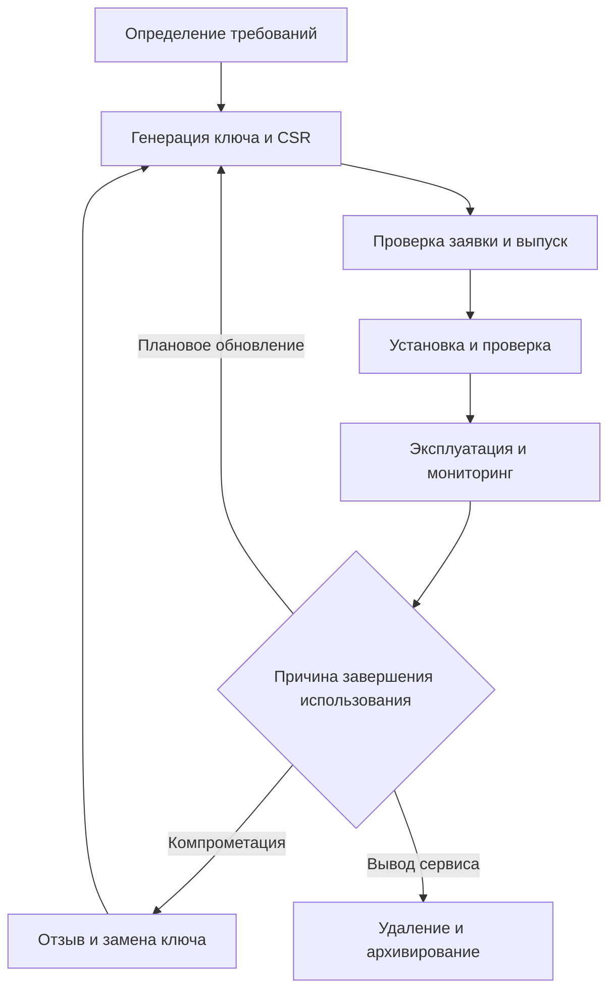
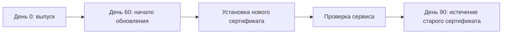
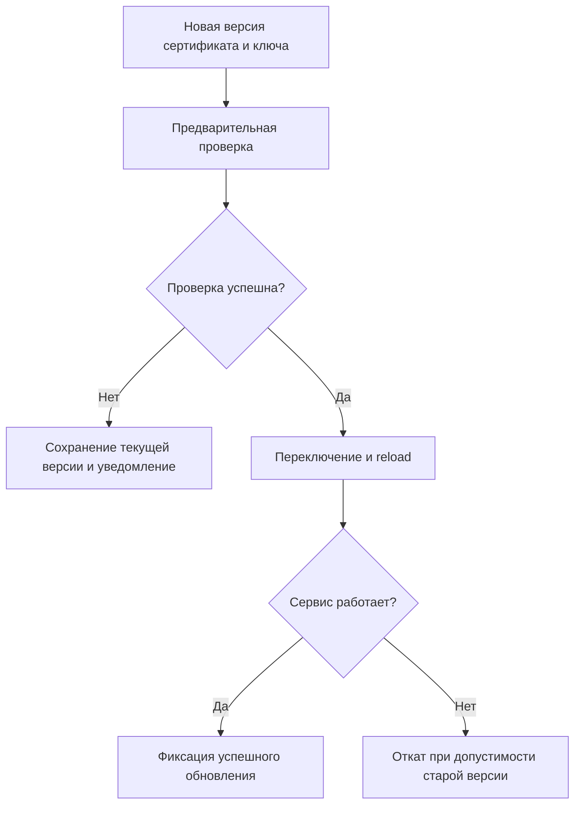

## 1. Понятие жизненного цикла сертификата

**Управление жизненным циклом сертификатов (Certificate Lifecycle Management, CLM)** — совокупность процессов, обеспечивающих получение, использование, своевременную замену и прекращение использования сертификатов.

Получение сертификата не завершает работу с ним. Необходимо установить его в нужный сервис, контролировать срок действия, обеспечить сохранность приватного ключа и своевременно выполнить замену.



Стрелки показывают переходы между этапами. При плановом обновлении начинается новый цикл выпуска. При компрометации необходимо прекратить доверие к старому сертификату и заменить ключ. При выводе сервиса новый сертификат не требуется.

> [!INFO] Сертификат после выпуска неизменяем
> Изменение SAN, срока действия или открытого ключа требует выпуска нового сертификата. Редактирование подписанных полей нарушает цифровую подпись CA.

## 2. Планирование и учёт сертификатов

Перед выпуском необходимо определить:

- владельца сертификата и ответственного за сервис;
- назначение: TLS-сервер, TLS-клиент, подпись кода и другие задачи;
- DNS-имена и IP-адреса в SAN;
- доверенный удостоверяющий центр;
- допустимый алгоритм и срок действия;
- место хранения ключа и способ обновления.

### 2.1. Реестр сертификатов

**Реестр сертификатов** — перечень сертификатов и связанных с ними сервисов, необходимый для контроля эксплуатации.

| Поле | Пример |
|---|---|
| Сервис | Grafana |
| Имя | `grafana.ggkit.local` |
| Владелец | Отдел ИТ |
| Issuer | Corporate Issuing CA |
| Серийный номер | `01A4F2` |
| Срок действия | 90 дней |
| Место установки | `/etc/nginx/tls/` |
| Способ обновления | ACME |
| Порог предупреждения | 30 дней |

В реестре хранится ссылка на место хранения приватного ключа, но не сам ключ и не пароль от него. Для идентификации конкретного сертификата удобно использовать SHA-256 fingerprint или сочетание издателя и серийного номера.

## 3. Выпуск сертификата

Обычный процесс выпуска включает генерацию ключевой пары, создание CSR, проверку заявки удостоверяющим центром и подписание сертификата.

Подробный процесс рассмотрен в [[Synced/DevOps/CI-CD, артефакты, тестирование и DevSecOps/5. DevSecOps и безопасность цепочки поставок/9. PKI и криптография в инфраструктуре/2. Инфраструктура открытых ключей/3. Создание и подписание сертификатов.md|создании и подписании сертификатов]].

### 3.1. Проверка перед установкой

```bash
openssl x509 -in server.crt -noout -subject -issuer -dates
```

- `-subject` — субъект сертификата;
- `-issuer` — издатель;
- `-dates` — начало и окончание срока действия.

Проверка имён:

```bash
openssl x509 -in server.crt -noout -ext subjectAltName
```

Проверка цепочки и имени TLS-сервера:

```bash
openssl verify -CAfile root.crt -untrusted intermediate.crt \
  -purpose sslserver -verify_hostname grafana.ggkit.local server.crt
```

Эта команда не проверяет отзыв автоматически. Для проверки отзыва необходимы соответствующие данные и параметры.

### 3.2. Проверка соответствия ключа сертификату

Извлечение открытого ключа из сертификата и вычисление его хеша:

```bash
openssl x509 -in server.crt -pubkey -noout | openssl pkey -pubin -outform DER | openssl dgst -sha256
```

Получение открытого ключа из приватного ключа:

```bash
openssl pkey -in server.key -pubout -outform DER | openssl dgst -sha256
```

Одинаковые хеши означают соответствие открытых ключей. Способ подходит не только для RSA, но и для других поддерживаемых OpenSSL типов ключей.

## 4. Установка сертификата

Для TLS-сервера обычно необходимы:

- приватный ключ сервера;
- сертификат сервера;
- промежуточные сертификаты для построения цепочки доверия.

Корневой сертификат устанавливается в доверенное хранилище клиентов независимо от серверной цепочки.

Создание файла цепочки:

```bash
cat server.crt intermediate.crt > fullchain.pem
```

Форматы файлов подробно рассмотрены в [[Synced/DevOps/CI-CD, артефакты, тестирование и DevSecOps/5. DevSecOps и безопасность цепочки поставок/9. PKI и криптография в инфраструктуре/3. Форматы сертификатов и ключей.md|форматах сертификатов и ключей]].

### 4.1. Пример подключения к Nginx

```nginx
ssl_certificate /etc/nginx/tls/fullchain.pem;
ssl_certificate_key /etc/nginx/tls/server.key;
```

Проверка конфигурации и перечитывание:

```bash
sudo nginx -t
sudo systemctl reload nginx
```

Проверка сертификата, реально предоставляемого сервисом:

```bash
openssl s_client -connect grafana.ggkit.local:443 \
  -servername grafana.ggkit.local -CAfile root.crt \
  -verify_hostname grafana.ggkit.local -verify_return_error </dev/null
```

> [!WARNING] Установка файла не равна обновлению сервиса
> Приложение может продолжать использовать сертификат, загруженный в память при запуске. Необходимо выполнить поддерживаемый приложением reload или restart и проверить сертификат через сетевое подключение.

## 5. Срок действия сертификата

Срок действия определяется двумя полями X.509:

- `Not Before` — начало действия;
- `Not After` — окончание действия.

Сертификат не становится действительным раньше `Not Before` и не продлевается автоматически после `Not After`.

### 5.1. Выбор срока действия

Пример внутренней политики организации (не универсальный стандарт):

| Тип | Пример срока |
|---|---|
| Root CA | 15 лет |
| Intermediate CA | 5 лет |
| TLS-сервер | 90 дней |
| TLS-клиент | 30–90 дней |
| Временная рабочая нагрузка | Несколько часов или дней |

Короткий срок снижает период возможного использования скомпрометированных учётных данных, но повышает требования к автоматизации. Он не заменяет отзыв и защиту ключа.

Срок конечного сертификата следует планировать так, чтобы цепочка оставалась действительной на протяжении его использования. Истечение промежуточного CA может нарушить проверку ещё не истёкших конечных сертификатов.

## 6. Обновление, перевыпуск и ротация

| Операция | Смысл |
|---|---|
| Renewal (обновление) | Выпуск нового сертификата для продолжения использования той же идентичности |
| Rekey (замена ключа) | Генерация новой ключевой пары и выпуск сертификата для неё |
| Reissue (перевыпуск) | Повторный выпуск, например при изменении SAN или исправлении ошибки |
| Rotation (ротация) | Управляемая замена используемых криптографических материалов |
| Revocation (отзыв) | Досрочное прекращение доверия к сертификату через механизмы PKI |

Терминология конкретных продуктов может отличаться. Обновление не обязательно означает замену ключа, а ротация может включать замену сертификата, ключа и цепочки.

### 6.1. Обновление с прежним ключом

Новый сертификат содержит тот же открытый ключ, но получает новые подписанные поля, включая срок действия и серийный номер. Такой вариант возможен, если политика CA допускает повторное использование ключа.

### 6.2. Обновление с новым ключом

Генерируется новая ключевая пара и выпускается новый сертификат. Старый приватный ключ после завершения перехода выводится из эксплуатации.

> [!TIP] Ротация ключей
> Для обычных TLS-сервисов при автоматизированном выпуске целесообразно регулярно генерировать новые ключи. При компрометации старого ключа его повторное использование недопустимо.

### 6.3. Планирование окна обновления

Для внутреннего сертификата сроком 90 дней можно начать обновление за 30 дней до истечения. Это оставляет время для повторных попыток при недоступности CA или ошибке установки.



Диаграмма показывает пример планового перехода: новый сертификат устанавливается до окончания действия старого. День 60 — пример политики, а не обязательный срок для всех сертификатов.

## 7. Безопасная замена сертификата

Замена должна выполняться как единая управляемая операция:

1. Получение нового сертификата и соответствующего ключа.
2. Проверка срока, SAN, цепочки и соответствия ключа.
3. Подготовка новой версии файлов с корректными правами доступа.
4. Переключение конфигурации на новую версию.
5. Перечитывание конфигурации приложения.
6. Проверка сетевого подключения.
7. Удаление или защищённое архивирование старых материалов согласно политике.



Старая версия может использоваться для отката только пока она действительна, не отозвана и её ключ не скомпрометирован. При компрометации откат к старому ключу недопустим.

В кластере необходимо проверить каждый экземпляр сервиса и балансировщик, если TLS завершается на нём.

## 8. Мониторинг сертификатов

Контролировать необходимо не только срок действия файла на диске, но и фактический сертификат, который предоставляет приложение.

### 8.1. Проверка оставшегося срока

```bash
openssl x509 -in server.crt -noout -enddate
```

Проверка, истечёт ли сертификат в течение ближайших семи суток:

```bash
openssl x509 -in server.crt -noout -checkend 604800
```

`604800` — количество секунд в семи сутках. Код завершения `0` означает, что сертификат не истечёт в указанном интервале; ненулевой код означает истечение в этом интервале или ошибку команды. Эта проверка не заменяет полную валидацию сертификата.

### 8.2. Контролируемые события

| Событие | Реакция |
|---|---|
| Приближение срока окончания | Запуск обновления или уведомление |
| Ошибка выпуска | Повторная попытка и диагностика |
| Ошибка установки | Проверка конфигурации и прав |
| Сертификат на диске отличается от сетевого | Проверка reload и всех экземпляров |
| Недоверенная цепочка | Проверка промежуточных CA и trust store |
| Компрометация ключа | Срочная замена и отзыв |

Порог предупреждения необходимо выбирать относительно срока жизни сертификата. Например, предупреждение за 30 дней подходит для 90-дневного сертификата, но не для сертификата сроком 24 часа.

Подробная реализация мониторинга: [[Synced/DevOps/CI-CD, артефакты, тестирование и DevSecOps/5. DevSecOps и безопасность цепочки поставок/9. PKI и криптография в инфраструктуре/5. Автоматизация PKI/7. Мониторинг сроков действия и состояния сертификатов.md|мониторинг сроков действия и состояния сертификатов]].

## 9. Отзыв и внеплановая замена

Отзыв необходим, когда сертификату больше нельзя доверять до окончания его срока действия. Например, при компрометации приватного ключа, ошибочной выдаче или прекращении полномочий владельца.

При компрометации ключа необходимо:

1. Ограничить использование скомпрометированного ключа и устранить причину утечки.
2. Инициировать отзыв сертификата и публикацию актуальных данных об отзыве.
3. Сгенерировать новый ключ в доверенной среде.
4. Выпустить и установить новый сертификат.
5. Проверить все сервисы, использовавшие старый ключ.

Отзыв не удаляет сертификат с серверов и не гарантирует немедленного прекращения доверия всеми клиентами: результат зависит от проверки статуса, кэширования и политики клиента.

Механизмы рассмотрены в [[Synced/DevOps/CI-CD, артефакты, тестирование и DevSecOps/5. DevSecOps и безопасность цепочки поставок/9. PKI и криптография в инфраструктуре/2. Инфраструктура открытых ключей/5. CRL и OCSP.md|CRL и OCSP]].

## 10. Вывод сертификата из эксплуатации

При удалении сервиса необходимо прекратить автоматический выпуск для него, удалить сертификат и ключ из рабочих конфигураций, отозвать действующий сертификат при необходимости и обновить реестр.

Публичные сертификаты и сведения об их выпуске могут сохраняться для аудита. Приватные ключи сохраняются только при наличии обоснованной потребности и в соответствии с политикой хранения. Удаление файла не гарантирует удаления его копий из резервных копий и снимков.

Для ключей шифрования данных требования к хранению могут отличаться от требований к ключам TLS-подписи: потеря ключа расшифрования может привести к потере доступа к данным.

## 11. Жизненный цикл удостоверяющих центров

Замена CA отличается от замены обычного серверного сертификата, поскольку затрагивает цепочки доверия множества сервисов.

При плановой замене Root CA сначала распространяется новый доверенный корневой сертификат, затем вводится новый issuing CA и постепенно перевыпускаются конечные сертификаты. Старое доверие удаляется после завершения миграции и проверки зависимостей.

При замене Intermediate CA необходимо обеспечить доставку новой промежуточной цепочки клиентам. Если корень остаётся прежним, обновление корневого trust store обычно не требуется.

Плановая замена CA сама по себе не является причиной немедленного отзыва старого CA. При компрометации применяются отдельные аварийные процедуры.

Подробнее: [[Synced/DevOps/CI-CD, артефакты, тестирование и DevSecOps/5. DevSecOps и безопасность цепочки поставок/9. PKI и криптография в инфраструктуре/2. Инфраструктура открытых ключей/2. Root CA и Intermediate CA.md|Root CA и Intermediate CA]].

## 12. Автоматизация жизненного цикла

Автоматизация должна охватывать не только получение сертификата, но и доставку, проверку, переключение сервиса и уведомление об ошибках.

| Компонент | Назначение |
|---|---|
| CA | Проверка заявок и выпуск сертификатов |
| ACME-клиент | Автоматическое получение и обновление |
| Планировщик | Регулярный запуск проверки и обновления |
| Deployment hook | Установка и перечитывание конфигурации |
| Мониторинг | Независимая проверка результата |
| Реестр | Учёт владельцев, сертификатов и зависимостей |

ACME — протокол автоматизированного взаимодействия клиента с CA. Он не гарантирует, что приложение успешно загрузило новый сертификат: это задача клиента, механизма доставки и мониторинга.

Подробнее: [[Synced/DevOps/CI-CD, артефакты, тестирование и DevSecOps/5. DevSecOps и безопасность цепочки поставок/9. PKI и криптография в инфраструктуре/5. Автоматизация PKI/1. ACME — архитектура и принципы работы.md|ACME — архитектура и принципы работы]] и [[Synced/DevOps/CI-CD, артефакты, тестирование и DevSecOps/5. DevSecOps и безопасность цепочки поставок/9. PKI и криптография в инфраструктуре/5. Автоматизация PKI/6. Автоматическое обновление и ротация сертификатов.md|автоматическое обновление и ротация сертификатов]].

## Вопросы для самопроверки

1. Почему нельзя изменить срок действия уже выпущенного сертификата?
2. Какие сведения необходимо хранить в реестре сертификатов?
3. Чем обновление сертификата отличается от ротации ключа?
4. Почему недостаточно проверить новый файл на диске?
5. Когда допустим откат к предыдущему сертификату?
6. Чем отзыв отличается от истечения срока действия?
7. Почему новый Root CA необходимо распространить до миграции сервисов?
8. Какие этапы должны контролироваться при автоматическом обновлении?

## Итоги — что было разобрано

- Этапы жизненного цикла сертификатов и их учёт.
- Проверка, установка и эксплуатация сертификатов.
- Плановое обновление, перевыпуск и ротация ключей.
- Мониторинг, отзыв и вывод из эксплуатации.
- Особенности замены CA и автоматизации процессов.

## Связанные заметки

- [[Synced/DevOps/CI-CD, артефакты, тестирование и DevSecOps/5. DevSecOps и безопасность цепочки поставок/9. PKI и криптография в инфраструктуре/2. Инфраструктура открытых ключей/1. Архитектура PKI и цепочка доверия.md|Архитектура PKI и цепочка доверия]]
- [[Synced/DevOps/CI-CD, артефакты, тестирование и DevSecOps/5. DevSecOps и безопасность цепочки поставок/9. PKI и криптография в инфраструктуре/3. Форматы сертификатов и ключей.md|Форматы сертификатов и ключей]]
- [[Synced/DevOps/CI-CD, артефакты, тестирование и DevSecOps/5. DevSecOps и безопасность цепочки поставок/9. PKI и криптография в инфраструктуре/5. Автоматизация PKI/6. Автоматическое обновление и ротация сертификатов.md|Автоматическое обновление и ротация сертификатов]]

---

## Теги

#PKI #CLM #X509 #TLS #SSL #CA #CertificateLifecycle #CertificateManagement #Renewal #Rekey #Rotation #Revocation #ACME #OpenSSL #Monitoring #DevSecOps #TrustStore #CertificateInventory
