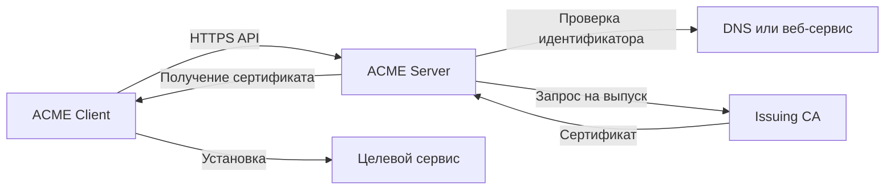
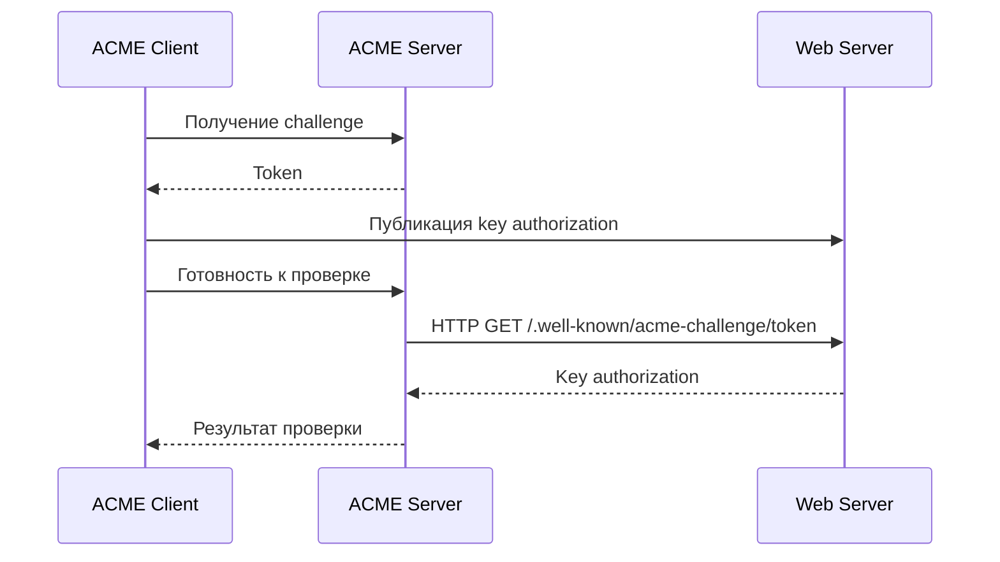
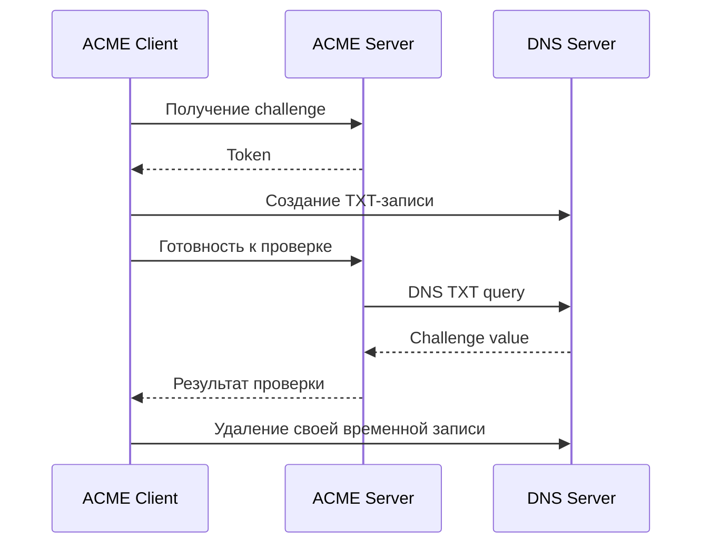
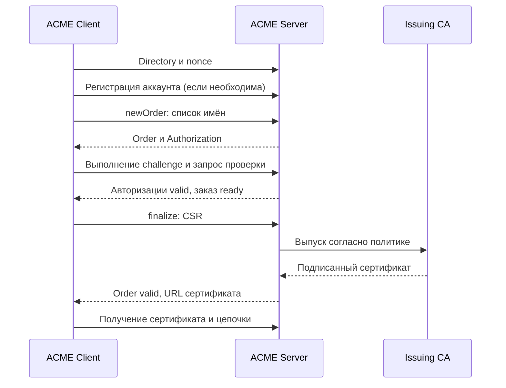
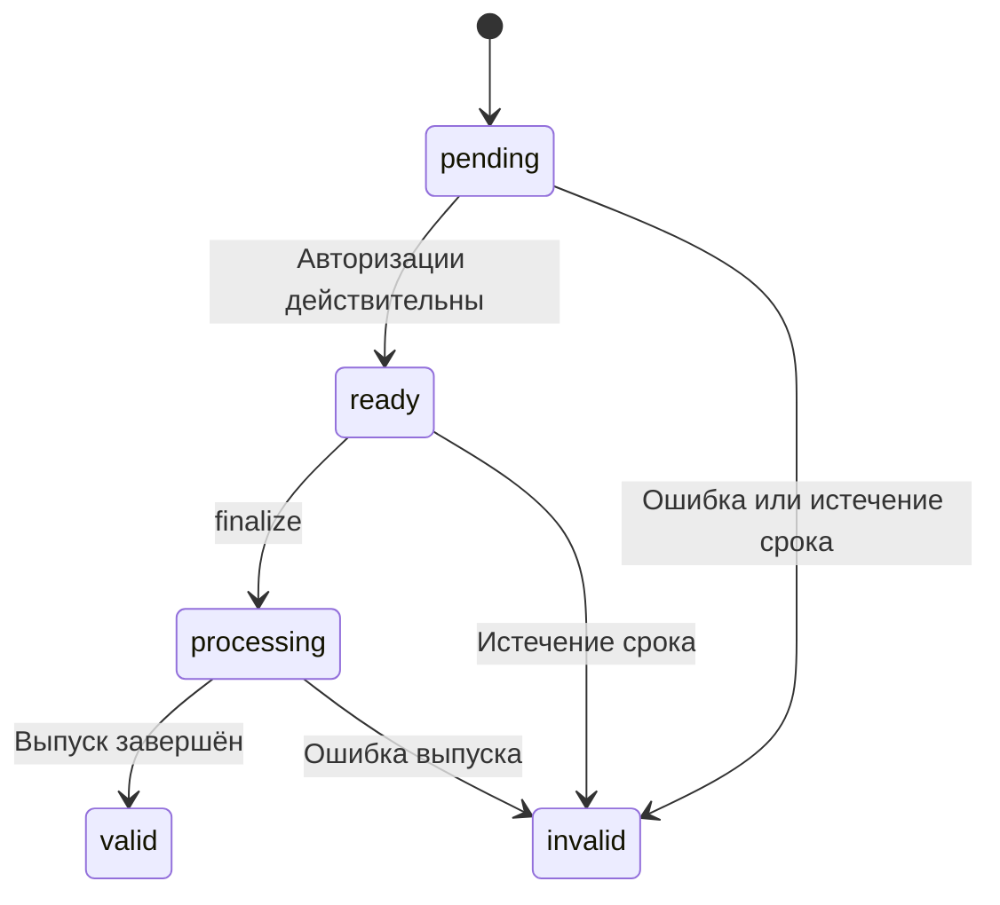

## 1. Назначение ACME

**ACME (Automatic Certificate Management Environment)** — протокол автоматизированного получения и управления сертификатами. Основной стандарт — RFC 8555.

При ручном выпуске администратор создаёт ключ, формирует CSR, передаёт запрос удостоверяющему центру, подтверждает право на имя и устанавливает полученный сертификат. ACME позволяет автоматизировать взаимодействие с CA через HTTPS API.

ACME не заменяет PKI и не является удостоверяющим центром. Он определяет правила взаимодействия клиента с сервером автоматизированной выдачи.

Общие этапы работы с сертификатами рассмотрены в [[Synced/DevOps/CI-CD, артефакты, тестирование и DevSecOps/5. DevSecOps и безопасность цепочки поставок/9. PKI и криптография в инфраструктуре/4. Управление жизненным циклом.md|управлении жизненным циклом]].

## 2. Архитектура ACME

| Компонент | Назначение |
|---|---|
| ACME Client | Регистрация аккаунта, создание запросов, выполнение проверок и получение сертификатов |
| ACME Server | Предоставление API, управление заказами и проверками |
| CA | Подписание сертификатов согласно политике выдачи |
| Validation infrastructure | Проверка права на запрашиваемые идентификаторы |
| Целевой сервис | Использование сертификата и соответствующего приватного ключа |



Клиент обращается к ACME API. Сервер проверяет право на запрошенное имя и инициирует выпуск через CA. После получения сертификата клиент или отдельный механизм развёртывания устанавливает его в целевой сервис. ACME Server и CA могут быть частями одного приложения.

Примеры серверов: Let's Encrypt (публичный CA), Smallstep step-ca (в том числе внутренняя PKI). Примеры клиентов: Certbot, acme.sh, lego, встроенные клиенты Caddy и Traefik.

## 3. Directory и аккаунт ACME

### 3.1. Directory

**Directory** — точка входа в ACME API. Она содержит адреса операций, поддерживаемых сервером.

Пример получения публичного каталога Let's Encrypt:

```bash
curl -s https://acme-v02.api.letsencrypt.org/directory
```

Основные поля ответа:

| Поле | Назначение |
|---|---|
| `newNonce` | Получение одноразового значения nonce |
| `newAccount` | Регистрация аккаунта |
| `newOrder` | Создание заказа на сертификат |
| `revokeCert` | Отзыв сертификата |
| `keyChange` | Замена ключа аккаунта |
| `meta` | Дополнительные сведения и требования сервера |

Адреса операций следует получать из Directory, а не формировать вручную.

### 3.2. Ключ аккаунта и ключ сертификата

ACME использует два разных по назначению ключа.

| Ключ | Назначение |
|---|---|
| Account Key | Подписание запросов к ACME API и подтверждение владения аккаунтом |
| Certificate Private Key | Создание CSR и последующее использование сертификата сервисом |

Ключ аккаунта может использоваться для множества заказов. Ключ сертификата относится к конкретной криптографической паре. Оба приватных ключа требуют защиты.

> [!WARNING] Важно
> Компрометация ключа аккаунта и компрометация ключа сертификата — разные инциденты. Замена ключа аккаунта не заменяет ключи уже выпущенных сертификатов.

### 3.3. Подписание запросов

Для большинства операций ACME использует JWS (JSON Web Signature). Клиент подписывает запрос ключом аккаунта. Сервер проверяет подпись, адрес операции и nonce — одноразовое значение, защищающее от повторного воспроизведения запросов.

HTTPS защищает транспорт, а JWS подтверждает подлинность запроса на уровне протокола. При регистрации передаётся публичный ключ аккаунта; после регистрации обычно используется идентификатор аккаунта (`kid`).

### 3.4. External Account Binding

**EAB (External Account Binding)** — механизм привязки нового ACME-аккаунта к учётной записи во внешней системе CA. Клиент получает идентификатор и секрет HMAC от оператора CA и использует их при регистрации.

EAB может ограничивать регистрацию аккаунтов, но сам по себе не заменяет проверку права на доменное имя и политику выдачи.

## 4. Объекты протокола

| Объект | Назначение |
|---|---|
| Account | Учётная запись клиента |
| Order | Заказ на выпуск сертификата для набора идентификаторов |
| Authorization | Состояние проверки права на конкретный идентификатор |
| Challenge | Способ выполнения проверки |
| Certificate | Результат успешного выпуска |

Например, заказ для `portal.example.org` и `api.example.org` может содержать две авторизации. Для каждой необходима действительная авторизация; сервер может повторно использовать ранее подтверждённую авторизацию согласно своей политике.

## 5. Подтверждение права на доменное имя

**Challenge** — проверочное задание, которое клиент выполняет для подтверждения контроля над идентификатором.

ACME-сервер предоставляет случайный токен. Клиент формирует key authorization из токена и отпечатка публичного ключа аккаунта. Способ публикации результата зависит от типа проверки.

### 5.1. HTTP-01

Клиент размещает проверочное содержимое по адресу:

```text
http://portal.example.org/.well-known/acme-challenge/<token>
```

Содержимое файла — key authorization. Сервер проверки обращается к указанному адресу по TCP-порту 80 и сравнивает полученное значение с ожидаемым.



Клиент сначала публикует проверочное значение, затем сообщает серверу о готовности. Проверяющая сторона самостоятельно обращается к веб-серверу. При наличии нескольких адресов или балансировщиков необходимо обеспечить корректный ответ со всех потенциально используемых узлов.

HTTP-01 подходит для обычных доменных имён, но не для wildcard-сертификатов. Публичному CA необходима доступность проверочного ресурса из его инфраструктуры.

### 5.2. DNS-01

Клиент создаёт TXT-запись:

```dns
_acme-challenge.example.org. IN TXT "<challenge-value>"
```

Значение — SHA-256 от key authorization, закодированный в Base64URL без заполнения. CA проверяет TXT-запись через DNS.



Клиент публикует запись, ожидает её доступности через DNS и инициирует проверку. После завершения временную запись можно удалить, не затрагивая записи других параллельных заказов.

DNS-01 позволяет выпускать wildcard-сертификаты (`*.example.org`) и сертификаты для сервисов, не доступных из интернета, если проверяющий CA видит нужную DNS-запись. Для автоматизации обычно требуется DNS API или делегирование зоны проверки.

> [!TIP] Безопасность DNS API
> Предпочтительно предоставлять клиенту минимальные права на изменение записей проверки, а не полный административный доступ ко всей DNS-зоне.

### 5.3. TLS-ALPN-01

Проверка описана в RFC 8737. Клиент временно предоставляет специальный TLS-сертификат с проверочным расширением. Проверяющий сервер подключается по TCP 443, используя ALPN `acme-tls/1`, и проверяет имя и расширение сертификата.

Этот способ требует поддержки специального TLS-режима на точке завершения TLS. Обычный сертификат HTTPS не подходит для выполнения challenge. Для wildcard используется DNS-01.

### 5.4. Сравнение способов

| Характеристика | HTTP-01 | DNS-01 | TLS-ALPN-01 |
|---|---|---|---|
| Проверяемый ресурс | HTTP | DNS TXT | TLS |
| Порт целевого сервиса | 80 | Не требуется | 443 |
| Wildcard | Нет | Да | Нет |
| Типичная автоматизация | Webroot или встроенный HTTP-сервер | DNS API | Встроенный TLS-клиент |

## 6. Процесс выпуска сертификата



1. Получение адресов API и регистрация аккаунта при необходимости.
2. Создание заказа с необходимыми идентификаторами.
3. Получение авторизаций и выполнение требуемых проверок.
4. Ожидание готовности заказа (`ready`).
5. Передача CSR в операцию `finalize`. CSR должен соответствовать идентификаторам заказа.
6. Выпуск сертификата CA после проверки политики.
7. Получение сертификата и цепочки по адресу из завершённого заказа.
8. Установка сертификата и проверка работы целевого сервиса.

Приватный ключ сертификата при обычном выпуске остаётся у клиента. В CSR передаются публичный ключ, запрашиваемые сведения и подпись владельца ключа. Подробнее: [[Synced/DevOps/CI-CD, артефакты, тестирование и DevSecOps/5. DevSecOps и безопасность цепочки поставок/9. PKI и криптография в инфраструктуре/2. Инфраструктура открытых ключей/3. Создание и подписание сертификатов.md|создание и подписание сертификатов]].

## 7. Состояния заказа

| Состояние | Значение |
|---|---|
| `pending` | Не все необходимые авторизации действительны |
| `ready` | Можно передать CSR для завершения заказа |
| `processing` | Сервер обрабатывает запрос на выпуск |
| `valid` | Сертификат выпущен и доступен |
| `invalid` | Заказ завершился неудачей |



Диаграмма показывает типичный переход между состояниями. При повторном использовании действительных авторизаций заказ может сразу оказаться готовым. Клиент опрашивает состояние заказа с учётом `Retry-After`, если сервер его предоставляет. Не следует непрерывно отправлять запросы без задержки.

## 8. Получение и установка сертификата

Обычно результат включает сертификат конечного субъекта и необходимые промежуточные сертификаты в PEM. Корневой сертификат распространяется как доверенный отдельно.

Типичные файлы (названия зависят от клиента):

| Файл | Содержимое |
|---|---|
| `cert.pem` | Сертификат сервиса |
| `chain.pem` | Промежуточные сертификаты |
| `fullchain.pem` | Сертификат сервиса и промежуточная цепочка |
| `privkey.pem` | Приватный ключ сертификата |

Подробнее о представлении данных: [[Synced/DevOps/CI-CD, артефакты, тестирование и DevSecOps/5. DevSecOps и безопасность цепочки поставок/9. PKI и криптография в инфраструктуре/3. Форматы сертификатов и ключей.md|форматы сертификатов и ключей]].

ACME определяет получение сертификата, но не универсальный способ установки в приложение. Перезагрузка Nginx, импорт в хранилище Java или обновление секрета контейнера — задачи клиента либо системы развёртывания.

## 9. Автоматическое обновление и отзыв

Обновление через ACME означает выпуск нового сертификата, а не изменение даты окончания старого. Клиент периодически проверяет необходимость обновления, создаёт новый заказ и выполняет требуемые проверки. При поддержке ACME Renewal Information (ARI, RFC 9773) клиент может получать рекомендованное сервером окно обновления.

После выпуска необходимо установить новый сертификат, при необходимости перечитать конфигурацию сервиса и проверить фактически предъявляемый сертификат. Выбор между сохранением и заменой ключевой пары определяется политикой и возможностями клиента.

ACME также предусматривает операцию `revokeCert`. В зависимости от условий протокола запрос может быть авторизован ключом аккаунта или приватным ключом сертификата. Отзыв не удаляет сертификат из файловой системы и не устанавливает замену.

Подробности автоматизации: [[Synced/DevOps/CI-CD, артефакты, тестирование и DevSecOps/5. DevSecOps и безопасность цепочки поставок/9. PKI и криптография в инфраструктуре/5. Автоматизация PKI/6. Автоматическое обновление и ротация сертификатов.md|автоматическое обновление и ротация сертификатов]].

## 10. Публичная и внутренняя PKI

| Характеристика | Публичный ACME CA | Внутренний ACME CA |
|---|---|---|
| Пример | Let's Encrypt | Smallstep step-ca |
| Доверие | Поддерживаемые публичные хранилища доверия | Необходима установка корпоративного корня |
| Имена | Допустимые публичные идентификаторы согласно политике CA | Внутренние имена согласно корпоративной политике |
| Проверка | Из инфраструктуры публичного CA | Из инфраструктуры внутреннего CA |

Для `portal.ggkit.local` можно использовать внутренний ACME CA при соответствующей настройке DNS, проверок и политики выдачи. Публичный CA не выдаёт публично доверенный сертификат на внутреннее имя `.local`. При этом внутренний сервис с публично зарегистрированным доменным именем может получить публичный сертификат через DNS-01 без публикации самого сервиса в интернете.

Развёртывание внутреннего CA рассмотрено в [[Synced/DevOps/CI-CD, артефакты, тестирование и DevSecOps/5. DevSecOps и безопасность цепочки поставок/9. PKI и криптография в инфраструктуре/5. Автоматизация PKI/2. Smallstep step-ca — архитектура и установка.md|Smallstep step-ca — архитектура и установка]].

## 11. Безопасность и типичные ошибки

- Защита ключа аккаунта, ключей сертификатов и учётных данных DNS API.
- Проверка TLS-сертификата самого ACME API; для внутреннего CA — настройка доверенного корня.
- Ограничение разрешённых имён и типов сертификатов политикой CA.
- Учёт CAA: DNS-записи CAA ограничивают допустимых издателей публичных сертификатов, но не заменяют challenge.
- Учёт лимитов запросов и выпуска; использование тестовой среды CA при отладке, если она предоставляется.
- Мониторинг успешности обновления и срока действия сертификата, реально используемого сервисом.

| Ошибка | Возможная причина |
|---|---|
| `unauthorized` | Проверочное значение отсутствует или не совпадает |
| `dns` | Ошибка разрешения DNS или недоступность нужной записи |
| `connection` | Проверяющая сторона не может подключиться к ресурсу |
| `rateLimited` | Превышение лимитов CA |
| `badNonce` | Недействительный или уже использованный nonce |
| `rejectedIdentifier` | Идентификатор запрещён политикой CA |

Конкретные причины следует определять по полям `type` и `detail` ответа ACME, а также журналам клиента и CA.

## Вопросы для самопроверки

1. Чем ACME отличается от CA?
2. Для чего нужны ключ аккаунта и ключ сертификата?
3. Чем Order отличается от Authorization и Challenge?
4. Как выполняется HTTP-01?
5. Почему для wildcard применяется DNS-01?
6. На каком этапе передаётся CSR?
7. Почему получение сертификата не гарантирует его установку в сервис?
8. Как использовать ACME для внутреннего домена?
9. Чем обновление сертификата отличается от отзыва?

## Итоги — что было разобрано

- Архитектура ACME и взаимодействие клиента с CA.
- Directory, аккаунты, JWS, nonce и EAB.
- Заказы, авторизации и проверочные задания.
- HTTP-01, DNS-01 и TLS-ALPN-01.
- Выпуск, получение, обновление и отзыв сертификатов.
- Применение ACME в публичной и корпоративной PKI.

## Связанные заметки

- [[Synced/DevOps/CI-CD, артефакты, тестирование и DevSecOps/5. DevSecOps и безопасность цепочки поставок/9. PKI и криптография в инфраструктуре/4. Управление жизненным циклом.md|Управление жизненным циклом]]
- [[Synced/DevOps/CI-CD, артефакты, тестирование и DevSecOps/5. DevSecOps и безопасность цепочки поставок/9. PKI и криптография в инфраструктуре/5. Автоматизация PKI/4. ACME — автоматическая выдача сертификатов.md|ACME — автоматическая выдача сертификатов]]
- [[Synced/DevOps/CI-CD, артефакты, тестирование и DevSecOps/5. DevSecOps и безопасность цепочки поставок/9. PKI и криптография в инфраструктуре/5. Автоматизация PKI/5. Certbot и acme.sh — ACME-клиенты.md|Certbot и acme.sh — ACME-клиенты]]

---

## Теги

#PKI #ACME #TLS #HTTPS #CA #X509 #CSR #DNS #DNS01 #HTTP01 #TLSALPN01 #JWS #EAB #сертификаты #криптография #автоматизация #DevSecOps #Smallstep #LetsEncrypt
