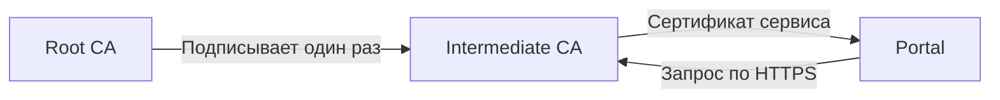

## 1. Что устанавливается

Smallstep — набор инструментов для работы с собственной PKI.

- `step` — команда для создания и проверки сертификатов, настройки CA и обращения к нему.
- `step-ca` — сервер, который принимает запросы и подписывает сертификаты.

ACME — один из способов обращения к этому серверу. Сам ACME не создаёт Root CA.

## 2. Схема развёртывания

| Машина | Адрес | Назначение |
|---|---|---|
| root-ca | Без сети после подготовки | Создание CA, хранение корневого ключа |
| ca.ggkit.local | 10.28.250.20 | Работающий step-ca, TCP 9000 |
| portal.ggkit.local | 10.28.250.21 | Получение сертификата |



Root CA подписывает сертификат Intermediate CA при подготовке. После этого он выключен. Portal обращается только к Intermediate CA. Подробнее: [[Synced/DevOps/CI-CD, артефакты, тестирование и DevSecOps/5. DevSecOps и безопасность цепочки поставок/9. PKI и криптография в инфраструктуре/2. Инфраструктура открытых ключей/2. Root CA и Intermediate CA.md|Root CA и Intermediate CA]].

## 3. Установка пакетов

**На всех трёх машинах, Ubuntu, до отключения Root CA от сети.**

```bash
sudo apt update
sudo apt install curl ca-certificates
sudo mkdir -p /etc/apt/keyrings
curl -fsSL https://packages.smallstep.com/keys/apt/repo-signing-key.gpg | sudo tee /etc/apt/keyrings/smallstep.asc >/dev/null
```

Установка curl и системных сертификатов, создание каталога ключей APT, загрузка ключа подписи репозитория. Параметры curl: `-f` — ошибка при неуспешном HTTP-ответе, `-sS` — тихий режим с выводом ошибок, `-L` — переход по перенаправлениям. `tee` записывает файл с правами root.

```bash
echo 'deb [signed-by=/etc/apt/keyrings/smallstep.asc] https://packages.smallstep.com/stable/debian debs main' | sudo tee /etc/apt/sources.list.d/smallstep.list
sudo apt update
sudo apt install step-cli
step version
```

Добавление репозитория с указанным ключом проверки подписи, обновление списка пакетов, установка и проверка CLI.

**Только на ca.ggkit.local:**

```bash
sudo apt install step-ca
step-ca version
```

Установка и проверка серверной программы. На Root CA и Portal она не нужна.

## 4. Создание CA

**На root-ca.** Отключить сеть после установки пакетов. Использовать отдельного администратора и новый каталог.

```bash
umask 077
export STEPPATH="$HOME/ggkit-pki"
step ca init
```

`umask 077` ограничивает доступ к новым файлам. `STEPPATH` задаёт каталог Smallstep. `init` создаёт обе пары ключей, оба сертификата и конфигурацию сервера.

Ответы на вопросы мастера:

| Вопрос | Ответ |
|---|---|
| Deployment type | Standalone |
| Name | GGKIT |
| DNS names | ca.ggkit.local |
| Address | :9000 |
| Provisioner name | admin |
| Password | Надёжный пароль, сохранить в защищённом хранилище |

Provisioner — правило, по которому CA разрешает выдачу сертификата. Здесь `admin` — созданный мастером JWK provisioner: администратор использует его пароль для подписания разрешения на выпуск. Это не системный пользователь Linux.

```bash
ls -R "$STEPPATH"
step certificate fingerprint "$STEPPATH/certs/root_ca.crt"
```

Просмотр файлов и получение SHA-256 отпечатка корня. Сохранить отпечаток отдельно: он потребуется клиенту.

| Файл | Назначение |
|---|---|
| certs/root_ca.crt | Корневой сертификат, можно распространять |
| secrets/root_ca_key | Корневой ключ, остаётся офлайн |
| certs/intermediate_ca.crt | Сертификат выпускающего CA |
| secrets/intermediate_ca_key | Ключ выпускающего CA |
| config/ca.json | Настройки сервера |

## 5. Перенос на Intermediate CA

**На root-ca:**

```bash
mkdir -p ~/ca-transfer/{certs,secrets,config}
cp "$STEPPATH/certs/"{root_ca.crt,intermediate_ca.crt} ~/ca-transfer/certs/
cp "$STEPPATH/secrets/intermediate_ca_key" ~/ca-transfer/secrets/
cp "$STEPPATH/config/ca.json" ~/ca-transfer/config/
```

Создание каталога и копирование только необходимых файлов. Корневой ключ не переносится. Передать каталог через защищённый съёмный носитель на ca.ggkit.local в домашний каталог администратора.

**На ca.ggkit.local:**

```bash
sudo useradd --system --home-dir /etc/step-ca --shell /usr/sbin/nologin ggkit-ca
sudo mkdir -p /etc/step-ca/db
sudo cp -r ~/ca-transfer/. /etc/step-ca/
sudo chown -R ggkit-ca:ggkit-ca /etc/step-ca
sudo chmod 700 /etc/step-ca /etc/step-ca/secrets
sudo chmod 600 /etc/step-ca/secrets/intermediate_ca_key
```

Создание отдельного пользователя без интерактивного входа (однократно), каталога базы, перенос файлов, назначение владельца и ограничение доступа. В этом примере промежуточный ключ создаётся на Root CA и переносится зашифрованным; для более строгой схемы ключ создают непосредственно на Intermediate CA.

## 6. Настройка сервера

**На ca.ggkit.local.**

```bash
sudo nano /etc/step-ca/config/ca.json
```

Изменить только указанные поля в созданном мастером JSON, сохранив остальные настройки:

```json
{
  "root": "/etc/step-ca/certs/root_ca.crt",
  "crt": "/etc/step-ca/certs/intermediate_ca.crt",
  "key": "/etc/step-ca/secrets/intermediate_ca_key",
  "address": ":9000",
  "dnsNames": ["ca.ggkit.local"],
  "db": {
    "type": "badgerv2",
    "dataSource": "/etc/step-ca/db"
  }
}
```

Это фрагмент, не полный файл. `root` — корень доверия, `crt` и `key` — сертификат и ключ подписывающего CA, `address` — порт, `dnsNames` — имя HTTPS API, `db` — база выдачи и отзыва. Проверить остальные абсолютные пути, если они остались от root-ca. Не удалять `authority` и созданный provisioner `admin`.

### 6.1. Включение ACME

```bash
sudo -u ggkit-ca step ca provisioner add acme --type ACME --ca-config /etc/step-ca/config/ca.json
```

Добавление второго способа выдачи: `acme` — имя, `--type ACME` — протокол, `--ca-config` — изменяемый файл. Теперь доступны JWK и ACME. Полный сценарий ACME: [[Synced/DevOps/CI-CD, артефакты, тестирование и DevSecOps/5. DevSecOps и безопасность цепочки поставок/9. PKI и криптография в инфраструктуре/5. Автоматизация PKI/4. ACME — автоматическая выдача сертификатов.md|Выдача через ACME]].

> [!WARNING]
> Ограничить доступ к API доверенной сетью и настроить правила допустимых имён перед промышленным использованием. Пароль JWK не раздавать всем пользователям.

### 6.2. Постоянный запуск

```bash
sudo install -m 600 -o ggkit-ca -g ggkit-ca /dev/null /etc/step-ca/secrets/password
sudo nano /etc/step-ca/secrets/password
```

Создание защищённого файла и ввод пароля промежуточного ключа одной строкой. Пароль нужен для автоматического запуска, не передавать его в аргументах команды. Не запускать install повторно после заполнения: файл будет очищен.

```bash
sudo nano /etc/systemd/system/ggkit-step-ca.service
```

Полное содержимое:

```ini
[Unit]
Description=GGKIT Smallstep CA
After=network-online.target
Wants=network-online.target

[Service]
User=ggkit-ca
Group=ggkit-ca
Environment=STEPPATH=/etc/step-ca
ExecStart=/usr/bin/step-ca /etc/step-ca/config/ca.json --password-file=/etc/step-ca/secrets/password
Restart=on-failure

[Install]
WantedBy=multi-user.target
```

`User` и `Group` — запуск без root; `Environment` — каталог Smallstep; `ExecStart` — запуск CA с конфигурацией и паролем ключа; `Restart` — перезапуск после сбоя; `WantedBy` — запуск при загрузке системы.

```bash
sudo systemctl daemon-reload
sudo systemctl enable --now ggkit-step-ca
sudo systemctl status ggkit-step-ca
```

Перечитывание unit-файлов, включение автозапуска и запуск, проверка состояния. Ожидается `active (running)`. При ошибке:

```bash
sudo journalctl -u ggkit-step-ca -n 50 --no-pager
```

Последние 50 строк журнала службы.

## 7. Проверка готовности

Создать DNS-запись ca.ggkit.local → 10.28.250.20 и разрешить TCP 9000 из доверенной сети. На CA выполнить:

```bash
sudo curl --cacert /etc/step-ca/certs/root_ca.crt https://ca.ggkit.local:9000/health
sudo curl --cacert /etc/step-ca/certs/root_ca.crt https://ca.ggkit.local:9000/acme/acme/directory
```

`--cacert` указывает доверенный корень для проверки HTTPS. Первый запрос возвращает статус `ok`, второй — JSON с адресами ACME. Это проверка API, не выдача сертификата.

step-ca самостоятельно получает свой HTTPS-сертификат при запуске. Отдельный Nginx перед CA не требуется. Сертификат API CA и сертификат будущего сайта — разные сертификаты.

После проверки отключить Root CA, защитить резервные копии и убрать временные копии ключа из каталогов переноса. Подробнее: [[Synced/DevOps/CI-CD, артефакты, тестирование и DevSecOps/5. DevSecOps и безопасность цепочки поставок/9. PKI и криптография в инфраструктуре/2. Инфраструктура открытых ключей/7. Резервное копирование и восстановление CA.md|Резервное копирование CA]].

Получение сертификата на Portal: [[Synced/DevOps/CI-CD, артефакты, тестирование и DevSecOps/5. DevSecOps и безопасность цепочки поставок/9. PKI и криптография в инфраструктуре/5. Автоматизация PKI/3. Smallstep step CLI — управление сертификатами.md|Управление сертификатами через step CLI]].

## Вопросы для самопроверки

1. Почему step-ca не нужен корневой ключ?
2. Чем отличаются provisioners admin и acme?
3. Какие файлы нужны для запуска CA?
4. Как проверить доступность API?

## Итоги — что было разобрано

Создана двухуровневая PKI, настроен постоянно работающий CA с двумя способами выдачи сертификатов. Клиентские команды вынесены в следующую заметку.

## Связанные заметки

- [[Synced/DevOps/CI-CD, артефакты, тестирование и DevSecOps/5. DevSecOps и безопасность цепочки поставок/9. PKI и криптография в инфраструктуре/2. Инфраструктура открытых ключей/2. Root CA и Intermediate CA.md|Root CA и Intermediate CA]]
- [[Synced/DevOps/CI-CD, артефакты, тестирование и DevSecOps/5. DevSecOps и безопасность цепочки поставок/9. PKI и криптография в инфраструктуре/5. Автоматизация PKI/3. Smallstep step CLI — управление сертификатами.md|Управление сертификатами через step CLI]]
- [[Synced/DevOps/CI-CD, артефакты, тестирование и DevSecOps/5. DevSecOps и безопасность цепочки поставок/9. PKI и криптография в инфраструктуре/5. Автоматизация PKI/4. ACME — автоматическая выдача сертификатов.md|Выдача через ACME]]
- [[Synced/DevOps/CI-CD, артефакты, тестирование и DevSecOps/5. DevSecOps и безопасность цепочки поставок/9. PKI и криптография в инфраструктуре/2. Инфраструктура открытых ключей/7. Резервное копирование и восстановление CA.md|Резервное копирование CA]]

---

## Теги

#PKI #Smallstep #step-ca #RootCA #IntermediateCA #ACME #TLS #systemd
