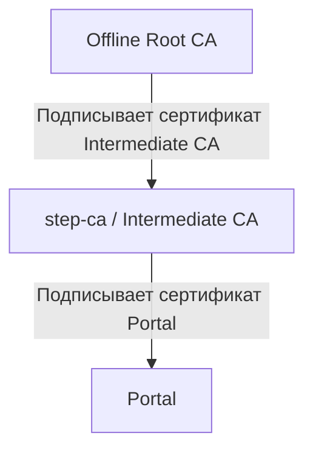
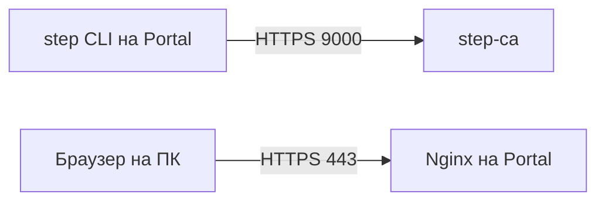
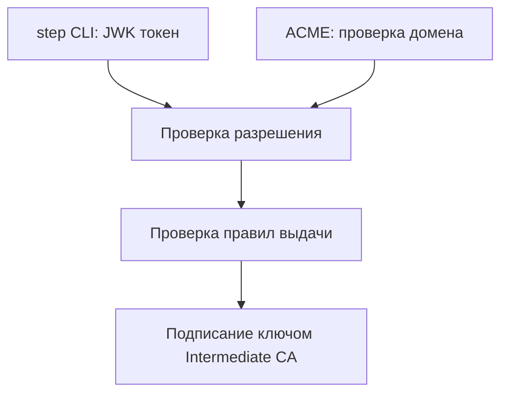

## 1. Назначение Smallstep

Smallstep позволяет организовать собственный центр выдачи сертификатов. Вместо ручного подписания каждого запроса на CA клиент обращается к работающему серверу по HTTPS.

| Компонент | Для чего нужен | Когда используется |
|---|---|---|
| `step` (step CLI) | Создание ключей, настройка CA, запрос и проверка сертификатов | Администратор и клиенты |
| `step-ca` | Проверка запросов и подписание сертификатов | Постоянно работающий сервер |
| ACME | Стандартный протокол запроса сертификатов | Certbot, другие ACME-клиенты |

`step ca init` создаёт файлы, но не запускает сервер. `step-ca` читает эти файлы и начинает обслуживать запросы. ACME не создаёт Root CA: это лишь один из способов получения конечных сертификатов.

В этой заметке — серверная часть. Работа клиента подробно разобрана в [[Synced/DevOps/CI-CD, артефакты, тестирование и DevSecOps/5. DevSecOps и безопасность цепочки поставок/9. PKI и криптография в инфраструктуре/5. Автоматизация PKI/3. Smallstep step CLI — управление сертификатами.md|Smallstep step CLI — управление сертификатами]].

## 2. Архитектура и TLS

| Машина | Адрес | Задача |
|---|---|---|
| `root-ca` | Без постоянного подключения к сети | Хранение корневого ключа |
| `ca.ggkit.local` | 10.28.250.20 | Работа step-ca на TCP 9000 |
| `portal.ggkit.local` | 10.28.250.21 | Nginx, получение сертификата |
| Рабочий ПК | Любой адрес LAN | Доступ к Portal |

Адреса — пример. В DNS заранее создать записи для CA и Portal. Настроить корректное время на всех машинах.



Стрелки показывают, кто подписывает сертификат. Приватные ключи Root CA, Intermediate CA и Portal различаются. Корневой ключ не нужен работающему step-ca. Подробнее: [[Synced/DevOps/CI-CD, артефакты, тестирование и DevSecOps/5. DevSecOps и безопасность цепочки поставок/9. PKI и криптография в инфраструктуре/2. Инфраструктура открытых ключей/2. Root CA и Intermediate CA.md|Root CA и Intermediate CA]].

### 2.1. Два разных HTTPS-соединения



Первое соединение нужно для получения сертификата, второе — для использования сайта. step-ca при запуске сам создаёт себе TLS-сертификат для API, подписанный выпускающим CA. Nginx получит отдельный сертификат позже.

В обоих случаях клиент проверяет имя сервера, цепочку сертификатов и срок действия. Шифрование трафика выполняется сеансовыми ключами TLS; сертификат помогает проверить, с кем установлено соединение.

> [!INFO]
> `ca.ggkit.local` в настройках step-ca — имя самого API, а не перечень всех имён, для которых разрешено выдавать сертификаты.

## 3. Установка

Пример рассчитан на Ubuntu с systemd. На Root CA подготовить пакеты до отключения сети; для строгой изоляции перенести проверенные пакеты и зависимости на носителе. На Intermediate CA установить оба инструмента. На Portal понадобится только step-cli.

Официальный репозиторий: https://smallstep.com/docs/step-ca/installation/

**Место: каждая машина Ubuntu, где разрешена установка из сети.**

```bash
sudo apt update
sudo apt install ca-certificates curl
sudo install -d -m 0755 /etc/apt/keyrings
curl -fsSL https://packages.smallstep.com/keys/apt/repo-signing-key.gpg | sudo tee /etc/apt/keyrings/smallstep.asc >/dev/null
```

`curl` скачивает ключ репозитория (`-f` — ошибка при HTTP-сбое, `-sS` — тихий режим с выводом ошибок, `-L` — переход по перенаправлениям). `tee` записывает файл с правами root. Проверить ключ по официальной инструкции перед использованием.


>[!WARNING] Про step-ca
>В следующих командах на Portal последнюю команду заменить на `sudo apt install step-cli`.

```bash
echo 'deb [signed-by=/etc/apt/keyrings/smallstep.asc] https://packages.smallstep.com/stable/debian debs main' | sudo tee /etc/apt/sources.list.d/smallstep.list
sudo apt update
sudo apt install step-cli step-ca
```

`signed-by` ограничивает ключ конкретным репозиторием; `debs main` — его разделы. 

```bash
step version
step-ca version
```

Вторая проверка нужна только там, где установлен сервер. Полезно сохранить версии в документации инфраструктуры.

## 4. Создание CA

Используется штатная инициализация Smallstep на изолированной машине. Она создаёт оба ключа и готовый JSON. Это осознанный выбор: промежуточный ключ появится на Root CA и будет перенесён в зашифрованном виде. Если политика запрещает перенос приватных ключей между машинами, нужен отдельный сценарий создания CSR промежуточного CA непосредственно на сервере.

### 4.1. Подготовка паролей

**Место: Root CA, обычный администратор, Bash.**

```bash
umask 077
export STEPPATH="$HOME/ggkit-pki"
mkdir -p "$STEPPATH"
read -rsp 'Пароль ключей CA: ' CA_PASS; echo
printf '%s\n' "$CA_PASS" > "$STEPPATH/ca-password"
unset CA_PASS
read -rsp 'Пароль JWK provisioner: ' JWK_PASS; echo
printf '%s\n' "$JWK_PASS" > "$STEPPATH/jwk-password"
unset JWK_PASS
```

`umask 077` ограничивает права новых файлов; `STEPPATH` задаёт рабочий каталог step; `read -rsp` вводит пароль без отображения; `printf` записывает его в файл; `unset` удаляет переменную. Ввести разные стойкие пароли, не использовать пустые значения. Пароли сохранить отдельно в защищённом хранилище.

### 4.2. Инициализация

```bash
step ca init --deployment-type standalone \
  --name GGKIT --dns ca.ggkit.local --address :9000 \
  --provisioner admin \
  --password-file "$STEPPATH/ca-password" \
  --provisioner-password-file "$STEPPATH/jwk-password"
```

| Параметр | Назначение |
|---|---|
| `--deployment-type standalone` | Собственный независимый CA |
| `--name GGKIT` | Название PKI |
| `--dns` | DNS-имя API, попадёт в его TLS-сертификат |
| `--address` | Адрес и порт прослушивания, здесь все интерфейсы |
| `--provisioner admin` | Имя начального способа авторизации JWK |
| `--password-file` | Пароль шифрования ключей CA |
| `--provisioner-password-file` | Отдельный пароль ключа авторизации JWK |

Не путать пароль JWK с паролем CA: первый разрешает выпуск, второй открывает ключ подписи CA. Название `admin` не создаёт пользователя Linux и не означает автоматически полномочия удалённого администратора.

### 4.3. Результат

```bash
ls -R "$STEPPATH"
step certificate inspect "$STEPPATH/certs/root_ca.crt" --short
step certificate inspect "$STEPPATH/certs/intermediate_ca.crt" --short
step certificate fingerprint "$STEPPATH/certs/root_ca.crt"
```

`inspect --short` выводит краткие сведения, включая издателя и сроки. `fingerprint` выводит отпечаток корневого сертификата. Сохранить его в доверенном административном канале для подключения клиентов.

| Файл | Содержимое | Куда передавать |
|---|---|---|
| `certs/root_ca.crt` | Корневой сертификат | CA, клиенты |
| `secrets/root_ca_key` | Приватный ключ корня | Никуда в рабочую сеть |
| `certs/intermediate_ca.crt` | Сертификат выпускающего CA | Intermediate CA |
| `secrets/intermediate_ca_key` | Зашифрованный ключ подписи | Intermediate CA |
| `config/ca.json` | Конфигурация сервера, включая JWK | Intermediate CA |
| `config/defaults.json` | Настройки локальной утилиты step | Не нужен серверу |

Сроки CA проверить по фактическим сертификатам: `--not-after` не является параметром `step ca init`. Если требуются особые сроки, создать CA отдельной процедурой до ввода в эксплуатацию. Не изменять срок сертификата редактированием JSON.

## 5. Перенос на Intermediate CA

**Место: Root CA.** Подготовить зашифрованный носитель, смонтированный в `/media/secure` (заменить на фактический путь).

```bash
mkdir -p /media/secure/ggkit/{certs,secrets,config}
cp "$STEPPATH/certs/"{root_ca.crt,intermediate_ca.crt} /media/secure/ggkit/certs/
cp "$STEPPATH/secrets/intermediate_ca_key" /media/secure/ggkit/secrets/
cp "$STEPPATH/config/ca.json" /media/secure/ggkit/config/
```

Копируются только необходимые файлы. Пароль CA вводится отдельно из защищённого хранилища. Корневой ключ и JWK-пароль не переносятся вместе с конфигурацией. Не подключать Root CA к сети ради SCP.

**Место: Intermediate CA.**

```bash
sudo useradd --system --home-dir /etc/step-ca --shell /usr/sbin/nologin ggkit-ca
sudo install -d -o ggkit-ca -g ggkit-ca -m 0750 /etc/step-ca/{certs,config,db}
sudo install -d -o ggkit-ca -g ggkit-ca -m 0700 /etc/step-ca/secrets
sudo cp -r /media/secure/ggkit/. /etc/step-ca/
sudo chown -R ggkit-ca:ggkit-ca /etc/step-ca
sudo chmod 600 /etc/step-ca/secrets/intermediate_ca_key /etc/step-ca/config/ca.json
```

`useradd --system` создаёт служебного пользователя без интерактивного входа; `install -d` создаёт каталоги с владельцем и правами; `chown` передаёт владение; `chmod 600` разрешает читать и менять секреты только владельцу. Если пользователь уже создан, повторно `useradd` не выполнять.

## 6. Разбор ca.json

**Место: Intermediate CA.**

```bash
sudo apt install jq
sudo cp /etc/step-ca/config/ca.json /etc/step-ca/config/ca.json.bak
sudo nano /etc/step-ca/config/ca.json
```

`jq` пригодится для проверки JSON. Сохранить автоматически созданный блок JWK. Далее показаны рабочие изменения, а не предложение заменить весь файл примером с вымышленными ключами.

### 6.1. Пути, прослушивание и база

Изменить существующие поля на следующие значения (фрагмент верхнего уровня):

```json
{
  "root": "/etc/step-ca/certs/root_ca.crt",
  "crt": "/etc/step-ca/certs/intermediate_ca.crt",
  "key": "/etc/step-ca/secrets/intermediate_ca_key",
  "address": ":9000",
  "dnsNames": ["ca.ggkit.local"],
  "logger": {"format": "text"},
  "db": {"type": "badgerv2", "dataSource": "/etc/step-ca/db"}
}
```

| Поле | Что делает | Ошибка при неверном значении |
|---|---|---|
| `root` | Указывает доверенный корень | Нарушение проверки цепочки |
| `crt` | Сертификат CA, подписывающего запросы | Неверная цепочка либо отказ запуска |
| `key` | Ключ, соответствующий `crt` | CA не может подписывать |
| `address` | Где слушать HTTPS | Порт занят или недоступен |
| `dnsNames` | Имена API | Ошибка проверки имени при подключении |
| `logger.format` | Формат журналов | Неудобство чтения/сбора логов |
| `db.type` | Встроенная база Badger v2 | Неподдерживаемый тип |
| `db.dataSource` | Каталог данных | Ошибка прав или потеря состояния |

Если `address` равен `:9000`, сервер доступен на всех подходящих интерфейсах. `10.28.250.20:9000` ограничит прослушивание указанным адресом. DNS-имя само по себе не ограничивает сетевой доступ.

База нужна для хранения состояния CA, включая сведения об отзыве и использованных токенах. Это не хранилище приватных ключей клиентов. Не удалять каталог при обновлении CA и не запускать два процесса с одной локальной базой. Резервирование: [[Synced/DevOps/CI-CD, артефакты, тестирование и DevSecOps/5. DevSecOps и безопасность цепочки поставок/9. PKI и криптография в инфраструктуре/2. Инфраструктура открытых ключей/7. Резервное копирование и восстановление CA.md|Резервное копирование и восстановление CA]].

### 6.2. authority и claims

`authority` объединяет правила выдачи и способы авторизации. В существующем объекте `authority` добавить или изменить объект `claims`, сохранив `provisioners` и остальные поля:

```json
"claims": {
  "minTLSCertDuration": "5m",
  "maxTLSCertDuration": "2160h",
  "defaultTLSCertDuration": "24h",
  "disableRenewal": false,
  "allowRenewalAfterExpiry": false
}
```

`5m` — пять минут, `24h` — сутки, `2160h` — 90 суток. Минимум и максимум ограничивают запрошенный срок, default используется при отсутствии явного запроса. `disableRenewal` запрещает обновление при true; `allowRenewalAfterExpiry` разрешает обновлять истёкший сертификат при true (оставить false).

Это правила конечных сертификатов, а не сроки Root CA и Intermediate CA. Claims конкретного provisioner могут переопределять общие значения. Не выпускать сертификаты за пределы срока допустимой цепочки.

### 6.3. TLS-настройки API

Автоматически созданный объект `tls` оставить без изменений. Он задаёт настройки TLS самого API, например допустимые версии протокола и наборы шифров. Он не управляет TLS на Nginx. Не добавлять устаревшие версии TLS ради устранения ошибки доверия: это разные проблемы.

### 6.4. Проверка полного файла

```bash
sudo jq empty /etc/step-ca/config/ca.json
sudo jq '{root,crt,key,address,dnsNames,db,claims:.authority.claims}' /etc/step-ca/config/ca.json
```

`jq empty` проверяет синтаксис, вторая команда выводит выбранные поля без вывода JWK-секретов. Успешный синтаксис не гарантирует рабочую конфигурацию — нужна проверка запуском. Убрать оставшиеся абсолютные пути Root CA, если они присутствуют в дополнительных настройках.

## 7. Provisioners: разрешение выпуска

Provisioner — правило, определяющее, как клиент доказывает право получить сертификат. Подпись сертификата выполняется одним и тем же Intermediate CA независимо от способа авторизации.



### 7.1. JWK

JWK — представление криптографического ключа в JSON. В начальной конфигурации provisioner `admin` уже создан. Его поля `type`, `name`, `key`, `encryptedKey` определяют тип, имя, открытый ключ проверки токенов и зашифрованный закрытый ключ авторизации соответственно.

CLI получает зашифрованный ключ provisioner, открывает его паролем и подписывает короткоживущий токен разрешения. CA проверяет этот токен открытым ключом. Приватный ключ CA для этой операции не выдаётся клиенту.

> [!WARNING]
> Знание пароля JWK может позволить запросить сертификаты для широкого набора имён. Не раздавать пароль всем серверам. Для примера его использует администратор; в эксплуатации предпочтительнее токен, ограниченный нужным именем, либо ACME и подходящие правила выдачи. JWK не проверяет DNS-владение автоматически.

### 7.2. ACME

**Место: Intermediate CA, до запуска сервиса.**

```bash
sudo -u ggkit-ca step ca provisioner add acme --type ACME --ca-config /etc/step-ca/config/ca.json
sudo -u ggkit-ca step ca provisioner update acme --x509-min-dur=5m --x509-default-dur=720h --x509-max-dur=2160h --ca-config /etc/step-ca/config/ca.json
```

`add` создаёт provisioner с именем `acme`; `update` меняет его сроки: по умолчанию 30 суток, максимум 90. `--ca-config` указывает локальный файл. Повторно `add` не выполнять, если запись существует.

Для просмотра без вывода секретов:

```bash
sudo jq '.authority.provisioners[] | {name,type,claims}' /etc/step-ca/config/ca.json
```

Ожидаются `admin` типа JWK и `acme` типа ACME. Изменения локального файла требуют перезапуска или поддерживаемой перезагрузки конфигурации. В этом примере используется локальное управление, не Remote Provisioner Management.

ACME directory: `https://ca.ggkit.local:9000/acme/acme/directory`. Первое `acme` — часть URL протокола, второе — имя provisioner. Полная выдача: [[Synced/DevOps/CI-CD, артефакты, тестирование и DevSecOps/5. DevSecOps и безопасность цепочки поставок/9. PKI и криптография в инфраструктуре/5. Автоматизация PKI/4. ACME — автоматическая выдача сертификатов.md|ACME — автоматическая выдача сертификатов]].

### 7.3. Ограничение выдачи

Claims отвечают за сроки и обновление, но не заменяют правила допустимых имён. В реальной инфраструктуре определить, каким клиентам разрешены какие DNS-имена, и настроить поддерживаемые политики issuance для используемой версии. Не считать внутренний DNS доказательством полномочий JWK. Разбор проектных требований: [[Synced/DevOps/CI-CD, артефакты, тестирование и DevSecOps/5. DevSecOps и безопасность цепочки поставок/9. PKI и криптография в инфраструктуре/2. Инфраструктура открытых ключей/8. Проектирование корпоративной PKI.md|Проектирование корпоративной PKI]].

## 8. Запуск через systemd

**Место: Intermediate CA.** Создать файл пароля ключа CA без передачи пароля в аргументах процесса:

```bash
sudo install -o ggkit-ca -g ggkit-ca -m 0600 /dev/null /etc/step-ca/secrets/password
sudo -u ggkit-ca bash -c 'read -rsp "Пароль CA: " p; echo; printf "%s\n" "$p" > /etc/step-ca/secrets/password'
```

Ввести пароль ключей CA из раздела 4, не пароль JWK. Файл содержит пароль в открытом виде: права доступа защищают от обычных пользователей, но не от root или полного захвата машины. Для более строгой защиты использовать отдельный механизм разблокировки или HSM.

Первый запуск:

```bash
sudo -u ggkit-ca step-ca /etc/step-ca/config/ca.json --password-file /etc/step-ca/secrets/password
```

Проверить отсутствие ошибок, затем остановить `Ctrl+C`. Не запускать одновременно ручной экземпляр и systemd.

Создать `/etc/systemd/system/ggkit-step-ca.service`:

```ini
[Unit]
Description=GGKIT Smallstep Certificate Authority
Wants=network-online.target
After=network-online.target

[Service]
Type=simple
User=ggkit-ca
Group=ggkit-ca
WorkingDirectory=/etc/step-ca
Environment=STEPPATH=/etc/step-ca
ExecStart=/usr/bin/step-ca /etc/step-ca/config/ca.json --password-file=/etc/step-ca/secrets/password
Restart=on-failure
RestartSec=5s
UMask=0077
NoNewPrivileges=true

[Install]
WantedBy=multi-user.target
```

| Директива | Назначение |
|---|---|
| `After`, `Wants` | Запуск после подготовки сети |
| `User`, `Group` | Отдельный пользователь без root-прав |
| `WorkingDirectory`, `STEPPATH` | Рабочие пути сервера |
| `ExecStart` | Команда запуска с конфигурацией и файлом пароля |
| `Restart`, `RestartSec` | Повторный запуск после сбоя с задержкой |
| `UMask` | Ограничение прав новых файлов |
| `NoNewPrivileges` | Запрет получения дополнительных привилегий через exec |
| `WantedBy` | Автозапуск в обычном многопользовательском режиме |

Путь `/usr/bin/step-ca` проверить через `command -v step-ca`; заменить при необходимости.

```bash
sudo systemctl daemon-reload
sudo systemctl enable --now ggkit-step-ca
sudo systemctl status ggkit-step-ca
sudo journalctl -u ggkit-step-ca -n 50 --no-pager
sudo ss -lntp | grep ':9000'
```

`daemon-reload` перечитывает unit; `enable --now` включает автозапуск и запускает; `status` показывает состояние; `journalctl` — последние 50 записей; `ss` — слушающие TCP-порты. Открыть TCP 9000 только нужным сетям на существующем межсетевом экране.

## 9. Проверка готовности CA

**Место: Intermediate CA.**

```bash
curl --cacert /etc/step-ca/certs/root_ca.crt https://ca.ggkit.local:9000/health
curl --cacert /etc/step-ca/certs/root_ca.crt https://ca.ggkit.local:9000/acme/acme/directory
```

`--cacert` задаёт доверенный корень для curl. Первый запрос должен вернуть статус `ok`, второй — JSON с адресами ACME. Успех не доказывает, что выпуск уже проверен: это будет сделано клиентом в [[Synced/DevOps/CI-CD, артефакты, тестирование и DevSecOps/5. DevSecOps и безопасность цепочки поставок/9. PKI и криптография в инфраструктуре/5. Автоматизация PKI/3. Smallstep step CLI — управление сертификатами.md|Smallstep step CLI — управление сертификатами]].

Проверка отсутствия корневого ключа в рабочем каталоге:

```bash
sudo test ! -e /etc/step-ca/secrets/root_ca_key && echo 'Root key absent'
```

После проверки сохранить защищённую резервную копию, удалить временные копии промежуточного ключа по принятой политике и отключить Root CA. Не удалять единственные рабочие ключи или данные восстановления.

## 10. Диагностика и изменение настроек

| Симптом | Что проверять |
|---|---|
| Сервис не стартует | JSON, пути, права, пароль ключа, журнал |
| Connection refused | Состояние сервиса, порт, адрес |
| Timeout | Маршрутизация и firewall |
| Unknown authority | Правильный Root CA у клиента |
| Certificate name mismatch | DNS-имя URL и `dnsNames` |
| Provisioner not found | Имя, конфигурация, перезапуск |
| Duration rejected | Claims provisioner и общие claims |

Порядок изменения: резервная копия JSON → изменение → `sudo jq empty /etc/step-ca/config/ca.json` → `sudo systemctl restart ggkit-step-ca` → журнал и `/health`. При неудаче восстановить предыдущую конфигурацию и повторить проверку. Не исправлять ошибки TLS отключением проверки сертификатов.

## Вопросы для самопроверки

1. Чем `step ca init` отличается от запуска `step-ca`?
2. Почему `dnsNames` не является списком разрешённых имён сертификатов?
3. Чем отличается пароль JWK от пароля ключа CA?
4. Где задаётся срок конечного сертификата?
5. Какие файлы нужны серверу при запуске и почему не нужен корневой ключ?
6. Чем проверка `/health` отличается от проверки фактической выдачи?

## Итоги — что было разобрано

Создана двухуровневая PKI, настроены постоянный сервер, два способа авторизации и сроки сертификатов. Следующая заметка показывает клиентскую работу без повторного создания CA.

## Связанные заметки

- [[Synced/DevOps/CI-CD, артефакты, тестирование и DevSecOps/5. DevSecOps и безопасность цепочки поставок/9. PKI и криптография в инфраструктуре/2. Инфраструктура открытых ключей/2. Root CA и Intermediate CA.md|Root CA и Intermediate CA]]
- [[Synced/DevOps/CI-CD, артефакты, тестирование и DevSecOps/5. DevSecOps и безопасность цепочки поставок/9. PKI и криптография в инфраструктуре/2. Инфраструктура открытых ключей/8. Проектирование корпоративной PKI.md|Проектирование корпоративной PKI]]
- [[Synced/DevOps/CI-CD, артефакты, тестирование и DevSecOps/5. DevSecOps и безопасность цепочки поставок/9. PKI и криптография в инфраструктуре/5. Автоматизация PKI/3. Smallstep step CLI — управление сертификатами.md|Smallstep step CLI — управление сертификатами]]
- [[Synced/DevOps/CI-CD, артефакты, тестирование и DevSecOps/5. DevSecOps и безопасность цепочки поставок/9. PKI и криптография в инфраструктуре/5. Автоматизация PKI/4. ACME — автоматическая выдача сертификатов.md|ACME — автоматическая выдача сертификатов]]
- [[Synced/DevOps/CI-CD, артефакты, тестирование и DevSecOps/5. DevSecOps и безопасность цепочки поставок/9. PKI и криптография в инфраструктуре/2. Инфраструктура открытых ключей/7. Резервное копирование и восстановление CA.md|Резервное копирование и восстановление CA]]

## Документация

- https://smallstep.com/docs/step-ca/configuration/
- https://smallstep.com/docs/step-cli/reference/ca/init/
- https://smallstep.com/docs/step-ca/provisioners/
- https://smallstep.com/docs/step-ca/certificate-authority-server-production/

---

## Теги

#PKI #Smallstep #step-ca #RootCA #IntermediateCA #TLS #ACME #JWK #systemd #Provisioners
