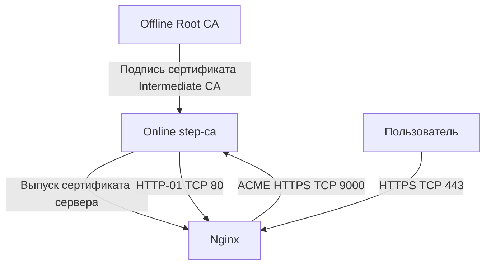
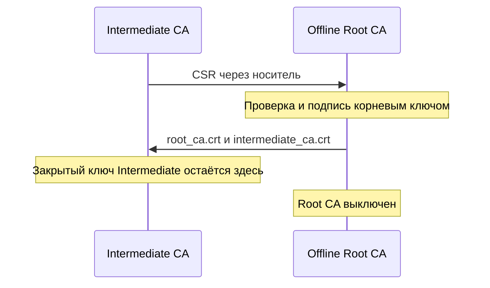
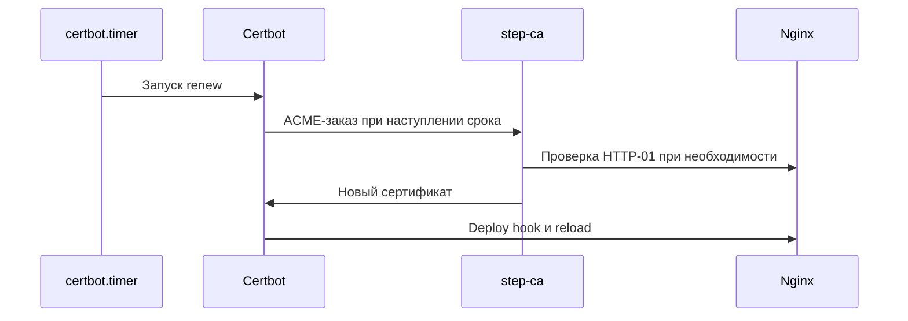

## 1. Архитектура развёртывания

Связанный материал: [[Synced/DevOps/CI-CD, артефакты, тестирование и DevSecOps/5. DevSecOps и безопасность цепочки поставок/9. PKI и криптография в инфраструктуре/2. Инфраструктура открытых ключей/2. Root CA и Intermediate CA.md|Root CA и Intermediate CA]].

**Smallstep step-ca** — удостоверяющий центр с API для выпуска сертификатов X.509. **step CLI** — утилита для создания ключей, сертификатов, запросов и взаимодействия с CA. ACME — протокол автоматического получения конечных сертификатов, а не создания корневого CA.

Пример новой корпоративной PKI на Ubuntu Server:

| Машина | Адрес (пример) | Назначение |
|---|---|---|
| root-ca | Без сетевого подключения | Корневой ключ и подпись Intermediate CA |
| ca.ggkit.local | 10.28.250.20 | step-ca, HTTPS API и ACME на TCP 9000 |
| portal.ggkit.local | 10.28.250.21 | Nginx и Certbot |

Адреса условные: перед развёртыванием проверить их доступность. На внутреннем DNS создать A-записи для ca и portal. На обеих сетевых машинах обеспечить корректное время. На CA разрешить TCP 9000 от клиентов, на portal — TCP 80 от CA и TCP 443 от пользователей. Для HTTP-01 CA должен разрешать имя portal и обращаться к нему по HTTP.



Root CA подписывает только промежуточный CA и выключается. Nginx получает сертификат через клиент Certbot; step-ca проверяет домен обратным HTTP-запросом. Пользователь доверяет корневому сертификату, установленному в его хранилище доверия.

## 2. Установка Smallstep

На root-ca подготовить пакеты до отключения сети (или перенести проверенные пакеты и зависимости на изолированный компьютер). На ca.ggkit.local выполнить те же команды настройки репозитория.

```bash
sudo apt update
sudo apt install -y curl ca-certificates
sudo install -d -m 0755 /etc/apt/keyrings
sudo curl -fsSL https://packages.smallstep.com/keys/apt/repo-signing-key.gpg \
  -o /etc/apt/keyrings/smallstep.asc
```

Создание `/etc/apt/sources.list.d/smallstep.sources`:

```text
Types: deb
URIs: https://packages.smallstep.com/stable/debian
Suites: debs
Components: main
Signed-By: /etc/apt/keyrings/smallstep.asc
```

Установка на обеих машинах:

```bash
sudo apt update
sudo apt install step-cli
step version
```

Только на ca.ggkit.local:

```bash
sudo apt install step-ca
step-ca version
```

На root-ca серверный демон не требуется. После подготовки отключить сетевой адаптер root-ca. Все дальнейшие обмены с ним выполнять через контролируемый съёмный носитель.

## 3. Создание Offline Root CA

На root-ca под отдельной учётной записью администратора:

```bash
umask 077
mkdir -p ~/root-pki
cd ~/root-pki
step certificate create "GGKIT Root CA" root_ca.crt root_ca_key \
  --profile root-ca --not-after 131400h
```

- `--profile root-ca` — профиль самоподписанного корневого CA;
- `root_ca.crt` — публичный сертификат;
- `root_ca_key` — закрытый ключ, защищённый паролем, который утилита запросит интерактивно;
- `--not-after 131400h` — пример срока около 15 лет, а не обязательное требование.

```bash
step certificate inspect root_ca.crt --short
step certificate fingerprint root_ca.crt
openssl x509 -in root_ca.crt -noout -text
```

Проверить совпадение Subject и Issuer, наличие CA:TRUE и права подписи сертификатов. Отпечаток сохранить отдельно по доверенному каналу. Создать защищённую резервную копию ключа и сертификата. Корневой ключ не переносить на online CA.

## 4. Подготовка Intermediate CA

На ca.ggkit.local создать системного пользователя и рабочие каталоги:

```bash
sudo useradd --system --user-group --create-home \
  --home-dir /var/lib/step-ca --shell /usr/sbin/nologin ggkit-ca
sudo install -d -o ggkit-ca -g ggkit-ca -m 0700 /etc/step-ca
sudo -u ggkit-ca mkdir -p /etc/step-ca/{certs,secrets,config,db}
```

Создание ключа и CSR непосредственно на online CA:

```bash
sudo -u ggkit-ca step certificate create "GGKIT Issuing CA" \
  /etc/step-ca/intermediate.csr \
  /etc/step-ca/secrets/intermediate_ca_key --csr
```

Задать отдельный надёжный пароль промежуточного ключа. Перенести только `intermediate.csr` на root-ca через носитель. Ключ остаётся на online CA.

## 5. Подписание Intermediate CA

Связанный материал: [[Synced/DevOps/CI-CD, артефакты, тестирование и DevSecOps/5. DevSecOps и безопасность цепочки поставок/9. PKI и криптография в инфраструктуре/2. Инфраструктура открытых ключей/3. Создание и подписание сертификатов.md|Создание и подписание сертификатов]].

На root-ca поместить CSR в `~/root-pki` и выполнить:

```bash
cd ~/root-pki
step certificate inspect intermediate.csr --short
openssl req -in intermediate.csr -noout -verify
```

Проверить субъект и принадлежность запроса своему серверу по доверенному каналу. Успешная проверка подписи CSR сама по себе не устанавливает личность заявителя.

```bash
step certificate sign intermediate.csr root_ca.crt root_ca_key \
  --profile intermediate-ca --not-after 43800h > intermediate_ca.crt
```

Ввести пароль Root CA. Срок 43800 часов соответствует примерно пяти годам. Проверить ограничения CA:

```bash
openssl x509 -in intermediate_ca.crt -noout -text
openssl verify -CAfile root_ca.crt intermediate_ca.crt
```

Ожидается `intermediate_ca.crt: OK`, CA:TRUE и ограничение pathlen:0 для выпуска конечных сертификатов. Если профиль установленной версии не формирует требуемые ограничения, не вводить CA в эксплуатацию до исправления профиля.

Перенести `root_ca.crt` и `intermediate_ca.crt` обратно на online CA. Выключить root-ca.



Передаются исключительно публичные объекты. Ни один из закрытых ключей не покидает свою машину в ходе выпуска.

## 6. Конфигурация step-ca

На online CA, из каталога с перенесёнными сертификатами:

```bash
sudo install -o ggkit-ca -g ggkit-ca -m 0644 root_ca.crt /etc/step-ca/certs/
sudo install -o ggkit-ca -g ggkit-ca -m 0644 intermediate_ca.crt /etc/step-ca/certs/
sudo chmod 600 /etc/step-ca/secrets/intermediate_ca_key
```

Проверить соответствие ключа сертификату (хеши должны совпасть):

```bash
sudo openssl pkey -in /etc/step-ca/secrets/intermediate_ca_key \
  -pubout -outform DER | sha256sum
sudo openssl x509 -in /etc/step-ca/certs/intermediate_ca.crt \
  -pubkey -noout | openssl pkey -pubin -outform DER | sha256sum
```

Создать `/etc/step-ca/config/ca.json` через `sudoedit`:

```json
{
  "root": "/etc/step-ca/certs/root_ca.crt",
  "crt": "/etc/step-ca/certs/intermediate_ca.crt",
  "key": "/etc/step-ca/secrets/intermediate_ca_key",
  "address": ":9000",
  "dnsNames": ["ca.ggkit.local"],
  "logger": {"format": "text"},
  "db": {
    "type": "badgerv2",
    "dataSource": "/etc/step-ca/db"
  },
  "authority": {
    "provisioners": [
      {
        "type": "ACME",
        "name": "acme",
        "challenges": ["http-01"],
        "claims": {
          "minTLSCertDuration": "5m",
          "maxTLSCertDuration": "2160h",
          "defaultTLSCertDuration": "2160h"
        }
      }
    ]
  }
}
```

`root` задаёт доверенный корень, `crt` и `key` — активный подписывающий CA. `dnsNames` определяет имя HTTPS API. Badger хранит состояние CA и ACME. Provisioner — механизм авторизации выпуска; здесь выбран ACME с HTTP-01 и сроком 90 дней для совместимости с обычным расписанием Certbot. Это пример внутренней политики. Конфигурация не содержит Root CA key и не требует JWK provisioner.

> [!WARNING]
> Один HTTP-01 не является полноценным корпоративным контролем доступа. Любой достижимый субъект, способный подтвердить имя, потенциально может получить сертификат. До промышленного внедрения настроить политики допустимых имён, ограничить доступ к API, оценить EAB и защиту DNS. Не публиковать этот CA в Интернет.

```bash
sudo chown ggkit-ca:ggkit-ca /etc/step-ca/config/ca.json
sudo chmod 600 /etc/step-ca/config/ca.json
```

## 7. Запуск CA через systemd

Для автоматического запуска сохранить пароль **промежуточного**, не корневого ключа. Редактировать файл интерактивно, не передавать пароль аргументом команды и не записывать его в историю shell.

```bash
sudo install -o ggkit-ca -g ggkit-ca -m 0600 /dev/null /etc/step-ca/secrets/password
sudoedit /etc/step-ca/secrets/password
command -v step-ca
```

Создать `/etc/systemd/system/ggkit-step-ca.service`. Ниже предполагается путь `/usr/bin/step-ca` из DEB-пакета; при другом результате `command -v` заменить путь.

```ini
[Unit]
Description=GGKIT issuing certificate authority
Wants=network-online.target
After=network-online.target

[Service]
Type=simple
User=ggkit-ca
Group=ggkit-ca
Environment=STEPPATH=/etc/step-ca
ExecStart=/usr/bin/step-ca /etc/step-ca/config/ca.json --password-file=/etc/step-ca/secrets/password
Restart=on-failure
UMask=0077
NoNewPrivileges=true
PrivateTmp=true

[Install]
WantedBy=multi-user.target
```

```bash
sudo systemctl daemon-reload
sudo systemctl enable --now ggkit-step-ca
sudo systemctl status ggkit-step-ca
sudo journalctl -u ggkit-step-ca -n 50 --no-pager
sudo ss -lntp | grep :9000
```

Пароль на диске обеспечивает unattended startup, но не защищает ключ при захвате всей машины. Для более строгой модели использовать поддерживаемое защищённое хранилище или HSM.

## 8. Установка доверия и проверка ACME

Связанный материал: [[Synced/DevOps/CI-CD, артефакты, тестирование и DevSecOps/5. DevSecOps и безопасность цепочки поставок/9. PKI и криптография в инфраструктуре/5. Автоматизация PKI/1. ACME — архитектура и принципы работы.md|Протокол ACME]].

На portal установить проверенный корневой сертификат, перенесённый по доверенному каналу. Сверить отпечаток с сохранённым при создании Root CA:

```bash
openssl x509 -in root_ca.crt -noout -fingerprint -sha256
sudo install -m 0644 root_ca.crt /usr/local/share/ca-certificates/ggkit-root.crt
sudo update-ca-certificates
getent hosts ca.ggkit.local
curl https://ca.ggkit.local:9000/health
curl https://ca.ggkit.local:9000/acme/acme/directory
```

Ожидается статус `ok` от health и JSON с адресами операций ACME, включая `newNonce`, `newAccount`, `newOrder`. Первое `acme` в пути — API, второе — имя provisioner. Не использовать `curl -k`: это скрывает проблемы с доверием.

## 9. Выпуск первого сертификата для Nginx

Связанный материал: [[Synced/DevOps/CI-CD, артефакты, тестирование и DevSecOps/5. DevSecOps и безопасность цепочки поставок/9. PKI и криптография в инфраструктуре/5. Автоматизация PKI/5. Certbot и acme.sh — ACME-клиенты.md|ACME-клиенты]].

На portal.ggkit.local:

```bash
sudo apt update
sudo apt install nginx certbot
sudo mkdir -p /var/www/acme
```

Создать `/etc/nginx/sites-available/portal`:

```nginx
server {
    listen 80;
    server_name portal.ggkit.local;
    location /.well-known/acme-challenge/ {
        root /var/www/acme;
    }
    location / {
        return 200 'GGKIT portal\n';
    }
}
```

```bash
sudo ln -s /etc/nginx/sites-available/portal /etc/nginx/sites-enabled/portal
sudo nginx -t
sudo systemctl reload nginx
sudo mkdir -p /var/www/acme/.well-known/acme-challenge
 echo ok | sudo tee /var/www/acme/.well-known/acme-challenge/check
```

На CA проверить `curl http://portal.ggkit.local/.well-known/acme-challenge/check`; ожидается `ok`. Удалить тестовый файл на portal.

```bash
sudo env REQUESTS_CA_BUNDLE=/etc/ssl/certs/ca-certificates.crt \
  certbot certonly --webroot -w /var/www/acme \
  --server https://ca.ggkit.local:9000/acme/acme/directory \
  --cert-name portal.ggkit.local -d portal.ggkit.local \
  --agree-tos --register-unsafely-without-email --non-interactive
```

`--server` выбирает внутренний CA вместо публичного Let's Encrypt, `--webroot` позволяет записать файл проверки в каталог работающего Nginx, `certonly` получает сертификат без изменения конфигурации веб-сервера. Переменная REQUESTS_CA_BUNDLE указывает системный набор доверенных CA для HTTPS-соединения Certbot. В этом примере контактный адрес не регистрируется; организационная политика может требовать адрес администратора.

```bash
sudo certbot certificates
sudo ls -l /etc/letsencrypt/live/portal.ggkit.local/
```

Файлы `cert.pem`, `chain.pem`, `fullchain.pem`, `privkey.pem` содержат соответственно конечный сертификат, цепочку издателей, объединённую цепочку и закрытый ключ.

## 10. Подключение HTTPS

Заменить конфигурацию `/etc/nginx/sites-available/portal`:

```nginx
server {
    listen 80;
    server_name portal.ggkit.local;
    location /.well-known/acme-challenge/ {
        root /var/www/acme;
    }
    location / {
        return 301 https://$host$request_uri;
    }
}
server {
    listen 443 ssl;
    server_name portal.ggkit.local;
    ssl_certificate /etc/letsencrypt/live/portal.ggkit.local/fullchain.pem;
    ssl_certificate_key /etc/letsencrypt/live/portal.ggkit.local/privkey.pem;
    location / {
        return 200 'GGKIT secure portal\n';
    }
}
```

```bash
sudo nginx -t
sudo systemctl reload nginx
curl https://portal.ggkit.local
```

На пользовательских машинах также установить доверенный Root CA. Проверка отдаваемой сервером цепочки:

```bash
openssl s_client -connect portal.ggkit.local:443 \
  -servername portal.ggkit.local -verify_hostname portal.ggkit.local \
  -verify_return_error -CAfile /etc/ssl/certs/ca-certificates.crt </dev/null
```

Ожидается `Verify return code: 0 (ok)`. Наличие HTTPS без успешной проверки доверия и имени не является критерием готовности.

## 11. Автоматическое обновление

Связанный материал: [[Synced/DevOps/CI-CD, артефакты, тестирование и DevSecOps/5. DevSecOps и безопасность цепочки поставок/9. PKI и криптография в инфраструктуре/4. Управление жизненным циклом.md|Управление жизненным циклом]].

На portal создать `/etc/letsencrypt/renewal-hooks/deploy/reload-nginx`:

```bash
#!/bin/sh
/usr/sbin/nginx -t && /usr/bin/systemctl reload nginx
```

```bash
sudo chmod 755 /etc/letsencrypt/renewal-hooks/deploy/reload-nginx
sudo systemctl edit certbot.service
```

Добавить override:

```ini
[Service]
Environment=REQUESTS_CA_BUNDLE=/etc/ssl/certs/ca-certificates.crt
```

```bash
sudo systemctl daemon-reload
sudo systemctl enable --now certbot.timer
systemctl list-timers certbot.timer
sudo systemctl start certbot.service
sudo journalctl -u certbot.service -n 50 --no-pager
```

При свежем сертификате обновление обычно пропускается. Для контролируемой однократной проверки на тестовом портале:

```bash
sudo env REQUESTS_CA_BUNDLE=/etc/ssl/certs/ca-certificates.crt \
  certbot renew --cert-name portal.ggkit.local --force-renewal
```

Это реальный перевыпуск, а не dry-run. Не выполнять регулярно принудительное обновление. Проверить новый серийный номер через HTTPS, убедиться в успешной перезагрузке Nginx. Для внутреннего CA не предполагать наличие публичного staging-сервера Let's Encrypt.



Таймер запускает проверку, а не обязательно выпуск. При успешной замене deploy hook заставляет Nginx загрузить новый сертификат. Root CA остаётся выключенным.

## 12. Эксплуатация и критерии готовности

| Проверка | Ожидаемый результат |
|---|---|
| Root CA выключен | Конечные сертификаты продолжают выпускаться |
| Содержимое online CA | Нет корневого приватного ключа |
| HTTPS API | Проверяется без отключения TLS verification |
| ACME directory | Доступен внутренним клиентам |
| HTTP-01 | CA достигает веб-сервера по имени |
| Nginx | Отдаёт доверенную цепочку |
| Certbot timer | Активен, журнал без ошибок |
| Резервное копирование | Ключи, конфигурация, БД и сертификаты сохраняются защищённо |

Для резервирования Badger использовать согласованную копию при остановленном CA либо поддерживаемый механизм резервирования БД. Контролировать сроки обоих CA и конечных сертификатов. Срок 90 дней в примере требует отдельной стратегии при компрометации: не предполагать наличие полноценной OCSP/CRL инфраструктуры автоматически после установки step-ca.

## Вопросы для самопроверки

1. Почему Root CA не нужен для каждого ACME-заказа?
2. Какие файлы передаются между CA при создании Intermediate CA?
3. Чем provisioner отличается от удостоверяющего центра?
4. Почему проверка HTTP-01 зависит от DNS и сетевой доступности?
5. Для чего Certbot требуется доверие к Root CA ещё до выпуска сертификата?
6. Почему после обновления файла сертификата необходим reload Nginx?

## Итоги — что было разобрано

Создана последовательная схема развёртывания двухуровневой PKI с изолированным корневым CA, online step-ca, ACME provisioner, доверенным HTTPS и автоматическим обновлением. Команды рассчитаны на Ubuntu с DEB-пакетами Smallstep и Certbot. Реальное выполнение в ВМ не проверялось; адреса и сроки являются параметрами примера.

Официальная документация:
- https://smallstep.com/docs/step-ca/installation/
- https://smallstep.com/docs/tutorials/intermediate-ca-new-ca/
- https://smallstep.com/docs/step-ca/configuration/
- https://smallstep.com/docs/step-ca/getting-started/
- https://smallstep.com/docs/step-cli/reference/certificate/sign/
- https://eff-certbot.readthedocs.io/en/stable/using.html

## Связанные заметки

- [[Synced/DevOps/CI-CD, артефакты, тестирование и DevSecOps/5. DevSecOps и безопасность цепочки поставок/9. PKI и криптография в инфраструктуре/2. Инфраструктура открытых ключей/2. Root CA и Intermediate CA.md|Root CA и Intermediate CA]]
- [[Synced/DevOps/CI-CD, артефакты, тестирование и DevSecOps/5. DevSecOps и безопасность цепочки поставок/9. PKI и криптография в инфраструктуре/2. Инфраструктура открытых ключей/3. Создание и подписание сертификатов.md|Создание и подписание сертификатов]]
- [[Synced/DevOps/CI-CD, артефакты, тестирование и DevSecOps/5. DevSecOps и безопасность цепочки поставок/9. PKI и криптография в инфраструктуре/5. Автоматизация PKI/1. ACME — архитектура и принципы работы.md|Протокол ACME]]
- [[Synced/DevOps/CI-CD, артефакты, тестирование и DevSecOps/5. DevSecOps и безопасность цепочки поставок/9. PKI и криптография в инфраструктуре/5. Автоматизация PKI/3. Smallstep step CLI — управление сертификатами.md|Smallstep step CLI]]
- [[Synced/DevOps/CI-CD, артефакты, тестирование и DevSecOps/5. DevSecOps и безопасность цепочки поставок/9. PKI и криптография в инфраструктуре/5. Автоматизация PKI/5. Certbot и acme.sh — ACME-клиенты.md|ACME-клиенты]]
- [[Synced/DevOps/CI-CD, артефакты, тестирование и DevSecOps/5. DevSecOps и безопасность цепочки поставок/9. PKI и криптография в инфраструктуре/4. Управление жизненным циклом.md|Управление жизненным циклом]]

---

## Теги

#PKI #Smallstep #step-ca #ACME #RootCA #IntermediateCA #OfflineCA #TLS #HTTPS #Certbot #Nginx #Ubuntu #systemd #сертификаты #автоматизация
