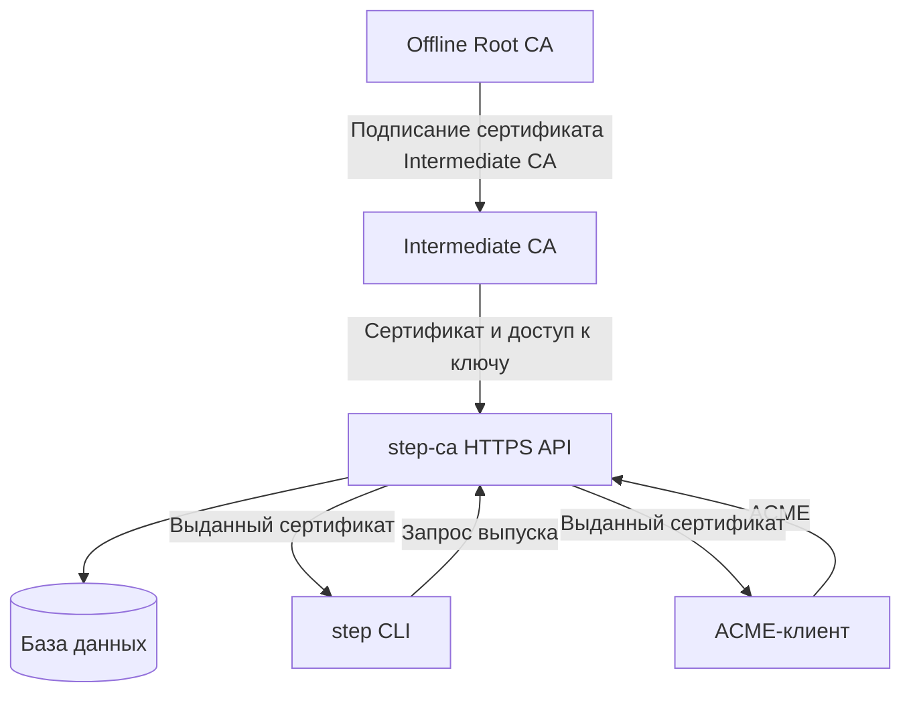
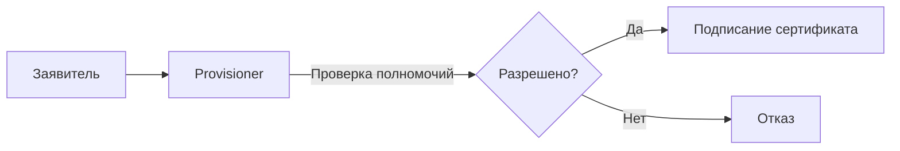
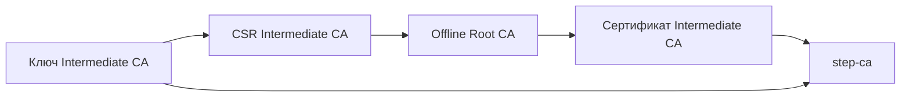

## 1. Назначение Smallstep

**step-ca** — программный удостоверяющий центр с HTTPS API для выпуска и обновления сертификатов X.509 и SSH-сертификатов. **step CLI** — отдельная клиентская утилита для взаимодействия с CA и работы с криптографическими объектами.

В отличие от ручного подписания запросов через OpenSSL, step-ca представляет собой постоянно работающий сервис, который проверяет полномочия заявителя, применяет политики выпуска и подписывает сертификаты.

Основные возможности:

- выпуск короткоживущих сертификатов;
- автоматизация через ACME;
- аутентификация заявителей через provisioners;
- использование существующей цепочки CA;
- обновление и отзыв сертификатов через API.

> [!INFO]
> step-ca не заменяет хранилище доверенных сертификатов операционной системы. Клиенты должны отдельно доверять корневому CA.

## 2. Архитектура



Root CA подписывает сертификат Intermediate CA и после этого может оставаться отключённым. step-ca использует ключ Intermediate CA для выпуска конечных сертификатов. Клиенты обращаются к API по HTTPS. База данных хранит служебное состояние, в частности сведения о сертификатах и операциях ACME.

Подробнее: [[Synced/DevOps/CI-CD, артефакты, тестирование и DevSecOps/5. DevSecOps и безопасность цепочки поставок/9. PKI и криптография в инфраструктуре/2. Инфраструктура открытых ключей/2. Root CA и Intermediate CA.md|Root CA и Intermediate CA]].

## 3. Provisioners

**Provisioner** — механизм определения того, каким способом заявитель получает право на выпуск сертификата.

| Тип | Назначение |
|---|---|
| JWK | Авторизация посредством подписанного токена |
| ACME | Автоматизированный выпуск с проверкой идентификатора |
| OIDC | Аутентификация через поставщика идентификации |
| X5C | Авторизация на основе существующей цепочки X.509 |
| SSHPOP | Подтверждение владения ключом SSH-сертификата |

Provisioner не является отдельным CA: несколько provisioners могут использовать один Intermediate CA. Для каждого могут задаваться ограничения срока действия и другие параметры выпуска. Наличие OIDC-провайдера само по себе не означает, что любой пользователь вправе получить сертификат на произвольный домен.



Сначала производится проверка полномочий, затем проверка применимых ограничений и только после этого — подписание. ACME подробно рассмотрен в [[Synced/DevOps/CI-CD, артефакты, тестирование и DevSecOps/5. DevSecOps и безопасность цепочки поставок/9. PKI и криптография в инфраструктуре/5. Автоматизация PKI/1. ACME — архитектура и принципы работы.md|архитектуре ACME]].

## 4. Планирование размещения

Пример параметров внутреннего CA:

| Параметр | Значение |
|---|---|
| DNS-имя | `ca.ggkit.local` |
| HTTPS API | `https://ca.ggkit.local:9000` |
| ОС | Ubuntu Server |
| Пользователь сервиса | `step` |
| STEPPATH | `/var/lib/step-ca` |
| Архитектура | Offline Root + Online Intermediate |

Создание DNS-записи для CA и разрешение TCP-порта 9000 от авторизованных сетей. Синхронизация времени через NTP обязательна для корректной проверки сроков сертификатов и токенов.

## 5. Установка

Установка официальных пакетов `step-cli` и `step-ca` из репозитория Smallstep. Пример для Ubuntu с APT:

```bash
sudo apt update
sudo apt install -y curl ca-certificates
sudo install -d -m 0755 /etc/apt/keyrings
curl -fsSL https://packages.smallstep.com/keys/apt/repo-signing-key.gpg | sudo tee /etc/apt/keyrings/smallstep.asc >/dev/null
```

```bash
 echo 'deb [signed-by=/etc/apt/keyrings/smallstep.asc] https://packages.smallstep.com/stable/debian debs main' | sudo tee /etc/apt/sources.list.d/smallstep.list
sudo apt update
sudo apt install step-cli step-ca
```

Перед подключением репозитория следует сверить ключ подписи и актуальную инструкцию производителя: https://smallstep.com/docs/step-ca/installation/.

Проверка установки:

```bash
step version
step-ca version
```

## 6. Первоначальная инициализация

Создание отдельного системного пользователя:

```bash
sudo useradd --system --create-home --home-dir /var/lib/step-ca --shell /usr/sbin/nologin step
sudo -u step env STEPPATH=/var/lib/step-ca step ca init
```

Пример ответов при интерактивной настройке:

| Вопрос | Ответ |
|---|---|
| Тип развёртывания | Standalone |
| Название PKI | GGKIT Internal CA |
| DNS names | ca.ggkit.local |
| Address | :9000 |
| First provisioner | admin |
| Password | Уникальный стойкий пароль |

Инициализация создаёт корневой и промежуточный CA, конфигурацию и начальный JWK provisioner. Пароль следует хранить в защищённом хранилище. В корпоративной среде генерацию Root CA предпочтительно выполнять на изолированной системе; данный интерактивный вариант подходит для первоначального знакомства или контролируемой церемонии инициализации.

## 7. Структура файлов

| Путь относительно STEPPATH | Содержимое |
|---|---|
| `certs/root_ca.crt` | Корневой сертификат |
| `certs/intermediate_ca.crt` | Сертификат выпускающего CA |
| `secrets/root_ca_key` | Закрытый ключ Root CA |
| `secrets/intermediate_ca_key` | Закрытый ключ Intermediate CA |
| `config/ca.json` | Конфигурация сервера |
| `config/defaults.json` | Клиентские настройки по умолчанию |
| `db/` | База данных при стандартной локальной конфигурации |

После инициализации корневой ключ необходимо перенести в защищённое офлайн-хранилище, проверить возможность его восстановления и исключить доступ к нему с онлайн-сервера. Простое удаление файла не гарантирует уничтожение копий в снапшотах и резервных копиях. Корневой сертификат остаётся на сервере.

## 8. Конфигурация ca.json

Файл `ca.json` создаётся автоматически. Ниже приведён сокращённый фрагмент, а не готовая замена файла:

```json
{
  "root": "/var/lib/step-ca/certs/root_ca.crt",
  "crt": "/var/lib/step-ca/certs/intermediate_ca.crt",
  "key": "/var/lib/step-ca/secrets/intermediate_ca_key",
  "address": ":9000",
  "dnsNames": ["ca.ggkit.local"],
  "db": {
    "type": "badgerv2",
    "dataSource": "/var/lib/step-ca/db"
  }
}
```

- `root` — доверенный корневой сертификат;
- `crt` — сертификат выпускающего CA;
- `key` — соответствующий закрытый ключ;
- `address` — адрес прослушивания API;
- `dnsNames` — имена самого API CA, а не список всех разрешённых доменов;
- `db` — параметры базы данных;
- `authority` — настройки удостоверяющего центра, включая provisioners и ограничения выпуска.

Сохранение автоматически созданного раздела `authority` обязательно. Изменение JSON вручную следует выполнять при остановленном сервисе с предварительной резервной копией.

## 9. Использование существующего CA

Если организация уже имеет Root CA, создавать новую независимую цепочку доверия не требуется. Необходимо подготовить сертификат Intermediate CA, подписанный существующим Root CA, и соответствующий закрытый ключ.



На Root CA передаётся запрос CSR, а не закрытый ключ Intermediate CA. После подписания возвращается сертификат. step-ca получает корневой сертификат, сертификат Intermediate CA и доступ к ключу Intermediate CA.

Проверка цепочки:

```bash
openssl verify -CAfile root_ca.crt intermediate_ca.crt
```

Проверка соответствия открытых ключей:

```bash
openssl x509 -in intermediate_ca.crt -pubkey -noout | openssl sha256
openssl pkey -in intermediate_ca_key -pubout | openssl sha256
```

Хеши должны совпасть. Intermediate CA должен иметь `CA:TRUE`, право `keyCertSign` и подходящие ограничения цепочки. Для простой двухуровневой PKI в конфигурации указываются пути к подготовленным файлам. Для более длинной цепочки необходимо учитывать порядок промежуточных сертификатов и требования step-ca.

## 10. Запуск через systemd

Для запуска зашифрованного ключа без интерактивного ввода используется защищённый файл пароля. Создание файла без передачи пароля через аргументы командной строки:

```bash
sudo install -o step -g step -m 0600 /dev/null /var/lib/step-ca/secrets/password
sudoedit /var/lib/step-ca/secrets/password
```

В файл записывается пароль ключа Intermediate CA. Проверка прав доступа после редактирования.

Создание `/etc/systemd/system/step-ca.service` (если пакет уже предоставил unit, следует использовать или адаптировать его вместо создания второго сервиса):

```ini
[Unit]
Description=Smallstep Certificate Authority
After=network-online.target
Wants=network-online.target

[Service]
Type=simple
User=step
Group=step
Environment=STEPPATH=/var/lib/step-ca
ExecStart=/usr/bin/step-ca /var/lib/step-ca/config/ca.json --password-file=/var/lib/step-ca/secrets/password
Restart=on-failure
UMask=0077
NoNewPrivileges=true

[Install]
WantedBy=multi-user.target
```

Проверка пути к исполняемому файлу командой `command -v step-ca`.

```bash
sudo systemctl daemon-reload
sudo systemctl enable --now step-ca
sudo systemctl status step-ca
```

Просмотр журнала:

```bash
sudo journalctl -u step-ca -n 50 --no-pager
```

> [!WARNING]
> Пароль рядом с зашифрованным ключом позволяет автоматический запуск, но не защищает от компрометации всей ВМ. Для повышенных требований следует рассматривать HSM или внешний механизм получения секретов.

## 11. Подключение клиента и проверка

Получение отпечатка Root CA на доверенной системе:

```bash
step certificate fingerprint /var/lib/step-ca/certs/root_ca.crt
```

Передача отпечатка клиенту по независимому доверенному каналу. На клиенте с установленным step CLI:

```bash
step ca bootstrap --ca-url https://ca.ggkit.local:9000 --fingerprint <SHA256-отпечаток>
step ca health
```

Вместо `<SHA256-отпечаток>` необходимо подставить фактическое значение. Bootstrap загружает корневой сертификат, сверяет его отпечаток и сохраняет настройки клиента. Это не означает автоматическое добавление CA в системное хранилище доверия.

Ожидаемый ответ проверки API: `ok`.

Проверка без step CLI при наличии доверенного корневого сертификата:

```bash
curl --cacert root_ca.crt https://ca.ggkit.local:9000/health
```

Не следует отключать проверку TLS через `curl -k` для штатного взаимодействия с CA.

## 12. Эксплуатация и ограничения

- Резервное копирование конфигурации, базы данных, сертификатов и защищённых ключей с проверкой восстановления.
- Ограничение сетевого доступа к API и административным операциям.
- Мониторинг доступности API, срока действия Intermediate CA и ошибок выпуска.
- Раздельные provisioners для разных сценариев использования.
- Проверка политики имён и сроков действия до подключения автоматизированных клиентов.

> [!INFO]
> Наличие API отзыва не означает автоматическую публикацию CRL или OCSP для всех приложений. В базовом step-ca отзыв прежде всего препятствует штатному обновлению отозванного сертификата; уже выданный сертификат может оставаться приемлемым для клиента до истечения срока. Возможности активного отзыва необходимо проверять для выбранной редакции и версии.

Локальная база данных не превращает несколько экземпляров step-ca в отказоустойчивый кластер. Для HA требуется отдельно проектировать поддерживаемое общее хранилище состояния, доступ к ключам, балансировку и восстановление.

## Вопросы для самопроверки

1. Чем step-ca отличается от step CLI?
2. Почему Root CA не требуется для каждого выпуска?
3. Что такое provisioner?
4. Что хранится в ca.json?
5. Чем `dnsNames` отличается от политики разрешённых имён сертификатов?
6. Зачем проверять отпечаток при bootstrap?
7. Какие данные необходимы для восстановления CA?
8. Почему успешный health check не подтверждает корректность всех политик выпуска?

## Итоги — что было разобрано

step-ca — сервис автоматизированного выпуска сертификатов, работающий с ключом выпускающего CA. Для безопасного развёртывания необходимы доверенная цепочка, корректные provisioners, защищённые ключи, база данных и контроль доступа. Следующий этап — управление сертификатами через step CLI.

## Связанные заметки

- [[Synced/DevOps/CI-CD, артефакты, тестирование и DevSecOps/5. DevSecOps и безопасность цепочки поставок/9. PKI и криптография в инфраструктуре/5. Автоматизация PKI/3. Smallstep step CLI — управление сертификатами.md|Smallstep step CLI — управление сертификатами]]
- [[Synced/DevOps/CI-CD, артефакты, тестирование и DevSecOps/5. DevSecOps и безопасность цепочки поставок/9. PKI и криптография в инфраструктуре/5. Автоматизация PKI/4. ACME — автоматическая выдача сертификатов.md|ACME — автоматическая выдача сертификатов]]
- [[Synced/DevOps/CI-CD, артефакты, тестирование и DevSecOps/5. DevSecOps и безопасность цепочки поставок/9. PKI и криптография в инфраструктуре/4. Управление жизненным циклом.md|Управление жизненным циклом]]

---

## Теги

#PKI #Smallstep #step-ca #step-cli #CA #RootCA #IntermediateCA #X509 #ACME #Provisioner #TLS #systemd #DevSecOps #Linux #Certificates
