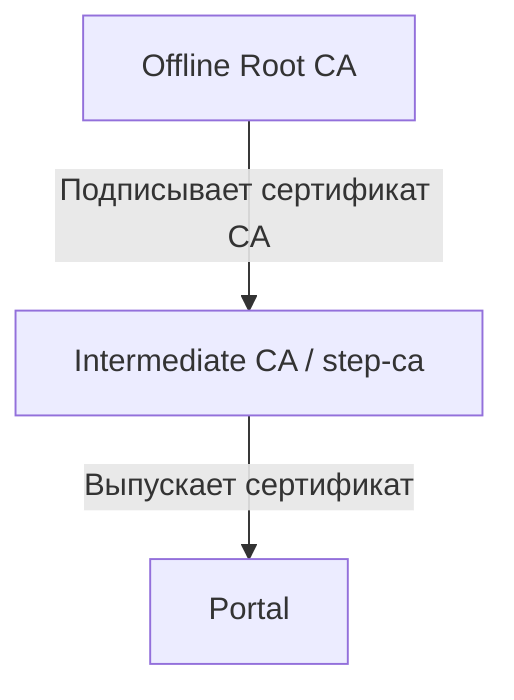
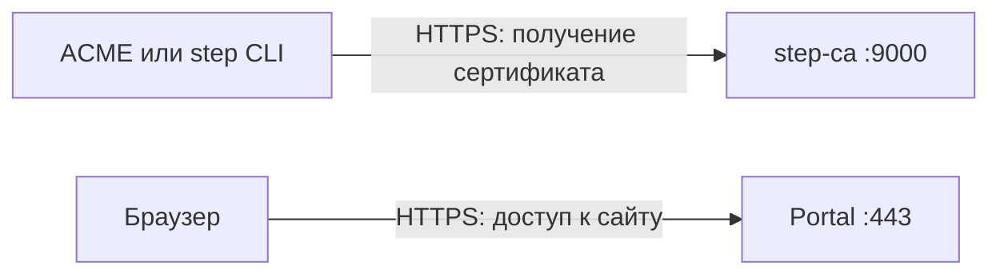

## 1. Что такое Smallstep

Smallstep позволяет создать собственный удостоверяющий центр и выдавать сертификаты внутренним сервисам.

| Инструмент | Назначение |
|---|---|
| `step` | Создание ключей, настройка CA, получение и проверка сертификатов |
| `step-ca` | Работающий сервер удостоверяющего центра |
| ACME | Протокол автоматического получения сертификатов |

Для запуска CA не требуется Nginx: step-ca самостоятельно обслуживает HTTPS API.

## 2. Архитектура

| Машина | Адрес (пример) | Назначение |
|---|---|---|
| root-ca | Изолированная машина | Хранение корневого ключа |
| ca.ggkit.local | 10.28.250.20 | Выпуск сертификатов |
| portal.ggkit.local | 10.28.250.21 | Получение сертификатов |



Root CA подписывает сертификат Intermediate CA при создании инфраструктуры. После этого корневой ключ не нужен для ежедневного выпуска сертификатов. Intermediate CA подписывает сертификаты сервисов собственным ключом.

Подробнее: [[Synced/DevOps/CI-CD, артефакты, тестирование и DevSecOps/5. DevSecOps и безопасность цепочки поставок/9. PKI и криптография в инфраструктуре/2. Инфраструктура открытых ключей/2. Root CA и Intermediate CA.md|Root CA и Intermediate CA]].

### 2.1. Какие файлы нужны

| Файл | Где находится после настройки | Назначение |
|---|---|---|
| `root_ca.crt` | CA и клиенты | Доверенный корневой сертификат |
| `root_ca_key` | Только Offline Root CA | Подписание промежуточных CA |
| `intermediate_ca.crt` | Intermediate CA | Сертификат выпускающего CA |
| `intermediate_ca_key` | Intermediate CA | Подписание сертификатов сервисов |
| `ca.json` | Intermediate CA | Настройки step-ca |

> [!INFO]
> Сертификаты `.crt` не содержат приватных ключей. Клиентам передаётся корневой сертификат, а не корневой ключ.

### 2.2. Как здесь используется TLS



Это два независимых TLS-соединения. В первом step-ca предъявляет собственный серверный сертификат, который он автоматически получает при запуске. Во втором Portal предъявляет свой сертификат. Оба могут быть подписаны одним Intermediate CA. Для проверки обоих клиенту достаточно доверять соответствующему Root CA и получить необходимые промежуточные сертификаты.

## 3. Установка инструментов

**Место выполнения: Root CA и Intermediate CA, до изоляции Root CA.**

Установить `step-cli` и `step-ca` из официального репозитория Smallstep. Инструкция: https://smallstep.com/docs/step-ca/installation/

Для Ubuntu с настроенным официальным репозиторием:

```bash
sudo apt update
sudo apt install step-cli step-ca
```

Первая команда обновляет список пакетов, вторая устанавливает клиентскую утилиту и сервер. На Root CA сервер запускать не требуется.

Проверка установки:

```bash
step version
step-ca version
```

На клиенте достаточно установить `step-cli`.

## 4. Создание Root CA и Intermediate CA

**Место выполнения: Root CA.**

Для простоты используется автоматическая инициализация всей цепочки на изолированной машине. Затем на Intermediate CA переносятся только необходимые ему файлы. Это означает, что промежуточный ключ первоначально создаётся на Root CA, а не непосредственно на Intermediate CA.

### 4.1. Выбор каталога

```bash
export STEPPATH="$HOME/.step"
umask 077
```

- `STEPPATH` — каталог конфигурации Smallstep.
- `umask 077` — ограничение прав на новые файлы и каталоги текущего пользователя.

### 4.2. Инициализация

```bash
step ca init
```

При запросе параметров указать:

| Параметр | Значение |
|---|---|
| Тип развёртывания (если запрашивается) | Standalone |
| Name | GGKIT |
| DNS names | ca.ggkit.local |
| Address | :9000 |
| Provisioner name | admin |
| Password | Надёжный пароль |

`Name` задаёт название PKI, `DNS names` — имя HTTPS-сервера CA, `Address` — адрес прослушивания и порт. Provisioner `admin` используется для авторизации выпуска через step CLI. Пароль защищает создаваемые секреты; его необходимо сохранить в защищённом хранилище.

Команда автоматически создаёт корневую пару ключей и сертификат, промежуточную пару ключей и подписанный корневым CA промежуточный сертификат, а также конфигурацию сервера.

### 4.3. Просмотр результата

```bash
ls -R "$STEPPATH"
```

Основные каталоги: `certs` — сертификаты, `secrets` — приватные ключи, `config` — конфигурация. Дополнительные файлы зависят от версии Smallstep.

```bash
step certificate inspect "$STEPPATH/certs/root_ca.crt" --short
step certificate inspect "$STEPPATH/certs/intermediate_ca.crt" --short
```

`inspect` показывает сведения о сертификате, `--short` сокращает вывод. У промежуточного сертификата издателем должен быть корневой CA.

## 5. Перенос Intermediate CA

**Место выполнения: Root CA.**

Создание отдельного каталога для переноса:

```bash
mkdir -p ~/ca-transfer/{certs,secrets,config}
cp "$STEPPATH/certs/"{root_ca.crt,intermediate_ca.crt} ~/ca-transfer/certs/
cp "$STEPPATH/secrets/intermediate_ca_key" ~/ca-transfer/secrets/
cp "$STEPPATH/config/ca.json" ~/ca-transfer/config/
```

`mkdir -p` создаёт каталоги, `cp` копирует файлы. Корневой ключ намеренно не включён.

Перенести каталог `ca-transfer` на Intermediate CA через защищённый съёмный носитель. Не подключать Offline Root CA к сети только ради копирования файлов. Носитель содержит приватный ключ Intermediate CA и требует защиты.

**Место выполнения: Intermediate CA.**

Далее предполагается, что каталог перенесён в домашнюю папку пользователя, который будет запускать CA.

```bash
export STEPPATH="$HOME/.step"
mkdir -p "$STEPPATH"
cp -r ~/ca-transfer/. "$STEPPATH/"
chmod 700 "$STEPPATH" "$STEPPATH/secrets"
chmod 600 "$STEPPATH/secrets/intermediate_ca_key"
```

`cp -r` копирует структуру каталогов, `chmod` ограничивает доступ к секретам. Не копировать `root_ca_key` на сервер.

## 6. Настройка Intermediate CA

**Место выполнения: Intermediate CA.**

### 6.1. Проверка конфигурации

```bash
nano "$STEPPATH/config/ca.json"
```

`nano` открывает автоматически созданную конфигурацию. Не нужно переписывать её целиком.

Основные поля (фрагмент, не полный файл):

```json
{
  "root": "/home/ca/.step/certs/root_ca.crt",
  "crt": "/home/ca/.step/certs/intermediate_ca.crt",
  "key": "/home/ca/.step/secrets/intermediate_ca_key",
  "address": ":9000",
  "dnsNames": ["ca.ggkit.local"]
}
```

| Поле | Значение |
|---|---|
| `root` | Корневой сертификат для цепочки доверия |
| `crt` | Сертификат выпускающего CA |
| `key` | Ключ выпускающего CA |
| `address` | Порт HTTPS API |
| `dnsNames` | Имена, по которым клиент обращается к CA |

Заменить пути на реальные пути текущего пользователя. Проверить также `db.dataSource`: база должна находиться в доступном для записи каталоге Intermediate CA. Если имеются другие абсолютные пути, оставшиеся от Root CA, исправить их. Сохранить остальные автоматически созданные поля, включая `authority` и provisioners.

### 6.2. Включение ACME

```bash
step ca provisioner add acme --type ACME --ca-config "$STEPPATH/config/ca.json"
```

Команда добавляет provisioner с именем `acme`. Provisioner определяет, каким способом клиент получает разрешение на выпуск сертификата. `--type ACME` выбирает протокол ACME, `--ca-config` указывает локальный файл конфигурации.

### 6.3. Первый запуск

```bash
step-ca "$STEPPATH/config/ca.json"
```

Команда запускает сервер в текущем терминале. При запросе ввести пароль промежуточного ключа, заданный при инициализации. Оставить терминал открытым для первоначальной проверки.

В DNS создать запись `ca.ggkit.local` с адресом Intermediate CA. Разрешить клиентам TCP-порт 9000.

## 7. Подключение клиента

**Место выполнения: Root CA.**

```bash
step certificate fingerprint "$HOME/.step/certs/root_ca.crt"
```

Команда выводит SHA-256 отпечаток корневого сертификата. Передать его клиенту по доверенному каналу. Отпечаток позволяет проверить, что при первом подключении получен именно нужный Root CA.

**Место выполнения: Portal.**

```bash
step ca bootstrap --ca-url https://ca.ggkit.local:9000 --fingerprint ОТПЕЧАТОК
```

Подставить полученный отпечаток. `bootstrap` загружает корневой сертификат, сверяет отпечаток и сохраняет настройки подключения для step CLI.

```bash
step ca health
```

Проверка доступности CA по HTTPS. Ожидаемый результат: `ok`.

> [!INFO]
> Bootstrap настраивает доверие для step CLI. Он не обязательно добавляет корневой сертификат в системное хранилище Ubuntu или браузера.

## 8. Получение первого сертификата

**Место выполнения: Portal.**

```bash
step ca certificate portal.ggkit.local portal.crt portal.key --provisioner admin
```

| Аргумент | Назначение |
|---|---|
| `portal.ggkit.local` | Имя будущего сертификата |
| `portal.crt` | Файл сертификата и цепочки |
| `portal.key` | Новый приватный ключ сервиса |
| `--provisioner admin` | Авторизация через созданный при инициализации provisioner |

При запросе ввести пароль provisioner. Этот способ использует собственный API Smallstep, а не ACME. Он нужен для первоначальной проверки выпуска.

```bash
chmod 600 portal.key
step certificate inspect portal.crt --short
```

Первая команда ограничивает доступ к ключу. Вторая показывает сведения о выданном сертификате. Проверить имя и издателя.

### 8.1. Проверка ACME

```bash
curl --cacert "$HOME/.step/certs/root_ca.crt" https://ca.ggkit.local:9000/acme/acme/directory
```

`--cacert` указывает доверенный корневой сертификат. URL содержит имя provisioner `acme`. Ожидается JSON с адресами ACME API, например `newNonce`, `newAccount`, `newOrder`.

Это проверка доступности ACME, а не выпуск сертификата через ACME. Полный выпуск рассматривается в [[Synced/DevOps/CI-CD, артефакты, тестирование и DevSecOps/5. DevSecOps и безопасность цепочки поставок/9. PKI и криптография в инфраструктуре/5. Автоматизация PKI/4. ACME — автоматическая выдача сертификатов.md|автоматической выдаче сертификатов через ACME]].

## 9. Что необходимо для постоянной эксплуатации

Первый запуск в терминале предназначен для проверки. Для постоянной эксплуатации нужен systemd-сервис под отдельным непривилегированным пользователем, защищённая передача пароля ключа при запуске, резервное копирование конфигурации, базы и ключей, а также мониторинг. Не оставлять проверочный экземпляр CA без этих мер в production.

После успешной проверки сохранить защищённую резервную копию Root CA и отключить его. Временные копии промежуточного ключа на носителях и в каталогах переноса необходимо удалить согласно политике хранения секретов.

## Вопросы для самопроверки

- Какой ключ подписывает сертификат Portal?
- Почему root_ca_key не нужен работающему step-ca?
- Чем bootstrap отличается от выпуска сертификата?
- Чем HTTPS API CA отличается от HTTPS сайта?
- Как проверить доступность ACME?

## Итоги — что было разобрано

Создание двухуровневой PKI, перенос выпускающего CA, настройка HTTPS API, подключение клиента, получение первого сертификата и включение ACME. Настройка веб-сервера, автоматическое продление и постоянный запуск вынесены за пределы базового сценария.

## Связанные заметки

- [[Synced/DevOps/CI-CD, артефакты, тестирование и DevSecOps/5. DevSecOps и безопасность цепочки поставок/9. PKI и криптография в инфраструктуре/5. Автоматизация PKI/1. ACME — архитектура и принципы работы.md|Принципы ACME]]
- [[Synced/DevOps/CI-CD, артефакты, тестирование и DevSecOps/5. DevSecOps и безопасность цепочки поставок/9. PKI и криптография в инфраструктуре/5. Автоматизация PKI/3. Smallstep step CLI — управление сертификатами.md|Управление сертификатами через step CLI]]

---

## Теги

#PKI #Smallstep #step-ca #ACME #TLS #RootCA #IntermediateCA #сертификаты
