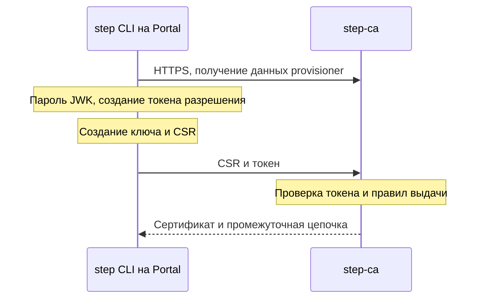

## 1. Назначение step CLI

`step` — утилита для работы с ключами, сертификатами и CA. Она может выполнять локальные операции без сети либо обращаться к работающему step-ca.

| Группа команд | Что делает | Нужен CA онлайн? |
|---|---|---|
| `step certificate inspect`, `fingerprint`, `verify` | Просмотр и проверка файлов | Нет, для локальных файлов |
| `step certificate create` | Создание ключа, CSR или локального сертификата | Нет |
| `step ca bootstrap`, `health` | Настройка подключения и проверка API | Да |
| `step ca certificate`, `sign` | Получение сертификатов от CA | Да |
| `step ca renew`, `rekey`, `revoke` | Управление ранее выданным сертификатом | Да |

Сервер уже настроен в [[Synced/DevOps/CI-CD, артефакты, тестирование и DevSecOps/5. DevSecOps и безопасность цепочки поставок/9. PKI и криптография в инфраструктуре/5. Автоматизация PKI/2. Smallstep step-ca — архитектура и установка.md|Smallstep step-ca — архитектура и установка]]. Здесь Root CA не включается и его ключ не используется.

## 2. Подключение к CA

| Компонент | Значение |
|---|---|
| CA API | `https://ca.ggkit.local:9000` |
| Клиент | `portal.ggkit.local` (10.28.250.21) |
| Provisioner | `admin` (JWK), также доступен `acme` |
| Программа | `step-cli` |

На Portal установить `step-cli` из репозитория, настроенного в предыдущей заметке. Все команды ниже, если не указано иначе, выполняются на Portal от обычного администратора в Bash.

### 2.1. Первоначальное доверие

При первом подключении у CLI ещё нет корневого сертификата. Нельзя просто скачать его и автоматически доверять: при подмене DNS можно скачать чужой корень.

Использовать SHA-256 отпечаток, сохранённый при создании Root CA. Это публичное значение, но важно получить его из доверенного источника.

```bash
read -rp 'Доверенный отпечаток Root CA: ' ROOT_FP
step ca bootstrap --ca-url https://ca.ggkit.local:9000 --fingerprint "$ROOT_FP"
```

`--ca-url` задаёт адрес API; `--fingerprint` — ожидаемый отпечаток. CLI загружает корень, сверяет его с отпечатком и сохраняет настройки. Не брать отпечаток с непроверенного сервера, к которому производится подключение.

### 2.2. Что изменилось на клиенте

```bash
step path
cat "$(step path)/config/defaults.json"
```

`step path` показывает каталог текущего профиля (обычно `~/.step`). `$(...)` подставляет результат команды. В `defaults.json` находятся `ca-url`, `fingerprint` и `root` — путь к локальному доверенному сертификату. Эти параметры используются последующими командами.

```bash
step ca health
```

Ожидаемый результат `ok`. Та же операция без сохранённых настроек:

```bash
step ca health --ca-url https://ca.ggkit.local:9000 --root "$(step path)/certs/root_ca.crt"
```

`--root` указывает корень доверия для подключения к API. Это не ключ подписи и не сертификат Portal.

### 2.3. Системное доверие

Bootstrap настраивает step CLI, но не все приложения Ubuntu. Для доверия curl и других приложений, использующих системное хранилище:

```bash
sudo install -m 0644 "$(step path)/certs/root_ca.crt" /usr/local/share/ca-certificates/ggkit-root.crt
sudo update-ca-certificates
```

`install` копирует файл с правами чтения; `update-ca-certificates` обновляет системное хранилище. Браузеры и контейнеры могут иметь собственные хранилища. На рабочих ПК корень также требуется установить доверенным способом. Сам сервер не обязан передавать корневой сертификат при TLS-подключении.

## 3. Получение сертификата через JWK

### 3.1. Как работает запрос



CSR — запрос с публичным ключом и именами. Токен — отдельное разрешение на выпуск. Приватный ключ Portal создаётся локально и не отправляется CA. Пароль JWK нужен для создания разрешения, а не для шифрования HTTPS-трафика.

### 3.2. Выпуск

```bash
umask 077
mkdir -p ~/portal-pki
cd ~/portal-pki
step ca certificate portal.ggkit.local portal.crt portal.key --issuer admin --not-after 24h
```

| Аргумент | Назначение |
|---|---|
| `portal.ggkit.local` | Имя сертификата; без явного SAN также используется как SAN |
| `portal.crt` | Выходной PEM-файл сертификата с цепочкой |
| `portal.key` | Выходной приватный ключ |
| `--issuer admin` | Выбор JWK provisioner (не имя самого CA) |
| `--not-after 24h` | Запрошенный срок окончания через 24 часа |

Ввести пароль provisioner `admin`. Он отличается от пароля ключа CA. Не передавать пароль через командную строку. Параметр `--not-after` подчиняется правилам CA. CA может отклонить неподходящий срок.

```bash
chmod 600 portal.key
ls -l portal.crt portal.key
step certificate inspect portal.crt --short
```

Ожидаются два файла, имя `portal.ggkit.local`, издатель Intermediate CA. Ключ должен быть доступен только владельцу. Команда выпуска обычно создаёт незашифрованный ключ сервиса, пригодный для автоматического запуска Nginx; защита файла обязательна.

### 3.3. Дополнительные имена

Если сервис действительно обслуживает несколько DNS-имён, указать каждое через `--san`. Пример отдельного сертификата, не заменяющего предыдущий:

```bash
step ca certificate portal.ggkit.local multi.crt multi.key --issuer admin \
  --san portal.ggkit.local --san api.ggkit.local
```

`--san` задаёт имена для проверки TLS. Указать и основное имя: при явных SAN не следует рассчитывать на автоматическое добавление CN. DNS-записи и права на эти имена должны быть подтверждены администратором. Не добавлять лишние имена. Подробнее: [[Synced/DevOps/CI-CD, артефакты, тестирование и DevSecOps/5. DevSecOps и безопасность цепочки поставок/9. PKI и криптография в инфраструктуре/2. Инфраструктура открытых ключей/4. X.509, Extensions и Certificate Policies.md|X.509, Extensions и Certificate Policies]].

## 4. Выпуск с отдельным токеном

Не требуется давать пароль JWK каждому серверу. Администратор может сформировать короткоживущий токен для конкретного имени, а сервер использует его для получения сертификата.

**Место: доверенная административная машина с step CLI и bootstrap к тому же CA.**

```bash
step ca token portal.ggkit.local --issuer admin
```

Ввести пароль JWK. Результат — строка токена. Передать её в защищённом канале уполномоченному оператору Portal, не записывать в общие логи и чаты. Токен ограничен назначением и временем, является секретом до использования. Не путать его с сертификатом.

**Место: Portal.**

```bash
read -rsp 'Токен: ' TOKEN; echo
step ca certificate portal.ggkit.local delegated.crt delegated.key --token "$TOKEN"
unset TOKEN
```

`--token` использует готовое разрешение вместо получения пароля JWK. Имя должно соответствовать токену. Не использовать `--san` совместно с `--token`; нужные SAN задаются при создании токена. Значение токена в аргументе может быть кратковременно видно локальным процессам с соответствующими правами; выполнять на доверенной машине. Для постоянной автоматизации выбирать подходящий provisioner вместо долговременного хранения таких токенов.

## 5. Создание CSR отдельно от выпуска

Предыдущий способ одновременно создаёт ключ и получает сертификат. Если приватный ключ уже есть либо выпуск разделён между администраторами, удобен отдельный CSR.

**Место: Portal, `~/portal-pki`.**

```bash
step certificate create portal.ggkit.local request.csr request.key --csr --san portal.ggkit.local
```

`--csr` создаёт запрос вместо готового сертификата. `request.key` — приватный ключ, `request.csr` — публичный запрос. При запросе задать пароль ключа и сохранить его. Опции защиты ключа здесь относятся к ключу Portal, а не JWK.

```bash
step certificate inspect request.csr --short
step ca sign request.csr request.crt --issuer admin
```

`sign` отправляет существующий CSR на CA и сохраняет сертификат в `request.crt`. Ввести пароль JWK для разрешения выпуска. Ключ `request.key` не передаётся, поэтому его пароль не нужен CA. Этот сертификат используется с `request.key`, а не с `portal.key`.

Проверка запроса через OpenSSL:

```bash
openssl req -in request.csr -noout -verify
```

`req` работает с CSR, `-noout` не выводит PEM, `-verify` проверяет подпись запроса. Это подтверждает владение ключом, но само по себе не подтверждает право на имя.

## 6. Просмотр и проверка сертификатов

Основной рабочий комплект далее — `portal.crt` и `portal.key` из раздела 3. Остальные примеры не заменяют его.

```bash
step certificate inspect portal.crt --short
step certificate inspect portal.crt
step certificate fingerprint portal.crt
```

Краткий вывод удобен для проверки срока и имени, полный — для SAN, Key Usage и других расширений. Отпечаток идентифицирует конкретный сертификат; при обновлении он меняется даже при сохранении ключа.

### 6.1. Проверка цепочки и имени

```bash
step certificate verify portal.crt --roots "$(step path)/certs/root_ca.crt" --host portal.ggkit.local
```

`--roots` задаёт доверенный корень, `--host` проверяет имя. Отличие от `step ca health`: здесь проверяется локальный конечный сертификат, а не доступность CA. При наличии промежуточного сертификата в bundle проверяется цепочка. Успех локальной проверки не означает, что Nginx уже использует этот файл.

```bash
grep -c 'BEGIN CERTIFICATE' portal.crt
```

Команда считает блоки сертификатов. Для двухуровневой PKI обычно два: конечный и Intermediate CA. Если цепочка неполна, получить проверенный Intermediate CA у администратора и дополнить PEM в порядке конечный → промежуточный (не дублировать уже имеющийся сертификат).

### 6.2. Проверка соответствия ключа

```bash
openssl x509 -in portal.crt -noout -pubkey | openssl sha256
openssl pkey -in portal.key -pubout | openssl sha256
```

Первая команда извлекает открытый ключ из сертификата, вторая — из приватного ключа. Хэши должны совпасть. Это сравнение ключей, а не отпечатков сертификатов. Приватный ключ на экран не выводится.

### 6.3. Проверка срока

```bash
step certificate needs-renewal portal.crt --expires-in 8h
```

Команда проверяет, осталось ли до окончания срока менее заданного интервала. Код завершения 0 означает необходимость обновления, ненулевой — отсутствие необходимости либо ошибку; при автоматизации учитывать диагностику. Команда сама не обновляет сертификат.

## 7. Использование сертификата в Nginx

Цель — увидеть реальное TLS-соединение, а не просто два файла. Пример для отдельного тестового Ubuntu-сервера с DNS `portal.ggkit.local`, свободным портом 443 и без конфликтующего виртуального хоста. Если сайт уже существует, изменить его действующую конфигурацию вместо создания второго server block.

```bash
sudo apt update
sudo apt install nginx
sudo install -d -m 0750 /etc/nginx/tls/portal
sudo install -m 0644 portal.crt /etc/nginx/tls/portal/fullchain.pem
sudo install -m 0600 portal.key /etc/nginx/tls/portal/privkey.pem
```

`install` копирует файлы от root с заданными правами. Для стандартного Nginx master-процесс root читает ключ при запуске. `fullchain.pem` — конечный сертификат и промежуточная цепочка. `privkey.pem` — соответствующий ключ. Расширения имён файлов не меняют содержимое.

Создать `/etc/nginx/sites-available/portal`:

```nginx
server {
    listen 443 ssl;
    server_name portal.ggkit.local;

    ssl_certificate /etc/nginx/tls/portal/fullchain.pem;
    ssl_certificate_key /etc/nginx/tls/portal/privkey.pem;

    location / {
        default_type text/plain;
        return 200 "GGKIT Portal TLS OK\n";
    }
}
```

| Директива | Назначение |
|---|---|
| `listen 443 ssl` | Принимать TLS на TCP 443 |
| `server_name` | Имя виртуального хоста |
| `ssl_certificate` | Цепочка, предъявляемая клиенту |
| `ssl_certificate_key` | Ключ для подтверждения владения сертификатом |
| `location /` | Простой тестовый HTTP-ответ внутри TLS |

```bash
sudo ln -s /etc/nginx/sites-available/portal /etc/nginx/sites-enabled/portal
sudo nginx -t
sudo systemctl reload nginx
curl https://portal.ggkit.local/
```

`ln -s` включает конфигурацию; если ссылка существует, не создавать повторно. `nginx -t` проверяет настройки и возможность чтения сертификата и ключа. Выполнять reload только после успешной проверки. Curl должен вернуть `GGKIT Portal TLS OK`. При необходимости разрешить TCP 443 на firewall.

С другого ПК запрос тоже должен работать, если DNS, сеть и доверие Root CA настроены. `curl -k` не использовать для проверки готовности: он отключает проверку подлинности.

### 7.1. Проверка реально предъявляемого сертификата

```bash
openssl s_client -connect portal.ggkit.local:443 -servername portal.ggkit.local \
  -CAfile "$(step path)/certs/root_ca.crt" -verify_hostname portal.ggkit.local -verify_return_error </dev/null
```

`-connect` — адрес, `-servername` — имя для выбора виртуального хоста (SNI), `-CAfile` — доверенный корень, `-verify_hostname` — проверка имени, `-verify_return_error` — завершение при ошибке проверки. `</dev/null` завершает интерактивный ввод. Ожидается `Verify return code: 0 (ok)`.

## 8. Продление и замена ключа

| Операция | Новый сертификат | Новый ключ | Для чего |
|---|---|---|---|
| `renew` | Да | Нет | Продление срока |
| `rekey` | Да | Да | Плановая замена ключа |
| Новый `certificate` | Да | Да | Новый выпуск с отдельной авторизацией |

### 8.1. Renew

```bash
cd ~/portal-pki
step ca renew portal.crt portal.key --out portal-renewed.crt
```

`--out` записывает результат в отдельный файл. Старый ключ остаётся прежним. Обычно CLI подтверждает владение ключом существующего действующего сертификата через взаимный TLS (mTLS): клиент тоже предъявляет сертификат. Пароль JWK повторно не требуется. Если сертификат просрочен или отозван, обычное обновление не должно проходить. При несовместимости mTLS предусмотрен `--mtls=false` с токеном X5C; это не отключение проверки TLS.

```bash
step certificate inspect portal-renewed.crt --short
step certificate verify portal-renewed.crt --roots "$(step path)/certs/root_ca.crt" --host portal.ggkit.local
```

После проверки заменить только сертификат Nginx:

```bash
sudo cp /etc/nginx/tls/portal/fullchain.pem /etc/nginx/tls/portal/fullchain.pem.bak
sudo install -m 0644 portal-renewed.crt /etc/nginx/tls/portal/fullchain.pem
sudo nginx -t && sudo systemctl reload nginx
```

При ошибке восстановить резервную копию и повторить `nginx -t`. После успешной проверки сайта можно использовать новый сертификат для следующих операций. Ключ не менялся.

### 8.2. Rekey

```bash
step ca rekey portal-renewed.crt portal.key --out-cert portal-next.crt --out-key portal-next.key
```

`--out-cert` и `--out-key` сохраняют новый комплект отдельно. Старые файлы не перезаписываются. Rekey подходит для плановой замены, когда старый ключ ещё доверен. При компрометации нужно провести новый авторизованный выпуск и отзыв старого сертификата, а не полагаться на украденный ключ для подтверждения права.

Проверить новую цепочку и совпадение ключей по разделу 6, используя новые имена файлов. Для установки заменить **оба** файла Nginx, предварительно сохранив защищённую резервную копию обоих. Выполнить `nginx -t`, reload и проверку сайта. Не заменять только ключ или только сертификат при rekey.

Автоматический запуск renew, таймеры и обработка перезагрузки сервисов описываются в [[Synced/DevOps/CI-CD, артефакты, тестирование и DevSecOps/5. DevSecOps и безопасность цепочки поставок/9. PKI и криптография в инфраструктуре/5. Автоматизация PKI/6. Автоматическое обновление и ротация сертификатов.md|Автоматическое обновление и ротация сертификатов]]. Важно выбрать один источник рабочих файлов: иначе обновление в домашнем каталоге не изменит сертификат, который использует Nginx.

## 9. Отзыв сертификата

Отзыв нужен, когда сертификатом больше нельзя пользоваться, например после утечки ключа. Он не удаляет файл с диска и не гарантирует мгновенный отказ всех TLS-клиентов.

Для демонстрации использовать отдельный сертификат `delegated.crt` из раздела 4, если он был выпущен и ещё действует. Не отзывать активный сертификат Portal:

```bash
step ca revoke --cert delegated.crt --key delegated.key
```

`--cert` и `--key` подтверждают право владельца отозвать собственный сертификат. Если ключ утрачен, администратор может выполнить авторизованный отзыв по серийному номеру (см. справку `step ca revoke --help`). Серийный номер виден в полном выводе `inspect`.

В обычной конфигурации step-ca отзыв прежде всего блокирует дальнейшее обновление. Не считать, что произвольный браузер автоматически узнает об отзыве. Реальная проверка CRL/OCSP зависит от конфигурации CA и клиента. Подробнее: [[Synced/DevOps/CI-CD, артефакты, тестирование и DevSecOps/5. DevSecOps и безопасность цепочки поставок/9. PKI и криптография в инфраструктуре/2. Инфраструктура открытых ключей/5. CRL и OCSP.md|CRL и OCSP]].

## 10. CLI и ACME: выбор способа

| Вопрос | JWK через step CLI | ACME |
|---|---|---|
| Как разрешается выпуск | Токен, подписанный ключом provisioner | Проверка контроля над именем |
| Инструмент | `step ca certificate --issuer admin` | Certbot, step CLI с ACME, другие клиенты |
| Нужен пароль JWK клиенту | Не обязательно, возможен отдельный токен | Нет |
| Когда выбирать | Административный выпуск, специальные сценарии | Регулярная автоматическая выдача веб-сервисам |

ACME использует тот же Intermediate CA, но другой протокол выдачи. Не нужно ради ACME заново создавать PKI. URL directory уже настроен; полный рабочий сценарий с проверкой домена — [[Synced/DevOps/CI-CD, артефакты, тестирование и DevSecOps/5. DevSecOps и безопасность цепочки поставок/9. PKI и криптография в инфраструктуре/5. Автоматизация PKI/4. ACME — автоматическая выдача сертификатов.md|ACME — автоматическая выдача сертификатов]].

## 11. Краткий справочник диагностики

| Задача | Команда |
|---|---|
| Где хранится профиль CLI | `step path` |
| Доступен ли API | `step ca health` |
| Что записано в сертификате | `step certificate inspect portal.crt --short` |
| Какой корень доверен | `cat "$(step path)/config/defaults.json"` |
| Требуется ли обновление | `step certificate needs-renewal portal.crt --expires-in 8h` |
| Проверка конфигурации веб-сервера | `sudo nginx -t` |
| Проверка HTTPS | `curl https://portal.ggkit.local/` |

При ошибке unknown authority проверить корень и промежуточную цепочку. При name mismatch проверить SAN и URL. При invalid token проверить время, имя, срок токена и provisioner. При ошибке обновления проверить срок действующего сертификата, отзыв и политику CA. При проблеме с Nginx сравнить реально предъявляемый сертификат с установленным файлом. Не обходить проверку TLS.

## Вопросы для самопроверки

1. Почему bootstrap требует отпечаток корня?
2. Чем токен отличается от CSR?
3. Где создаётся приватный ключ Portal?
4. Почему `--issuer admin` не означает имя Intermediate CA?
5. Что нужно передать Nginx, а что необходимо установить на рабочий ПК?
6. Чем renew отличается от rekey?
7. Почему успешный revoke не гарантирует мгновенный отказ браузера?

## Итоги — что было разобрано

Подключение клиента к готовому CA, выдача через JWK и отдельный CSR, проверка файлов, запуск HTTPS на Nginx, обновление и отзыв. Root CA во всех этих операциях остаётся офлайн.

## Связанные заметки

- [[Synced/DevOps/CI-CD, артефакты, тестирование и DevSecOps/5. DevSecOps и безопасность цепочки поставок/9. PKI и криптография в инфраструктуре/5. Автоматизация PKI/2. Smallstep step-ca — архитектура и установка.md|Smallstep step-ca — архитектура и установка]]
- [[Synced/DevOps/CI-CD, артефакты, тестирование и DevSecOps/5. DevSecOps и безопасность цепочки поставок/9. PKI и криптография в инфраструктуре/2. Инфраструктура открытых ключей/4. X.509, Extensions и Certificate Policies.md|X.509, Extensions и Certificate Policies]]
- [[Synced/DevOps/CI-CD, артефакты, тестирование и DevSecOps/5. DevSecOps и безопасность цепочки поставок/9. PKI и криптография в инфраструктуре/5. Автоматизация PKI/4. ACME — автоматическая выдача сертификатов.md|ACME — автоматическая выдача сертификатов]]
- [[Synced/DevOps/CI-CD, артефакты, тестирование и DevSecOps/5. DevSecOps и безопасность цепочки поставок/9. PKI и криптография в инфраструктуре/5. Автоматизация PKI/6. Автоматическое обновление и ротация сертификатов.md|Автоматическое обновление и ротация сертификатов]]
- [[Synced/DevOps/CI-CD, артефакты, тестирование и DevSecOps/5. DevSecOps и безопасность цепочки поставок/9. PKI и криптография в инфраструктуре/2. Инфраструктура открытых ключей/5. CRL и OCSP.md|CRL и OCSP]]

## Документация

- https://smallstep.com/docs/step-cli/reference/ca/
- https://smallstep.com/docs/step-cli/reference/ca/certificate/
- https://smallstep.com/docs/step-cli/reference/ca/renew/
- https://smallstep.com/docs/step-cli/reference/ca/rekey/
- https://smallstep.com/docs/step-ca/renewal/

---

## Теги

#PKI #Smallstep #stepCLI #TLS #CSR #JWK #Nginx #Сертификаты #Renew #Rekey #ACME
