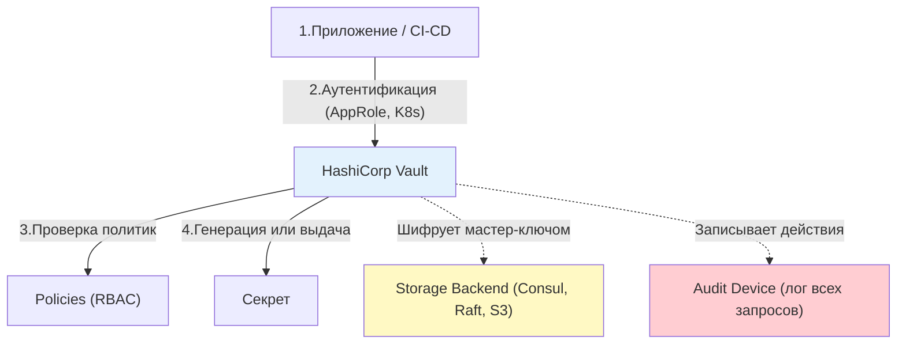

## Введение

Управление секретами — это один из самых критичных аспектов DevSecOps. Хардкодинг паролей в коде, хранение ключей в открытых репозиториях или передача их через мессенджеры являются прямым путем к компрометации инфраструктуры.

Эволюция хранения секретов прошла путь от простых файлов на диске до специализированных аппаратных решений. Понимание компромиссов между удобством, стоимостью и уровнем безопасности при выборе метода хранения критически важно для архитектора или DevOps-инженера.

> [!INFO] Связь с другими темами
> 
> - Принципы шифрования и работы с ключами подробно разобраны в [[Synced/DevOps/CI-CD, артефакты, тестирование и DevSecOps/5. DevSecOps и безопасность цепочки поставок/9. PKI и криптография в инфраструктуре/1. Основы криптографии.md | Основах криптографии]].
> - Архитектура и механизмы аутентификации специализированного менеджера секретов детально описаны в [[Synced/DevOps/CI-CD, артефакты, тестирование и DevSecOps/5. DevSecOps и безопасность цепочки поставок/1. Управление идентификацией и доступом (IAM)/3. HashiCorp Vault/1. Архитектура и принципы работы| Архитектуре HashiCorp Vault]].
> - Применение секретов в конфигурациях регулируется практиками [[Synced/DevOps/IaC/6. Ansible (Продвинутые практики)/2. Управление секретами.md | Управления секретами в Ansible]].

## 1. Уровень 1: Файловая система (Базовый и рискованный)

Самый простой способ хранения секретов — текстовые файлы (`.env`, `config.yaml`, `id_rsa`). В современных условиях это считается антипаттерном для production, но понимание его ограничений необходимо.

### Проблемы файлового хранения

1. **Отсутствие шифрования в покое**: Файл лежит на диске в открытом виде. Любой, кто получит доступ к ОС (или сделает снапшот диска), украдет секрет.
2. **Отсутствие аудита**: Невозможно узнать, кто, когда и откуда прочитал файл.
3. **Сложность ротации**: Чтобы сменить пароль, нужно найти все места, где он используется, обновить файл и перезапустить сервисы.
4. **Риск коммита в Git**: Человеческий фактор приводит к случайной публикации `.env` в репозиторий.

### Как минимизировать риски (если нет выбора)

Если использование файлов неизбежно, применяйте строгие меры защиты на уровне ОС:

```bash
# 1. Жесткие права доступа: чтение и запись только для владельца (root или сервисный аккаунт)
chmod 600 /etc/myapp/secrets.env

# 2. Запрет на изменение файла даже для root (защита от случайного удаления или перезаписи скриптом)
chattr +i /etc/myapp/secrets.env

# 3. Шифрование диска на уровне ОС (LUKS) или использование tmpfs (хранение в RAM)
# Монтирование секрета в оперативную память (исчезает при перезагрузке)
mount -t tmpfs -o size=10M,mode=700 tmpfs /run/secrets
```

## 2. Уровень 2: Менеджеры секретов (HashiCorp Vault)

Vault стал индустриальным стандартом для управления секретами. Он решает проблемы файловых систем, предоставляя централизованное, зашифрованное и аудируемое хранилище.

### Ключевые механизмы Vault



#### А. Статические секреты (KV Engine)

Аналог защищенной файловой системы. Вы вручную кладете секрет (`vault kv put secret/myapp password="123"`), и приложение забирает его по API. Данные шифруются перед записью в бэкенд хранения.

#### Б. Динамические секреты (Dynamic Secrets)

"Убийственная фича" Vault. Вместо того чтобы хранить статический пароль от базы данных, Vault **генерирует его на лету** при запросе приложения.

1. Приложение запрашивает доступ к PostgreSQL.
2. Vault создает временного пользователя БД с правами `read-only` и TTL (временем жизни) 1 час.
3. Vault отдает логин и пароль приложению.
4. Через час Vault автоматически удаляет этого пользователя из БД. _Результат_: Даже если секрет украдут, через час он станет бесполезным.

#### В. Шифрование как услуга (Transit Engine)

Vault хранит только криптографические ключи, но позволяет приложениям отправлять ему данные для шифрования/дешифрования. Сами данные (например, номера кредитных карт) в Vault не сохраняются, что снижает требования к compliance.

## 3. Уровень 3: Аппаратные модули безопасности (HSM)

Когда речь идет о корневых сертификатах (Root CA), ключах шифрования дисков или ключах для подписи критичного ПО, программных решений недостаточно. Требуется **HSM (Hardware Security Module)**.

### Что такое HSM и как он работает

HSM — это физическое устройство (или выделенный облачный инстанс, например, AWS CloudHSM), сертифицированное по стандартам безопасности (например, FIPS 140-2 Level 3 или 4).

**Главный принцип**: Криптографические ключи генерируются внутри HSM и **никогда не покидают** его в открытом (plaintext) виде. Все операции (подпись, шифрование) выполняются внутри "черного ящика". На вход подается данные, на выход — результат операции.

### Уровни защиты HSM

1. **Логическая защита**: Строгий контроль доступа, разделение ролей (один человек не может выполнить критическую операцию в одиночку).
2. **Физическая защита**: Датчики вскрытия корпуса, температуры, напряжения. При попытке физического вскрытия HSM мгновенно стирает (zeroizes) все ключи в памяти.

### Интеграция HSM и Vault

Vault и HSM не конкурируют, а дополняют друг друга. Vault использует HSM как **Root of Trust** (Корень доверия):

- При инициализации Vault мастер-ключ шифруется ключом, который хранится _только_ внутри HSM.
- Это позволяет реализовать **Auto-Unseal**: Vault может автоматически расшифровывать себя при перезагрузке, обращаясь к HSM, без необходимости вручную вводить ключи Шамира (хотя это и снижает уровень безопасности "разделения ответственности").

## 4. Сравнение подходов к хранению

| Характеристика            | Файловая система (.env)     | HashiCorp Vault                                | HSM                                                     |
| ------------------------- | --------------------------- | ---------------------------------------------- | ------------------------------------------------------- |
| **Уровень безопасности**  | Низкий (зависит от прав ОС) | Высокий (шифрование, аудит, TTL)               | Максимальный (аппаратная защита, FIPS)                  |
| **Ротация секретов**      | Ручная, сложная             | Автоматическая (динамические секреты)          | Зависит от интеграции (обычно ручная или через Vault)   |
| **Аудит и логирование**   | Отсутствует                 | Детальный (кто, когда, какой путь)             | Ограниченный (факт использования ключа)                 |
| **Стоимость и сложность** | Бесплатно, очень просто     | Средняя/Высокая (требует кластера и обучения)  | Очень высокая (дорогое железо или облачные тарифы)      |
| **Идеальный сценарий**    | Локальная разработка, тесты | Production-инфраструктура, CI/CD, микросервисы | Root CA, ключи шифрования дисков, банковские транзакции |

## 5. Установка Vault

### Способ 1: Установка из официального репозитория (Debian/Ubuntu)

```bash
# 1. Установка зависимостей
apt update
apt install -y gnupg software-properties-common curl

# 2. Добавление GPG-ключа HashiCorp
curl -fsSL https://apt.releases.hashicorp.com/gpg | gpg --dearmor -o /usr/share/keyrings/hashicorp-archive-keyring.gpg

# 3. Добавление репозитория
echo "deb [signed-by=/usr/share/keyrings/hashicorp-archive-keyring.gpg] https://apt.releases.hashicorp.com $(lsb_release -cs) main" > /etc/apt/sources.list.d/hashicorp.list

# 4. Установка Vault
apt update
apt install -y vault

# 5. Проверка версии
vault --version
```

### Способ 2: Установка из бинарника (универсально)

```bash
# Скачивание конкретной версии
VAULT_VERSION="1.15.4"
curl -LO "https://releases.hashicorp.com/vault/${VAULT_VERSION}/vault_${VAULT_VERSION}_linux_amd64.zip"

# Установка unzip и распаковка
apt install -y unzip
unzip "vault_${VAULT_VERSION}_linux_amd64.zip"
mv vault /usr/local/bin/
chmod +x /usr/local/bin/vault

# Создание пользователя и директорий
useradd --system --home /etc/vault --shell /bin/false vault
mkdir -p /etc/vault /var/lib/vault /var/log/vault
chown -R vault:vault /etc/vault /var/lib/vault /var/log/vault
```

### Способ 3: Запуск в Docker (для тестов)

```bash
docker run -d \
    --name vault-dev \
    --cap-add=IPC_LOCK \
    -p 8200:8200 \
    -e 'VAULT_DEV_ROOT_TOKEN_ID=myroot' \
    -e 'VAULT_DEV_LISTEN_ADDRESS=0.0.0.0:8200' \
    hashicorp/vault:latest
```

>[!WARNING] Dev-режим
>Флаг `VAULT_DEV_ROOT_TOKEN_ID` создает предсказуемый root-токен. **Никогда не используйте это в production**. Dev-режим также хранит данные только в памяти и не использует TLS.

## 6. Базовая конфигурация (Production)

Создадим production-конфигурацию с хранением данных на диске (RAFT) и включенным TLS в `/etc/vault/config.hcl`

```hcl
# Слушать на всех интерфейсах, порт 8200
listener "tcp" {
  address     = "0.0.0.0:8200"
  tls_cert_file = "/etc/vault/tls/vault.crt"
  tls_key_file  = "/etc/vault/tls/vault.key"
  
  # Запрет plaintext (без TLS)
  tls_disable = false
}

# Хранилище: встроенный RAFT (для HA-кластера)
storage "raft" {
  path    = "/var/lib/vault/data"
  node_id = "vault-node-1"
}

# Адрес API (используется для редиректов в HA-кластере)
api_addr = "https://vault.example.com:8200"
cluster_addr = "https://vault.example.com:8201"

# Высокая доступность
ui = true
disable_mlock = false

# Аудит (обязательно в production!)
# audit "file" {
#   file_path = "/var/log/vault/audit.log"
# }
```
## 5. Практические сценарии для DevOps

### Сценарий 1: Безопасная работа с файлами секретов в bash-скрипте

```bash
#!/bin/bash
set -euo pipefail

SECRET_FILE="/run/secrets/db_password"

# 1. Проверяем, что файл существует и это не симлинк (защита от подмены)
if [[ ! -f "$SECRET_FILE" ]] || [[ -L "$SECRET_FILE" ]]; then
    echo "Ошибка: файл секрета отсутствует или является симлинком" >&2
    exit 1
fi

# 2. Проверяем права: владелец должен быть root или текущий пользователь, прав у других быть не должно
PERMS=$(stat -c "%a" "$SECRET_FILE")
if [[ "$PERMS" != "600" ]] && [[ "$PERMS" != "400" ]]; then
    echo "Ошибка: небезопасные права на файл секрета ($PERMS)" >&2
    exit 1
fi

# 3. Чтение секрета в переменную (без вывода в историю bash благодаря пробелу перед командой, если настроено, или через read)
read -r DB_PASSWORD < "$SECRET_FILE"

# Использование...
```

### Сценарий 2: Получение динамического секрета из Vault через API (curl)

```bash
# 1. Аутентификация через AppRole (получаем client_token)
TOKEN_RESPONSE=$(curl -s -X POST -d '{"role_id":"my-role-id", "secret_id":"my-secret-id"}' http://vault:8200/v1/auth/approle/login)
CLIENT_TOKEN=$(echo "$TOKEN_RESPONSE" | jq -r '.auth.client_token')

# 2. Запрос динамических кредов PostgreSQL
CREDS_RESPONSE=$(curl -s -H "X-Vault-Token: $CLIENT_TOKEN" http://vault:8200/v1/database/creds/my-db-role)

# 3. Извлечение логина и пароля
DB_USERNAME=$(echo "$CREDS_RESPONSE" | jq -r '.data.username')
DB_PASSWORD=$(echo "$CREDS_RESPONSE" | jq -r '.data.password')

echo "Подключаемся к БД с временными правами..."
```

### Сценарий 3: Интеграция Ansible с HashiCorp Vault

Вместо хранения паролей в Ansible Vault, мы запрашиваем их из HashiCorp Vault на лету.

```yml
# playbook.yml
- name: Развертывание приложения с секретами из HashiCorp Vault
  hosts: app_servers
  tasks:
    - name: Получение пароля из Vault
      set_fact:
        db_password: "{{ lookup('hashi_vault', 'secret=secret/data/myapp:db_password token=my-vault-token url=http://vault:8200') }}"

    - name: Создание конфигурационного файла приложения
      template:
        src: app_config.j2
        dest: /etc/myapp/config.yaml
        mode: '0600'
      vars:
        app_db_pass: "{{ db_password }}"
```

## 6. Troubleshooting и типичные проблемы

|Проблема|Причина|Решение|
|---|---|---|
|`Error: Vault is sealed`|Vault был перезапущен или потерял связь с хранилищем. Данные зашифрованы и недоступны.|Выполнить процедуру unseal, предоставив необходимые Key Shares (`vault operator unseal`).|
|`Permission denied` при чтении файла секрета|Скрипт запускается от имени пользователя, у которого нет прав на чтение файла (например, файл принадлежит root, а скрипт запускает www-data).|Изменить владельца файла (`chown`) или группу, либо использовать механизмы вроде `sudo` или ACL.|
|Приложение не может аутентифицироваться в Vault|Истек срок действия токена, неверный `role_id`/`secret_id`, или сетевая проблема.|Проверить логи Vault (`vault audit`), убедиться, что AppRole настроен корректно и сеть позволяет доступ к порту 8200.|
|HSM возвращает ошибку таймаута|Сетевая задержка между Vault и HSM, или HSM перегружен запросами.|Проверить сетевую связность, мониторинг HSM. Увеличить таймауты в конфигурации Vault.|

---

## Контрольные вопросы для самопроверки

1. Почему хранение секретов в файлах `.env` считается антипаттерном в production-среде, и какие минимальные меры защиты можно применить, если别无 выбора?
2. В чем фундаментальное преимущество "динамических секретов" HashiCorp Vault перед традиционным хранением статических паролей?
3. Что такое процесс "Unseal" в HashiCorp Vault и почему он необходим для безопасности хранилища?
4. Каков главный принцип работы HSM, отличающий его от обычного сервера, и почему это важно для защиты корневых ключей?
5. Как HashiCorp Vault и HSM могут работать вместе в одной архитектуре безопасности?
6. Как с помощью Ansible получить секрет из HashiCorp Vault, не храня его в репозитории кода?

---

## Вопросы со звездочкой (*) для глубокого понимания

1. **Алгоритм Шамира (Shamir's Secret Sharing)**: Объясните математическую концепцию этого алгоритма (использование полиномов над конечными полями). Почему для восстановления секрета требуется именно K из N частей, и почему знание K-1 частей не дает абсолютно никакой информации о секрете?
2. **Side-channel атаки на HSM**: Несмотря на физическую защиту, HSM уязвимы к атакам по побочным каналам (анализ потребления энергии, электромагнитного излучения или времени выполнения операции). Как производители HSM (и стандарт FIPS 140-2 Level 4) пытаются нивелировать эти риски на аппаратном уровне?
3. **Компрометация Storage Backend**: Если злоумышленник получил полный доступ к бэкенду хранения Vault (например, к диску или S3-бакету), но не имеет ключей Unseal, какие данные он сможет прочитать, а какие останутся для него криптографическим мусором? Какую роль играет Master Key в этой архитектуре?
4. **Проблема "Chicken and Egg" в Kubernetes**: Как приложение в Pod'е может безопасно аутентифицироваться в Vault для получения секретов, если для самой аутентификации (например, через Service Account Token) уже требуются определенные права и настройки, которые должны быть заданы до запуска пода? (Рассмотрите механизм Kubernetes Auth Method в Vault).

---

#devops #devsecops #security #secrets-management #hashicorp-vault #hsm #encryption #cryptography #infrastructure #compliance #ansible #troubleshooting