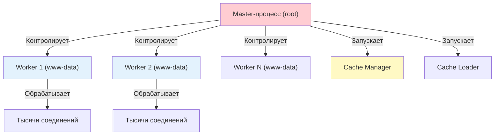

## Введение

Главная причина, по которой Nginx так популярен — его способность держать десятки тысяч одновременных подключений, потребляя при этом очень мало оперативной памяти.

Старые веб-серверы (например, Apache в режиме prefork) работали по принципу: **"Один запрос = Один процесс"**. Если на сервер приходило 10 000 запросов, операционная система создавала 10 000 процессов. Это быстро съедало всю оперативную память и перегружало процессор переключением между задачами.

Nginx работает иначе: **"Много запросов = Несколько процессов"**. Один рабочий процесс может обслуживать тысячи соединений одновременно, просто переключаясь между ними в моменты, когда от клиента или бэкенда приходят данные.

> [!INFO] Связь с другими темами
> 
> - Механизм `epoll` работает с файловыми дескрипторами, концепция которых разобрана в [[Synced/DevOps/Сетевое и системное администрирование/1. Операционные системы/1. Linux/2. Stdin, Stdout, Stderr, пайплайны, перенаправления.md | потоках ввода-вывода]].
> - Разделение прав между Master (root) и Worker (обычный пользователь) напрямую связано с [[Synced/DevOps/Сетевое и системное администрирование/1. Операционные системы/1. Linux/8. Пользователи, группы, аутентификация/3. Управление правами для файлов и директорий.md | управлением правами]] в Linux.

## 1. Как Nginx обрабатывает запросы (Event-driven)

Вместо того чтобы "ждать" ответа от клиента или бэкенда, блокируя весь процесс, Nginx использует асинхронную модель.

### Простая аналогия

Представьте ресторан:

- **Старый подход (Apache prefork)**: На каждый столик сажают отдельного официанта. Если клиент долго выбирает блюдо, официант просто стоит и ждет. Чтобы обслужить 1000 столиков, нужно 1000 официантов (огромные затраты на зарплату/память).
- **Подход Nginx**: В зале работает всего несколько официантов (Worker-процессов). Они раздают меню всем и идут дальше. Как только клиент поднимает руку (происходит "событие" — готов сделать заказ), официант мгновенно подходит именно к этому столику. Один официант легко обслуживает сотни столиков.

### Роль `epoll` в этом процессе

Раньше, чтобы узнать, какие из 10 000 соединений готовы к работе, программе приходилось перебирать их все по очереди в цикле. Это сильно грузило процессор. Системный вызов `epoll` в Linux решает эту проблему:

1. Nginx один раз говорит ядру: "Следи за этими 10 000 соединениями".
2. Nginx "засыпает" и не тратит ресурсы процессора.
3. Как только на _любом_ соединении появляются данные, ядро Linux будит Nginx и передает ему короткий список: "Готовы к работе только эти 5 соединений".
4. Nginx мгновенно обрабатывает эти 5 соединений и снова "засыпает".

## 2. Модель процессов: кто за что отвечает

При запуске Nginx создает четкую иерархию процессов.




1. **Master-процесс (Менеджер)**:
    - Запускается первым от имени `root` (чтобы иметь право занять порт 80 или 443).
    - Читает `nginx.conf` и проверяет его на ошибки.
    - Запускает нужное количество Worker-процессов.
    - Если какой-то Worker-процесс внезапно упал (например, из-за нехватки памяти), Master мгновенно создает ему замену.
    - Принимает команды от администратора (перезагрузка, остановка).
2. **Worker-процессы (Рабочие)**:
    - Запускаются от имени обычного пользователя (например, `www-data` или `nginx`) ради безопасности. Если хакер найдет уязвимость в обработке запроса, он получит права только этого обычного пользователя, а не root.
    - Выполняют всю реальную работу: читают запросы, отдают статические файлы, проксируют запросы на бэкенд (PHP, Node.js, Python).
    - Работают независимо друг от друга, не мешая друг другу.
3. **Cache Loader и Cache Manager**:
    - Вспомогательные процессы для работы с кэшем на диске. Loader один раз при старте строит индекс кэша в памяти, а Manager периодически чистит старый кэш, чтобы он не занял весь диск.

## 3. Как работает плавная перезагрузка (`nginx -s reload`)

Это одна из самых важных функций для DevOps, позволяющая применять новые настройки без остановки сервиса (Zero Downtime).

**Пошаговый механизм:**

1. Вы вводите `nginx -s reload` (или отправляете сигнал `HUP`).
2. Master-процесс сначала проверяет новый конфиг командой `nginx -t`. **Если там есть синтаксическая ошибка, перезагрузка прерывается, и текущая работа не страдает.**
3. Если конфиг верный, Master применяет новые настройки.
4. Master запускает **новые** Worker-процессы, которые начинают работать уже с новыми настройками и принимать **новые** запросы.
5. Master отправляет старым Worker-процессам команду на завершение.
6. Старые Worker-процессы перестают принимать новые запросы, но **продолжают обрабатывать те запросы, которые уже начали выполнять**, пока не закончат их (или пока не истечет таймаут `worker_shutdown_timeout`). После этого они завершаются.

## 4. Практическая настройка производительности

Как правильно настроить Nginx под железо сервера.

```nginx
# /etc/nginx/nginx.conf

# Главное правило: количество воркеров = количеству ядер CPU.
# Значение 'auto' сделает это автоматически. Ставить больше ядер нет смысла, 
# это только создаст лишнюю нагрузку на переключение контекста в ОС.
worker_processes auto;

events {
    # Сколько запросов может держать ОДИН worker-процесс.
    # Общее максимальное число клиентов = worker_processes * worker_connections
    worker_connections 4096;
    
    # Явно указываем использовать epoll (на Linux это и так по умолчанию, 
    # но явное указание считается хорошей практикой).
    use epoll;
    
    # Разрешаем worker-процессу принимать сразу несколько новых соединений 
    # за один системный вызов, что немного ускоряет работу при высоких нагрузках.
    multi_accept on;
}
```

## 5. Типичные проблемы и их решение (Troubleshooting)

|Симптом|Вероятная причина|Как исправить|
|---|---|---|
|В логах: `1024 worker_connections are not enough`|На сервер пришло больше одновременных запросов, чем настроено в `worker_connections`.|1. Увеличить `worker_connections` в блоке `events`.  <br>2. Проверить лимит ОС: `ulimit -n` (должен быть больше или равен `worker_connections`).|
|Worker-процессы постоянно перезапускаются|Ошибка в конфиге, нехватка памяти (OOM Killer) или сбой в стороннем модуле.|Посмотреть `/var/log/nginx/error.log`. Проверить логи ядра: `dmesg -T \| grep -i oom`.|
|Команда `nginx -s reload` выполняется очень долго|Старые worker-процессы "зависли", обрабатывая очень медленные запросы (или атаку Slowloris), и не могут завершиться.|Настроить жесткие таймауты: `client_body_timeout`, `proxy_read_timeout`. Добавить `worker_shutdown_timeout 10s;`, чтобы принудительно обрывать зависшие соединения при перезагрузке.|
|Ошибка: `bind() to 0.0.0.0:80 failed (98: Address already in use)`|Порт 80 уже занят другим процессом (часто это зависший старый процесс Nginx или другой веб-сервер, например, Apache).|Найти виновника: `ss -tlnp \| grep :80`. Завершить мешающий процесс.|

---

## Контрольные вопросы для самопроверки

1. Почему Nginx может держать тысячи соединений, используя мало памяти, в отличие от старых веб-серверов?
2. Какую задачу выполняет Master-процесс, а какую — Worker-процесс? Почему Worker не должен работать от имени root?
3. Объясните простыми словами, чем `epoll` лучше старого метода перебора соединений в цикле.
4. Что произойдет, если вы выполните `nginx -s reload`, но допустите синтаксическую ошибку в новом конфигурационном файле?
5. Как правильно рассчитать общее максимальное количество одновременных соединений, которое может выдержать сервер?

---

## Вопросы со звездочкой (*) для глубокого понимания

1. **Edge-Triggered vs Level-Triggered**: `epoll` может работать в двух режимах. Nginx по умолчанию использует Level-Triggered (сообщать, пока есть данные для чтения). Почему использование Edge-Triggered (сообщить только один раз при появлении новых данных) в Nginx требует более сложного кода и может привести к "потере" запросов, если программист допустит ошибку?
2. **Разделяемая память (Shared Memory)**: Worker-процессы в Linux изолированы друг от друга и не видят память друг друга. Как тогда Nginx реализует функции, требующие общего состояния, например, ограничение частоты запросов (`limit_req`) или балансировку с `ip_hash`? (Подсказка: Master-процесс выделяет специальный блок памяти до запуска воркеров).

---

#devops #nginx #architecture #web-server #epoll #event-driven #linux #performance #troubleshooting #sysadmin