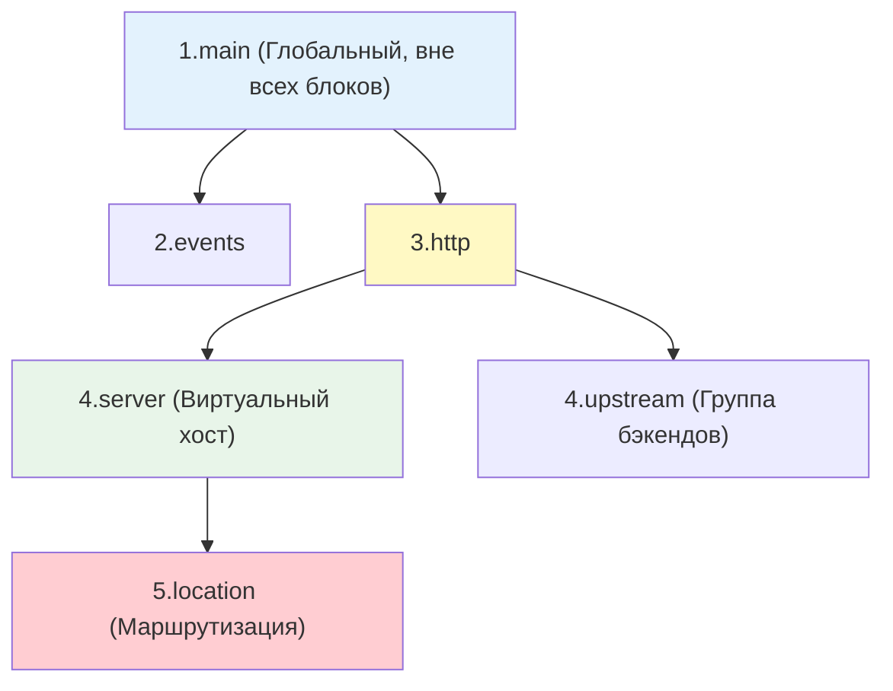

## Введение

Конфигурационный файл Nginx (`nginx.conf`) — это не просто список настроек, а строгая иерархическая структура. Самая частая причина ошибок "404 Not Found", "502 Bad Gateway" или странного поведения проксирования — непонимание двух вещей: как Nginx выбирает нужный блок `location` и как директивы наследуются от родителя к ребенку.

Этот конспект фокусируется на практическом понимании этих механизмов, чтобы вы могли уверенно писать и отлаживать конфигурации.

> [!INFO] Связь с другими темами
> 
> - Конфигурация управляет поведением процессов, архитектура которых разобрана в [[Synced/DevOps/Балансировка, проксирование и веб-сервера/1. Классические веб-серверы и обратные прокси/1. Nginx/1. Архитектура.md | Архитектуре Nginx]].
> - Директивы, управляющие доступом к файлам (например, `root`), напрямую зависят от прав ОС, описанных в [[Synced/DevOps/Сетевое и системное администрирование/1. Операционные системы/1. Linux/8. Пользователи, группы, аутентификация/3. Управление правами для файлов и директорий.md | Управлении правами для файлов и директорий]].

## 1. Базовый синтаксис: два главных правила

Конфигурация состоит из директив. Чтобы Nginx её понял, нужно соблюдать два простых правила:

1. **Простые директивы** всегда заканчиваются точкой с запятой `;`.
2. **Блочные директивы (контексты)** открываются `{` и закрываются `}`. Внутри них могут быть другие директивы.

```nginx
# 1. Простая директива (имя + значение + точка с запятой)
user www-data;

# 2. Блочная директива (контекст)
events {
    # Внутри контекста снова простые директивы
    worker_connections 1024;
}

http {
    # Директива include подгружает содержимое другого файла в это место
    include /etc/nginx/mime.types;
    
    server {
        listen 80;
        server_name example.com;
        
        location / {
            root /var/www/html;
        }
    }
}
```

>[!TIP] Модульность
>Не пишите всё в один файл `nginx.conf`. Используйте `include /etc/nginx/conf.d/*.conf;`, чтобы разбить конфигурацию на логические части (например, по одному файлу на каждый сайт или `upstream`). Это стандарт для автоматизации через Ansible или Terraform.

## 2. Иерархия контекстов

Директивы можно писать только в определенных местах. Попытка написать `root` внутри блока `events` вызовет ошибку при проверке `nginx -t`.



**Краткая шпаргалка по контекстам:**

- **main**: Глобальные настройки процесса (`user`, `worker_processes`, `pid`).
- **events**: Настройки сети на уровне ОС (`worker_connections`, `use epoll`).
- **http**: Настройки для всего веб-трафика (таймауты, форматы логов, типы MIME, кэш).
- **server**: Конкретный сайт/домен (`listen`, `server_name`).
- **location**: Обработка конкретных путей (URI) внутри сайта (`/`, `/api`, `/images`).
- **upstream**: Группа серверов для балансировки (живет внутри `http`, но вне `server`).

## 3. Механизм наследования: переопределение, а не слияние

Это критически важный момент. В Nginx наследование работает по принципу **полного переопределения (overwrite)**.

Если вы задали директиву в родителе (`http`), она действует во всех детях (`server`, `location`), **ПОКА** вы не зададите эту же директиву в ребенке. Как только вы задаете её в ребенке, значение родителя **полностью игнорируется**. Слияния списков или значений не происходит.

### Пример:

```nginx
http {
    # Родитель: лимит 10 МБ для всех
    client_max_body_size 10m;

    server {
        server_name example.com;
        # Здесь действует 10m, так как переопределения нет
        
        location /upload {
            # Ребенок: полное переопределение!
            client_max_body_size 50m;
            # Теперь здесь 50m. Значение 10m из http полностью забыто.
        }
        
        location /api {
            # Здесь снова действует 10m, унаследованное от http
        }
    }
}
```

>[!WARNING] Ловушка с `proxy_set_header`
>Это исключение, которое ведет себя хитро. Если вы зададите `proxy_set_header` в блоке `http`, а затем зададите _другой_ `proxy_set_header` в блоке `location`, второй **не дополнит** первый, а полностью заменит все заголовки проксирования для этого location. Чтобы добавить заголовок, не удаляя унаследованные, нужно явно продублировать нужные заголовки в `location` или использовать `include`.

## 4. Алгоритм выбора блока `location` (Пошагово)

Когда приходит запрос (например, `/images/logo.png`), Nginx не ищет совпадения сверху вниз. Он использует строгий алгоритм приоритетов. Запомните этот порядок действий, это главный инструмент отладки.

### Типы модификаторов

| Модификатор | Описание                                                                 | Пример                 |
| ----------- | ------------------------------------------------------------------------ | ---------------------- |
| `=`         | Точное совпадение всего URI.                                             | `location = /exact`    |
| `^~`        | Совпадение по префиксу. **Останавливает** проверку регулярных выражений. | `location ^~ /images/` |
| `~`         | Регулярное выражение (с учетом регистра).                                | `location ~ \.php$`    |
| `~*`        | Регулярное выражение (без учета регистра).                               | `location ~* \.jpg$`   |
| _(нет)_     | Обычное совпадение по префиксу.                                          | `location /`           |

### Пошаговый алгоритм выбора (Чек-лист Nginx)

1. **Проверка на точное совпадение (`=`)**. Если URI полностью совпадает, Nginx сразу использует этот `location` и прекращает поиск.
2. **Поиск самого длинного совпадения по префиксу** (среди обычных префиксов и префиксов с `^~`). Nginx запоминает этот вариант, но **не останавливается**.
3. **Проверка флага `^~`**. Если запомненный на шаге 2 префикс имеет модификатор `^~`, Nginx использует его и **прекращает поиск** (регулярные выражения даже не проверяются).
4. **Проверка регулярных выражений (`~` и `~*`)**. Nginx проверяет их **строго в том порядке**, в котором они написаны в конфигурационном файле. Первое совпадение побеждает, и поиск прекращается.
5. **Финал**. Если ни одно регулярное выражение не совпало, Nginx использует тот самый длинный префикс, который он запомнил на шаге 2.

### Практический пример

```nginx
server {
    location /documents { 
        return 200 "A: Обычный префикс"; 
    }
    location = /documents { 
        return 200 "B: Точное совпадение"; 
    }
    location ~ ^/doc[a-z]+ { 
        return 200 "C: Регулярное выражение"; 
    }
    location ^~ /documents { 
        return 200 "D: Префикс с приоритетом"; 
    }
}
```

**Результаты запросов:**

- Запрос `/documents` → **B**. (Шаг 1: точное совпадение всегда побеждает).
- Запрос `/documents/report.pdf` → **D**. (Шаг 2: самый длинный префикс `/documents`. Шаг 3: есть флаг `^~`, поиск остановлен. Регулярка C игнорируется).
- Запрос `/documentation` → **C**. (Шаг 2: самый длинный префикс `/documents` (A). Шаг 3: флага `^~` нет. Шаг 4: проверяем регулярки. `^/doc[a-z]+` совпадает с `/documentation`. Регулярка побеждает обычный префикс).

## 5. Практические сценарии для DevOps

### Сценарий 1: Статика + Fallback на бэкенд (Самый частый паттерн)

Используем `try_files` и `named location` для эффективной отдачи статики с последующим проксированием, если файла нет.

```nginx
server {
    listen 80;
    server_name myapp.com;
    root /var/www/myapp;

    location / {
        # 1. Ищем файл по URI ($uri)
        # 2. Ищем директорию по URI ($uri/)
        # 3. Если ничего нет, внутренне перенаправляем запрос в @backend
        try_files $uri $uri/ @backend;
    }

    # Named location: сюда нельзя обратиться из браузера напрямую
    location @backend {
        proxy_pass http://127.0.0.1:8080;
        proxy_set_header Host $host;
        proxy_set_header X-Real-IP $remote_addr;
    }
}
```

### Сценарий 2: Управление конфигурацией через Ansible (Jinja2)

Использование шаблонов предотвращает человеческие ошибки и обеспечивает идемпотентность.

```yml
# playbook.yml
- name: Deploy Nginx config
  template:
    src: nginx_server.conf.j2
    dest: /etc/nginx/conf.d/{{ domain_name }}.conf
    mode: '0644'
  notify: Reload Nginx
```

```jinja2
# templates/nginx_server.conf.j2
server {
    listen 80;
    server_name {{ domain_name }};

    location / {
        root {{ web_root_path }};
        index index.html;
    }

    
    location /api/ {
        # Используем include для чистоты кода и избежания проблем с наследованием заголовков
        include /etc/nginx/proxy_params;
        proxy_pass http://{{ api_upstream }};
    }
    
}
```

## 6. Troubleshooting и типичные проблемы

|Проблема|Причина|Решение|
|---|---|---|
|`nginx: [emerg] "directive" is not allowed here`|Директива написана не в том контексте (например, `root` внутри `events`).|Переместить директиву в разрешенный контекст (`http`, `server` или `location`).|
|`404 Not Found` для существующего файла|1. Неправильный путь в `root`/`alias`.  <br>2. У пользователя `www-data` нет прав на чтение файла или выполнение (`+x`) на родительские директории.|1. Проверить путь: `ls -la /путь/к/файлу`.  <br>2. Проверить права через [[Synced/DevOps/Сетевое и системное администрирование/1. Операционные системы/1. Linux/8. Пользователи, группы, аутентификация/3. Управление правами для файлов и директорий.md|
|Запрос попадает не в тот `location`|Регулярное выражение перехватило запрос, который вы ожидали увидеть в обычном префиксе.|Добавить модификатор `^~` к префиксному `location`, чтобы запретить проверку регулярных выражений.|
|`nginx: [emerg] unexpected "}"`|Пропущена `;` в строке перед закрывающей скобкой или лишняя/недостающая `{`.|Запустить `nginx -t`. Ошибка укажет на примерную строку. Проверить парность скобок.|
|Изменения не применяются|Конфиг изменен, но Nginx не перезагружен, или `nginx -t` выдал ошибку, которую проигнорировали.|Всегда использовать цепочку: `nginx -t && nginx -s reload`.|

---

## Контрольные вопросы для самопроверки

1. В чем разница между простой директивой и блочной директивой (контекстом) в синтаксисе Nginx?
2. Назовите 4 основных уровня иерархии контекстов Nginx (от глобального к частному).
3. Как работает механизм наследования директив? Происходит ли слияние (merge) значений, если директива задана и в родителе, и в ребенке?
4. Опишите пошагово алгоритм, по которому Nginx выбирает блок `location` для обработки запроса.
5. В чем практическая разница между использованием `root` и `alias` внутри блока `location`?
6. Какую команду необходимо выполнить перед перезагрузкой Nginx, чтобы гарантировать, что синтаксические ошибки не приведут к падению сервиса?

---

## Вопросы со звездочкой (*) для глубокого понимания

1. **Алгоритм location (Edge Case):** Если у нас есть `location /documents/` и `location ~ ^/documents/.*\.pdf$`, и приходит запрос `/documents/report.pdf`, какой блок будет выбран и почему? Как изменить конфигурацию, чтобы гарантированно выбрать первый вариант, не меняя регулярное выражение?
2. **Внутренняя обработка `include`:** В каком порядке Nginx обрабатывает файлы при использовании wildcard (`include /etc/nginx/conf.d/*.conf`)? Почему reliance на алфавитный порядок файлов может привести к недетерминированному поведению при переопределении одних и тех же директив в разных файлах?
3. **Named locations:** Почему в блок `location @name` нельзя попасть напрямую через HTTP-запрос клиента? Как именно директива `try_files` использует его для внутренней маршрутизации без изменения URI в браузере пользователя?
4. **Переменные в конфигурации:** В чем разница между вычислением переменной Nginx (например, `$uri`) на этапе чтения конфигурации и на этапе обработки конкретного запроса? Почему некоторые директивы (например, `root`) не поддерживают использование переменных в своих параметрах?

---

#devops #nginx #configuration #syntax #inheritance #location-matching #reverse-proxy #ansible #troubleshooting #web-server #linux #sysadmin