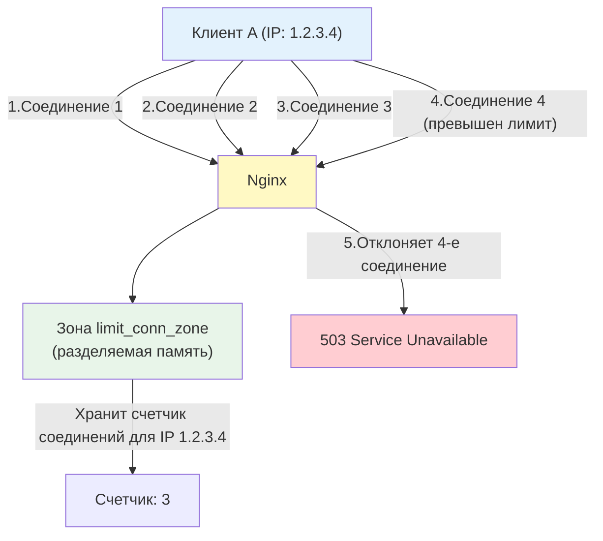
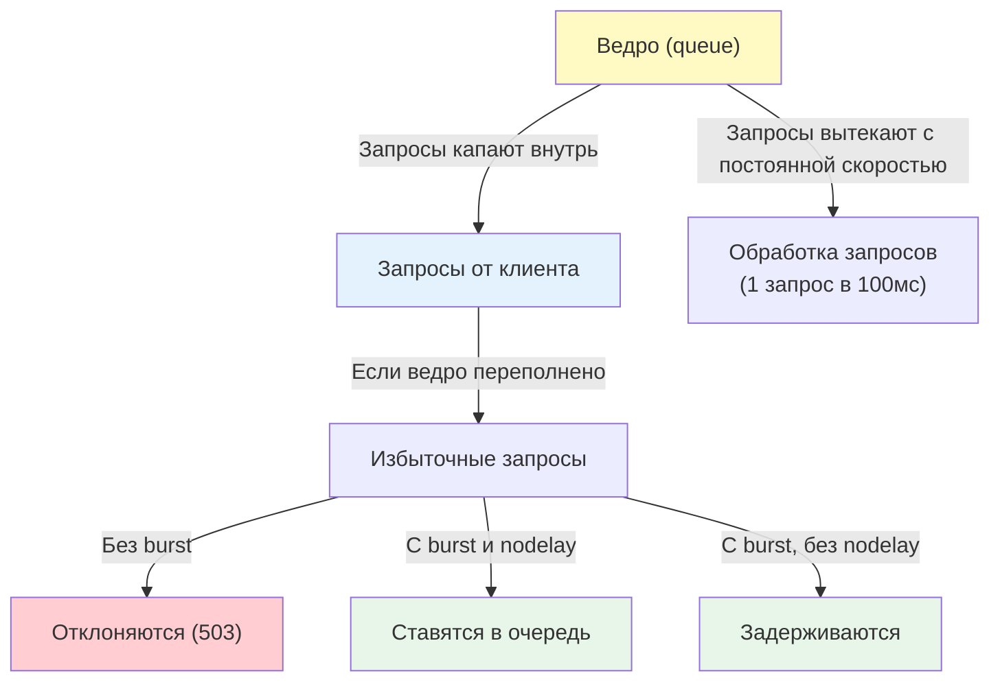

## Введение

Безопасность веб-сервера — это многоуровневая защита, которая начинается еще до того, как запрос достигнет приложения. Nginx, находясь на передовой линии, может:

- Скрыть информацию о себе, усложняя работу злоумышленникам
- Ограничить количество запросов от одного клиента (защита от DDoS и брутфорса)
- Заблокировать явно вредоносные запросы (базовый WAF)
- Добавить заголовки безопасности, защищающие от распространенных атак (XSS, Clickjacking, MIME-sniffing)

Понимание этих механизмов критично для DevOps-инженера, так как правильно настроенный Nginx может предотвратить 80% типовых атак еще до того, как они достигнут приложения.

> [!INFO] Связь с другими темами
> 
> - Механизмы `limit_req` и `limit_conn` используют разделяемую память между worker-процессами, архитектура которых разобрана в [[Synced/DevOps/Балансировка, проксирование и веб-сервера/1. Классические веб-серверы и обратные прокси/1. Nginx/1. Архитектура.md | Архитектуре Nginx]].
> - Наследование директив безопасности (например, `limit_req`) подчиняется правилам, описанным в [[Synced/DevOps/Балансировка, проксирование и веб-сервера/1. Классические веб-серверы и обратные прокси/1. Nginx/2. Конфигурация.md | Конфигурации Nginx]].

## 1. Скрытие информации о сервере

Первый принцип безопасности — **минимизация раскрытия информации**. Чем меньше злоумышленник знает о вашей инфраструктуре, тем сложнее ему подобрать специфичную атаку.

### Директива `server_tokens`

По умолчанию Nginx добавляет в заголовок `Server` свою версию:

```http
Server: nginx/1.24.0
```

Это помогает злоумышленникам найти CVE (уязвимости) для конкретной версии.

**Решение:**

```nginx
http {
    server_tokens off;
}
```

Теперь заголовок будет выглядеть так:

```http
Server: nginx
```

> [!WARNING] Это не панацея
> Отключение `server_tokens` — это "security through obscurity" (безопасность через неясность). Опытный злоумышленник может определить версию Nginx по другим признакам (поведение ошибок, специфичные заголовки). Но это усложняет автоматизированные атаки и отсекает скрипт-кидди.

### Полное скрытие заголовка `Server`

Если нужно полностью убрать заголовок `Server`, потребуется сторонний модуль `headers-more-nginx-module`:

```nginx
# После компиляции с модулем headers-more
more_clear_headers Server;
```

### Скрытие версий других компонентов

Не забывайте, что бэкенды (PHP, Python, Node.js) тоже раскрывают информацию:

```nginx
# Скрываем версию PHP
fastcgi_hide_header X-Powered-By;
proxy_hide_header X-Powered-By;

# Скрываем версию ASP.NET
proxy_hide_header X-AspNet-Version;
proxy_hide_header X-AspNetMvc-Version;
```

## 2. Ограничение соединений: `limit_conn`

Директива `limit_conn` ограничивает **количество одновременных соединений** от одного клиента (или группы клиентов). Это защищает от атак, цель которых — исчерпать пул соединений Nginx.

### Как это работает "под капотом"



### Конфигурация

```nginx
http {
    # 1. Определяем зону (разделяемую память) для хранения счетчиков
    # Ключ: $binary_remote_addr (IP клиента в бинарном виде, экономит память)
    # Размер зоны: 10MB (хватит примерно на 160 000 уникальных IP)
    limit_conn_zone $binary_remote_addr zone=addr:10m;
    
    server {
        listen 80;
        
        location / {
            # 2. Применяем лимит: не более 10 одновременных соединений с одного IP
            limit_conn addr 10;
            
            # 3. Код ответа при превышении лимита (по умолчанию 503)
            limit_conn_status 503;
            
            proxy_pass http://backend;
        }
    }
}
```

### Когда использовать `limit_conn`

| Сценарий                  | Рекомендуемый лимит    | Почему                                                                          |
| ------------------------- | ---------------------- | ------------------------------------------------------------------------------- |
| Обычный веб-сайт          | 10-20 соединений на IP | Один браузер обычно открывает 6-8 соединений для параллельной загрузки ресурсов |
| API с долгими запросами   | 5-10 соединений на IP  | Защита от исчерпания пула worker-процессов                                      |
| Скачивание больших файлов | 1-2 соединения на IP   | Предотвращение монополизации полосы пропускания одним клиентом                  |

## 3. Ограничение частоты запросов: `limit_req`

Директива `limit_req` ограничивает **частоту запросов** (requests per second) от одного клиента. Это основной инструмент защиты от DDoS-атак и брутфорса.

### Алгоритм Leaky Bucket (Протекающее ведро)

`limit_req` использует алгоритм "протекающего ведра". Представьте ведро с дыркой внизу:



**Как это работает:**

1. Запросы "капают" в ведро с определенной скоростью (например, 10 запросов в секунду).
2. Ведро "протекает" с фиксированной скоростью (обрабатывает запросы).
3. Если запросов приходит больше, чем ведро может обработать, они накапливаются.
4. Если ведро переполняется, новые запросы отклоняются.

### Конфигурация

```nginx
http {
    # 1. Определяем зону для хранения счетчиков запросов
    # Ключ: $binary_remote_addr
    # Скорость: 10 запросов в секунду (один запрос каждые 100мс)
    # Размер зоны: 10MB
    limit_req_zone $binary_remote_addr zone=api_limit:10m rate=10r/s;
    
    server {
        listen 80;
        
        location /api/ {
            # 2. Применяем лимит
            # burst=20: разрешаем "всплеск" до 20 запросов сверх лимита
            # nodelay: не задерживать запросы из burst, а обрабатывать их немедленно
            limit_req zone=api_limit burst=20 nodelay;
            
            # 3. Код ответа при превышении лимита
            limit_req_status 429; # 429 Too Many Requests (стандарт для rate limiting)
            
            proxy_pass http://backend;
        }
    }
}
```

### Разбор параметров `limit_req`

|Параметр|Описание|Когда использовать|
|---|---|---|
|`zone=name:size`|Имя зоны в разделяемой памяти и её размер. Размер должен быть достаточным для хранения всех уникальных ключей (IP).|Всегда обязателен|
|`rate=Xr/s` или `rate=Xr/m`|Скорость обработки запросов. `10r/s` = 10 запросов в секунду (один запрос каждые 100мс).|Определяет базовый лимит|
|`burst=N`|Размер "всплеска" — сколько запросов сверх лимита можно накопить в очереди.|Для обработки кратковременных всплесков трафика|
|`nodelay`|Если указан, запросы из burst обрабатываются немедленно, не задерживаясь. Если не указан, запросы задерживаются так, чтобы соблюдать `rate`.|Для API, где важна низкая задержка|

### Как происходит "очистка" (Eviction)

В Nginx нет фонового процесса, который бы регулярно чистил зону `limit_conn_zone` или `limit_req_zone`. Очистка происходит **лениво (lazy eviction)** в момент добавления нового элемента:

1. Когда приходит запрос от **нового** IP-адреса, Nginx пытается выделить под него запись в разделяемой памяти.
2. Если свободной памяти в зоне **нет**, Nginx удаляет (перезаписывает) одну из **наименее недавно использованных (LRU — Least Recently Used)** записей.
3. Запись старого IP освобождается, и на её место записывается новый IP.

**Что это значит на практике:**

- Если у вас зона на 10 МБ и она заполнилась уникальными IP, то при появлении 100 001-го клиента самый "старый" по времени обращения клиент будет удален из счетчиков.
- Для этого "старого" клиента счетчик обнулится. Если он снова начнет слать запросы, Nginx будет считать его как нового пользователя.

### Что будет, если 10 МБ закончатся?

Rate limiting **не перестанет работать**. Он продолжит работать, но с нюансами:

- **Для существующих клиентов:** Все работает штатно. Их счетчики хранятся в памяти и обновляются.
- **Для новых клиентов:** Они будут успешно добавляться в зону, вытесняя самых старых/неактивных клиентов.
- **Риск:** Если атака идет с миллионов разных IP (IP-spoofing или большой ботнет), зона будет постоянно находиться в состоянии "полной замены". Это создает небольшую нагрузку на CPU (поиск LRU-записи), но функционально ограничение

### Практические примеры

**Пример 1: Защита от брутфорса логина**

```nginx
location /login {
    # Разрешаем только 5 попыток в минуту
    limit_req_zone $binary_remote_addr zone=login_limit:10m rate=5r/m;
    limit_req zone=login_limit burst=3 nodelay;
    limit_req_status 429;
    
    proxy_pass http://auth_backend;
}
```

**Пример 2: Ограничение для публичного API**

```nginx
location /api/public/ {
    # 100 запросов в секунду, всплеск до 50
    limit_req zone=api_limit rate=100r/s burst=50 nodelay;
    
    proxy_pass http://api_backend;
}
```

**Пример 3: Ограничение для скачивания файлов**

```nginx
location /downloads/ {
    # 1 запрос в секунду, без всплесков
    limit_req zone=download_limit rate=1r/s;
    
    root /var/www/files;
}
```


## 4. Базовые WAF-правила

Помимо rate limiting, Nginx может блокировать явно вредоносные запросы на основе правил.

### Блокировка по User-Agent

```nginx
# Блокируем известных ботов и сканеры уязвимостей
map $http_user_agent $blocked_agent {
    default 0;
    ~*nikto 1;
    ~*sqlmap 1;
    ~*nmap 1;
    ~*masscan 1;
    ~*ZmEu 1;
    "" 1; # Пустой User-Agent
}

server {
    if ($blocked_agent) {
        return 403;
    }
}
```

### Блокировка по IP и странам

```nginx
# Блокируем конкретные IP
deny 192.168.1.100;
deny 10.0.0.0/8;

# Разрешаем только определенные IP (whitelist)
allow 192.168.1.0/24;
deny all;

# Блокировка по странам (требует модуль geoip2)
# geoip2 /usr/share/GeoIP/GeoLite2-Country.mmdb {
#     $geoip2_data_country_code country iso_code;
# }
# map $geoip2_data_country_code $blocked_country {
#     default 0;
#     CN 1;
#     RU 1;
# }
```

### Блокировка HTTP-методов

```nginx
# Разрешаем только безопасные методы
if ($request_method !~ ^(GET|HEAD|POST|PUT|DELETE)$) {
    return 405;
}

# Блокируем TRACE (защита от XST-атак)
if ($request_method = TRACE) {
    return 405;
}
```

### Защита от SQL-инъекций и XSS (базовая)

```nginx
# Блокируем запросы с подозрительными паттернами в URL
if ($query_string ~* "(.*)(<|>|'|%3C|%3E|%27)") {
    return 403;
}

# Блокируем попытки доступа к системным файлам
location ~* \.(git|env|bak|backup|sql|log)$ {
    deny all;
}

location ~ /\. {
    deny all;
}
```

>[!WARNING] Ограничения базового WAF
>Эти правила — лишь первая линия обороны. Для полноценной защиты от сложных атак (SQL-инъекции, XSS, CSRF) используйте специализированные WAF (ModSecurity, Nginx App Protect, Cloudflare WAF) или защищайте приложение на уровне кода.

## 5. Заголовки безопасности

HTTP-заголовки — мощный инструмент защиты клиентов от распространенных атак.

### Защита от Clickjacking

```nginx
# Запрещаем встраивание сайта в iframe на других доменах
add_header X-Frame-Options "SAMEORIGIN" always;

# Или полностью запрещаем iframe
add_header X-Frame-Options "DENY" always;
```

### Защита от MIME-sniffing

```nginx
# Запрещаем браузеру угадывать тип содержимого
add_header X-Content-Type-Options "nosniff" always;
```

### Защита от XSS (межсайтового скриптинга)

```nginx
# Включаем встроенный XSS-фильтр браузера
add_header X-XSS-Protection "1; mode=block" always;
```

### Content Security Policy (CSP)

CSP — мощный механизм контроля источников, откуда можно загружать ресурсы (скрипты, стили, изображения).

```nginx
# Разрешаем ресурсы только с собственного домена и доверенных CDN
add_header Content-Security-Policy "default-src 'self'; script-src 'self' https://cdn.example.com; style-src 'self' 'unsafe-inline';" always;
```

>[!TIP] Тестирование CSP
>Используйте заголовок `Content-Security-Policy-Report-Only` для тестирования политики без блокировки:
>```nginx
>add_header Content-Security-Policy-Report-Only "default-src 'self'; report-uri /csp-report";
>```

### Strict Transport Security (HSTS)

```nginx
# Заставляем браузер всегда использовать HTTPS
add_header Strict-Transport-Security "max-age=31536000; includeSubDomains" always;
```

## 6. Практические сценарии для DevOps

### Сценарий 1: Комплексная защита API

```nginx
http {
    # Зоны для rate limiting
    limit_req_zone $binary_remote_addr zone=api_general:10m rate=100r/s;
    limit_req_zone $binary_remote_addr zone=api_login:10m rate=5r/m;
    
    # Зона для limit_conn
    limit_conn_zone $binary_remote_addr zone=conn_limit:10m;
    
    server {
        listen 443 ssl;
        server_name api.example.com;
        
        # Базовая безопасность
        server_tokens off;
        
        # Ограничение соединений
        limit_conn conn_limit 20;
        limit_conn_status 503;
        
        # Заголовки безопасности
        add_header X-Frame-Options "DENY" always;
        add_header X-Content-Type-Options "nosniff" always;
        add_header X-XSS-Protection "1; mode=block" always;
        add_header Strict-Transport-Security "max-age=31536000" always;
        
        # Общий лимит для всех API-запросов
        location /api/ {
            limit_req zone=api_general burst=50 nodelay;
            limit_req_status 429;
            
            proxy_pass http://api_backend;
        }
        
        # Строгий лимит для логина (защита от брутфорса)
        location /api/auth/login {
            limit_req zone=api_login burst=3 nodelay;
            limit_req_status 429;
            
            proxy_pass http://auth_backend;
        }
        
        # Блокируем опасные методы
        if ($request_method !~ ^(GET|POST|PUT|DELETE)$) {
            return 405;
        }
    }
}
```

### Сценарий 2: Защита админ-панели

```nginx
location /admin/ {
    # Доступ только из внутренней сети
    allow 10.0.0.0/8;
    allow 192.168.0.0/16;
    deny all;
    
    # Строгий rate limiting
    limit_req zone=admin_limit rate=10r/s burst=5;
    
    # Базовая HTTP-аутентификация (дополнительный слой)
    auth_basic "Admin Area";
    auth_basic_user_file /etc/nginx/.htpasswd;
    
    proxy_pass http://admin_backend;
}
```

## 7. Troubleshooting и типичные проблемы

|Проблема|Причина|Решение|
|---|---|---|
|Легитимные пользователи получают `429 Too Many Requests`|Слишком агрессивный `rate` или маленький `burst`.|Увеличить `burst` или `rate`. Проверить, не находятся ли пользователи за общим NAT (один IP).|
|`503 Service Unavailable` при нормальной нагрузке|Превышен `limit_conn`.|Увеличить лимит `limit_conn` или проверить, не использует ли клиент слишком много параллельных соединений.|
|`limit_req` не работает, все запросы проходят|Зона `limit_req_zone` определена не в блоке `http`, а в `server` или `location`.|Переместить `limit_req_zone` в блок `http`.|
|Заголовки безопасности не добавляются|Директива `add_header` переопределена в дочернем блоке (наследование не работает).|Добавить `always` к `add_header` или продублировать заголовки в каждом блоке `location`.|
|`limit_req_zone` занимает слишком много памяти|Размер зоны недостаточен для количества уникальных IP.|Увеличить размер зоны или использовать более компактный ключ (например, `$binary_remote_addr` вместо `$remote_addr`).|

### Диагностика rate limiting

```bash
# Посмотреть, сколько запросов отклоняется
tail -f /var/log/nginx/access.log | grep "429"

# Найти IP, которые превышают лимит
awk '$9 == "429" {print $1}' /var/log/nginx/access.log | sort | uniq -c | sort -rn | head -10

# Проверить, работает ли limit_req (включить debug log)
# error_log /var/log/nginx/error.log debug;
```

---

## Контрольные вопросы для самопроверки

1. Какую информацию раскрывает директива `server_tokens on` и почему её рекомендуется отключать?
2. В чем разница между `limit_conn` и `limit_req`? Какие типы атак они предотвращают?
3. Объясните алгоритм "протекающего ведра" (leaky bucket), используемый в `limit_req`. Как работают параметры `burst` и `nodelay`?
4. Почему важно использовать `$binary_remote_addr` вместо `$remote_addr` в качестве ключа для `limit_req_zone`?
5. Какие HTTP-заголовки безопасности нужно добавить для защиты от Clickjacking, MIME-sniffing и XSS?
6. Как настроить Nginx так, чтобы админ-панель была доступна только из внутренней сети и требовала дополнительной аутентификации?

---

## Вопросы со звездочкой (*) для глубокого понимания

1. **Разделяемая память в `limit_req`**: Как именно Nginx хранит счетчики запросов для миллионов уникальных IP в разделяемой памяти между worker-процессами? Что произойдет, если зона `limit_req_zone` переполнится, и как Nginx обрабатывает коллизии хэшей?
2. **Точность `rate=10r/s`**: Если указано `rate=10r/s`, означает ли это, что Nginx обрабатывает ровно 10 запросов каждую секунду, или это означает, что между запросами должно пройти минимум 100мс? Как это влияет на обработку всплесков трафика?
3. **Взаимодействие `limit_req` и `limit_conn`**: Если клиент превысил оба лимита одновременно, какой код ответа вернет Nginx — 429 (от `limit_req`) или 503 (от `limit_conn`)? Как приоритизируются эти директивы?
4. **Обход rate limiting**: Какие техники могут использовать злоумышленники для обхода `limit_req` (например, ротация IP через прокси, использование разных User-Agent)? Как можно усложнить обход с помощью модулей `geo`, `map` или интеграции с Redis?

---

#devops #nginx #security #waf #rate-limiting #ddos-protection #limit-req #limit-conn #server-tokens #security-headers #clickjacking #xss-protection #troubleshooting #web-server #sysadmin