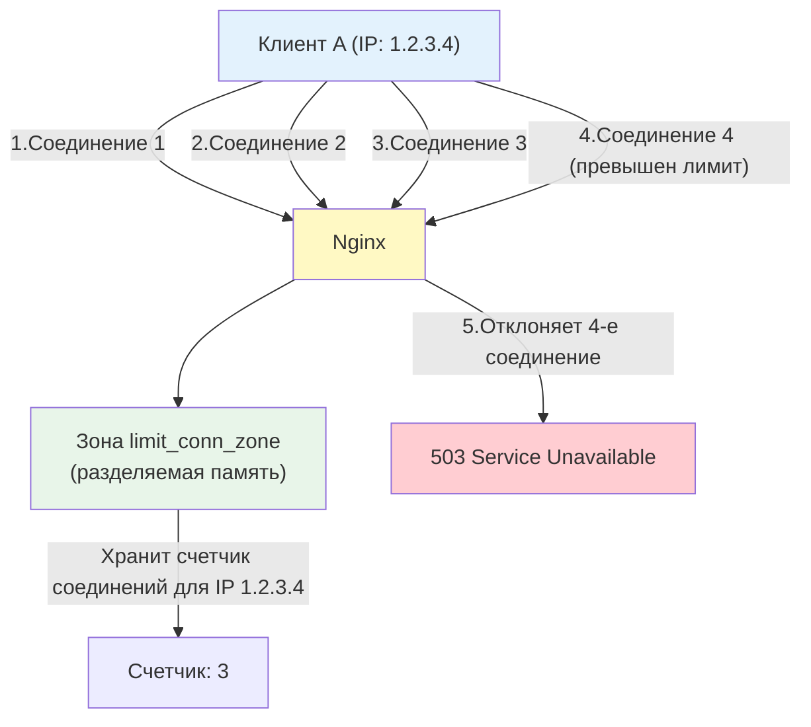

## Введение

Безопасность веб-сервера — это многоуровневая защита, которая начинается еще до того, как запрос достигнет приложения. Nginx, находясь на передовой линии, может:

- Скрыть информацию о себе, усложняя работу злоумышленникам
- Ограничить количество запросов от одного клиента (защита от DDoS и брутфорса)
- Заблокировать явно вредоносные запросы (базовый WAF)
- Добавить заголовки безопасности, защищающие от распространенных атак (XSS, Clickjacking, MIME-sniffing)

Понимание этих механизмов критично для DevOps-инженера, так как правильно настроенный Nginx может предотвратить 80% типовых атак еще до того, как они достигнут приложения.

> [!INFO] Связь с другими темами
> 
> - Механизмы `limit_req` и `limit_conn` используют разделяемую память между worker-процессами, архитектура которых разобрана в [[Synced/DevOps/Балансировка, проксирование и веб-сервера/1. Классические веб-серверы и обратные прокси/1. Nginx/1. Архитектура.md | Архитектуре Nginx]].
> - Наследование директив безопасности (например, `limit_req`) подчиняется правилам, описанным в [[Synced/DevOps/Балансировка, проксирование и веб-сервера/1. Классические веб-серверы и обратные прокси/1. Nginx/2. Конфигурация.md | Конфигурации Nginx]].

## 1. Скрытие информации о сервере

Первый принцип безопасности — **минимизация раскрытия информации**. Чем меньше злоумышленник знает о вашей инфраструктуре, тем сложнее ему подобрать специфичную атаку.

### Директива `server_tokens`

По умолчанию Nginx добавляет в заголовок `Server` свою версию:

```http
Server: nginx/1.24.0
```

Это помогает злоумышленникам найти CVE (уязвимости) для конкретной версии.

**Решение:**

```nginx
http {
    server_tokens off;
}
```

Теперь заголовок будет выглядеть так:

```http
Server: nginx
```

> [!WARNING] Это не панацея
> Отключение `server_tokens` — это "security through obscurity" (безопасность через неясность). Опытный злоумышленник может определить версию Nginx по другим признакам (поведение ошибок, специфичные заголовки). Но это усложняет автоматизированные атаки и отсекает скрипт-кидди.

### Полное скрытие заголовка `Server`

Если нужно полностью убрать заголовок `Server`, потребуется сторонний модуль `headers-more-nginx-module`:

```nginx
# После компиляции с модулем headers-more
more_clear_headers Server;
```

### Скрытие версий других компонентов

Не забывайте, что бэкенды (PHP, Python, Node.js) тоже раскрывают информацию:

```nginx
# Скрываем версию PHP
fastcgi_hide_header X-Powered-By;
proxy_hide_header X-Powered-By;

# Скрываем версию ASP.NET
proxy_hide_header X-AspNet-Version;
proxy_hide_header X-AspNetMvc-Version;
```

## 2. Ограничение соединений: `limit_conn`

Директива `limit_conn` ограничивает **количество одновременных соединений** от одного клиента (или группы клиентов). Это защищает от атак, цель которых — исчерпать пул соединений Nginx.

### Как это работает "под капотом"



### Конфигурация

```nginx
http {
    # 1. Определяем зону (разделяемую память) для хранения счетчиков
    # Ключ: $binary_remote_addr (IP клиента в бинарном виде, экономит память)
    # Размер зоны: 10MB (хватит примерно на 160 000 уникальных IP)
    limit_conn_zone $binary_remote_addr zone=addr:10m;
    
    server {
        listen 80;
        
        location / {
            # 2. Применяем лимит: не более 10 одновременных соединений с одного IP
            limit_conn addr 10;
            
            # 3. Код ответа при превышении лимита (по умолчанию 503)
            limit_conn_status 503;
            
            proxy_pass http://backend;
        }
    }
}
```
