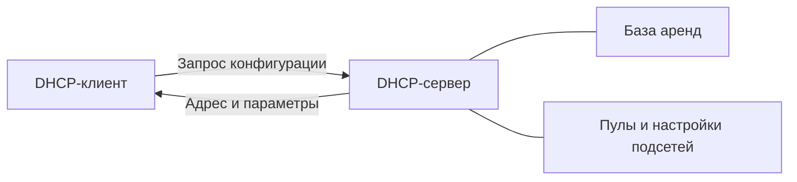

## 1. Что такое DHCP

**DHCP (Dynamic Host Configuration Protocol)** — сетевой протокол прикладного уровня, который автоматически предоставляет устройствам параметры IP-конфигурации. В IPv4 это, прежде всего, IP-адрес, маска сети, шлюз по умолчанию и адреса DNS-серверов.

Без DHCP администратору пришлось бы вручную настраивать сетевые параметры каждого компьютера, телефона и принтера. DHCP особенно полезен в учебных аудиториях, офисах, Wi-Fi-сетях и сетях с большим количеством временных клиентов.

**Пример:** ноутбук подключается к Wi-Fi колледжа и автоматически получает:

| Параметр | Пример | Для чего нужен |
|---|---|---|
| IPv4-адрес | `192.168.10.105` | Идентифицирует устройство в подсети |
| Маска | `255.255.255.0` (`/24`) | Определяет локальную подсеть |
| Шлюз | `192.168.10.1` | Позволяет обращаться к другим сетям |
| DNS | `192.168.10.10` | Преобразует имена в IP-адреса |
| Время аренды | 8 часов | Определяет срок использования адреса |

> [!important] DHCP не создает доступ в Интернет
> Он лишь передает клиенту сетевые настройки. Для связи с внешними сетями по-прежнему нужны маршрутизация, работоспособный шлюз, DNS и при необходимости NAT.

## 2. Задачи DHCP

1. **Автоматизация адресации.** Устройства получают конфигурацию без ручного ввода.
2. **Централизованное управление.** Изменение DNS или шлюза на DHCP-сервере позволяет передавать новые настройки клиентам при обновлении аренды.
3. **Рациональное использование адресов.** Временные аренды позволяют повторно выдавать освобожденные адреса.
4. **Предсказуемая адресация.** Резервации позволяют закреплять конкретный IP-адрес за определенным клиентом.
5. **Передача дополнительных параметров.** Например, NTP-серверов, параметров PXE-загрузки и доменного суффикса — если клиент их поддерживает.

DHCP особенно полезен в сетях с сотнями клиентских устройств. Для критичных серверов часто применяют статическую адресацию либо DHCP-резервации — выбор зависит от политики эксплуатации и требований к доступности.

## 3. Участники DHCP

### 3.1. DHCP-клиент

**DHCP-клиент** — устройство или программный компонент, запрашивающий сетевую конфигурацию. Это может быть Windows, Linux, смартфон, сетевой принтер или виртуальная машина.

В Linux клиентом может управлять NetworkManager, systemd-networkd либо отдельная DHCP-программа. Наличие DHCP-клиента не означает, что на устройстве установлен DHCP-сервер.

### 3.2. DHCP-сервер

**DHCP-сервер** — служба, которая обрабатывает запросы клиентов, выбирает подходящие адреса, передает параметры и ведет учет аренд.

Примеры реализаций:

- **ISC DHCP (`dhcpd`)** — классическая реализация; проект ISC DHCP достиг конца жизненного цикла (EOL), поэтому его разумно изучать для сопровождения существующих установок.
- **Kea DHCP** — современная реализация ISC с JSON-конфигурацией и возможностями автоматизации.
- DHCP-службы маршрутизаторов, межсетевых экранов и Windows Server.

### 3.3. DHCP Relay Agent

**DHCP Relay Agent** — промежуточный компонент, который пересылает DHCP-сообщения между клиентской подсетью и DHCP-сервером в другой подсети.

Он часто работает на маршрутизаторе или L3-коммутаторе. Обычный маршрутизатор не пересылает широковещательные DHCP-запросы между подсетями автоматически. Для этого требуется DHCP Relay или иная специально настроенная схема.

### 3.4. Администратор сети

Администратор задает подсети, пулы адресов, резервации, DHCP Options, правила доступа, мониторинг и резервирование. DHCP-сервер не определяет правильную топологию сети самостоятельно.

## 4. Общая архитектура DHCPv4



В простой сети клиент и сервер находятся в одном широковещательном сегменте. Клиент, который еще не знает своего IPv4-адреса, может отправить широковещательное сообщение. DHCP-сервер отвечает в соответствии с правилами протокола и состоянием клиента.

### Пример с DHCP Relay


Так один DHCP-сервер может обслуживать несколько VLAN. Для каждой подсети создают соответствующую конфигурацию адресов и параметров.

## 5. Где расположен DHCP в модели сети

DHCP относится к **прикладному уровню**. В DHCPv4 используются UDP-порты:

| Сторона | UDP-порт | Назначение |
|---|---:|---|
| DHCP-сервер | 67 | Прием запросов DHCPv4 |
| DHCP-клиент | 68 | Прием ответов DHCPv4 |

Для DHCPv6 используются другие порты: UDP 547 на сервере и UDP 546 на клиенте. DHCPv4 и DHCPv6 — связанные, но разные протоколы; DHCPv6 не является простым «DHCPv4 с длинными адресами».

> [!note] Broadcast и unicast
> Начальный обмен DHCPv4 часто использует широковещательную передачу, поскольку у клиента еще нет полноценной IPv4-конфигурации. Некоторые сообщения и последующие обновления аренды могут передаваться одноадресно. Не следует считать, что весь DHCP-трафик всегда broadcast.

## 6. Что именно выдает DHCP

DHCP передает параметры с помощью **DHCP Options** — пронумерованных полей протокола.

| Option | Значение | Пример |
|---|---|---|
| 1 | Subnet Mask | `255.255.255.0` |
| 3 | Router | `192.168.10.1` |
| 6 | DNS Servers | `192.168.10.10`, `192.168.10.11` |
| 15 | Domain Name | `example.internal` |
| 42 | NTP Servers | `192.168.10.20` |
| 51 | IP Address Lease Time | `28800` секунд |
| 66 | TFTP Server Name | Пример для некоторых сценариев PXE |
| 67 | Bootfile Name | Имя загрузочного файла для поддерживаемых клиентов |

Набор используемых параметров зависит от возможностей клиента и требований инфраструктуры. Для PXE существуют также другие механизмы передачи загрузочных параметров; Options 66/67 не универсальное решение для всех UEFI/BIOS-клиентов.

## 7. Откуда DHCP знает, какой адрес выдать

Администратор настраивает **подсеть** и **пул адресов**.

Пример:

```text
Подсеть:          192.168.10.0/24
Шлюз:            192.168.10.1
DHCP-пул:        192.168.10.100–192.168.10.200
DNS:             192.168.10.10
```

Сервер выбирает адрес в рамках настроенного пула с учетом своей базы аренд, резерваций и других правил. DHCP не гарантирует обнаружение абсолютно всех конфликтов адресов во всей сети. Поэтому адреса, назначенные вручную, не должны случайно пересекаться с динамическим пулом.

**Аренда (lease)** — запись о временном предоставлении клиенту IP-адреса. После окончания срока и при отсутствии продления адрес может снова стать доступен для выдачи. Точные состояния и механика продления рассматриваются в отдельной заметке.

**Резервация (reservation)** — правило, позволяющее выдавать определенному клиенту заданный адрес. Идентификация клиента зависит от реализации и настроек; это не всегда только MAC-адрес.

## 8. DHCP и DNS: разные задачи

- **DHCP** сообщает клиенту, какой IP-адрес и другие параметры использовать.
- **DNS** сопоставляет доменные имена с адресами и другими данными.

Пример: DHCP выдал ПК адрес `192.168.10.105`, а DNS может содержать запись `pc-105.example.internal → 192.168.10.105`.

**DDNS (Dynamic DNS)** — механизм автоматического обновления DNS-записей при изменении адреса. DHCP и DNS могут интегрироваться, но сама выдача адреса не означает, что DNS-запись обязательно создастся.

В сетях с Samba AD и защищенными обновлениями DNS важно отдельно продумать учетные записи, Kerberos/GSS-TSIG, права на зоны и выбор DHCP-реализации. Это относится к следующим практическим заметкам.

## 9. Где DHCP работает на практике

### 9.1. Домашняя сеть

Чаще всего DHCP-сервер встроен в домашний маршрутизатор. Телефоны и компьютеры автоматически получают адреса и шлюз.

### 9.2. Колледж или предприятие

DHCP-сервер может работать на отдельной VM, а маршрутизаторы или L3-коммутаторы передают запросы от разных VLAN через DHCP Relay.

**Условная схема:**

```text
VLAN 10 — студенты:     192.168.10.0/24
VLAN 20 — преподаватели: 192.168.20.0/24
VLAN 30 — оборудование:  192.168.30.0/24
                 |
           DHCP Relay
                 |
        DHCP Server (VM)
```

Для каждой сети могут быть собственные пулы, шлюзы и DNS-параметры. DHCP Relay не заменяет маршрутизацию и межсетевые правила.

### 9.3. PXE-загрузка

DHCP помогает клиенту получить параметры сети и информацию, необходимую для начала сетевой загрузки. Это используется в сценариях автоматической установки ОС и развертывания рабочих станций. Для полного PXE-процесса обычно нужны и другие компоненты, например HTTP/TFTP-сервер и загрузчик.

## 10. Минимальная диагностика на Linux

Эти команды позволяют увидеть DHCP-настройки и сетевое состояние, не устанавливая DHCP-сервер.

### Посмотреть адреса интерфейсов

```bash
ip -br addr
```

### Посмотреть маршруты

```bash
ip route
```

### Посмотреть DNS-настройки

```bash
resolvectl status
```

Команда `resolvectl` применима к системам с `systemd-resolved`; на других системах проверяют настройки соответствующего DNS-резолвера.

### Посмотреть конфигурацию NetworkManager

```bash
nmcli device show
```

Работает, если используется NetworkManager.

### Увидеть DHCPv4-пакеты

```bash
sudo tcpdump -ni any 'udp port 67 or udp port 68'
```

На DHCPv6:

```bash
sudo tcpdump -ni any 'udp port 546 or udp port 547'
```

> [!warning] Осторожно с изменением сетевых настроек
> Не отключайте DHCP и не перезапускайте сетевые службы на удаленном сервере без консольного доступа: можно потерять SSH-соединение.

## 11. Типичные заблуждения

| Заблуждение | Как правильно |
|---|---|
| «DHCP — это DNS» | DHCP выдает сетевые параметры, DNS разрешает имена |
| «DHCP всегда работает только внутри одной подсети» | DHCP Relay позволяет обслуживать другие подсети |
| «DHCP всегда выдает случайный адрес» | Выбор зависит от пула, аренд, резерваций и логики сервера |
| «Все DHCP-сообщения — broadcast» | В DHCPv4 используются и broadcast, и unicast |
| «DHCP нужен только компьютерам» | Его используют телефоны, принтеры, VM и другое оборудование |
| «Если DHCP не работает, Интернет сразу исчезнет у всех» | У клиентов с действующей конфигурацией связь может сохраняться до необходимости ее обновления; поведение зависит от ситуации |

---

## Вопросы для самопроверки

1. Что такое DHCP и какие проблемы он решает?
2. Чем DHCP-клиент отличается от DHCP-сервера?
3. Зачем нужен DHCP Relay Agent?
4. Какие UDP-порты используются в DHCPv4?
5. Чем пул адресов отличается от аренды?
6. Почему DHCP и DNS — не одно и то же?
7. Что произойдет, если DHCP-сервер находится в другой VLAN и DHCP Relay не настроен?
8. Для чего DHCP используется при PXE-загрузке?
9. Почему статические адреса не стоит назначать внутри динамического пула без согласованной схемы?
10. Чем отличается DHCPv6 от DHCPv4 на уровне используемых UDP-портов?

---

**Теги:** #DevOps #Networking #DHCP #IPv4 #NetworkAdministration

**Нормативная база:** RFC 2131 (DHCPv4), RFC 2132 (DHCP Options), RFC 8415 (DHCPv6).
