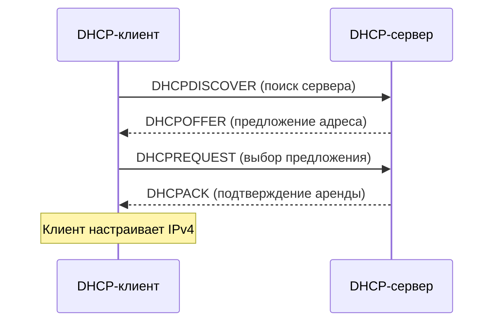
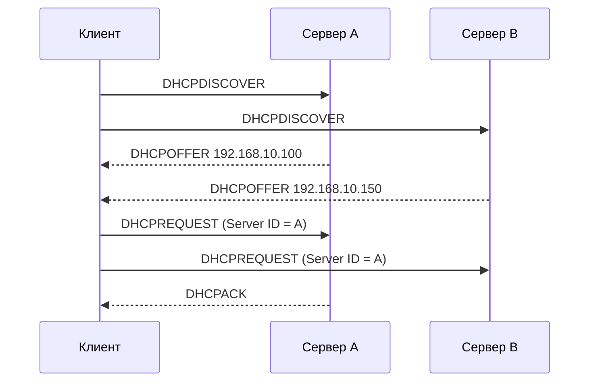
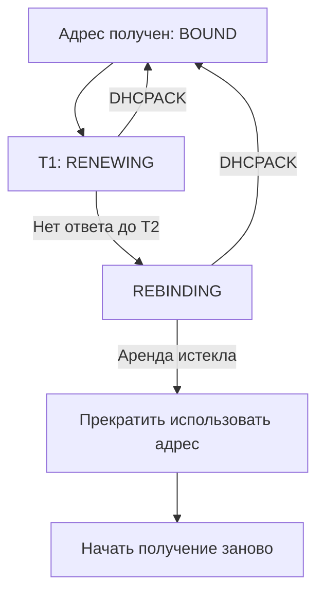
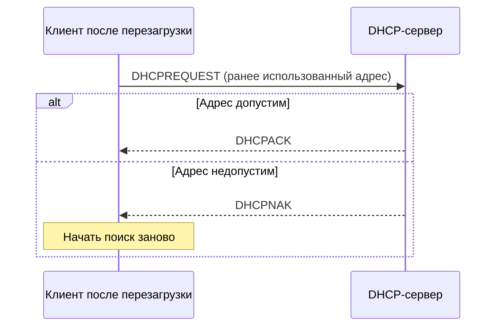

## 1. DHCPv4: общая идея

**DHCPv4 (Dynamic Host Configuration Protocol)** — протокол прикладного уровня, который позволяет устройству автоматически получить параметры IPv4: адрес, маску подсети, шлюз, DNS-серверы и срок аренды адреса.

**DHCP-клиент** запрашивает конфигурацию. **DHCP-сервер** выбирает адрес из доступного диапазона и выдает его на ограниченный срок — **аренду (lease)**.

Для DHCPv4 используются UDP-порты:

| Участник | UDP-порт | Назначение |
|---|---:|---|
| DHCP-сервер | 67 | Принимает запросы клиентов |
| DHCP-клиент | 68 | Принимает ответы сервера |

В начале работы у клиента может не быть IPv4-адреса. Поэтому начальные сообщения часто отправляются с `0.0.0.0:68` на `255.255.255.255:67`. Однако не **все** DHCP-сообщения всегда широковещательные: при продлении аренды клиент обычно обращается к известному серверу по unicast.

## 2. DORA — четыре этапа получения адреса

**DORA** — название типичного четырехэтапного обмена DHCPv4:

1. **D — Discover**: клиент ищет DHCP-серверы.
2. **O — Offer**: сервер предлагает адрес и параметры.
3. **R — Request**: клиент выбирает предложение и запрашивает его.
4. **A — ACK**: сервер подтверждает выдачу аренды.



> [!important] DORA — типовой, но не единственный сценарий
> При перезагрузке устройства с еще действующей арендой или при ее продлении клиент может отправить DHCPREQUEST без нового DHCPDISCOVER и DHCPOFFER.

### 2.1. DHCPDISCOVER — поиск сервера

При первом подключении клиент не знает, где находится DHCP-сервер, и отправляет сообщение **DHCPDISCOVER**.

Типичный пакет:

```text
Source IP:      0.0.0.0
Destination IP: 255.255.255.255
Source UDP:     68
Destination UDP:67
DHCP Message:   Discover
```

В сообщении есть идентификатор транзакции **XID**: он помогает сопоставить запросы и ответы. Клиент также может указать, какие DHCP Options ему нужны (Parameter Request List).

### 2.2. DHCPOFFER — предложение сервера

Сервер выбирает подходящий адрес из пула и отвечает **DHCPOFFER**. Например:

```text
Предлагаемый IPv4: 192.168.10.100
Маска:             255.255.255.0
Шлюз:              192.168.10.1
DNS:               192.168.10.10
Срок аренды:       3600 секунд
DHCP Server ID:    192.168.10.2
```

Сервер **предлагает**, но клиент еще не завершил получение адреса. Если в сегменте несколько DHCP-серверов, клиент может получить несколько предложений.

> [!note] Broadcast или unicast?
> Ответ сервера может передаваться разными способами в зависимости от состояния клиента, флага broadcast и наличия DHCP Relay. Нельзя утверждать, что DHCPOFFER всегда передается только broadcast.

### 2.3. DHCPREQUEST — выбор предложения

Клиент выбирает одно предложение и отправляет **DHCPREQUEST**. В начальном обмене это обычно broadcast, чтобы все DHCP-серверы узнали, какое предложение принято.

Содержимое включает:

- **Requested IP Address (Option 50)** — запрошенный IPv4-адрес.
- **DHCP Server Identifier (Option 54)** — идентификатор выбранного DHCP-сервера.

Другие серверы понимают, что их предложения не выбраны, и могут освободить соответствующие временные резервирования.

### 2.4. DHCPACK — подтверждение

Выбранный сервер отправляет **DHCPACK**: адрес и параметры официально предоставлены клиенту на срок аренды.

Клиент применяет настройки сетевого интерфейса. Перед использованием адреса он может проверить, нет ли конфликта в сети (например, с помощью ARP).

**Результат:** интерфейс получает IPv4, маску, маршрут по умолчанию и DNS-настройки, если они были предоставлены сервером и приняты клиентом.

## 3. Что происходит, если серверов несколько?

Допустим, в одном VLAN находятся два DHCP-сервера:



На схеме широковещательные сообщения условно показаны как доставка обоим серверам. Клиент выбирает одно предложение; это **не обязательно первое** полученное предложение, выбор зависит от реализации клиента.

> [!warning] Два DHCP-сервера — не автоматически отказоустойчивость
> Если независимые серверы раздают пересекающиеся пулы без согласования, возможны конфликты адресов. Корректную отказоустойчивость и разделение диапазонов рассматриваем в заметках по ISC DHCP и Kea.

## 4. Дополнительные DHCPv4-сообщения

DORA — только основной сценарий. Для реальной эксплуатации важно знать остальные сообщения.

| Сообщение | Кто отправляет | Для чего |
|---|---|---|
| `DHCPDISCOVER` | Клиент | Поиск доступных серверов |
| `DHCPOFFER` | Сервер | Предложение конфигурации |
| `DHCPREQUEST` | Клиент | Выбор предложения, запрос или продление аренды |
| `DHCPACK` | Сервер | Подтверждение конфигурации |
| `DHCPNAK` | Сервер | Отказ в запрошенной конфигурации (например, адрес не подходит для сети) |
| `DHCPDECLINE` | Клиент | Сообщение, что предложенный адрес, вероятно, уже занят |
| `DHCPRELEASE` | Клиент | Добровольное освобождение аренды |
| `DHCPINFORM` | Клиент | Запрос дополнительных параметров без получения адреса через DHCP |

### DHCPNAK

Если клиент просит адрес, который сервер считает недопустимым, сервер может отправить `DHCPNAK`. Клиент прекращает использовать прежнюю конфигурацию и обычно начинает процесс получения адреса заново.

### DHCPDECLINE

Если клиент обнаружил, что адрес уже используется другим устройством, он может отправить `DHCPDECLINE`. Это сигнал серверу не выдавать данный адрес до проверки ситуации.

### DHCPRELEASE

Когда клиент корректно освобождает аренду, он может отправить `DHCPRELEASE`. Но **выключение питания не гарантирует отправку RELEASE**. Поэтому сервер ориентируется также на срок аренды.

### DHCPINFORM

Устройство с уже назначенным статическим IPv4 может запросить дополнительные параметры, например DNS-серверы, не запрашивая новый адрес.

## 5. Жизненный цикл аренды: получение, продление, повторный поиск

После получения адреса клиент не обязан выполнять DORA при каждом обращении к сети. Он отслеживает время аренды.

- **Lease Time** — общая продолжительность аренды.
- **T1 (Renewal)** — момент попытки продлить аренду у исходного сервера.
- **T2 (Rebinding)** — момент попытки продлить аренду у любого подходящего сервера.

При отсутствии специальных значений часто применяются ориентиры **T1 = 50%**, **T2 = 87,5%** времени аренды; реальные значения могут задаваться сервером и зависят от реализации.

Пример: аренда на 8 часов.

| Событие | Время от начала |
|---|---|
| Аренда получена | 0:00 |
| T1: попытка продления у прежнего сервера | 4:00 |
| T2: повторный запрос доступным серверам | 7:00 |
| Окончание аренды | 8:00 |



**На T1** клиент обычно отправляет `DHCPREQUEST` известному серверу по unicast. **На T2** обычно отправляет broadcast-запрос, чтобы ответить мог другой сервер. Успешное продление подтверждается `DHCPACK`, а полный DORA не требуется.

Если аренда истекла и продлить ее не удалось, клиент должен перестать использовать адрес как действующую DHCP-аренду.

## 6. Что происходит после перезагрузки клиента?

Если клиент сохранил информацию о предыдущей аренде, он может попытаться подтвердить старый адрес с помощью `DHCPREQUEST` (состояние **INIT-REBOOT**), не выполняя сначала полный DORA.



Клиент не должен без проверки считать прежний адрес бессрочно действующим.

## 7. DHCP-пакет: какие поля полезно знать

| Поле / параметр | Значение |
|---|---|
| `op` | Запрос (`BOOTREQUEST`) или ответ (`BOOTREPLY`) |
| `xid` | Идентификатор транзакции |
| `chaddr` | Аппаратный адрес клиента в базовом формате пакета |
| `ciaddr` | Текущий IPv4 клиента, когда он уже известен и используется в соответствующем состоянии |
| `yiaddr` | Предлагаемый/выдаваемый IPv4 клиента |
| `giaddr` | Адрес DHCP Relay Agent при пересылке |
| `Option 53` | Тип DHCP-сообщения |
| `Option 50` | Запрашиваемый IPv4 |
| `Option 51` | Время аренды |
| `Option 54` | Идентификатор DHCP-сервера |
| `Option 55` | Список запрашиваемых клиентом параметров |

> [!tip] MAC и Client Identifier
> DHCP-сервер может идентифицировать клиента не только по MAC-адресу, но и по **Client Identifier (Option 61)**. Поэтому при диагностике резерваций важно смотреть, как конкретный сервер идентифицирует клиента.

## 8. Практика в Linux: наблюдаем DORA

> [!warning] Условия лабораторной работы
> Используй тестовую VM и тестовую сеть, в которой есть разрешенный DHCP-сервер. Не запускай второй DHCP-сервер в рабочем VLAN. Команды ниже могут временно изменить сетевое подключение VM.

### 8.1. Узнаем имя интерфейса

```bash
ip -br link
ip -4 addr
ip route
```

Пример интерфейса: `ens18`. В следующих командах **замени `ens18` на свой**.

### 8.2. Запускаем захват DHCP-трафика

В первом терминале:

```bash
sudo apt update
sudo apt install -y tcpdump
sudo tcpdump -ni ens18 -vvv 'udp and (port 67 or port 68)'
```

Если нужно сохранить пакеты для Wireshark:

```bash
sudo tcpdump -ni ens18 -s 0 -w /tmp/dhcp-dora.pcap 'udp and (port 67 or port 68)'
```

Для остановки нажми `Ctrl+C`.

### 8.3. Запрашиваем адрес заново

**Вариант A: VM использует NetworkManager.**

```bash
nmcli device status
sudo nmcli device disconnect ens18
sudo nmcli device connect ens18
```

**Вариант B: тестовая VM управляется `dhclient`.** Только если этот клиент действительно установлен и интерфейс не управляется конкурирующим сетевым менеджером:

```bash
sudo dhclient -r ens18
sudo dhclient -v ens18
```

На современных Ubuntu с Netplan и `systemd-networkd` `dhclient` может отсутствовать, поэтому **не следует устанавливать его поверх действующего сетевого менеджера без необходимости**. Если VM использует `systemd-networkd`, можно посмотреть состояние:

```bash
networkctl status ens18
journalctl -u systemd-networkd -n 50 --no-pager
```

И при необходимости повторно настроить интерфейс в лаборатории:

```bash
sudo networkctl reconfigure ens18
sudo networkctl renew ens18
```

`renew` обычно вызывает **продление аренды**, а не полный DORA. Для наблюдения полного DORA удобнее использовать новую VM/новый клиентский идентификатор или запуск клиента без действующей сохраненной аренды.

### 8.4. Что искать в выводе tcpdump

Пример типовой последовательности (упрощенно):

```text
DHCP-Message Option 53: Discover
DHCP-Message Option 53: Offer
DHCP-Message Option 53: Request
DHCP-Message Option 53: ACK
```

Сравни:

1. `xid` у четырех сообщений одной транзакции.
2. Предлагаемый адрес `yiaddr` в Offer/ACK.
3. `Server Identifier` выбранного сервера.
4. Значения `Lease Time`, `Router`, `DNS Server`.
5. Источник и назначение IP: где используется broadcast, а где unicast.

### 8.5. Проверяем результат

```bash
ip -4 addr show dev ens18
ip route
resolvectl status ens18
```

`resolvectl` применим при использовании `systemd-resolved`. В других конфигурациях проверь DNS через настройки сетевого менеджера или `/etc/resolv.conf`.

## 9. Типичные проблемы и их диагностика

| Симптом | Возможная причина | Что проверить |
|---|---|---|
| Есть Discover, но нет Offer | DHCP-сервер недоступен, не обслуживает VLAN или блокируется трафик | `tcpdump` на клиенте/сервере, VLAN, Relay, firewall |
| Есть Offer, но нет ACK | Request не дошел или сервер отклонил выбор | `Option 54`, `DHCPNAK`, журналы сервера |
| Адрес получен, но нет интернета | Не выдан шлюз или проблема маршрутизации | `ip route`, DHCP Option 3, маршрутизатор |
| Адрес получен, но имена не разрешаются | Неверные DNS Options или проблемы DNS | Option 6, `resolvectl`, `dig` |
| Клиент получает не тот диапазон | Rogue DHCP или ошибка настройки Relay/пулов | Server Identifier, `giaddr`, сетевые VLAN |
| После переноса в другую сеть старый адрес не подходит | Старый lease и запрос INIT-REBOOT | DHCPREQUEST/DHCPNAK, новая конфигурация |

> [!important] Отсутствие ответа в клиентском tcpdump — не доказательство ошибки сервера
> Пакет мог не дойти до сервера или ответ мог потеряться по пути. При необходимости сравни захват на клиенте, Relay и сервере.

---

## Вопросы для самопроверки

1. Почему DHCPDISCOVER обычно передается широковещательно?
2. Почему получение DHCPOFFER еще не означает завершение выдачи адреса?
3. Как клиент сообщает остальным DHCP-серверам, чье предложение выбрал?
4. Чем продление аренды отличается от первоначального DORA?
5. Для чего нужны T1 и T2?
6. Что означает `giaddr`?
7. Может ли клиент получить DHCP Options, не получая IP-адрес через DHCP?
8. Почему два независимых DHCP-сервера с одинаковыми пулами опасны?

---

#devops #networking #dhcp #dhcpv4 #dora #linux