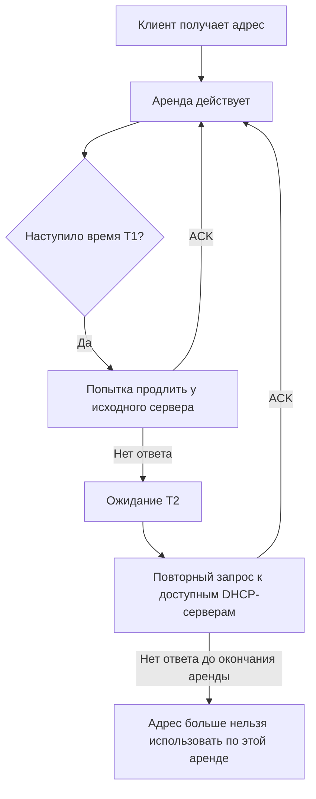

## 1. Зачем DHCP управляет адресами

**DHCP (Dynamic Host Configuration Protocol)** — протокол, с помощью которого клиент автоматически получает параметры сетевой конфигурации: IP-адрес, маску сети, шлюз, DNS-серверы и другие значения. В DHCPv4 сервер обычно выделяет адрес **на ограниченное время**, называемое арендой (*lease*).

Пример: компьютер подключается к сети `192.168.10.0/24` и получает:

| Параметр | Значение | Назначение |
|---|---|---|
| IPv4-адрес | `192.168.10.105` | Адрес компьютера в сети |
| Маска | `255.255.255.0` | Граница локальной подсети |
| Шлюз | `192.168.10.1` | Выход в другие сети |
| DNS | `192.168.10.10` | Разрешение имен |
| Домен поиска | `lab.example` | Дополнение коротких имен |
| Время аренды | `8 часов` | Период действия выданного адреса |

> [!important] Разделение понятий
> IP-адрес — **значение**, которое получает клиент. Аренда — **состояние выдачи адреса конкретному клиенту на определенное время**. DHCP Option — **параметр**, передаваемый клиенту вместе с ответом DHCP.

## 2. Scope, Subnet и Address Pool

### 2.1. Подсеть (Subnet)

**Подсеть** — диапазон IP-адресов, определяемый сетевым префиксом. Например, `192.168.10.0/24` содержит адреса `192.168.10.0`–`192.168.10.255`. В типичной подсети `/24` адрес `.0` обозначает сеть, а `.255` — широковещательный адрес; их нельзя назначать обычным узлам.

### 2.2. Scope

**DHCP Scope** — логическая область настройки выдачи адресов для определенной подсети: диапазоны, исключения, время аренды и параметры. Термин особенно распространен в Windows DHCP. В ISC DHCP и Kea похожая логика описывается настройками подсети и пулов, но названия и модель конфигурации отличаются.

### 2.3. Pool

**Address Pool (пул)** — диапазон адресов, которые сервер может динамически назначать клиентам.

Пример:

```text
Подсеть:           192.168.10.0/24
Шлюз:             192.168.10.1
DNS:              192.168.10.10
Динамический пул: 192.168.10.100–192.168.10.200
Статические узлы: 192.168.10.2–192.168.10.99
Резерв:           192.168.10.201–192.168.10.254
```

> [!warning] Не путать статические адреса и резервации
> **Статический IP** задается на самом устройстве. **DHCP Reservation** задается на сервере: устройство продолжает использовать DHCP, но получает заранее закрепленный адрес.

### 2.4. Исключения (Exclusions)

**Исключение** — адрес или диапазон, который не должен попадать в динамическую выдачу. В разных DHCP-серверах это реализуется по-разному: часто проще задать пул, который изначально не включает такие адреса.

Пример: если маршрутизатор имеет `192.168.10.1`, а контроллер домена — `192.168.10.10`, не следует включать их адреса в динамический пул.

### 2.5. Несколько пулов

Одна подсеть может иметь несколько диапазонов выдачи, например `192.168.10.50–99` и `192.168.10.150–199`. В некоторых реализациях к пулам можно применять дополнительные условия (классы клиентов и другие правила). Подробные конфигурации изучим отдельно для ISC DHCP и Kea.

## 3. Динамическая выдача, резервация и ручная настройка

| Способ | Где задается адрес | Когда подходит |
|---|---|---|
| Динамическая аренда | DHCP-сервер выбирает свободный адрес из пула | Рабочие станции, телефоны, гостевые устройства |
| DHCP Reservation | DHCP-сервер закрепляет адрес за идентификатором клиента | Принтеры, некоторые сетевые устройства |
| Статическая конфигурация | В ОС или прошивке устройства | Шлюзы, критичные серверы, инфраструктурные интерфейсы |

**Идентификатор клиента:** в DHCPv4 сервер может использовать MAC-адрес (`chaddr`) или DHCP Client Identifier (Option 61). Поведение зависит от клиента и реализации сервера. Поэтому фраза «резервация всегда работает только по MAC» неточна.

Пример резервации по MAC в концептуальном виде:

```text
Устройство:   printer-01
MAC:          52:54:00:12:34:56
IPv4:         192.168.10.20
```

> [!tip] Практический принцип
> Для важных серверов сначала определите схему адресации, DNS и восстановления после аварии. DHCP Reservation удобна, но делает доступность выдачи адресов частью процедуры запуска устройства.

## 4. Что такое DHCP Lease

**Lease (аренда)** — ограниченное по времени право клиента использовать выданный IPv4-адрес. DHCP-сервер учитывает, кому и на какой срок он выдал адрес.

Типичный жизненный цикл:



> [!note] Что происходит при перезагрузке
> Перезагрузка компьютера **не означает**, что сервер немедленно освобождает ранее выданный адрес. Клиент может попытаться подтвердить прежний адрес; сервер хранит состояние аренды согласно своей реализации и настройкам.

## 5. Lease Time, T1 и T2

### 5.1. Lease Time

**Lease Time** — продолжительность аренды, например `8 часов`.

### 5.2. T1 — Renewal Time

**T1** — момент, когда клиент обычно начинает продлевать аренду у сервера, который ее выдал. Если сервер не передал отдельное значение T1, стандартное значение по умолчанию — **50% срока аренды**.

### 5.3. T2 — Rebinding Time

**T2** — момент, когда клиент, не получивший подтверждения продления, пытается обратиться к доступным DHCP-серверам. Если T2 отдельно не задан, типичное значение по умолчанию — **87,5% срока аренды**.

Для аренды 8 часов:

| Событие | От начала аренды | Пример при выдаче в 09:00 |
|---|---:|---|
| Начало аренды | 0 ч | 09:00 |
| T1 (50%) | 4 ч | 13:00 |
| T2 (87,5%) | 7 ч | 16:00 |
| Окончание | 8 ч | 17:00 |

```text
09:00                  13:00             16:00   17:00
  |----------------------|-----------------|-------|
  Начало                 T1                T2      Конец
  аренды                 Renew             Rebind  аренды
```

> [!important] TTL — не то же самое, что Lease Time
> DNS TTL определяет, как долго кэшируется DNS-запись. DHCP Lease Time определяет, как долго клиенту разрешено пользоваться выданным IP-адресом. Эти механизмы независимы.

### 5.4. Как выбрать время аренды

- **Постоянные рабочие станции:** часто подходят часы или дни, в зависимости от числа адресов и политики сети.
- **Гостевой Wi-Fi с высокой сменяемостью:** более короткая аренда может ускорить возврат адресов в пул, но увеличивает частоту DHCP-обмена.
- **Небольшая лаборатория с ограниченным пулом:** время аренды подбирают по числу одновременно работающих клиентов и частоте смены устройств.

Нет единственного правильного срока для всех сетей. Слишком короткая аренда создает лишние запросы, а слишком длинная может удерживать адреса за давно отключившимися клиентами.

## 6. Основные DHCP Options

**DHCP Option** — поле с номером и значением, через которое сервер сообщает клиенту дополнительные параметры.

| Option | Название | Пример / назначение |
|---|---|---|
| 1 | Subnet Mask | `255.255.255.0` |
| 3 | Router | `192.168.10.1` — шлюз по умолчанию |
| 6 | Domain Name Server | `192.168.10.10`, `192.168.10.11` |
| 12 | Host Name | Имя хоста |
| 15 | Domain Name | `lab.example` |
| 42 | NTP Servers | Адреса NTP-серверов; поддержка клиентами зависит от ОС |
| 51 | IP Address Lease Time | Время аренды в секундах |
| 53 | DHCP Message Type | Discover, Offer, Request, ACK и другие |
| 54 | Server Identifier | Идентификатор DHCP-сервера |
| 55 | Parameter Request List | Какие параметры запрашивает клиент |
| 58 | Renewal Time (T1) | Время до начала продления |
| 59 | Rebinding Time (T2) | Время до широковещательного повторного запроса |
| 61 | Client Identifier | Идентификатор DHCP-клиента |
| 66 | TFTP Server Name | Имя TFTP-сервера; применяется в некоторых PXE-сценариях |
| 67 | Bootfile Name | Имя загрузочного файла; применяется в некоторых PXE-сценариях |
| 119 | Domain Search | Список DNS-суффиксов поиска |
| 121 | Classless Static Route | Дополнительные маршруты |

> [!warning] PXE и Option 66/67
> PXE не сводится к обязательной передаче Options 66 и 67. Конкретный способ зависит от BIOS/UEFI, DHCP/PXE-сервера и архитектуры клиента; возможны отдельный ProxyDHCP и поля BOOTP.

### 6.1. Что делает Parameter Request List

Клиент может сообщить серверу, какие параметры ему нужны, через **Option 55**. Сервер не обязан передавать все возможные Options, а клиент не обязан поддерживать каждую полученную опцию.

### 6.2. Глобальные и локальные параметры

В серверных реализациях параметры часто задаются на нескольких уровнях: глобально, для подсети, пула или конкретного клиента. Приоритеты наследования различаются между ISC DHCP и Kea — точные правила изучим в соответствующих разделах.

## 7. Практический пример проектирования

**Задача:** подготовить DHCP для учебной аудитории с 30 компьютерами, принтером, маршрутизатором и локальным DNS.

Выберем учебную подсеть `192.168.40.0/24`:

| Назначение | Адреса |
|---|---|
| Шлюз | `192.168.40.1` |
| DNS | `192.168.40.10` |
| Принтер (резервация) | `192.168.40.20` |
| DHCP Pool | `192.168.40.100–192.168.40.180` |
| Lease Time | 8 часов |
| Домен поиска | `lab.example` |

Пул содержит **81 адрес** (180 − 100 + 1). Для 30 компьютеров остается запас для дополнительных устройств.

**Почему принтер вне пула?** Чтобы избежать случайного назначения того же адреса другому клиенту и явно разделить диапазоны. При этом допустимость резерваций вне динамического пула зависит от выбранного DHCP-сервера и его конфигурации.

## 8. Практика в Linux: посмотреть реальные параметры

Команды зависят от сетевого менеджера и дистрибутива. Они **не требуют установки DHCP-сервера**.

### 8.1. Узнать интерфейсы и IPv4-адреса

```bash
ip -br addr
ip -4 addr show
```

### 8.2. Посмотреть маршрут по умолчанию

```bash
ip -4 route
```

Пример:

```text
default via 192.168.40.1 dev ens18 proto dhcp
192.168.40.0/24 dev ens18 proto kernel scope link src 192.168.40.105
```

Строка `proto dhcp` указывает, что маршрут установлен с использованием информации DHCP (если это так отмечено сетевым менеджером).

### 8.3. Проверить DNS

```bash
resolvectl status
```

В некоторых системах `resolvectl` отсутствует или DNS управляется другим компонентом. Тогда проверяйте конфигурацию используемого сетевого менеджера.

### 8.4. Если используется NetworkManager

```bash
nmcli device status
nmcli device show ens18
```

В выводе ищите поля `IP4.ADDRESS`, `IP4.GATEWAY`, `IP4.DNS`, а также `DHCP4.OPTION`, если они предоставляются установленной версией NetworkManager.

### 8.5. Если используется systemd-networkd

```bash
networkctl status ens18
```

Некоторые версии `networkctl` показывают сведения о DHCP-аренде; набор полей зависит от версии systemd.

### 8.6. Посмотреть DHCP-пакеты

На тестовой VM или в учебной сети:

```bash
sudo tcpdump -ni ens18 -vv 'udp port 67 or udp port 68'
```

Если DHCP-трафика нет, это не обязательно ошибка: клиент может уже иметь действующую аренду. Чтобы наблюдать новый обмен, инициируйте переподключение **только на учебной машине**, поскольку обновление сети может оборвать SSH-сессию.

> [!warning] Не запускайте обновление сетевого подключения удаленно без резервного доступа
> Команды, которые отключают интерфейс, могут разорвать SSH и сделать VM недоступной до восстановления сети. Для эксперимента используйте консоль гипервизора.

## 9. Типичные ошибки проектирования

| Ошибка | Последствие | Что проверить |
|---|---|---|
| Пул включает адрес шлюза или статических серверов | Возможные IP-конфликты | Границы диапазонов |
| Пул слишком мал | Новым клиентам не хватает адресов | Число одновременных клиентов и аренды |
| Слишком длинная аренда в гостевой сети | Адреса долго остаются занятыми | Lease Time и заполняемость пула |
| Неправильная Option 3 | Нет маршрута в другие сети | Адрес шлюза |
| Неправильная Option 6 | Не работают имена при доступности IP | DNS-серверы и их доступность |
| Несогласованные настройки нескольких DHCP-серверов | Клиенты получают разные параметры | Политики выдачи, Relay и HA |
| Резервация привязана не к тому идентификатору | Устройство получает неожиданный адрес | MAC и Option 61 |

---
## Вопросы для самопроверки

1. Чем отличается подсеть от DHCP Pool?
2. Что такое DHCP Scope и почему термин может отличаться между реализациями?
3. Чем отличается статический IP от DHCP Reservation?
4. Почему DHCP Reservation не всегда следует считать простой привязкой по MAC?
5. Что происходит, когда наступает T1? А T2?
6. Может ли DHCP-сервер передать клиенту несколько DNS-серверов?
7. В чем разница между Lease Time и DNS TTL?
8. Для чего нужны Options 3, 6, 51, 55, 58 и 59?
9. Почему нельзя включать адрес шлюза в динамический пул?
10. Как проверить полученные сетевые параметры на Linux?

---
## Краткий итог

- **Subnet** определяет адресное пространство; **Pool** — адреса для динамической выдачи.
- **Lease** ограничивает время использования выданного адреса.
- **T1** и **T2** задают этапы продления аренды; по умолчанию часто используются 50% и 87,5% срока.
- **Reservation** позволяет закрепить адрес на DHCP-сервере за идентификатором клиента.
- **DHCP Options** передают шлюз, DNS, доменное имя и другие параметры.
- Корректная адресная схема и выбор Lease Time важны не меньше, чем синтаксис конкретного DHCP-сервера.

---

#DHCP #DHCPv4 #Networking #IPAM #Linux #DevOps
