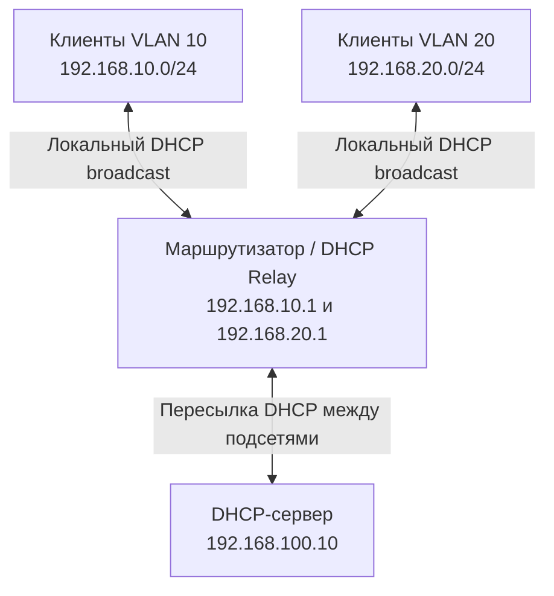
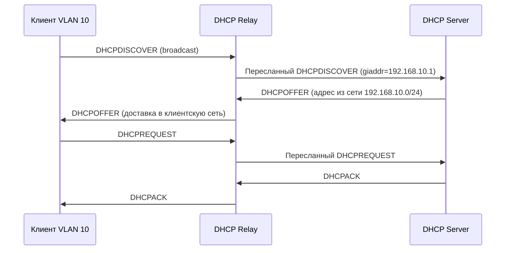

## 1. Назначение DHCP Relay

**DHCP Relay Agent (ретранслятор DHCP)** — функция маршрутизатора или отдельного узла, которая принимает DHCP-сообщения клиентов в одной подсети и пересылает их DHCP-серверу, расположенному в другой подсети.

**Проблема:** новый DHCP-клиент еще не имеет IP-адреса и обычно отправляет `DHCPDISCOVER` широковещательно (`255.255.255.255`, UDP 68 → 67). Маршрутизаторы по умолчанию **не пересылают широковещательные IP-пакеты** между подсетями. Поэтому сервер в другом VLAN не получит такой запрос напрямую.

**Решение:** DHCP Relay принимает запрос в клиентской подсети, отправляет его серверу и доставляет ответ обратно клиенту.

> [!important] Главное правило
> DHCP Relay **не раздает адреса из собственного пула**. Он помогает клиенту связаться с настоящим DHCP-сервером. Пулы, аренды, резервации и DHCP Options настраиваются на DHCP-сервере.

### 1.1. Где обычно работает Relay

- На L3-коммутаторе с интерфейсами VLAN (SVI).
- На маршрутизаторе, обслуживающем несколько подсетей.
- На Linux-машине, если она маршрутизирует трафик между сегментами.

В сетевом оборудовании эту функцию часто называют **DHCP Helper**, **IP Helper** или **DHCP Relay**.

## 2. Пример сети с двумя VLAN

Используем учебную схему (адреса условные):

| Устройство или сеть | Адрес | Назначение |
|---|---|---|
| VLAN 10 | `192.168.10.0/24` | Кабинет № 1 |
| VLAN 20 | `192.168.20.0/24` | Кабинет № 2 |
| Шлюз VLAN 10 | `192.168.10.1` | Интерфейс маршрутизатора |
| Шлюз VLAN 20 | `192.168.20.1` | Интерфейс маршрутизатора |
| DHCP-сервер | `192.168.100.10` | Единый сервер для обеих подсетей |



DHCP-сервер должен иметь маршрут обратно к сетям `192.168.10.0/24` и `192.168.20.0/24`. Межсетевой экран должен пропускать необходимый DHCP-трафик между Relay и сервером.

## 3. Как Relay участвует в DORA

Разберем получение адреса клиентом из VLAN 10.



1. Клиент отправляет `DHCPDISCOVER` в своем VLAN.
2. Relay принимает сообщение на интерфейсе VLAN 10.
3. Relay указывает свой адрес для этой клиентской сети в поле `giaddr` и пересылает запрос DHCP-серверу.
4. DHCP-сервер определяет, из какой подсети следует предложить адрес.
5. Сервер возвращает `DHCPOFFER` ретранслятору.
6. Relay доставляет предложение клиенту; затем аналогично проходят `DHCPREQUEST` и `DHCPACK`.

> [!note] Broadcast или unicast?
> Между Relay и DHCP-сервером обычно используется маршрутизируемый unicast. На участке Relay → клиент способ доставки зависит от DHCP-сообщения, флагов и состояния клиента: возможны broadcast и unicast. Поэтому утверждение «Relay всегда отвечает широковещательно» неверно.

## 4. Поле `giaddr`: как сервер выбирает подсеть

**`giaddr` (Gateway IP Address)** — поле DHCP/BOOTP-сообщения, которое Relay использует для указания адреса интерфейса, связанного с клиентской сетью.

Пример:

```text
DHCPDISCOVER
  Клиент: еще без IP
  VLAN: 10
  giaddr: 192.168.10.1
```

Сервер видит `giaddr=192.168.10.1` и выбирает конфигурацию подсети `192.168.10.0/24`. Для VLAN 20 Relay укажет `192.168.20.1`, поэтому сервер выберет другой пул.

**Не путать:**

- `giaddr` — служебное поле DHCP, нужное для ретрансляции и выбора подсети.
- **DHCP Option 3 (Router)** — адрес шлюза по умолчанию, который DHCP-сервер сообщает клиенту.

Часто значения совпадают (`192.168.10.1`), но их назначение различается. В сложных топологиях они могут не совпадать.

### 4.1. Другие важные поля

| Поле | Что означает |
|---|---|
| `chaddr` | Аппаратный адрес клиента в DHCP/BOOTP-сообщении |
| `xid` | Идентификатор транзакции, связывающий запрос и ответ |
| `yiaddr` | IP-адрес, предлагаемый или назначаемый клиенту |
| `ciaddr` | Текущий адрес клиента, когда он уже известен и применим |
| `giaddr` | Адрес ретранслятора для данного DHCP-обмена |
| `hops` | Счетчик прохождений через Relay |

## 5. DHCP Relay и Option 82

**DHCP Option 82 (Relay Agent Information Option)** — дополнительные сведения о том, откуда пришел DHCP-запрос. Relay может добавлять эту опцию при пересылке.

Распространенные подполя:

- **Circuit ID** — идентификатор порта, интерфейса или VLAN, через который подключен клиент.
- **Remote ID** — идентификатор устройства доступа или другой идентификатор, заданный оборудованием.

Например, коммутатор может сообщить серверу, что запрос поступил из `VLAN 10`, с определенного порта. Сервер может использовать это при выборе политики назначения адресов.

> [!warning] Безопасность Option 82
> Содержимому Option 82 нельзя безусловно доверять: его нужно принимать от доверенного сетевого оборудования. Обработка зависит от модели коммутатора, настроек Relay и DHCP-сервера.

**Отличие от `giaddr`:** `giaddr` прежде всего помогает выбрать сеть и маршрут ответа, а Option 82 передает дополнительные сведения о точке подключения.

## 6. DHCP Relay в Linux: лабораторный пример

Ниже — **учебная схема** для Linux-маршрутизатора на Ubuntu. Она предполагает, что сетевые интерфейсы, IP-адреса и маршрутизация уже настроены:

- `ens19` — клиентская сеть VLAN 10 (`192.168.10.1/24`);
- `ens20` — клиентская сеть VLAN 20 (`192.168.20.1/24`);
- `ens18` — интерфейс в сторону DHCP-сервера `192.168.100.10`.

Названия интерфейсов проверь командой:

```bash
ip -br addr
ip route
```

### 6.1. Установка

```bash
sudo apt update
sudo apt install isc-dhcp-relay
```

> [!warning] Примечание по реализации
> `isc-dhcp-relay` относится к семейству ISC DHCP, которое снято с поддержки upstream. Пример полезен для понимания принципа Relay и существующих систем. Для новой production-инфраструктуры выбирай поддерживаемую реализацию Relay в сетевом оборудовании либо актуальное программное решение.

В некоторых версиях Ubuntu установка пакета вызывает диалог настройки. Те же параметры можно задать в файле `/etc/default/isc-dhcp-relay`.

### 6.2. Настройка

```bash
sudo nano /etc/default/isc-dhcp-relay
```

Пример содержимого:

```bash
SERVERS="192.168.100.10"
INTERFACES="ens19 ens20 ens18"
OPTIONS=""
```

В некоторых версиях пакета используются переменные `INTERFACESv4` и `INTERFACESv6` вместо `INTERFACES`. Проверь шаблон `/etc/default/isc-dhcp-relay` именно своей установленной версии и настрой интерфейсы по нему. В список включены клиентские интерфейсы и интерфейс связи с сервером; точный набор зависит от реализации и топологии.

Перезапуск и проверка:

```bash
sudo systemctl restart isc-dhcp-relay
sudo systemctl status isc-dhcp-relay --no-pager
sudo journalctl -u isc-dhcp-relay -n 50 --no-pager
```

**Важно:** Relay не заменяет настройку IP-маршрутизации. У сервера должен быть маршрут к адресам Relay, а на промежуточных узлах должны разрешаться нужные пакеты UDP 67 (и в клиентских сегментах — DHCP 67/68).

### 6.3. Что должно быть на DHCP-сервере

DHCP-серверу нужны отдельные настройки для обеих клиентских подсетей. Следующий фрагмент **показывает логику ISC DHCP, но не является полной конфигурацией сервера**:

```conf
subnet 192.168.10.0 netmask 255.255.255.0 {
    range 192.168.10.100 192.168.10.200;
    option routers 192.168.10.1;
    option domain-name-servers 192.168.100.53;
}

subnet 192.168.20.0 netmask 255.255.255.0 {
    range 192.168.20.100 192.168.20.200;
    option routers 192.168.20.1;
    option domain-name-servers 192.168.100.53;
}
```

Если сервер физически находится в сети `192.168.100.0/24`, его локальный интерфейс и конфигурацию этой сети тоже нужно учитывать. Полная настройка ISC DHCP и Kea будет разобрана в соответствующих разделах.

## 7. DHCP Relay на маршрутизаторах

На сетевом оборудовании Relay обычно включается **на интерфейсе клиентского VLAN**, а не на DHCP-сервере.

Пример **Cisco IOS-подобного** синтаксиса:

```text
interface Vlan10
 ip address 192.168.10.1 255.255.255.0
 ip helper-address 192.168.100.10

interface Vlan20
 ip address 192.168.20.1 255.255.255.0
 ip helper-address 192.168.100.10
```

Это пример синтаксиса для конкретного семейства оборудования, а не универсальная команда для всех маршрутизаторов. В Cisco `ip helper-address` может пересылать не только DHCP, поэтому дополнительные протоколы и параметры нужно контролировать отдельно.

## 8. Диагностика DHCP Relay

### 8.1. Проверить интерфейсы и маршруты

На Relay:

```bash
ip -br addr
ip route get 192.168.100.10
```

На DHCP-сервере проверь обратный маршрут, например к `192.168.10.1`:

```bash
ip route get 192.168.10.1
```

### 8.2. Увидеть DHCP-пакеты

На клиентском интерфейсе Relay:

```bash
sudo tcpdump -ni ens19 -vv 'udp port 67 or udp port 68'
```

На интерфейсе Relay в сторону сервера:

```bash
sudo tcpdump -ni ens18 -vv 'udp port 67 or udp port 68'
```

На DHCP-сервере:

```bash
sudo tcpdump -ni any -vv 'udp port 67 or udp port 68'
```

В подробном выводе ищи DHCP Message Type и поле `Gateway-IP`/`giaddr` (название зависит от версии `tcpdump`).

### 8.3. Типовые проблемы

| Симптом | Возможная причина | Что проверить |
|---|---|---|
| Клиент отправляет Discover, но сервер его не видит | Relay выключен, выбран неверный интерфейс, firewall | Служба Relay, `tcpdump` на обоих интерфейсах, ACL |
| Сервер видит Discover, но не предлагает адрес | Нет подходящей подсети или свободных адресов | `giaddr`, конфигурация subnet/pool, журнал сервера |
| Сервер отвечает, но клиент не получает Offer | Ошибка маршрута или блокировка обратного трафика | Маршрут к Relay, firewall, `tcpdump` на Relay |
| Клиент получает адрес не из того VLAN | Неверный `giaddr` или конфигурация Relay/серверных пулов | Интерфейс приема, поле `giaddr`, настройки subnet |
| Часть клиентов работает, часть — нет | Проблема конкретного VLAN, Option 82, DHCP Snooping | Конфигурация VLAN, trust-порты, Relay и Option 82 |

> [!tip] Метод диагностики
> Иди по пути пакета: **клиент → Relay (клиентский интерфейс) → DHCP-сервер → Relay → клиент**. На каждом участке ищи, где сообщение перестало проходить.

## 9. Безопасность и эксплуатация

1. Разрешай DHCP Relay пересылать запросы только на известные DHCP-серверы.
2. Ограничивай доступ к UDP 67/68 на границах сети с учетом направления и роли узла.
3. Используй DHCP Snooping на поддерживаемых коммутаторах, чтобы снижать риск появления посторонних DHCP-серверов.
4. Учитывай, что DHCP Relay сам по себе **не шифрует** DHCP и не подтверждает личность клиента.
5. Документируй соответствие VLAN → подсеть → шлюз → пул на DHCP-сервере.
6. Для критичных сетей планируй резервирование DHCP-сервера и самой функции Relay, учитывая возможности оборудования.

---
## Вопросы для самопроверки

1. Почему DHCP Discover не проходит через обычный маршрутизатор без Relay?
2. Чем DHCP Relay отличается от DHCP-сервера?
3. Для чего предназначено поле `giaddr`?
4. Чем `giaddr` отличается от DHCP Option 3?
5. Как DHCP-сервер определяет, из какой подсети выделить адрес клиенту?
6. Зачем нужна DHCP Option 82 и какие риски связаны с доверием к ней?
7. На каком интерфейсе маршрутизатора обычно настраивают DHCP Relay?
8. Почему корректный прямой маршрут к серверу недостаточен без обратного маршрута?
9. Какие два места захвата пакетов помогут найти неисправность Relay?
10. Может ли Relay сам назначить клиенту IP-адрес?

---
## Краткий итог

- DHCP Relay нужен, когда DHCP-клиент и сервер находятся **в разных подсетях**.
- Relay принимает локальные DHCP-сообщения и пересылает их удаленному серверу.
- Поле `giaddr` помогает серверу выбрать правильную клиентскую подсеть и отправить ответ.
- Option 82 может передавать дополнительные сведения о точке подключения.
- Для работы необходимы корректные маршруты, правила firewall и настройки DHCP-пулов.
- Практическую диагностику удобнее проводить через `tcpdump` последовательно на каждом участке.

---

#DHCP #DHCP-Relay #Сети #VLAN #Маршрутизация #Linux #DevOps
