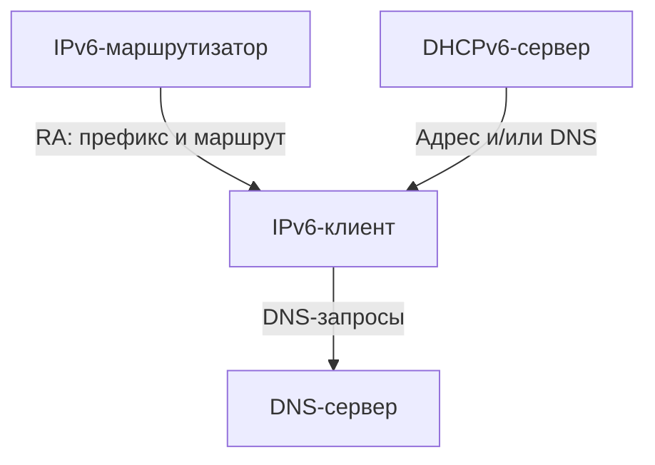
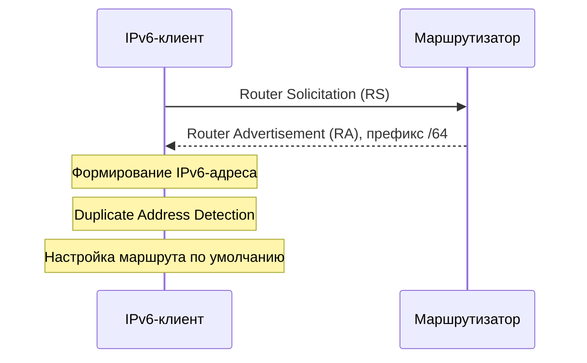
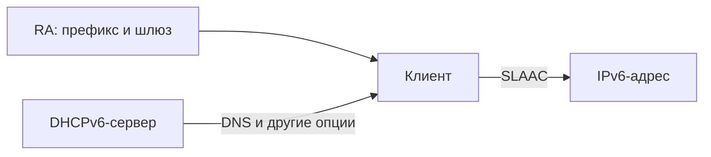
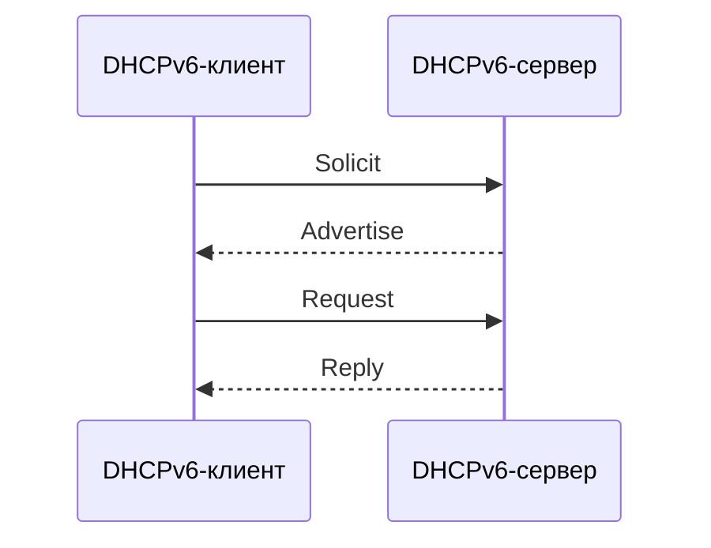

## 1. Зачем нужен DHCPv6

**DHCPv6 (Dynamic Host Configuration Protocol for IPv6)** — протокол, с помощью которого узел может получать IPv6-адреса, DNS-серверы и другие параметры сети от DHCPv6-сервера.

В IPv4 для автоматической настройки чаще всего достаточно DHCPv4: сервер выдает адрес, маску, шлюз и DNS. В IPv6 функции разделены между несколькими механизмами:

- **Router Advertisement (RA)** — сообщения маршрутизатора с информацией о сети и маршруте по умолчанию.
- **SLAAC** — самостоятельное формирование IPv6-адреса на основе информации из RA.
- **DHCPv6** — выдача адресов и/или дополнительных параметров через отдельный сервер.

> [!important] Ключевое отличие от DHCPv4
> **Стандартный DHCPv6 не выдает адрес шлюза по умолчанию.** Обычно маршрут по умолчанию клиент узнает из RA. Поэтому наличие DHCPv6-сервера само по себе не заменяет маршрутизатор, рассылающий RA.

### 1.1. Основные участники

| Компонент | Задача |
|---|---|
| IPv6-клиент | Получает или формирует адрес и сетевые параметры |
| IPv6-маршрутизатор | Рассылает RA и сообщает о маршруте по умолчанию |
| DHCPv6-сервер | Выдает адреса и/или дополнительные параметры |
| DHCPv6 Relay | Пересылает запросы между разными IPv6-сегментами |
| DNS-сервер | Разрешает доменные имена в IP-адреса |



## 2. Базовые IPv6-адреса

**Link-local адрес** — адрес из диапазона `fe80::/10`, предназначенный для взаимодействия в пределах одного канального сегмента. Он обычно появляется на IPv6-интерфейсе автоматически и используется, в частности, для обмена RA.

**Global Unicast Address (GUA)** — глобально маршрутизируемый IPv6-адрес, обычно из пространства `2000::/3`.

**Unique Local Address (ULA)** — адрес для внутренней сети из диапазона `fc00::/7`; на практике обычно используются локально сгенерированные префиксы `fd00::/8`.

Пример учебной сети:

```text
Маршрутизатор: 2001:db8:10::1/64
Префикс VLAN 10: 2001:db8:10::/64
Клиент:       2001:db8:10::25/64
Link-local:   fe80::abcd:1234
```

`2001:db8::/32` зарезервирован для документации — его нельзя использовать как реальную глобальную адресацию в рабочей сети.

> [!note] Почему часто /64?
> Для обычных сетей с SLAAC используется префикс `/64`: устройство формирует 64-битный идентификатор интерфейса и объединяет его с 64-битным сетевым префиксом.

## 3. Router Advertisement и Neighbor Discovery

**Neighbor Discovery Protocol (NDP)** — набор механизмов ICMPv6 для обнаружения соседей, маршрутизаторов и сетевых префиксов. Сообщения RA и Router Solicitation (RS) входят в NDP.

- **RS (Router Solicitation)** — клиент запрашивает сведения у маршрутизаторов.
- **RA (Router Advertisement)** — маршрутизатор сообщает сведения о сети.
- **Prefix Information Option (PIO)** — опция RA с IPv6-префиксом и флагами, влияющими на его использование.
- **Router Lifetime** — время, в течение которого отправитель RA может считаться маршрутизатором по умолчанию.

RA может содержать префиксы, MTU, параметры маршрутизатора, а также DNS-информацию через RDNSS/DNSSL, если это поддерживается маршрутизатором и клиентом.

### 3.1. Флаги M и O

| Флаг | Название | Смысл |
|---|---|---|
| `M` | Managed Address Configuration | Указывает, что адресную конфигурацию можно получать через DHCPv6 |
| `O` | Other Configuration | Указывает, что дополнительные параметры доступны через DHCPv6 |

**Флаг A (Autonomous)** относится не ко всему RA, а к конкретному префиксу в PIO. Если `A=1`, клиент может использовать этот префикс для SLAAC.

> [!warning] Не путайте флаги
> `M` и `O` не являются жесткими командами, которые гарантируют одинаковое поведение всех ОС. Возможность SLAAC зависит от `A` в PIO. Разные клиенты могут по-разному поддерживать DHCPv6 и DNS из RA.

## 4. SLAAC — автоматическая адресация без DHCPv6

**SLAAC (Stateless Address Autoconfiguration)** — механизм, при котором устройство само создает IPv6-адрес, используя префикс из RA.

Пример последовательности:

1. Клиент подключается к сети и создает link-local адрес.
2. Клиент получает RA от маршрутизатора (или сначала отправляет RS).
3. В RA находится префикс `2001:db8:10::/64` с `A=1`.
4. Клиент формирует адрес, например `2001:db8:10::a1b2`.
5. Проверяет отсутствие конфликта адреса с помощью Duplicate Address Detection (DAD).
6. Использует маршрут по умолчанию, полученный из RA.



> [!tip] Практическая особенность
> Современные ОС часто используют стабильные непрозрачные идентификаторы или временные privacy-адреса, а не напрямую MAC-адрес. Поэтому не стоит ожидать, что IPv6-адрес обязательно содержит MAC устройства.

## 5. Stateless DHCPv6

**Stateless DHCPv6** — режим, в котором адрес клиент формирует через SLAAC, а DHCPv6 используется для получения дополнительных параметров, например DNS-серверов.

Типичная схема:

- RA: `A=1`, `M=0`, `O=1`.
- SLAAC: формирует IPv6-адрес.
- DHCPv6: предоставляет дополнительные параметры через обмен `Information-request` → `Reply`.
- RA: сообщает маршрут по умолчанию.



**Важный нюанс:** DNS может передаваться и через RA (RDNSS), без DHCPv6. Не все клиентские ОС одинаково используют Stateless DHCPv6.

## 6. Stateful DHCPv6

**Stateful DHCPv6** — режим, при котором DHCPv6-сервер назначает клиенту IPv6-адрес и учитывает выданные назначения.

Типичная схема:

- RA: `M=1`, часто `O=1`.
- DHCPv6-сервер: выдает IPv6-адрес и дополнительные параметры.
- RA: по-прежнему сообщает маршрут по умолчанию.
- Если в PIO включен `A=1`, клиент может дополнительно сформировать SLAAC-адрес — Stateful DHCPv6 не обязательно исключает SLAAC.

### 6.1. Обмен сообщениями

Типичный четырехэтапный обмен DHCPv6:

1. **Solicit** — клиент ищет DHCPv6-серверы.
2. **Advertise** — сервер предлагает параметры.
3. **Request** — клиент запрашивает параметры у выбранного сервера.
4. **Reply** — сервер подтверждает назначение.



При определенных условиях возможен ускоренный двухсообщенческий обмен Rapid Commit (`Solicit` → `Reply`). Также существуют Renew, Rebind, Release, Decline и другие сообщения.

### 6.2. Сравнение трех вариантов

| Параметр | SLAAC | Stateless DHCPv6 | Stateful DHCPv6 |
|---|---|---|---|
| Источник адреса | Клиент по RA | Клиент по RA | DHCPv6-сервер |
| DNS | RA или другой способ | Обычно DHCPv6, возможно RA | DHCPv6 и/или RA |
| Шлюз по умолчанию | RA | RA | RA |
| Сервер ведет учет выданных адресов | Нет | Нет | Да |
| Типичный сценарий | Простая сеть | SLAAC + централизованные опции | Управляемая выдача адресов |

## 7. DUID и IAID

В DHCPv4 для идентификации клиента часто используют MAC-адрес. В DHCPv6 ключевую роль играет **DUID (DHCP Unique Identifier)**.

**DUID** — идентификатор DHCPv6-клиента или сервера. Он не обязан совпадать с MAC-адресом и может сохраняться при замене сетевого интерфейса.

**IAID (Identity Association Identifier)** — 32-битный идентификатор конкретной группы назначений внутри клиента, позволяющий различать назначения для разных интерфейсов или конфигураций.

Упрощенно:

```text
DHCPv6-клиент
├── DUID: идентификатор устройства/клиента
├── IAID 1: назначения интерфейса enp1s0
└── IAID 2: назначения интерфейса enp2s0
```

В реальном протоколе используются Identity Associations, например IA_NA для непостоянных (non-temporary) адресов и IA_PD для делегирования префиксов.

> [!important] Практическое следствие
> При создании резерваций DHCPv6 нельзя бездумно переносить подход «MAC → IP» из DHCPv4. Конкретный сервер может опираться на DUID, IAID и другие идентификаторы.

## 8. Префиксная делегация DHCPv6-PD

**Prefix Delegation (PD)** — выдача не одного IPv6-адреса, а целого префикса маршрутизатору-клиенту, например `/56` или `/60`.

Пример:

```text
Провайдер → домашний маршрутизатор: 2001:db8:1200:3400::/56
Маршрутизатор → LAN 1:           2001:db8:1200:3401::/64
Маршрутизатор → LAN 2:           2001:db8:1200:3402::/64
```

Это особенно полезно для маршрутизаторов с несколькими локальными сетями. **IA_PD** относится к делегированию префикса, а **IA_NA** — к назначению адреса интерфейсу.

## 9. DHCPv6 Relay и транспорт

DHCPv6 использует UDP:

| Сторона | UDP-порт |
|---|---|
| Клиент | 546 |
| Сервер или Relay | 547 |

Для обращения к серверам и relay используются IPv6 multicast-адреса, в том числе `ff02::1:2` (All_DHCP_Relay_Agents_and_Servers). **DHCPv6 не использует IPv4 broadcast**.

Если сервер расположен в другой подсети, DHCPv6 Relay пересылает запросы между сегментами с использованием сообщений Relay-forward и Relay-reply. Конкретные интерфейсы и адреса relay зависят от сетевой топологии.


## 10. Особенности клиентских ОС

Не все операционные системы одинаково поддерживают DHCPv6:

- **Linux**: возможности зависят от NetworkManager, systemd-networkd и конфигурации интерфейса.
- **Windows**: поддерживает DHCPv6 и SLAAC; детали зависят от настроек и версии.
- **Android**: обычно использует SLAAC и DNS из RA, не поддерживая классическое назначение IPv6-адресов через Stateful DHCPv6.

Поэтому сеть, в которой адрес можно получить **только через Stateful DHCPv6**, может оказаться несовместимой с частью мобильных устройств.

> [!warning] Проектирование
> Не рассчитывайте, что установка `M=1` автоматически заставит все устройства получать IPv6-адрес через DHCPv6. Для смешанной клиентской сети обычно важно корректно настроить RA и SLAAC.

## 11. Практика: исследуем IPv6 в Linux

Команды ниже безопасны для наблюдения. Для изменения настроек интерфейса используйте отдельную лабораторную VM.

### 11.1. Посмотреть IPv6-адреса

```bash
ip -6 address show
```

Для конкретного интерфейса:

```bash
ip -6 address show dev enp1s0
```

Обратите внимание на `scope link` (link-local) и `scope global` (GUA или ULA).

### 11.2. Проверить IPv6-маршруты

```bash
ip -6 route show
```

Пример:

```text
default via fe80::1 dev enp1s0 proto ra metric 1024
2001:db8:10::/64 dev enp1s0 proto ra metric 256
```

Маршрут по умолчанию с `proto ra` показывает, что он был получен через Router Advertisement.

### 11.3. Посмотреть соседей NDP

```bash
ip -6 neigh show
```

### 11.4. Проверить DNS

```bash
resolvectl status
```

Учитывайте, что команда показывает итоговую DNS-конфигурацию, но сама по себе не всегда позволяет однозначно установить, пришел DNS через RA, DHCPv6 или статическую настройку.

### 11.5. Захватить RA и DHCPv6

В одном терминале:

```bash
sudo tcpdump -ni enp1s0 -vv 'icmp6 or udp port 546 or udp port 547'
```

Для записи в файл:

```bash
sudo tcpdump -ni enp1s0 -w ipv6-dhcp.pcap 'icmp6 or udp port 546 or udp port 547'
```

Откройте файл в Wireshark и найдите Router Solicitation, Router Advertisement, Solicit, Advertise, Request и Reply. Не все сообщения обязательно будут присутствовать: это зависит от режима сети.

### 11.6. Проверить настройки NetworkManager

```bash
nmcli device status
nmcli -f GENERAL,IP6 device show enp1s0
nmcli connection show
```

Посмотреть IPv6-метод конкретного профиля:

```bash
nmcli -g ipv6.method connection show "Имя подключения"
```

`ipv6.method auto` обычно позволяет использовать автоматическую настройку IPv6 на основе RA и, при соответствующих условиях, DHCPv6. Конкретное поведение зависит от версии и дополнительных параметров профиля.

### 11.7. Проверить systemd-networkd

Если система использует systemd-networkd:

```bash
networkctl status enp1s0
journalctl -u systemd-networkd -b --no-pager
```

Не меняйте одновременно конфигурацию NetworkManager и systemd-networkd для одного интерфейса: сначала определите, какой сервис управляет сетью.

## 12. Типичные ошибки и диагностика

| Симптом | Возможная причина | Что проверить |
|---|---|---|
| Есть `fe80::`, но нет глобального IPv6 | Нет подходящего RA или адресной конфигурации | `tcpdump`, флаги RA, PIO, настройки клиента |
| Есть IPv6-адрес, но нет выхода в сеть | Нет маршрута по умолчанию или маршрутизации | `ip -6 route`, RA, firewall |
| DHCPv6 выдал адрес, но нет шлюза | Ожидание шлюза от DHCPv6 | Наличие RA и Router Lifetime |
| Нет DNS | Не передается DNS через RA/DHCPv6 или клиент его не принимает | RDNSS, DHCPv6 Options, `resolvectl` |
| Windows работает, Android — нет | Сеть полагается только на Stateful DHCPv6 | SLAAC и RA с корректным PIO |
| DHCPv6 работает в одном VLAN, но не в другом | Нет DHCPv6 Relay или проблемы маршрутизации | Relay, UDP 546/547, firewall |
| Адрес появился и исчез | Ошибка DAD или истечение времени жизни | `ip -6 addr`, логи NDP и RA |

> [!tip] Минимальный алгоритм диагностики
> **Адрес → RA → маршрут → DNS → DHCPv6 → firewall.** Начните с `ip -6 addr` и `ip -6 route`, затем посмотрите RA и DHCPv6 в `tcpdump`.

---
## Вопросы для самопроверки

1. Почему в IPv6 DHCPv6 не заменяет Router Advertisement?
2. Чем отличается SLAAC от Stateful DHCPv6?
3. Что делает Stateless DHCPv6?
4. В чем разница между флагами M/O и флагом A?
5. Почему DHCPv6 не использует IPv4 broadcast?
6. Какие UDP-порты используются в DHCPv6?
7. Чем DUID отличается от MAC-адреса?
8. Зачем нужен IAID?
9. Что такое DHCPv6-PD и IA_PD?
10. Почему сеть только со Stateful DHCPv6 может вызвать проблемы у Android-клиентов?

---

## Краткие выводы

- **RA** сообщает маршрутизатор по умолчанию и сведения о сети.
- **SLAAC** позволяет клиенту сформировать адрес без DHCPv6-сервера.
- **Stateless DHCPv6** обычно предоставляет дополнительные параметры, а адрес формируется через SLAAC.
- **Stateful DHCPv6** позволяет серверу назначать и учитывать IPv6-адреса.
- **DUID и IAID** используются для идентификации клиента и назначений.
- **DHCPv6-PD** предназначен для выдачи маршрутизаторам целых IPv6-префиксов.
- При проектировании IPv6 нужно учитывать поддержку RA, SLAAC и DHCPv6 конкретными ОС.

---

#DHCP #DHCPv6 #IPv6 #SLAAC #RouterAdvertisement #NDP #Linux #Networking
