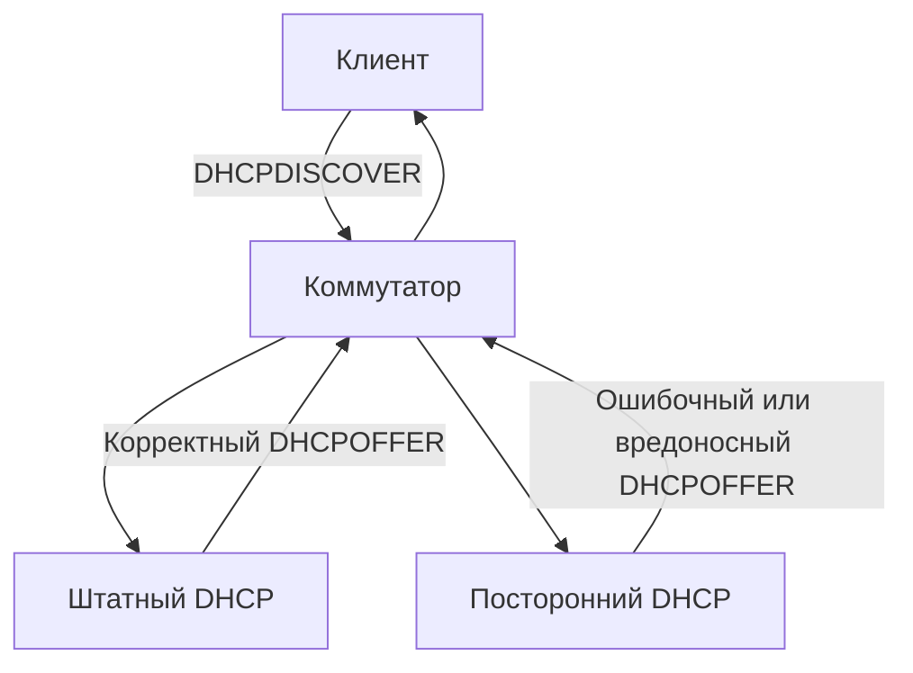
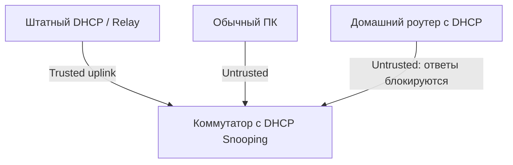

## 1. Назначение и модель угроз

**Безопасность DHCP** — совокупность мер, которые не позволяют посторонним устройствам выдавать сетевые параметры, исчерпывать пул адресов или нарушать получение корректной конфигурации клиентами.

DHCPv4 изначально рассчитан на доверенную локальную сеть: клиент, который еще не получил IP-адрес, обращается к DHCP-серверам в сегменте. По умолчанию клиент не проверяет криптографически подлинность DHCP-сервера. Поэтому устройство в том же широковещательном домене может попытаться ответить на запрос клиента раньше легитимного сервера.

**Границы этой заметки:** здесь рассматриваются угрозы именно для DHCP и практические способы защиты. Подробный обмен сообщениями вынесен в [[Synced/DevOps/Сетевое и системное администрирование/2. Сети/5. Сетевые сервисы (L7)/2. DHCP/0. Теория и принципы работы/2. Протокол DHCPv4 и процесс DORA|Протокол DHCPv4 и процесс DORA]], а работа между VLAN — в [[Synced/DevOps/Сетевое и системное администрирование/2. Сети/5. Сетевые сервисы (L7)/2. DHCP/0. Теория и принципы работы/4. DHCP Relay и работа между подсетями|DHCP Relay и работа между подсетями]].

### Что нужно защищать

| Объект | Возможная проблема | Последствие |
|---|---|---|
| DHCP-клиент | Получил параметры от чужого сервера | Неверный шлюз, DNS или адрес |
| DHCP-сервер | Массовые запросы и исчерпание пула | Новые клиенты не получают адрес |
| Коммутатор и сегмент VLAN | Нет разграничения доверенных портов | Неавторизованные DHCP-ответы доходят до клиентов |
| DHCP Relay | Ошибочная настройка или недоверенный источник | Запросы направляются не туда или неверно классифицируются |
| Администратор | Нет мониторинга изменений | Инцидент обнаруживается только по жалобам |

## 2. Rogue DHCP Server — посторонний DHCP-сервер

**Rogue DHCP Server** — DHCP-сервер, не разрешенный администратором сети. Он может появиться как по ошибке (домашний роутер подключили LAN-портом к сети), так и намеренно.

### Пример

В аудитории работает легитимный DHCP-сервер `10.28.250.6`. Пользователь подключил к сети домашний маршрутизатор с включенным DHCP. Оба устройства отвечают на запросы. Часть клиентов получает неверные параметры.



Клиент может выбрать предложение постороннего сервера. Наличие нескольких ответов **само по себе не доказывает атаку**: в некоторых сетях несколько DHCP-серверов работают намеренно.

**Возможные последствия:**

- неправильный шлюз по умолчанию;
- неверные DNS-серверы;
- выдача адреса из чужой подсети;
- перенаправление части трафика через подконтрольный узел;
- потеря доступа к сети.

> [!warning] Важно
> Подмена DNS или шлюза создает условия для перехвата или перенаправления трафика, но не означает автоматическую расшифровку корректно защищенных HTTPS-соединений.

### Как защищаться

Основная мера в управляемой коммутируемой сети — **DHCP Snooping**: коммутатор пропускает DHCP-ответы сервера только с доверенных портов. Дополнительно нужны контроль физических подключений, сегментация VLAN и инвентаризация оборудования.

## 3. DHCP Starvation — исчерпание адресного пула

**DHCP Starvation** — ситуация, когда большое количество запросов на аренду адресов приводит к исчерпанию доступного пула. Это может быть атакой либо результатом некорректной работы клиентов и автоматизации.

Пример: в пуле 100 адресов. Если сервер считает все 100 адресов занятыми, новый клиент не сможет получить адрес, пока не освободится подходящая аренда.


**Защита:** ограничение числа MAC-адресов на порту, DHCP Snooping rate limiting, 802.1X или NAC при наличии, контроль размера пула, мониторинг аренд и аномалий. Одного увеличения пула недостаточно: это лишь отсрочит проблему.

> [!note] DHCP Snooping не равен полной защите от Starvation
> Snooping блокирует неавторизованные серверные ответы и может ограничивать интенсивность DHCP-пакетов, но защита от подмены идентификаторов клиентов и массовых запросов зависит также от функций конкретного коммутатора и политики доступа к портам.

## 4. DHCP Snooping: доверенные и недоверенные порты

**DHCP Snooping** — функция управляемого коммутатора, которая проверяет DHCP-трафик и различает доверенные (`trusted`) и недоверенные (`untrusted`) порты.

- **Trusted:** порт, откуда допустимы серверные DHCP-ответы (обычно uplink к авторизованному серверу или Relay).
- **Untrusted:** пользовательский порт; ответы от DHCP-сервера, подключенного к нему, блокируются.



### Пример для Cisco IOS (учебный)

> [!warning] Перед применением
> Синтаксис и поведение зависят от модели, версии IOS и топологии. Не включайте Snooping без определения всех портов, через которые действительно приходят ответы DHCP-сервера или Relay: можно нарушить выдачу адресов во всей VLAN.

```text
configure terminal
ip dhcp snooping
ip dhcp snooping vlan 10,20
!
interface GigabitEthernet1/0/24
 description Uplink-to-authorized-DHCP-or-relay
 ip dhcp snooping trust
!
interface range GigabitEthernet1/0/1 - 23
 ip dhcp snooping limit rate 15
end
```

Здесь порт `Gi1/0/24` считается доверенным, а клиентские порты остаются недоверенными по умолчанию. Лимит `15` — **только учебный пример**, а не универсальная рекомендуемая величина: подбирается под реальную нагрузку.

Проверка:

```text
show ip dhcp snooping
show ip dhcp snooping binding
```

**Таблица DHCP Snooping Binding** может связывать MAC, IP, VLAN, порт и срок аренды. На ее основе некоторые платформы реализуют дополнительные механизмы защиты (например, Dynamic ARP Inspection и IP Source Guard). Это отдельные функции, их настройка выходит за рамки этой заметки.

### DHCP Relay и Option 82

Коммутатор с Snooping может добавлять **Option 82** (сведения о точке подключения). Однако это зависит от оборудования и конфигурации. Сервер/Relay должны корректно обрабатывать такой параметр; иначе DHCP может перестать работать.

Подробнее: [[Synced/DevOps/Сетевое и системное администрирование/2. Сети/5. Сетевые сервисы (L7)/2. DHCP/0. Теория и принципы работы/4. DHCP Relay и работа между подсетями|DHCP Relay и работа между подсетями]].

## 5. Защита самого DHCP-сервера

Даже при наличии Snooping необходимо защищать ОС и серверное приложение.

1. **Ограничьте доступ к администрированию.** SSH только с административных адресов, персональные учетные записи, минимум прав.
2. **Обновляйте поддерживаемое ПО.** ISC DHCP является устаревшей реализацией; для нового развертывания целесообразно рассматривать Kea.
3. **Ограничьте интерфейсы прослушивания.** DHCP должен работать только в нужных сегментах и интерфейсах.
4. **Не открывайте UDP 67/68 в Интернет.** Эти порты нужны для DHCP в предусмотренных сетевых сегментах и через настроенный Relay.
5. **Контролируйте конфигурацию.** Храните изменения в системе контроля версий, проверяйте конфигурацию перед перезапуском.
6. **Ведите журналы и наблюдайте за пулом.** Важны неожиданные всплески запросов, частые отказы и быстрое сокращение свободных адресов.
7. **Делайте резервные копии.** Конфигурация, параметры резерваций и при необходимости состояние аренд должны восстанавливаться предсказуемо.

Практические особенности конкретных серверов будут разобраны отдельно в разделах `1. ISC DHCP Server` и `2. Kea DHCP Server`.

## 6. Диагностика в Linux

### 6.1. Найти DHCP-пакеты

На клиенте или на сервере (с учетом доступности трафика на интерфейсе):

```bash
sudo tcpdump -ni enp1s0 -vvv 'udp port 67 or udp port 68'
```

**Что смотреть:** кто отправляет DHCPOFFER/DHCPACK, какие адреса серверов указаны, какие параметры предлагаются клиенту.

> [!tip] Захват на клиенте
> Если в одном VLAN работают несколько DHCP-серверов, захват трафика на клиентском интерфейсе во время обновления аренды может показать несколько DHCPOFFER. Не запускайте сброс сетевого подключения на удаленной машине без резервного доступа.

### 6.2. Проверить параметры, полученные клиентом

```bash
ip -4 address show
ip -4 route show
resolvectl status
```

Если используется NetworkManager:

```bash
nmcli -f GENERAL,IP4 device show enp1s0
```

Проверьте, соответствует ли адрес нужной подсети, правильны ли маршрут по умолчанию и DNS-серверы. О самих механизмах адресации и маршрутизации см. профильный раздел `Synced/DevOps/Сетевое и системное администрирование/2. Сети/3. Сетевой уровень (L3)/1. IP адресация и маршрутизация` (точный файл в этом разделе здесь не указан, поэтому wiki-ссылка не создается).

### 6.3. Посмотреть системные журналы

```bash
sudo journalctl -u isc-dhcp-server --since '30 minutes ago'
```

Или для Kea (имя unit зависит от пакета и дистрибутива):

```bash
systemctl list-units '*kea*'
sudo journalctl -u kea-dhcp4-server --since '30 minutes ago'
```

Обращайте внимание на сообщения об исчерпании пула, некорректных запросах, отказах выдачи адреса и ошибках конфигурации.

## 7. Типовые ситуации и действия администратора

| Симптом | Возможная причина | Что проверить |
|---|---|---|
| Часть ПК получает неверный шлюз | Посторонний DHCP-сервер | Источник DHCPOFFER, trusted-порты, подключенные роутеры |
| Новые ПК не получают адреса | Исчерпание пула или массовые запросы | Свободные адреса, leases, счетчики Snooping |
| После включения Snooping DHCP перестал работать | Не помечен доверенный uplink | Путь ответов DHCP-сервера/Relay, trusted-порты |
| Адреса выдаются, но DNS не работает | Неверная DHCP Option для DNS | Полученные клиентом DNS-серверы и конфигурацию DHCP |
| Проблема только в одной VLAN | Relay, ACL или Snooping на конкретной VLAN | VLAN, giaddr, путь до сервера, конфигурацию коммутатора |

---
## Вопросы для самопроверки

1. Почему DHCPv4 особенно уязвим к появлению постороннего сервера в одном VLAN?
2. Чем случайно подключенный домашний роутер отличается от намеренной атаки Rogue DHCP с точки зрения симптомов?
3. Что такое DHCP Starvation и почему увеличение пула не является полноценной защитой?
4. Чем отличается trusted-порт от untrusted-порта в DHCP Snooping?
5. Почему после неправильного включения Snooping клиенты могут перестать получать адреса?
6. Какие сведения дает таблица DHCP Snooping Binding?
7. Какой командой в Linux можно наблюдать DHCPOFFER и DHCPACK?
8. Почему необходимо защищать и DHCP-сервер, и сетевые коммутаторы?
9. Как DHCP Relay влияет на выбор доверенных портов?
10. Почему наличие двух DHCPOFFER не всегда означает атаку?

---
## Глоссарий

| Термин | Определение |
|---|---|
| **Rogue DHCP Server** | Неавторизованный DHCP-сервер, выдающий клиентам сетевые параметры |
| **DHCP Starvation** | Исчерпание доступных адресов вследствие большого количества аренд или запросов |
| **DHCP Snooping** | Функция коммутатора для проверки DHCP-трафика и блокировки недоверенных серверных ответов |
| **Trusted Port** | Порт коммутатора, с которого разрешено принимать серверные DHCP-сообщения |
| **Untrusted Port** | Порт коммутатора, с которого серверные DHCP-ответы обычно блокируются |
| **DHCP Snooping Binding** | Таблица соответствий IP, MAC, VLAN, порта и параметров аренды |
| **Rate Limiting** | Ограничение частоты пакетов или запросов для снижения риска перегрузки |
| **Option 82** | DHCP Relay Agent Information Option, позволяющая передать информацию о точке подключения клиента |
| **DHCP Relay** | Посредник, пересылающий DHCP-сообщения между разными IP-подсетями |
| **VLAN** | Логический сегмент сети второго уровня |
| **NAC** | Network Access Control — контроль допуска устройств к сети |
| **802.1X** | Стандарт контроля доступа к сети с аутентификацией устройств или пользователей |
| **DHCPACK** | Подтверждение параметров аренды DHCP-сервером |
| **DHCPOFFER** | Предложение параметров аренды от DHCP-сервера |

---
## Связанные заметки

- [[Synced/DevOps/Сетевое и системное администрирование/2. Сети/5. Сетевые сервисы (L7)/2. DHCP/0. Теория и принципы работы/1. Архитектура и назначение DHCP|Архитектура и назначение DHCP]] — компоненты DHCP и назначение протокола.
- [[Synced/DevOps/Сетевое и системное администрирование/2. Сети/5. Сетевые сервисы (L7)/2. DHCP/0. Теория и принципы работы/2. Протокол DHCPv4 и процесс DORA|Протокол DHCPv4 и процесс DORA]] — последовательность обмена сообщениями.
- [[Synced/DevOps/Сетевое и системное администрирование/2. Сети/5. Сетевые сервисы (L7)/2. DHCP/0. Теория и принципы работы/3. DHCP-адресация, аренда и параметры|DHCP-адресация, аренда и параметры]] — пулы, аренды, резервации и DHCP Options.
- [[Synced/DevOps/Сетевое и системное администрирование/2. Сети/5. Сетевые сервисы (L7)/2. DHCP/0. Теория и принципы работы/4. DHCP Relay и работа между подсетями|DHCP Relay и работа между подсетями]] — DHCP между VLAN и Option 82.
- [[Synced/DevOps/Сетевое и системное администрирование/2. Сети/5. Сетевые сервисы (L7)/2. DHCP/0. Теория и принципы работы/5. DHCPv6 и взаимодействие с IPv6|DHCPv6 и взаимодействие с IPv6]] — особенности DHCP в IPv6.

---

#DHCP #NetworkSecurity #DHCPSnooping #RogueDHCP #NetworkAdministration #DevOps
