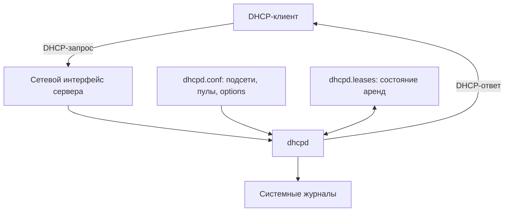

## 1. Назначение и статус проекта

**ISC DHCP** — классическая реализация DHCP-сервера от Internet Systems Consortium (ISC). Ее основной серверный процесс — **`dhcpd`**. Он принимает запросы клиентов, выбирает доступный адрес, передает параметры сети и учитывает выданные аренды.

> [!warning] Статус поддержки
> ISC DHCP достиг конца жизненного цикла (End of Life) в октябре 2022 года. Для новых развертываний ISC рекомендует **Kea DHCP**. ISC DHCP полезно изучать для поддержки действующих инфраструктур, чтения старых конфигураций и понимания принципов работы DHCP-сервера. Не следует считать его предпочтительным выбором для нового production-развертывания.

Общие принципы DHCP уже рассмотрены в [[Synced/DevOps/Сетевое и системное администрирование/2. Сети/5. Сетевые сервисы (L7)/2. DHCP/0. Теория и принципы работы/1. Архитектура и назначение DHCP.md|Архитектура и назначение DHCP]]. Здесь рассматриваем **именно реализацию ISC DHCP**, не повторяя подробно DORA и жизненный цикл аренды.

## 2. Компоненты ISC DHCP

| Компонент | Назначение |
|---|---|
| `dhcpd` | Серверный демон DHCPv4/DHCPv6, обслуживает клиентов и учитывает аренды |
| `dhcpd.conf` | Основной конфигурационный файл: подсети, пулы, параметры, резервации |
| `dhcpd.leases` | Файл состояния выданных аренд DHCPv4 |
| `dhcpd6.leases` | Файл состояния аренд DHCPv6 (путь зависит от дистрибутива) |
| `dhcpd -t` | Проверка синтаксиса конфигурации без запуска сервера |
| `journalctl` / syslog | Просмотр событий и ошибок сервера |
| `dhcrelay` | Отдельная утилита DHCP Relay; не часть основного процесса `dhcpd` |

> [!note] О путях
> Далее показаны распространенные пути Ubuntu/Debian. Они могут отличаться в других дистрибутивах и пакетных сборках.

## 3. Архитектура обработки запроса



Упрощенный порядок работы:

1. `dhcpd` получает DHCP-сообщение на интерфейсе, который обслуживает.
2. Определяет сеть клиента: по локальному интерфейсу либо сведениям DHCP Relay.
3. Проверяет настройки подсети, доступные адреса и существующие аренды.
4. Формирует ответ с адресом и DHCP Options.
5. Сохраняет состояние аренды и записывает диагностические сообщения.

Подробности обмена пакетами: [[Synced/DevOps/Сетевое и системное администрирование/2. Сети/5. Сетевые сервисы (L7)/2. DHCP/0. Теория и принципы работы/2. Протокол DHCPv4 и процесс DORA.md|Протокол DHCPv4 и DORA]]. Работа между подсетями: [[Synced/DevOps/Сетевое и системное администрирование/2. Сети/5. Сетевые сервисы (L7)/2. DHCP/0. Теория и принципы работы/4. DHCP Relay и работа между подсетями.md|DHCP Relay]].

## 4. Где ISC DHCP хранит конфигурацию

В Ubuntu/Debian типичная структура выглядит так:

```text
/etc/dhcp/
└── dhcpd.conf               # основная конфигурация DHCPv4
/etc/default/
└── isc-dhcp-server          # параметры запуска, интерфейсы
/var/lib/dhcp/
└── dhcpd.leases             # база аренд DHCPv4
```

### 4.1. `dhcpd.conf`

В этом файле задаются:

- **глобальные параметры** — например, время аренды и DNS;
- **объявления `subnet`** — обслуживаемые подсети;
- **`range`** — динамические диапазоны адресов;
- **`host`** — резервации и параметры отдельных устройств;
- **`option`** — сетевые настройки, выдаваемые клиентам.

Пример для знакомства с синтаксисом (не полная инструкция развертывания):

```conf
authoritative;
default-lease-time 3600;
max-lease-time 7200;

subnet 192.168.50.0 netmask 255.255.255.0 {
    range 192.168.50.100 192.168.50.150;
    option routers 192.168.50.1;
    option domain-name-servers 192.168.50.10;
    option domain-name "lab.internal";
}
```

Здесь `authoritative;` сообщает, что сервер считается авторитетным для обслуживаемой сети; его следует применять только там, где это действительно так. Диапазон `range` определяет адреса для динамической выдачи. Синтаксис и настройку подробно разберем в [[Synced/DevOps/Сетевое и системное администрирование/2. Сети/5. Сетевые сервисы (L7)/2. DHCP/1. ISC DHCP Server/2. Установка и базовая настройка.md|Установке и базовой настройке]] и [[Synced/DevOps/Сетевое и системное администрирование/2. Сети/5. Сетевые сервисы (L7)/2. DHCP/1. ISC DHCP Server/4. Подсети, пулы, резервации и DHCP Options|Подсетях, пулах и резервациях]].

### 4.2. Выбор интерфейсов

В Ubuntu/Debian в `/etc/default/isc-dhcp-server` можно встретить:

```bash
INTERFACESv4="ens18"
INTERFACESv6=""
```

Это пример имени интерфейса. На конкретной VM оно может быть `ens18`, `enp1s0` или другим. Проверить:

```bash
ip -br address
```

Если сервер должен обслуживать несколько VLAN через Relay, ему необязательно иметь сетевой интерфейс в каждом VLAN: Relay передает запросы серверу. Но конфигурация `dhcpd` должна учитывать соответствующие подсети.

## 5. Как устроен учет аренд

**Аренда (lease)** — запись о предоставлении клиенту IP-адреса на определенное время. ISC DHCP записывает сведения об арендах в файл `dhcpd.leases`.

Пример фрагмента:

```conf
lease 192.168.50.101 {
  starts 6 2026/11/14 09:00:00;
  ends 6 2026/11/14 10:00:00;
  binding state active;
  hardware ethernet 52:54:00:12:34:56;
}
```

Это иллюстративный фрагмент: реальная запись может содержать дополнительные поля. В файле могут присутствовать **несколько исторических записей об одном адресе**. Поэтому нельзя считать каждую встреченную строку `lease` отдельной активной арендой.

> [!warning] Не редактируйте файл аренд на работающем сервере
> `dhcpd` управляет своим файлом состояния самостоятельно. Ручное изменение во время работы может привести к несогласованности данных. Перед вмешательством нужны остановка сервиса, резервная копия и понимание формата файла.

В отличие от Kea, классический ISC DHCP обычно использует файловое хранение аренд. Возможности хранения Kea будем изучать отдельно в разделе `2. Kea DHCP Server`.

## 6. Запуск и системные службы

В Ubuntu/Debian служба обычно называется `isc-dhcp-server`.

Просмотр состояния:

```bash
systemctl status isc-dhcp-server
```

Просмотр событий:

```bash
journalctl -u isc-dhcp-server -n 50 --no-pager
```

Проверка синтаксиса конфигурации:

```bash
sudo dhcpd -t -4 -cf /etc/dhcp/dhcpd.conf
```

Команда **проверяет синтаксис**, но не гарантирует, что интерфейсы, маршрутизация, права и сеть настроены правильно. Проверку лучше выполнять до перезапуска службы.

> [!tip] Удобный порядок диагностики
> Сначала проверить синтаксис `dhcpd.conf`, затем состояние systemd, потом журнал и только после этого анализировать сетевой трафик.

Подробная диагностика будет в [[15. Логирование и Troubleshooting|Логировании и Troubleshooting]].

## 7. Особенности ISC DHCP

### 7.1. Текстовая конфигурация

Конфигурация читается человеком и хорошо подходит для небольших сетей, но при большом количестве подсетей и резерваций становится громоздкой. Изменения обычно требуют проверки файла и перечитывания конфигурации/перезапуска службы.

### 7.2. Файловое хранение аренд

Простой способ учета состояния, не требующий внешней СУБД. Для автоматизации и централизованного управления это может быть ограничением.

### 7.3. Поддержка DHCPv4 и DHCPv6

`dhcpd` поддерживает оба протокола, но их запуск и конфигурация различаются. Общие принципы DHCPv6 рассмотрены в [[Synced/DevOps/Сетевое и системное администрирование/2. Сети/5. Сетевые сервисы (L7)/2. DHCP/0. Теория и принципы работы/5. DHCPv6 и взаимодействие с IPv6.md|DHCPv6 и взаимодействии с IPv6]].

### 7.4. DHCP Failover

ISC DHCP поддерживает механизм failover для DHCPv4. Это отдельная настройка взаимодействия двух серверов, а не автоматическое резервирование всей VM. Подробности — в [[12. DHCP Failover и отказоустойчивость|Отказоустойчивости и DHCP Failover]].

### 7.5. Dynamic DNS

ISC DHCP может взаимодействовать с DNS для обновления записей при изменении аренд. Механизмы DNS-аутентификации и интеграции рассматриваются отдельно в [[9. Dynamic DNS и интеграция с DNS|Dynamic DNS и интеграции с DNS]].

### 7.6. Безопасность и эксплуатация

DHCP использует сетевую инфраструктуру, поэтому защиту нельзя сводить только к настройке `dhcpd`. Контроль неавторизованных DHCP-серверов и доверенных портов рассматривается в [[Synced/DevOps/Сетевое и системное администрирование/2. Сети/5. Сетевые сервисы (L7)/2. DHCP/0. Теория и принципы работы/6. Безопасность DHCP и типовые угрозы.md|Безопасности DHCP]].

## 8. ISC DHCP и Kea: краткое сравнение

| Характеристика | ISC DHCP | Kea DHCP |
|---|---|---|
| Статус | End of Life | Активно развиваемый проект |
| Основной формат конфигурации | `dhcpd.conf` | JSON |
| Типичный учет аренд | Локальный файл | Memfile или поддерживаемые СУБД |
| Управление через API | Нет штатного современного API управления, аналогичного Kea | Поддерживаются управляющие команды/API |
| Рекомендуемый сценарий | Сопровождение существующих систем, обучение | Новые развертывания и автоматизация |

Не следует воспринимать эту таблицу как полный перечень возможностей. Подробную архитектуру Kea рассмотрим в `2. Kea DHCP Server/1. Архитектура и компоненты Kea.md`.

## 9. Небольшая практика без изменения конфигурации

На VM, где **уже установлен** ISC DHCP, выполните:

```bash
# 1. Узнать версию и доступность исполняемого файла
dhcpd --version

# 2. Посмотреть интерфейсы
ip -br addr

# 3. Проверить наличие конфигурации
sudo ls -l /etc/dhcp/dhcpd.conf

# 4. Проверить синтаксис
sudo dhcpd -t -4 -cf /etc/dhcp/dhcpd.conf

# 5. Посмотреть состояние службы
systemctl status isc-dhcp-server --no-pager

# 6. Посмотреть последние события
journalctl -u isc-dhcp-server -n 30 --no-pager

# 7. Посмотреть файл аренд (если он существует)
sudo ls -lh /var/lib/dhcp/dhcpd.leases
```

**Что нужно определить:** на каком интерфейсе работает сервер; какие подсети объявлены; какой диапазон выдается клиентам; где находятся аренды; есть ли ошибки в журнале. Если пакет не установлен, команды `dhcpd` и `systemctl status` закономерно не дадут рабочего результата — установка рассматривается в следующей заметке.

> [!warning] Лабораторная безопасность
> Не запускайте дополнительный DHCP-сервер в действующей сети колледжа без согласования. Два несогласованных DHCP-сервера в одном широковещательном домене могут выдавать клиентам конфликтующие параметры. Для упражнений используйте изолированную сеть Proxmox.

---
## Типичные вопросы

**Почему серверу нужен файл `dhcpd.leases`, если пул адресов уже указан в конфигурации?**

Пул определяет *какие адреса можно выдавать*, а файл аренд — *какие адреса уже выданы, кому и на какой срок*.

**Можно ли обслуживать несколько VLAN одним ISC DHCP?**

Да. Обычно на L3-устройстве настраивается DHCP Relay, а на сервере — объявления для соответствующих подсетей.

**Нужно ли устанавливать PostgreSQL?**

Нет. Для типичной конфигурации ISC DHCP PostgreSQL не требуется.

**Почему не стоит использовать ISC DHCP для нового проекта?**

Проект завершил жизненный цикл; для новых установок лучше выбирать поддерживаемую реализацию, например Kea.

---
## Глоссарий

| Термин | Определение |
|---|---|
| **ISC DHCP** | Классическая реализация DHCP-сервера от Internet Systems Consortium |
| **`dhcpd`** | Демон, обслуживающий DHCP-клиентов |
| **Демон (daemon)** | Фоновый процесс операционной системы, выполняющий сервисные задачи |
| **`dhcpd.conf`** | Основной файл конфигурации ISC DHCP |
| **Lease** | Запись об аренде IP-адреса клиентом |
| **`dhcpd.leases`** | Файл состояния аренд ISC DHCPv4 |
| **Subnet declaration** | Объявление обслуживаемой подсети в конфигурации |
| **Pool / Range** | Набор или диапазон адресов, доступных для выдачи |
| **Reservation** | Закрепление параметров, обычно IP-адреса, за конкретным клиентом |
| **DHCP Option** | Параметр сети, передаваемый DHCP-клиенту |
| **DHCP Relay** | Посредник, пересылающий DHCP-сообщения между подсетями |
| **DHCP Failover** | Механизм согласования аренд между двумя DHCPv4-серверами ISC DHCP |
| **Dynamic DNS (DDNS)** | Автоматическое обновление DNS-записей при изменении адресации |
| **End of Life (EOL)** | Завершение жизненного цикла поддержки продукта |

---
## Вопросы для самопроверки

1. Какой процесс отвечает за обслуживание клиентов в ISC DHCP?
2. Чем отличается `dhcpd.conf` от `dhcpd.leases`?
3. Почему в файле аренд может встречаться несколько записей об одном IP-адресе?
4. Зачем в Ubuntu/Debian указывают `INTERFACESv4`?
5. Как проверить синтаксис конфигурации до перезапуска службы?
6. Может ли один ISC DHCP обслуживать несколько VLAN и что для этого требуется?
7. Почему ISC DHCP не рекомендуется для новых production-развертываний?
8. Какие задачи мы будем решать в Kea вместо ISC DHCP?

---

#DHCP #ISC-DHCP #Linux #NetworkAdministration #DevOps #СетевыеСервисы
