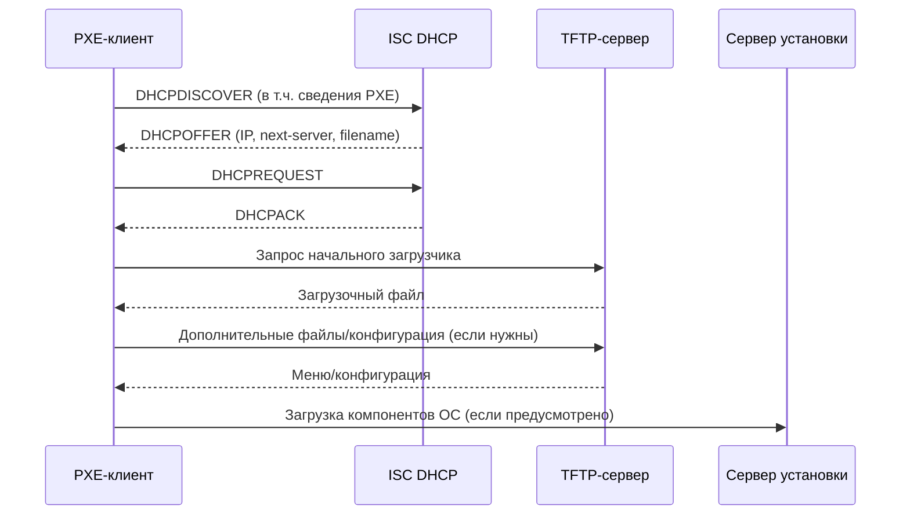

## 1. Назначение сетевой загрузки

**Сетевая загрузка** — запуск начального загрузчика компьютера с сервера по сети, без необходимости загружать его с локального диска. Применяется для установки ОС, восстановления компьютеров, инвентаризации и массового развертывания рабочих мест.

**PXE (Preboot Execution Environment)** — среда сетевой загрузки, обычно реализованная в прошивке сетевого адаптера или UEFI. **BOOTP** — более старый протокол, на основе которого развивался DHCP; часть его полей используется и при сетевой загрузке DHCP-клиентов.

Важно разделять роли:

- **DHCP-сервер** сообщает клиенту сетевые настройки и сведения о том, откуда взять начальный загрузчик.
- **TFTP-сервер** обычно отдает начальный загрузочный файл (NBP, Network Bootstrap Program).
- **Загрузчик** может затем получать меню, ядро, initramfs и другие файлы по TFTP, HTTP или другим поддерживаемым им протоколам.
- **Сервер установки/образов** предоставляет содержимое ОС или образы, если это требуется сценарием.

DHCP сам по себе **не передает образ операционной системы**.

## 2. Последовательность PXE-загрузки



Это типовой упрощенный сценарий: конкретная последовательность и протоколы зависят от прошивки и загрузчика. DHCP-обмен не всегда выглядит идентично, особенно при наличии ProxyDHCP.

## 3. Ключевые параметры DHCP для PXE

| Параметр ISC DHCP | Назначение | Пример |
|---|---|---|
| `next-server` | IPv4-адрес сервера следующего этапа загрузки; обычно TFTP | `next-server 192.168.50.20;` |
| `filename` | Имя начального загрузочного файла | `filename "pxelinux.0";` |
| `option tftp-server-name` (66) | Дополнительное указание имени TFTP-сервера | `option tftp-server-name "192.168.50.20";` |
| `option bootfile-name` (67) | DHCP Option 67 с именем загрузочного файла | `option bootfile-name "pxelinux.0";` |
| `option architecture-type` (93) | Архитектура клиента по RFC 4578 | `option architecture-type code 93 = unsigned integer 16;` |
| `option vendor-class-identifier` (60) | Строка, которой клиент обозначает тип/производителя; часто начинается с `PXEClient` | Используется в `match if` |

**Принципиальное различие:** `next-server` и `filename` — директивы `dhcpd.conf`, задающие поля BOOTP/DHCP-заголовка (`siaddr` и `file`), тогда как Options 66 и 67 — отдельные DHCP-опции. Они могут сообщать сходную информацию, но не являются буквальными синонимами на уровне пакета. Поведение прошивок различается; для простого сценария сначала используйте `next-server` и `filename` и проверяйте реальный трафик.

## 4. BIOS, UEFI и выбор загрузочного файла

**Legacy BIOS PXE** обычно запускает BIOS-совместимый NBP, например `pxelinux.0`. **UEFI x86-64** требует EFI-приложение, например `grubx64.efi` или `ipxe.efi` соответствующей архитектуры и сборки. Файл для BIOS нельзя считать совместимым с UEFI.

Типичные варианты:

| Тип клиента | Пример загрузочного файла | Замечание |
|---|---|---|
| Legacy BIOS | `pxelinux.0` | Требуются соответствующие файлы SYSLINUX |
| UEFI x86-64 | `grubx64.efi` | Нужен EFI GRUB, совместимый с прошивкой |
| UEFI x86-64 с Secure Boot | Подписанная цепочка загрузки, часто через `shimx64.efi` | Наличие EFI-файла само по себе не гарантирует загрузку |
| iPXE | `undionly.kpxe` (BIOS), `ipxe.efi` (UEFI) | Важна защита от повторной загрузки iPXE |

Имена файлов — примеры, **не универсальные стандарты**. Проверяйте фактические файлы и их совместимость с используемым загрузчиком.

### 4.1. Option 93 — архитектура клиента

Клиент может передавать DHCP Option 93 — список архитектур. Для распространенных значений RFC 4578:

- `0` — Intel x86PC (обычно Legacy BIOS).
- `7` — EFI BC.
- `9` — EFI x86-64.

На практике UEFI x86-64 может объявлять `7` или `9`; не стоит считать `7` единственным кодом UEFI x86-64. Кроме того, Option 93 по стандарту допускает **список** 16-битных кодов. Простое сравнение `option architecture-type = 00:07` применимо только когда фактическое содержимое равно двум байтам `00:07`. Для среды с разными прошивками сначала изучите реальные пакеты.

## 5. Минимальная конфигурация для одного типа клиентов

**Сценарий:** DHCP-сервер работает в сети `192.168.50.0/24`, TFTP-сервер находится по адресу `192.168.50.20`, компьютеры загружаются в режиме Legacy BIOS.

```dhcpd
# /etc/dhcp/dhcpd.conf

authoritative;
default-lease-time 3600;
max-lease-time 7200;

subnet 192.168.50.0 netmask 255.255.255.0 {
    range 192.168.50.100 192.168.50.200;
    option routers 192.168.50.1;
    option domain-name-servers 192.168.50.1;

    next-server 192.168.50.20;
    filename "pxelinux.0";
}
```

`authoritative` уместен, если это действительно ответственный DHCP-сервер данной сети. В рабочей сети с несколькими DHCP-серверами включать его без анализа нельзя.

**Где искать файлы:** путь `pxelinux.0` интерпретируется относительно корня TFTP-сервера, а не относительно `/etc/dhcp`. Например, при TFTP root `/srv/tftp` файл должен быть доступен как `/srv/tftp/pxelinux.0`. ISC DHCP **не проверяет**, существует ли он на TFTP-сервере.

## 6. Разделение Legacy BIOS и UEFI в одной подсети

В этой конфигурации DHCP-сервер выбирает начальный файл на основании Option 93. Она демонстрирует механизм; поддержка конкретных прошивок должна быть проверена пакетным анализом.

```dhcpd
option architecture-type code 93 = unsigned integer 16;

subnet 192.168.50.0 netmask 255.255.255.0 {
    range 192.168.50.100 192.168.50.200;
    option routers 192.168.50.1;
    option domain-name-servers 192.168.50.1;

    next-server 192.168.50.20;

    if exists architecture-type {
        if option architecture-type = 00:07 or
           option architecture-type = 00:09 {
            filename "uefi/grubx64.efi";
        } else {
            filename "pxelinux.0";
        }
    } else {
        filename "pxelinux.0";
    }
}
```

**Ограничение:** сравнение с `00:07` и `00:09` здесь рассчитано на двухбайтовое значение Option 93. Если клиент присылает несколько архитектур, такое сравнение не сработает. В неоднородной инфраструктуре потребуется учитывать формат списка и использовать выражения `substring()`/`extract-int()` с проверкой длины либо иной проверенный подход. Не следует безоговорочно копировать этот пример для всех UEFI-устройств.

### Почему нельзя полагаться только на `PXEClient`

```dhcpd
substring(option vendor-class-identifier, 0, 9) = "PXEClient"
```

Это позволяет обнаружить распространенный тип PXE-запроса, но **не различает надежно BIOS и UEFI**. Для выбора NBP нужны сведения об архитектуре, а для отдельных загрузчиков — и о стадии загрузки.

## 7. PXE через `class` и условные блоки

Классы удобны, если PXE-клиентам требуется назначать отдельные параметры или разрешать доступ к специальному пулу. Но для выбора одного из двух файлов внутри подсети часто достаточно обычного `if`.

```dhcpd
class "pxe-clients" {
    match if exists vendor-class-identifier and
        substring(option vendor-class-identifier, 0, 9) = "PXEClient";
}

subnet 192.168.50.0 netmask 255.255.255.0 {
    range 192.168.50.100 192.168.50.200;
    option routers 192.168.50.1;

    if member of "pxe-clients" {
        next-server 192.168.50.20;
        filename "pxelinux.0";
    }
}
```

Этот пример показывает **классификацию PXE-клиентов**, но не выбор UEFI/BIOS. Кроме того, нельзя считать все запросы с `PXEClient` доверенными: клиентские поля можно подделать.

**Важный нюанс вложенности:** `class` обычно объявляют на глобальном уровне. Не следует переносить `class` внутрь `subnet` по аналогии с `if`: это разные типы объявлений, а допустимые области зависят от синтаксиса ISC DHCP.

## 8. Пространство опций PXELINUX

В некоторых конфигурациях встречаются пользовательские DHCP-опции PXELINUX:

```dhcpd
option space pxelinux;
option pxelinux.magic code 208 = string;
option pxelinux.configfile code 209 = text;
option pxelinux.pathprefix code 210 = text;
option pxelinux.reboottime code 211 = unsigned integer 32;
```

Они предназначены для конкретного поведения PXELINUX и **не обязательны для любой PXE-загрузки**. Одно лишь объявление `option ... code` задает формат опции, но не отправляет клиенту ее значение. Отправка зависит от фактического присваивания, пространства опций, запроса клиента и реализации сервера.

При работе с пользовательскими опциями важно не смешивать *объявление формата*, *установку значения* и *фактическую передачу в DHCP-ответе*. Подробнее — в заметке `5. Расширенные параметры DHCP и пользовательские Options.md`.

## 9. BOOTP: что означает `allow bootp`

```dhcpd
allow bootp;
```

Директива разрешает обслуживание BOOTP-клиентов в соответствующей области конфигурации. **Это не обязательный переключатель для современных PXE-клиентов, использующих DHCP.** PXE и BOOTP исторически связаны, но это не означает, что каждый PXE-клиент является чистым BOOTP-клиентом.

В современных сетях поддержку BOOTP следует включать только при наличии реальных клиентов, которым она необходима. BOOTP не обладает всеми механизмами аренды и согласования параметров DHCP.

## 10. DHCP Relay и отдельный сервер загрузки

Если PXE-клиент находится в другой подсети, DHCP-запрос обычно передает **DHCP Relay**. В таком случае:

1. На маршрутизаторе/коммутаторе L3 настраивают DHCP Relay к серверу ISC DHCP.
2. ISC DHCP выбирает подсеть по сведениям Relay (обычно `giaddr`).
3. Клиент получает IP-параметры и адрес сервера начальной загрузки.
4. Клиент должен иметь **маршрут и разрешенный сетевой доступ** к TFTP/HTTP-серверу.

Наличие Relay для DHCP **не гарантирует** доступность TFTP. Межсетевые экраны, маршрутизация и особенности TFTP должны проверяться отдельно.

## 11. Типичные ошибки

| Симптом | Вероятная причина | Что проверить |
|---|---|---|
| Клиент получает IP, но пишет `TFTP timeout` | Нет доступа к TFTP-серверу | IP `next-server`, маршруты, ACL, TFTP-сервис |
| `File not found` | Неверное имя или расположение NBP | `filename`, TFTP root, регистр букв |
| BIOS загружается, UEFI нет | Выдается BIOS-файл или неподходящий EFI-файл | Option 93, `filename`, архитектура EFI |
| UEFI отказывает в запуске | Secure Boot или несовместимая сборка | Подпись, shim, настройки UEFI |
| Клиент повторно получает PXE-файл | Цикл цепной загрузки iPXE | Условие для уже запущенного iPXE |
| PXE не работает в другой VLAN | Не настроен Relay или недоступен сервер файлов | Relay, `giaddr`, firewall, TFTP/HTTP |
| Сервер отдает неправильный файл | Перекрывающиеся условия, неожиданный формат Option 93 | Содержимое DHCP-пакета и итоговые настройки |

## 12. Проверка и диагностика

**Проверить синтаксис** (при необходимости укажите файл явно):

```bash
sudo dhcpd -t -cf /etc/dhcp/dhcpd.conf
```

**Посмотреть сообщения службы** (для Ubuntu с пакетом `isc-dhcp-server`):

```bash
sudo journalctl -u isc-dhcp-server -n 100 --no-pager
```

**Посмотреть DHCP и TFTP-трафик** на нужном интерфейсе:

```bash
sudo tcpdump -ni any -vvv 'udp port 67 or udp port 68 or udp port 69'
```

> Фильтр `udp port 69` показывает начальные TFTP-запросы, но не обязательно весь последующий TFTP-обмен: передача данных обычно переходит на согласованные UDP-порты.

Для анализа Option 93 и фактически выданного `filename` удобен Wireshark. Сравнивайте не только конфигурацию, но и реальные DHCP OFFER/ACK, особенно при нескольких серверах DHCP или ProxyDHCP.

**Проверить доступность файла** с другого Linux-узла можно TFTP-клиентом, например `tftp` (если установлен):

```bash
tftp 192.168.50.20 -c get pxelinux.0
```

Проверка зависит от установленного клиента TFTP и не заменяет реальную загрузку прошивки.

## 13. Безопасность и эксплуатационные ограничения

- PXE-загрузка позволяет запускать программный код до основной ОС; защищайте сеть загрузки от подмены DHCP/TFTP-ответов.
- TFTP не шифрует передачу и не аутентифицирует сервер. Для критичных сценариев рассматривайте доверенную цепочку загрузки и подходящие защищенные протоколы на следующих этапах.
- Secure Boot проверяет подписи в цепочке загрузки, но **не превращает TFTP в защищенный транспорт**.
- DHCP Options 60/93 и MAC-адрес — сведения, предоставленные клиентом; их нельзя считать надежной аутентификацией.
- Не включайте сетевую загрузку на всех рабочих станциях без эксплуатационной необходимости; ограничивайте права и доступ к серверу образов.
- При использовании FOG, iPXE или другой платформы учитывайте, что она может иметь собственную логику выбора NBP, ProxyDHCP и HTTP-загрузки.

## 14. Глоссарий

| Термин | Определение |
|---|---|
| **PXE** | Среда начальной загрузки компьютера по сети, доступная до запуска ОС. |
| **BOOTP** | Ранний протокол назначения сетевых параметров и сведений о загрузке, предшественник DHCP. |
| **NBP** | Network Bootstrap Program — начальная программа, которую прошивка загружает по сети. |
| **TFTP** | Простой протокол передачи файлов поверх UDP, часто применяемый для первого этапа PXE. |
| **Legacy BIOS** | Традиционный режим прошивки и загрузки, отличающийся от UEFI. |
| **UEFI** | Современный интерфейс прошивки, запускающий EFI-приложения. |
| **Secure Boot** | Механизм проверки доверенности подписей компонентов загрузочной цепочки UEFI. |
| **`next-server`** | Директива ISC DHCP, задающая адрес сервера следующего этапа загрузки. |
| **`filename`** | Директива ISC DHCP, задающая имя начального загрузочного файла. |
| **Option 66** | DHCP-опция с именем TFTP-сервера. |
| **Option 67** | DHCP-опция с именем загрузочного файла. |
| **Option 93** | DHCP-опция со сведениями об архитектуре PXE-клиента. |
| **ProxyDHCP** | Механизм, при котором отдельный сервер предоставляет загрузочные параметры, не обязательно выдавая IP-адрес. |
| **DHCP Relay** | Устройство или функция, пересылающая DHCP-сообщения между подсетями. |
| **PXELINUX** | Загрузчик семейства SYSLINUX для PXE-среды. |
| **iPXE** | Расширяемая среда сетевой загрузки, поддерживающая дополнительные протоколы и сценарии. |

---

## Вопросы для самопроверки

1. Как распределяются роли DHCP, TFTP и сервера установки при PXE-загрузке?
2. Чем директивы `next-server` и `filename` отличаются от DHCP Options 66 и 67?
3. Почему `pxelinux.0` нельзя без проверки выдавать UEFI x86-64 клиентам?
4. Для чего предназначена Option 93 и почему ее значение не всегда ограничивается двумя байтами?
5. Почему строка `PXEClient` не позволяет однозначно определить архитектуру компьютера?
6. Требуется ли `allow bootp` для каждого современного PXE-клиента?
7. Почему успешная выдача IP-адреса не гарантирует успешную загрузку по TFTP?
8. Что следует проверить при ошибке `TFTP timeout`?
9. Чем опасна подмена DHCP-ответа в сети с PXE?
10. Как проверить, какой загрузочный файл фактически получил клиент?

---

## Итоги — что было разобрано

- PXE использует DHCP для получения сетевых параметров и сведений о начальном загрузчике, но сам DHCP не передает образ ОС.
- `next-server` и `filename` определяют сервер и имя загрузочного файла; Options 66/67 — отдельные поля DHCP.
- BIOS и UEFI требуют совместимых загрузчиков; Option 93 помогает выбрать файл, но требует учета формата и содержимого запроса.
- PXE-клиентов можно выделять через `match if`, однако это не замена проверке архитектуры и не механизм аутентификации.
- Для загрузки через VLAN необходимы и DHCP Relay, и реальная доступность файлового сервера.
- Диагностика включает проверку `dhcpd.conf`, DHCP-пакетов, TFTP и совместимости загрузочной цепочки.

---

## Связанные заметки

- [[Synced/DevOps/Сетевое и системное администрирование/2. Сети/5. Сетевые сервисы (L7)/2. DHCP/1. ISC DHCP Server/4. Подсети, пулы, резервации и DHCP Options.md|Подсети, пулы, резервации и DHCP Options]]
- [[Synced/DevOps/Сетевое и системное администрирование/2. Сети/5. Сетевые сервисы (L7)/2. DHCP/1. ISC DHCP Server/3. Структура dhcpd.conf, области действия и наследование.md|Структура dhcpd.conf, области действия и наследование]]
- [[Synced/DevOps/Сетевое и системное администрирование/2. Сети/5. Сетевые сервисы (L7)/2. DHCP/1. ISC DHCP Server/5. Расширенные параметры DHCP и пользовательские Options.md|Расширенные параметры DHCP и пользовательские Options]]
- [[Synced/DevOps/Сетевое и системное администрирование/2. Сети/5. Сетевые сервисы (L7)/2. DHCP/1. ISC DHCP Server/6. Классы клиентов и условная выдача параметров.md|Классы клиентов и условная выдача параметров]]
- [[Synced/DevOps/Сетевое и системное администрирование/2. Сети/5. Сетевые сервисы (L7)/2. DHCP/0. Теория и принципы работы/4. DHCP Relay и работа между подсетями.md|DHCP Relay и работа между подсетями]]

---

#DHCP #ISC-DHCP #ISC-DHCP-Server #PXE #BOOTP #Network-Boot #Netboot #TFTP #PXELINUX #SYSLINUX #iPXE #UEFI #BIOS #Secure-Boot #DHCP-Option-66 #DHCP-Option-67 #DHCP-Option-93 #DHCP-Option-60 #DHCP-Relay #ProxyDHCP #Linux #Ubuntu #dhcpd-conf #Troubleshooting #СетеваяЗагрузка #РазвертываниеОС
