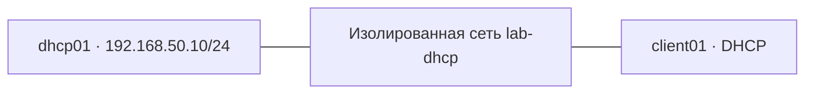

## 1. Назначение и место в структуре

**ISC DHCP Server** — серверное программное обеспечение, выдающее клиентам сетевые параметры по протоколу DHCP. Главный процесс — `dhcpd`.

Связанные заметки:

- [[Synced/DevOps/Сетевое и системное администрирование/2. Сети/5. Сетевые сервисы (L7)/2. DHCP/0. Теория и принципы работы/1. Архитектура и назначение DHCP.md|Архитектура и назначение DHCP]] — общие понятия.
- [[Synced/DevOps/Сетевое и системное администрирование/2. Сети/5. Сетевые сервисы (L7)/2. DHCP/0. Теория и принципы работы/2. Протокол DHCPv4 и процесс DORA.md|DHCPv4 и DORA]] — обмен сообщениями.
- [[Synced/DevOps/Сетевое и системное администрирование/2. Сети/5. Сетевые сервисы (L7)/2. DHCP/1. ISC DHCP Server/1. Архитектура и особенности ISC DHCP.md|Архитектура ISC DHCP]] — устройство демона и хранение аренд.
- [[Synced/DevOps/Сетевое и системное администрирование/2. Сети/5. Сетевые сервисы (L7)/2. DHCP/1. ISC DHCP Server/3. Подсети, пулы, резервации и DHCP Options.md|Пулы и резервации]] — расширенная настройка.

## 2. Лабораторная схема

| Узел | Интерфейс | IPv4 | Роль |
|---|---|---|---|
| `dhcp01` | `ens19` | `192.168.50.10/24` | ISC DHCP Server |
| `client01` | `ens19` | Получает по DHCP | Linux-клиент |

Используем **отдельную виртуальную сеть** `lab-dhcp` без других DHCP-серверов. Имена интерфейсов в вашей VM могут отличаться.


## 3. Подготовка Ubuntu

### 3.1. Определяем интерфейсы

На сервере:

```bash
ip -br link
ip -br address
ip route
```

Предположим, лабораторный интерфейс — `ens19`.

### 3.2. Назначаем серверу статический IP

Если сервер использует Netplan с `systemd-networkd`, создаем отдельный файл `/etc/netplan/60-lab-dhcp.yaml`:

```yaml
network:
  version: 2
  ethernets:
    ens19:
      dhcp4: false
      addresses:
        - 192.168.50.10/24
```

> [!warning] Существующая конфигурация
> Проверьте файлы `/etc/netplan/*.yaml` и не создавайте конфликтующее определение `ens19`. На Ubuntu Desktop с NetworkManager настройка будет отличаться. Не меняйте удаленный административный интерфейс без доступа через консоль VM.

Применяем:

```bash
sudo netplan generate
sudo netplan try
ip -4 addr show dev ens19
```

`netplan try` позволяет откатить изменение, если вы не подтвердите его вовремя. Ожидаемый адрес: `192.168.50.10/24`.

## 4. Установка ISC DHCP Server

Проверяем доступность пакета:

```bash
sudo apt update
apt-cache policy isc-dhcp-server
sudo apt install isc-dhcp-server
```

Если доступна версия-кандидат (`Candidate` не `(none)`), устанавливаем.

Сразу после установки служба может быть в состоянии `failed`: это ожидаемо, пока не указаны интерфейс и подсеть.

```bash
systemctl status isc-dhcp-server --no-pager
```

## 5. Выбор интерфейса сервера

Для Ubuntu/Debian обычно используется `/etc/default/isc-dhcp-server`.

Открываем:

```bash
sudo nano /etc/default/isc-dhcp-server
```

Указываем:

```ini
INTERFACESv4="ens19"
INTERFACESv6=""
```

`INTERFACESv4` ограничивает интерфейсы, на которых запускается IPv4-сервер. Это **не заменяет** сетевую изоляцию и настройки firewall.

## 6. Минимальная конфигурация dhcpd.conf

Создаем резервную копию:

```bash
sudo cp /etc/dhcp/dhcpd.conf /etc/dhcp/dhcpd.conf.bak
```

Открываем файл:

```bash
sudo nano /etc/dhcp/dhcpd.conf
```

Для лаборатории используем конфигурацию:

```conf
authoritative;

default-lease-time 600;
max-lease-time 7200;

subnet 192.168.50.0 netmask 255.255.255.0 {
    range 192.168.50.100 192.168.50.150;
    option subnet-mask 255.255.255.0;
}
```

**Что означает каждая директива:**

| Директива | Значение |
|---|---|
| `authoritative;` | Сервер считается авторитетным для обслуживаемой лабораторной сети; применять только там, где вы контролируете DHCP |
| `default-lease-time 600;` | Типичный срок аренды по умолчанию — 600 секунд (10 минут) |
| `max-lease-time 7200;` | Максимальный срок аренды — 7200 секунд (2 часа) |
| `subnet ... netmask ...` | Обслуживаемая IPv4-подсеть |
| `range ...` | Диапазон адресов, выдаваемых динамически |
| `option subnet-mask ...` | Маска, передаваемая клиенту |

Серверный адрес `192.168.50.10` находится **за пределами** динамического диапазона, поэтому конфликт с пулом не возникает.

## 7. Проверка и запуск

Сначала проверяем синтаксис, **не запуская сервер**:

```bash
sudo dhcpd -t -4 -cf /etc/dhcp/dhcpd.conf
```

Если команда завершилась без ошибки, запускаем службу:

```bash
sudo systemctl restart isc-dhcp-server
sudo systemctl enable isc-dhcp-server
sudo systemctl status isc-dhcp-server --no-pager
```

Проверяем журнал:

```bash
sudo journalctl -u isc-dhcp-server -n 50 --no-pager
```

И UDP-порт:

```bash
sudo ss -lunp | grep ':67'
```

> [!note] Firewall
> Если используется UFW или другой firewall, он должен пропускать DHCP-трафик **на лабораторном интерфейсе**. Не открывайте UDP/67 на всех интерфейсах без необходимости. DHCP использует UDP/67 на сервере и UDP/68 на клиенте.

## 8. Проверка с Linux-клиента

Подключаем `client01` к той же изолированной сети. Интерфейс клиента также обозначим `ens19`.

### 8.1. Если используется NetworkManager

Проверяем соединения:

```bash
nmcli device status
nmcli connection show
```

Для существующего профиля, привязанного к `ens19`, включаем DHCP (замените `LAB-CONNECTION` на реальное имя профиля):

```bash
sudo nmcli connection modify "LAB-CONNECTION" ipv4.method auto
sudo nmcli connection up "LAB-CONNECTION"
```

### 8.2. Если используется systemd-networkd

Убедитесь, что в конфигурации нужного интерфейса включен DHCPv4, например:

```ini
[Match]
Name=ens19

[Network]
DHCP=ipv4
```

После изменения соответствующего `.network`-файла:

```bash
sudo networkctl reload
sudo networkctl reconfigure ens19
```

> [!warning] Не смешивайте менеджеры сети
> На одной VM выясните, кто управляет интерфейсом (`NetworkManager`, `systemd-networkd` или другой инструмент), и используйте команды именно этого менеджера.

### 8.3. Проверяем результат

```bash
ip -4 addr show dev ens19
ip -4 route
ping -c 3 192.168.50.10
```

Ожидаем адрес из диапазона `192.168.50.100–192.168.50.150`. Отсутствие маршрута по умолчанию в этой лаборатории нормально.

На сервере:

```bash
sudo journalctl -u isc-dhcp-server -f
```

В журнале должны появиться события вида:

```text
DHCPDISCOVER from 52:54:00:aa:bb:cc via ens19
DHCPOFFER on 192.168.50.100 to 52:54:00:aa:bb:cc via ens19
DHCPREQUEST for 192.168.50.100 from 52:54:00:aa:bb:cc via ens19
DHCPACK on 192.168.50.100 to 52:54:00:aa:bb:cc via ens19
```

Это **иллюстративный вывод**, MAC и адрес в вашей лаборатории будут другими. Подробнее последовательность сообщений разобрана в [[Synced/DevOps/Сетевое и системное администрирование/2. Сети/5. Сетевые сервисы (L7)/2. DHCP/0. Теория и принципы работы/2. Протокол DHCPv4 и процесс DORA.md|заметке о DORA]].

## 9. Просмотр выданных аренд

В типичной установке ISC DHCP на Ubuntu аренды хранятся в `/var/lib/dhcp/dhcpd.leases`:

```bash
sudo tail -n 40 /var/lib/dhcp/dhcpd.leases
```

Пример фрагмента:

```conf
lease 192.168.50.100 {
  starts 6 2026/11/14 10:00:00;
  ends 6 2026/11/14 10:10:00;
  binding state active;
  hardware ethernet 52:54:00:aa:bb:cc;
}
```

Файл может содержать исторические записи об одной аренде; не следует считать каждую запись отдельным активным клиентом. **Не редактируйте файл вручную при работающем `dhcpd`**. Подробности внутреннего устройства — в [[Synced/DevOps/Сетевое и системное администрирование/2. Сети/5. Сетевые сервисы (L7)/2. DHCP/1. ISC DHCP Server/1. Архитектура и особенности ISC DHCP.md|архитектуре ISC DHCP]].

## 10. Диагностика типичных проблем

| Симптом | Возможная причина | Проверка |
|---|---|---|
| Служба не запускается | Ошибка синтаксиса `dhcpd.conf` | `sudo dhcpd -t -4 -cf /etc/dhcp/dhcpd.conf` |
| `Not configured to listen on any interfaces` | Неверный интерфейс или нет подходящей подсети | `ip -br addr`, `/etc/default/isc-dhcp-server`, `subnet` |
| Клиент не получает адрес | VM в разных виртуальных сетях | Проверить bridge/VLAN и сетевые интерфейсы VM |
| Клиент получает адрес из чужой сети | В сегменте работает другой DHCP | Изолировать лабораторию, проверить DHCP-ответы |
| Адрес есть, но нет интернета | В примере намеренно не настроен шлюз | Это ожидаемо для изолированной лаборатории |
| Запросы видны, ответы не доходят | Firewall или ограничения виртуального коммутатора | Проверить правила и захват трафика |

Для просмотра обмена на сервере:

```bash
sudo tcpdump -ni ens19 -vv 'udp port 67 or udp port 68'
```

Для быстрой проверки состояния:

```bash
sudo systemctl is-active isc-dhcp-server
sudo journalctl -u isc-dhcp-server -n 30 --no-pager
ip -4 addr show dev ens19
```

Более подробный Troubleshooting вынесен в [[Synced/DevOps/Сетевое и системное администрирование/2. Сети/5. Сетевые сервисы (L7)/2. DHCP/1. ISC DHCP Server/6. Логирование и Troubleshooting.md|отдельную заметку]].

## 11. Мини-практика

1. Создайте две VM в отдельной виртуальной сети без другого DHCP-сервера.
2. Назначьте серверу `192.168.50.10/24` на лабораторном интерфейсе.
3. Установите ISC DHCP из официального репозитория, если пакет доступен.
4. Ограничьте запуск `dhcpd` лабораторным интерфейсом.
5. Настройте выдачу адресов `192.168.50.100–192.168.50.150`.
6. Проверьте конфигурацию `dhcpd -t` и запустите службу.
7. Переведите клиентский интерфейс в DHCP-режим.
8. Зафиксируйте полученный IP, события `DHCPDISCOVER`/`DHCPOFFER`/`DHCPREQUEST`/`DHCPACK` и запись об аренде.
9. Убедитесь, что клиент может выполнить `ping 192.168.50.10`.

**Критерий успеха:** клиент получает адрес из заданного диапазона, а сервер регистрирует выдачу аренды.

## 12. Вопросы для самопроверки

1. Почему серверу DHCP лучше назначить статический IP?
2. Зачем указывать `INTERFACESv4`?
3. Почему серверный IP не должен входить в динамический диапазон?
4. Для чего служит `dhcpd -t`?
5. Что означают `default-lease-time` и `max-lease-time`?
6. Почему в нашей лаборатории не указан `option routers`?
7. Как отличить проблему DHCP-сервера от проблемы виртуальной сети?
8. Где ISC DHCP хранит сведения об арендах?

## 13. Глоссарий

| Термин | Определение |
|---|---|
| **ISC DHCP Server** | Классическая реализация DHCP-сервера от Internet Systems Consortium, ныне EOL |
| **dhcpd** | Основной серверный процесс ISC DHCP |
| **dhcpd.conf** | Главный конфигурационный файл ISC DHCP |
| **INTERFACESv4** | Параметр Debian/Ubuntu, задающий интерфейсы для IPv4-сервера |
| **Subnet** | Подсеть, для которой сервер задает параметры выдачи адресов |
| **Range / Pool** | Диапазон IPv4-адресов для динамической выдачи |
| **Lease** | Временное право клиента использовать выданный IP-адрес |
| **Authoritative** | Режим, в котором сервер заявляет ответственность за обслуживаемую сеть |
| **DHCP Option** | Дополнительный параметр, передаваемый клиенту вместе с адресом |
| **Netplan** | Средство декларативной настройки сети в Ubuntu |
| **systemd-networkd** | Системный менеджер сетевых интерфейсов Linux |
| **NetworkManager** | Менеджер сетевых подключений Linux |

---

#DHCP #ISC-DHCP #Linux #Ubuntu #Сети #СетевоеАдминистрирование #DevOps
