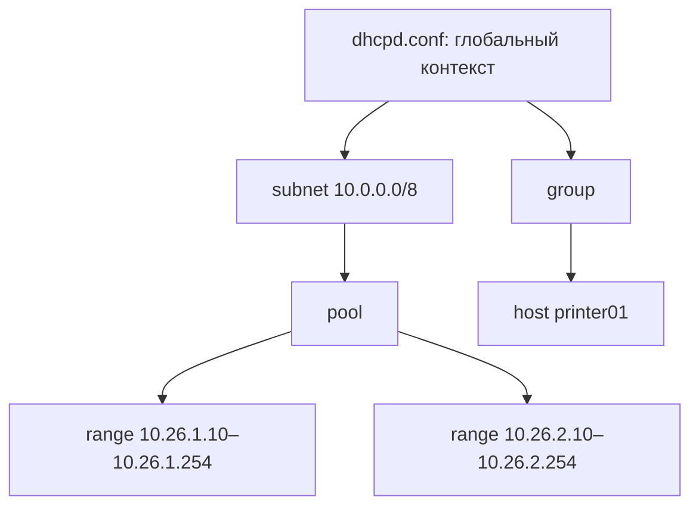

## 1. Модель конфигурации ISC DHCP

`dhcpd` читает файл `/etc/dhcp/dhcpd.conf` при запуске и строит из него описание сетей, клиентов, диапазонов выдачи адресов и правил поведения сервера.

Конфигурация состоит из двух основных видов инструкций:

| Вид | Назначение | Пример |
|---|---|---|
| **Параметр (parameter)** | Управляет поведением сервера или значением, передаваемым клиенту | `default-lease-time 7200;`, `option routers 10.0.0.1;` |
| **Объявление (declaration)** | Описывает сеть, пул, клиента или логическую группу | `subnet { ... }`, `pool { ... }`, `host { ... }` |

Часть параметров начинается с `option`: это значения DHCP Options, передаваемые клиентам. Другие параметры (например, `default-lease-time`) влияют на работу сервера. Не все директивы допускаются в любой области: у каждой есть собственные правила размещения.

## 2. Синтаксис файла

Базовые правила:

- **`;`** завершает простую инструкцию: `max-lease-time 14400;`.
- **`{ ... }`** ограничивают блок и создают вложенный контекст.
- **`#`** начинает комментарий до конца строки.
- **Строки** заключаются в двойные кавычки.
- **Отступы** не влияют на выполнение, но показывают вложенность.
- **`include "путь";`** вставляет содержимое другого файла в точке подключения.

```dhcpd
# Параметр глобального уровня
option domain-name "ggkit.local";

# Объявление подсети
subnet 10.0.0.0 netmask 255.0.0.0 {
    option routers 10.0.0.1;

    pool {
        range 10.26.1.10 10.26.1.254;
    }
}
```

Сначала в соответствующем блоке указывают параметры, затем зависящие от них объявления. Это правило особенно полезно соблюдать в крупных конфигурациях.

## 3. Уровни и блоки конфигурации

| Контекст | Для чего нужен | Типичное содержимое |
|---|---|---|
| **Глобальный** | Общие настройки сервера | `default-lease-time`, `option domain-name`, `authoritative` |
| **`shared-network`** | Несколько IP-подсетей на одном физическом/канальном сегменте | Общие параметры и несколько `subnet` |
| **`subnet`** | Описание IP-подсети | Маска, шлюз, пулы и диапазоны |
| **`pool`** | Управление динамическим набором адресов и допуском клиентов | `range`, `allow`, `deny`, отдельные параметры |
| **`group`** | Общие настройки для группы объявлений | Параметры и несколько `host` |
| **`host`** | Описание конкретного клиента | `hardware ethernet`, `fixed-address`, индивидуальные Options |
| **`class` / `subclass`** | Классификация клиентов | Условия совпадения и связанные параметры |

**Важно:** таблица показывает назначение, а не разрешает произвольно вкладывать любой блок в любой другой. Например, `host` можно объявлять отдельно от `subnet`; `pool` используют в контексте адресного пространства, а `range` должен описывать адреса соответствующей подсети. Полные ограничения определяются синтаксисом каждой директивы.

### 3.1. Глобальный уровень

```dhcpd
log-facility local7;
default-lease-time 7200;
max-lease-time 14400;
option domain-name "ggkit.local";
option domain-name-servers 10.26.250.7, 10.26.250.8;
```

Эти значения выступают общими настройками, если более специфичный контекст не задает другое значение. `log-facility` — параметр журналирования; его не следует считать наследуемой DHCP Option.

### 3.2. `subnet` и `pool`

```dhcpd
subnet 10.0.0.0 netmask 255.0.0.0 {
    option routers 10.0.0.1;

    pool {
        range 10.26.1.10 10.26.1.254;
        range 10.26.2.10 10.26.2.254;
    }
}
```

`subnet` задает сетевой контекст. `pool` объединяет диапазоны и правила допуска. Несколько `range` в одном `pool` допустимы; это **не** означает выдачу адресов строго по порядку строк.

В приведенном примере оба диапазона принадлежат одной подсети `10.0.0.0/8`. Это важно: два диапазона с разными третьими октетами сами по себе не образуют две подсети.

### 3.3. `host` и `group`

```dhcpd
group {
    option domain-name "printers.ggkit.local";

    host printer01 {
        hardware ethernet 02:11:22:33:44:55;
        fixed-address 10.26.10.20;
    }

    host printer02 {
        hardware ethernet 02:11:22:33:44:66;
        fixed-address 10.26.10.21;
    }
}
```

`group` позволяет не повторять одинаковые параметры для нескольких объявлений `host`. Имя `host` — идентификатор объявления в конфигурации, а не автоматическое создание DNS-записи.

## 4. Что означает «область действия»

**Область действия (scope)** — контекст, в котором объявлен параметр. Она определяет, для каких клиентов и при каких условиях он применяется.

Пример:

```dhcpd
option domain-name-servers 10.26.250.7, 10.26.250.8;

subnet 10.0.0.0 netmask 255.0.0.0 {
    option routers 10.0.0.1;

    pool {
        range 10.26.1.10 10.26.1.254;
        option domain-name-servers 10.26.250.7;
    }
}
```

Клиент, получивший адрес из этого `pool`, получает значение DNS из `pool`, поскольку оно конкретнее глобального. При этом `option routers` берется из `subnet`, где он задан.

**Наследование не означает копирование строк** из глобального блока в каждый вложенный блок. При формировании ответа сервер ищет применимые настройки в соответствующих контекстах.

## 5. Приоритет параметров и важные исключения

Для параметров, используемых при загрузке клиента, ISC DHCP рассматривает подходящие контексты примерно в следующей последовательности:

1. Соответствующее объявление `host` (если найдено).
2. Подходящие объявления `class`.
3. `pool`, из которого назначен адрес.
4. `subnet` назначенного адреса.
5. `shared-network`, если он есть.
6. Менее специфичные лексические контексты, включая глобальный.

Если значение определено в нескольких применимых контекстах, используется более специфичное. Это **модель поиска параметров**, а не универсальная гарантия, что любые директивы можно переопределять в любом месте.

> [!warning] Не путать две иерархии
> **Лексическая вложенность** — где блок физически написан в файле. **Контекст выбора параметров клиента** — какие объявления сервер применяет к конкретной аренде. Они связаны, но не тождественны. Например, объявление `host` может располагаться вне `subnet`, однако участвовать в подборе параметров для клиента этой подсети.

### 5.1. Пример переопределения

```dhcpd
option domain-name "ggkit.local";

subnet 10.0.0.0 netmask 255.0.0.0 {
    option domain-name "students.ggkit.local";
    option routers 10.0.0.1;
    range 10.26.1.10 10.26.1.254;
}

host teacher-pc {
    hardware ethernet 02:aa:bb:cc:dd:ee;
    fixed-address 10.26.10.50;
    option domain-name "staff.ggkit.local";
}
```

| Клиент | `domain-name` | Почему |
|---|---|---|
| Обычный клиент из диапазона | `students.ggkit.local` | Настройка `subnet` конкретнее глобальной |
| `teacher-pc` с подходящим `host` | `staff.ggkit.local` | Индивидуальное значение `host` имеет приоритет |

Для `teacher-pc` шлюз при отсутствии собственного значения берется из применимого контекста подсети.

### 5.2. Если значение отсутствует

Если опция не задана ни в одном применимом контексте, сервер не обязан отправлять ее клиенту. Нельзя считать, что DHCP автоматически передает все параметры сетевой конфигурации.

## 6. `shared-network`: не путать с несколькими VLAN

`shared-network` описывает **несколько IP-подсетей, использующих один общий канальный сегмент**, а не просто несколько подсетей, обслуживаемых одним сервером.

```dhcpd
shared-network campus-lan {
    option domain-name-servers 10.26.250.7, 10.26.250.8;

    subnet 192.168.10.0 netmask 255.255.255.0 {
        range 192.168.10.100 192.168.10.150;
    }

    subnet 192.168.20.0 netmask 255.255.255.0 {
        range 192.168.20.100 192.168.20.150;
    }
}
```

Это пример **двух логических IP-подсетей в одном L2-сегменте**. Для отдельных VLAN, соединенных маршрутизатором, обычно описывают отдельные `subnet` и используют DHCP Relay, а не объединяют их в `shared-network` только из-за общего DHCP-сервера.

У `shared-network` есть важная особенность: сервер рассматривает доступные динамические адреса как относящиеся к общему сегменту; выбор конкретной подсети для клиента нельзя надежно определять лишь по его принадлежности к одному физическому сегменту. Подробности вынесены в профильную заметку по сложным топологиям.

## 7. `include`: разбиение большой конфигурации

Когда объявлений много, файл можно разделить:

```dhcpd
# /etc/dhcp/dhcpd.conf
log-facility local7;
default-lease-time 7200;
max-lease-time 14400;

include "/etc/dhcp/conf.d/networks.conf";
include "/etc/dhcp/conf.d/reservations.conf";
```

```dhcpd
# /etc/dhcp/conf.d/networks.conf
subnet 10.0.0.0 netmask 255.0.0.0 {
    option routers 10.0.0.1;
    range 10.26.1.10 10.26.1.254;
}
```

`include` обрабатывается **как подстановка содержимого в текущем месте файла**. Это не отдельный namespace и не независимый конфигурационный модуль. Поэтому расположение `include` и окружающие блоки имеют значение.

Практически полезно разделять сети, резервации и специальные классы клиентов, но сохранять понятный порядок подключения.

## 8. Полный пример и карта вложенности

Ниже **цельный синтаксический пример**, объединяющий рассмотренные контексты. Он не претендует на полную production-конфигурацию с DDNS, PXE, Failover и обработчиками событий: эти механизмы изучаются отдельно.

```dhcpd
# /etc/dhcp/dhcpd.conf

# Глобальные параметры
authoritative;
log-facility local7;
default-lease-time 7200;
max-lease-time 14400;
option domain-name "ggkit.local";
option domain-name-servers 10.26.250.7, 10.26.250.8;

# Подсеть и динамические диапазоны
subnet 10.0.0.0 netmask 255.0.0.0 {
    option routers 10.0.0.1;

    pool {
        range 10.26.1.10 10.26.1.254;
        range 10.26.2.10 10.26.2.254;
    }
}

# Группа статически известных устройств
group {
    option domain-name "printers.ggkit.local";

    host printer01 {
        hardware ethernet 02:11:22:33:44:55;
        fixed-address 10.26.10.20;
    }
}
```

Схема структуры:



**Как читать этот пример:**

- Общие DNS и домен определены один раз.
- Шлюз задан в контексте подсети.
- Диапазоны находятся в одном пуле.
- Резервация `printer01` размещена в `group`, отдельно от `subnet`.
- Значение `domain-name` для принтера берется из `group`.

Это удобная отправная точка для чтения реальных конфигураций: сначала определить **блок**, затем **область действия**, затем **какие параметры может унаследовать конкретный клиент**.

## 9. Проверка конфигурации

После изменения файла проверяют синтаксис **до** перезапуска службы:

```bash
sudo dhcpd -t -4 -cf /etc/dhcp/dhcpd.conf
```

- `-t` — проверка конфигурации без запуска сервера для обслуживания клиентов.
- `-4` — режим DHCPv4.
- `-cf` — явный путь к конфигурационному файлу.

При успешной проверке применяют изменения:

```bash
sudo systemctl restart isc-dhcp-server
sudo systemctl status isc-dhcp-server --no-pager
```

Проверка синтаксиса **не гарантирует**, что адресный план корректен, DHCP Relay настроен или все клиенты получат ожидаемые Options. Это проверяют по фактическим DHCP-ответам и журналам.

## 10. Глоссарий

| Термин | Определение |
|---|---|
| **`dhcpd.conf`** | Основной текстовый файл конфигурации ISC DHCP Server |
| **Statement** | Инструкция языка конфигурации: параметр или объявление |
| **Parameter** | Инструкция, задающая поведение сервера или передаваемое значение |
| **Declaration** | Блок, описывающий сеть, пул, клиента или группу |
| **Scope** | Область действия параметра |
| **Inheritance** | Использование значения из применимого менее специфичного контекста |
| **Override** | Переопределение параметра более специфичным значением |
| **Global scope** | Контекст вне вложенных блоков конфигурации |
| **`subnet`** | Объявление IP-подсети |
| **`pool`** | Объявление динамического пула адресов и правил его использования |
| **`host`** | Объявление конкретного клиента |
| **`group`** | Объединение объявлений с общими параметрами |
| **`shared-network`** | Группа IP-подсетей на одном канальном сегменте |
| **`include`** | Включение содержимого другого файла в текущую точку конфигурации |
| **Лексическая вложенность** | Расположение инструкций внутри фигурных скобок других блоков |

---

## Вопросы для самопроверки

1. Чем параметр отличается от объявления в `dhcpd.conf`?
2. Для чего используются `;`, `{}` и `#`?
3. Чем отличаются глобальный контекст, `subnet`, `pool`, `group` и `host`?
4. Как определяется значение DHCP Option, если она задана глобально и внутри `subnet`?
5. Почему объявление `host` не обязательно помещать внутрь `subnet`?
6. Чем `shared-network` отличается от нескольких VLAN с DHCP Relay?
7. Что делает `include` и почему важно место его размещения?
8. Почему успешный `dhcpd -t` не гарантирует корректной выдачи адресов?
9. Почему нельзя считать, что все параметры разрешены во всех контекстах?

---

## Итоги — что было разобрано

- `dhcpd.conf` состоит из параметров и объявлений, организованных в контексты.
- Область действия определяет, где применяется параметр; более специфичные применимые настройки обычно переопределяют общие.
- `subnet`, `pool`, `group`, `host` и `shared-network` решают разные задачи и не являются взаимозаменяемыми.
- Лексическая вложенность файла и фактический поиск параметров для клиента — связанные, но разные механизмы.
- `include` помогает разделить файл, не меняя семантику языка.
- Перед перезапуском необходима проверка синтаксиса; после — проверка фактической выдачи.

---

## Связанные заметки

- [[Synced/DevOps/Сетевое и системное администрирование/2. Сети/5. Сетевые сервисы (L7)/2. DHCP/1. ISC DHCP Server/1. Архитектура и особенности ISC DHCP.md|Архитектура и особенности ISC DHCP]]
- [[Synced/DevOps/Сетевое и системное администрирование/2. Сети/5. Сетевые сервисы (L7)/2. DHCP/1. ISC DHCP Server/2. Установка и базовая настройка.md|Установка и базовая настройка]]
- [[Synced/DevOps/Сетевое и системное администрирование/2. Сети/5. Сетевые сервисы (L7)/2. DHCP/1. ISC DHCP Server/4. Подсети, пулы, резервации и DHCP Options|Подсети, пулы, резервации и DHCP Options]]
- [[Synced/DevOps/Сетевое и системное администрирование/2. Сети/5. Сетевые сервисы (L7)/2. DHCP/1. ISC DHCP Server/5. Расширенные параметры DHCP и пользовательские Options.md|Расширенные параметры DHCP и пользовательские Options]]
- [[Synced/DevOps/Сетевое и системное администрирование/2. Сети/5. Сетевые сервисы (L7)/2. DHCP/1. ISC DHCP Server/11. DHCP Relay, shared-network и сложные топологии.md|DHCP Relay, shared-network и сложные топологии]]

**Официальный справочник:** [ISC DHCP `dhcpd.conf(5)`](https://kb.isc.org/v1/docs/isc-dhcp-41-manual-pages-dhcpdconf).

---

#DHCP #ISC-DHCP #dhcpd #Linux #СетевоеАдминистрирование
