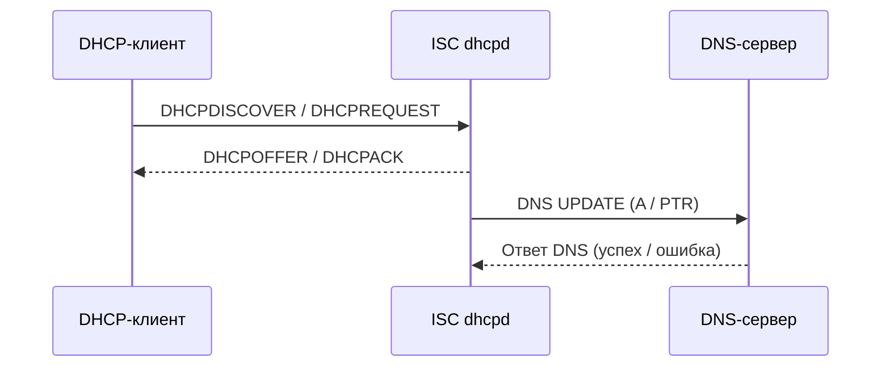

## 1. Зачем DHCP-серверу обновлять DNS

**Dynamic DNS (DDNS)** — механизм изменения DNS-записей при изменении сетевых параметров клиента. DHCP выдает IP-адрес, а DNS позволяет обращаться к устройству по имени.

Например, компьютер `pc-01.ggkit.local` получил `10.26.1.50`. DHCP-сервер может создать или обновить:

- **A**: `pc-01.ggkit.local. → 10.26.1.50`;
- **PTR**: `50.1.26.10.in-addr.arpa. → pc-01.ggkit.local.`.

Когда адрес меняется, DNS-записи должны измениться согласованно. Иначе имя указывает на старый IP, а обратное разрешение становится недостоверным.

**Важно:** выдача адреса DHCP и успешное обновление DNS — разные операции. Клиент может получить аренду, даже если DNS-обновление завершилось ошибкой.

## 2. Архитектура взаимодействия



Участники и роли:

1. **DHCP-клиент** сообщает идентификаторы и, при необходимости, запрашиваемое имя.
2. **ISC dhcpd** выбирает адрес, формирует имя и определяет, кто отвечает за обновление DNS.
3. **Авторитетный DNS-сервер** принимает либо отклоняет запросы обновления в соответствии с настройками зоны и политикой безопасности.

DNS-сервер не обязан находиться на том же узле, что и DHCP. Для обновления требуется сетевой доступ к DNS-серверу и соответствующие разрешения.

## 3. Режимы DDNS в ISC DHCP

Основная директива:

```dhcpd
# Один из вариантов, не одновременно:
ddns-update-style none;
# ddns-update-style interim;
# ddns-update-style standard;
```

| Режим | Назначение | Особенности |
|---|---|---|
| `none` | Отключает встроенный механизм DDNS | Можно применять внешнюю интеграцию, но сам `dhcpd` DNS не обновляет |
| `interim` | Исторический механизм ISC | Использует собственный подход к идентификации владения записями, в том числе TXT |
| `standard` | Механизм, основанный на стандартизованном поведении DHCP-DDNS | Использует DHCID; совместимость зависит от клиента и DNS-инфраструктуры |

**Не следует механически переключать `interim` на `standard` в работающей системе.** Формат служебных записей и правила владения могут отличаться. Перед переходом изучают существующую зону, записи и версию ISC DHCP.

Директива `ddns-updates on;` разрешает динамические обновления в соответствующей области действия, но **не отменяет** глобальное `ddns-update-style none;`.

## 4. Кто выбирает имя компьютера

Имя может поступить из нескольких источников:

- `option host-name` (DHCP Option 12) — короткое имя, переданное клиентом;
- `option fqdn.*` (DHCP Option 81) — параметры FQDN и согласования обновлений;
- `ddns-hostname` — имя, которое формирует или задает DHCP-сервер;
- `ddns-domainname` — доменная часть, используемая для DDNS.

Пример серверного формирования имени:

```dhcpd
# Пример в контексте активного встроенного DDNS:
ddns-hostname = concat(
    "host-",
    binary-to-ascii(16, 8, "-", substring(hardware, 1, 6))
);
ddns-domainname "ggkit.local.";
```

`hardware` включает тип оборудования первым байтом. Поэтому `substring(hardware, 1, 6)` извлекает шесть байтов Ethernet MAC. `binary-to-ascii(16, 8, "-", ...)` переводит байты в шестнадцатеричную текстовую запись с разделителем. Сгенерированное имя может отличаться по длине и формату в зависимости от MAC; его нужно проверять на соответствие правилам DNS-имен.

**Важно:** директива `ddns-hostname` сама по себе не гарантирует, что обновление DNS будет выполнено. Нужны активный механизм DDNS, корректная зона и разрешение на запись.

## 5. Основные параметры DDNS и их назначение

| Параметр | Что контролирует |
|---|---|
| `ddns-update-style` | Механизм встроенного обновления DNS |
| `ddns-updates` | Разрешение обновлений в соответствующей области |
| `ddns-domainname` | Домен, добавляемый к имени для прямого обновления |
| `ddns-rev-domainname` | Суффикс обратного пространства имен; обычно `in-addr.arpa.` для IPv4 |
| `ddns-hostname` | Имя, выбираемое сервером для DDNS |
| `ignore client-updates` | Не передавать клиенту ответственность за обновление его A-записи в рамках согласования DHCP-DDNS |
| `update-static-leases` | Разрешать обновления для статических аренд, если это применимо |
| `update-optimization` | Определяет, избегать ли повторных DNS UPDATE при неизменных данных |
| `allow client-updates` | Управляет участием клиентов в обновлении собственных записей |

**Уточнение по обратной зоне:** `ddns-rev-domainname` — не имя конкретной обратной зоны `/8`, `/16` или `/24`. Это суффикс, используемый механизмом построения обратного имени. Например, `10.in-addr.arpa.` может быть зоной, обслуживающей пространство `10.0.0.0/8`, но не должен автоматически подставляться вместо стандартного суффикса при генерации PTR. Обычно параметр оставляют по умолчанию, если нет специальных требований.

## 6. Зоны и ключи TSIG

Для встроенного DDNS ISC DHCP должен знать, куда отправлять обновления и как их подписывать.

**TSIG** — механизм аутентификации DNS-сообщений на основе общего секретного ключа. Это не то же самое, что **GSS-TSIG**, использующий Kerberos.

Упрощенный пример **для лабораторной среды с BIND и заранее настроенным TSIG**:

```dhcpd
key "dhcp-ddns-key" {
    algorithm hmac-sha256;
    secret "REPLACE_WITH_REAL_BASE64_SECRET";
}

zone ggkit.local. {
    primary 10.26.250.7;
    key "dhcp-ddns-key";
}

zone 10.in-addr.arpa. {
    primary 10.26.250.7;
    key "dhcp-ddns-key";
}
```

Этот фрагмент **не является готовой рабочей конфигурацией**: секрет нужно сгенерировать, а DNS-сервер — настроить на прием обновлений с тем же ключом и корректными правами для соответствующих зон.

`primary` в `zone` указывает адрес сервера для отправки обновлений. `secondary` в синтаксисе ISC DHCP может задавать резервную цель обновления, но **не заменяет настройку DNS-репликации или разрешений**.

### 6.1. Прямая и обратная зоны

- `ggkit.local.` — прямая зона для A-записей.
- `10.in-addr.arpa.` — пример обратной зоны для адресов `10.0.0.0/8`.

Для адреса `10.26.1.50` полное PTR-имя — `50.1.26.10.in-addr.arpa.`. При более дробном делегировании обратных зон DNS-структура может отличаться.

## 7. Цельный пример встроенного DDNS с BIND

Сценарий: Ubuntu с ISC DHCP Server, DHCP-сеть `10.26.1.0/24`, DNS-сервер `10.26.250.7`, домен `ggkit.local`. Предполагается, что BIND уже принимает TSIG-обновления прямой и обратной зон. IP-адреса здесь учебные и не предназначены для копирования без адаптации.

```dhcpd
# /etc/dhcp/dhcpd.conf

authoritative;
log-facility local7;

ddns-update-style interim;
ddns-updates on;
ignore client-updates;
update-static-leases on;
update-optimization on;

ddns-domainname "ggkit.local.";
# Для обычной обратной IPv4-адресации оставляем
# стандартный суффикс in-addr.arpa.

key "dhcp-ddns-key" {
    algorithm hmac-sha256;
    secret "REPLACE_WITH_REAL_BASE64_SECRET";
}

zone ggkit.local. {
    primary 10.26.250.7;
    key "dhcp-ddns-key";
}

zone 10.in-addr.arpa. {
    primary 10.26.250.7;
    key "dhcp-ddns-key";
}

subnet 10.26.1.0 netmask 255.255.255.0 {
    range 10.26.1.100 10.26.1.200;
    option routers 10.26.1.1;
    option domain-name "ggkit.local";
    option domain-name-servers 10.26.250.7;
    default-lease-time 3600;
    max-lease-time 7200;
}
```

**Что находится на каком уровне:**

- `ddns-update-style`, объявления `key` и `zone` — глобальная конфигурация;
- `ddns-updates`, `ddns-domainname` и часть других параметров могут действовать в соответствующих областях, согласно правилам наследования;
- `subnet` описывает адресное пространство и DHCP-параметры клиентов;
- DNS-зона и `subnet` **не обязаны иметь одинаковую границу адресации**: DNS обслуживает имена, а DHCP — аренды.

Для проверки синтаксиса перед перезапуском:

```bash
sudo dhcpd -t -cf /etc/dhcp/dhcpd.conf
sudo systemctl restart isc-dhcp-server
sudo journalctl -u isc-dhcp-server -n 100 --no-pager
```

Проверка синтаксиса не подтверждает, что DNS примет обновление.

## 8. Особенности Samba Active Directory и GSS-TSIG

**Samba AD DNS** часто использует безопасные обновления, основанные на Kerberos и **GSS-TSIG**. Обычный статический TSIG-ключ из предыдущего примера не равнозначен Kerberos-аутентификации.

Для среды Samba AD обычно рассматривают один из двух подходов:

1. Использование механизма обновления, совместимого с Kerberos/GSS-TSIG, через отдельный компонент или скрипт с учетными данными и соответствующими правами.
2. Архитектуру, в которой обновление определенных записей выполняет другой уполномоченный компонент (с учетом политики DNS и клиентов).

**Нельзя считать, что встроенный DDNS ISC DHCP автоматически умеет отправлять GSS-TSIG-обновления только из-за наличия `zone { primary ...; }`.** Типичный механизм встроенного ISC DHCP ориентирован на DNS UPDATE и TSIG; интеграция с Samba AD через Kerberos требует отдельной реализации.

### 8.1. Внешний сценарий через события аренды

Принцип:

```text
DHCPACK / фиксация аренды
    ↓
on commit
    ↓
Определение IP, имени и идентификатора
    ↓
Внешний обработчик
    ↓
Kerberos (keytab) + nsupdate -g
    ↓
Samba AD DNS: A / PTR
```

Типовая команда в **самом внешнем скрипте**, после получения Kerberos-учетных данных:

```bash
# Выполняется под специально выделенной учетной записью
# с доступом к keytab и правами на DNS-обновления.
kinit -k -t /etc/dhcp/dhcp-ddns.keytab 'DHCP-DDNS@GGKIT.LOCAL'
nsupdate -g
```

`nsupdate -g` запускает режим GSS-TSIG, но без команд обновления в стандартном вводе он ничего не изменит. Полный рабочий обработчик должен формировать транзакции `server`, `zone`, `update delete/add`, `send`, проверять ошибки и обеспечивать безопасную обработку входных имен.

**Замечание:** поддержка прямого вызова внешних программ из выражений ISC DHCP зависит от конкретной сборки и доступных механизмов. Не следует считать `execute()` универсально доступной директивой `dhcpd.conf` во всех пакетах ISC DHCP. При отсутствии такой поддержки используют внешний обработчик событий, журналы, lease-файл или специализированную интеграцию. Подробности жизненного цикла событий вынесены в предыдущую заметку.

### 8.2. Что нельзя делать

- Давать DHCP-серверу административный Kerberos-keytab контроллера домена.
- Принимать имя клиента без проверки и напрямую вставлять его в команды shell.
- Обновлять любую DNS-запись без проверки принадлежности имени и адреса.
- Оставлять одновременно независимые механизмы обновления одних и тех же A/PTR-записей без согласованной политики владения.
- Удалять записи без проверки, что они по-прежнему относятся к соответствующей аренде.

## 9. Важные особенности согласования с DHCP-клиентом

В разных ОС обновление DNS может выполняться по-разному:

- Клиент может отправлять FQDN Option 81 и просить обновлять часть записей самостоятельно.
- Сервер может взять ответственность за обновления на себя.
- Клиент может вообще не сообщать корректное имя.
- В доменной сети Windows-клиенты могут использовать собственную политику динамических DNS-обновлений.

Поэтому прежде чем включать `ignore client-updates`, нужно решить, **кто владеет обновлением A и PTR** и не возникает ли конфликтов с политиками AD. При анализе проверяют DHCP Option 81, реальные DNS UPDATE и поведение конкретной ОС.

## 10. Диагностика DDNS

### 10.1. Проверка DHCP

```bash
sudo dhcpd -t -cf /etc/dhcp/dhcpd.conf
sudo systemctl status isc-dhcp-server
sudo journalctl -u isc-dhcp-server -f
```

### 10.2. Проверка DNS-записей

```bash
dig @10.26.250.7 pc-01.ggkit.local A +noall +answer
dig @10.26.250.7 -x 10.26.1.50 +noall +answer
```

### 10.3. Наблюдение за DNS UPDATE

```bash
sudo tcpdump -ni any 'port 53'
```

Для диагностики удобно открыть дамп в Wireshark и проверить, отправляется ли DNS UPDATE и какой код ответа возвращает сервер. При GSS-TSIG содержимое обмена и причины ошибок могут потребовать дополнительной диагностики Kerberos и DNS.

### 10.4. Типовые неисправности

| Симптом | Вероятная причина | Что проверить |
|---|---|---|
| Аренда выдана, A-записи нет | DDNS отключен или DNS отклонил UPDATE | `ddns-update-style`, журнал, ответ DNS |
| A-запись есть, PTR отсутствует | Нет прав на обратную зону либо она неверно определена | Делегирование обратной зоны, права, FQDN PTR |
| `REFUSED` / `NOTAUTH` | Обновление не разрешено или направлено не на авторитетный сервер | Политика обновлений, SOA/NS, адрес назначения |
| `BADSIG` / ошибки TSIG | Не совпадают ключ, алгоритм или имя ключа | Обе стороны TSIG |
| Ошибки GSS-TSIG | Проблема Kerberos, SPN, keytab, времени или прав | `kinit`, журнал DNS, синхронизация времени |
| Имя указывает на старый IP | Конфликт владельцев обновлений или некорректная очистка | A/PTR, lease, клиентские DNS UPDATE |
| Обновления периодически пропадают | DNS недоступен, таймауты, отказ реплики | Сеть, DNS-журналы, авторитетность |

## 11. Практические рекомендации для production

1. Зафиксировать, **кто обновляет A и PTR**: DHCP, клиент или отдельная служба.
2. Использовать минимальные права учетной записи или TSIG-ключа на нужные зоны.
3. Исключить конкуренцию нескольких независимых обновляющих компонентов.
4. Согласовать правила формирования имени, обработки конфликтов и удаления записей.
5. Проверить работу при продлении аренды, изменении IP, отключении клиента и сбое DNS.
6. Мониторить не только выдачу DHCP, но и ошибки DNS UPDATE.
7. Перед изменением режима `interim`/`standard` предусмотреть миграцию служебных DNS-записей и откат.
8. Для Samba AD проверять Kerberos-права и реальное поведение DNS-бэкенда, а не предполагать совместимость с обычным TSIG.

## 12. Глоссарий

| Термин | Определение |
|---|---|
| DDNS | Автоматическое создание, изменение и удаление DNS-записей при изменении сетевых параметров |
| DNS UPDATE | DNS-операция изменения записей на авторитетном сервере |
| A-запись | Сопоставление DNS-имени с IPv4-адресом |
| PTR-запись | Обратное сопоставление IP-адреса с DNS-именем |
| FQDN | Полное доменное имя узла, включая доменную часть |
| TSIG | Аутентификация DNS-сообщений общим секретом |
| GSS-TSIG | Аутентификация DNS-обновлений через GSS-API, обычно с Kerberos |
| Kerberos | Протокол сетевой аутентификации на основе билетов |
| Keytab | Файл с ключевым материалом для неинтерактивной Kerberos-аутентификации |
| DHCID | DNS-запись, применяемая для определения владения именем в стандартизованном DHCP-DDNS |
| DNS-зона | Административная часть DNS-пространства с собственными правилами обслуживания |
| Авторитетный DNS-сервер | Сервер, ответственный за данные конкретной DNS-зоны |
| `nsupdate` | Утилита отправки динамических DNS-обновлений |
| Option 81 | DHCP-опция Client FQDN, используемая для согласования имени и ответственности за DNS-обновления |

---

## Вопросы для самопроверки

1. Почему успешная выдача IP-адреса не гарантирует появление DNS-записи?
2. Чем различаются режимы `none`, `interim` и `standard`?
3. Для чего нужны A, PTR и DHCID?
4. Почему `ddns-updates on;` не помогает при `ddns-update-style none;`?
5. Чем TSIG отличается от GSS-TSIG?
6. Как определить, кто обновляет DNS-записи в доменной сети?
7. Почему `ddns-rev-domainname` не следует путать с именем обратной зоны?
8. Какие риски возникают при запуске внешнего DDNS-скрипта от привилегированной учетной записи?
9. Как проверить фактическое наличие A/PTR-записей и DNS UPDATE?
10. Почему нельзя без подготовки менять `interim` на `standard`?

---

## Итоги — что было разобрано

- DDNS связывает DHCP-аренду с прямыми и обратными DNS-записями.
- Встроенный механизм ISC DHCP управляется `ddns-update-style` и связанными параметрами.
- Для обычного TSIG и Kerberos/GSS-TSIG требуются разные механизмы аутентификации.
- Интеграция с Samba AD DNS должна учитывать права, владение записями и поведение клиентов.
- Отдельная диагностика DHCP, DNS и Kerberos позволяет локализовать ошибки обновления.

---

## Связанные заметки

- [[Synced/DevOps/Сетевое и системное администрирование/2. Сети/5. Сетевые сервисы (L7)/2. DHCP/1. ISC DHCP Server/3. Структура dhcpd.conf, области действия и наследование.md|Структура dhcpd.conf, области действия и наследование]] — уровни объявления параметров и правила конфигурации.
- [[Synced/DevOps/Сетевое и системное администрирование/2. Сети/5. Сетевые сервисы (L7)/2. DHCP/1. ISC DHCP Server/7. Выражения, функции и переменные dhcpd.conf.md|Выражения, функции и переменные dhcpd.conf]] — построение имен и преобразование данных.
- [[Synced/DevOps/Сетевое и системное администрирование/2. Сети/5. Сетевые сервисы (L7)/2. DHCP/1. ISC DHCP Server/8. Обработчики событий и выполнение скриптов.md|Обработчики событий и выполнение скриптов]] — жизненный цикл событий аренды и внешняя автоматизация.

---

#DHCP #DHCPv4 #ISC-DHCP #dhcpd #dhcpd-conf #DDNS #Dynamic-DNS #DNS #DNS-UPDATE #DNS-A #DNS-PTR #DHCID #FQDN #DHCP-Option-81 #TSIG #GSS-TSIG #Kerberos #Keytab #Samba-AD #Active-Directory #BIND9 #nsupdate #Linux #Ubuntu #Network-Services #Troubleshooting #DNS-Security #Infrastructure
