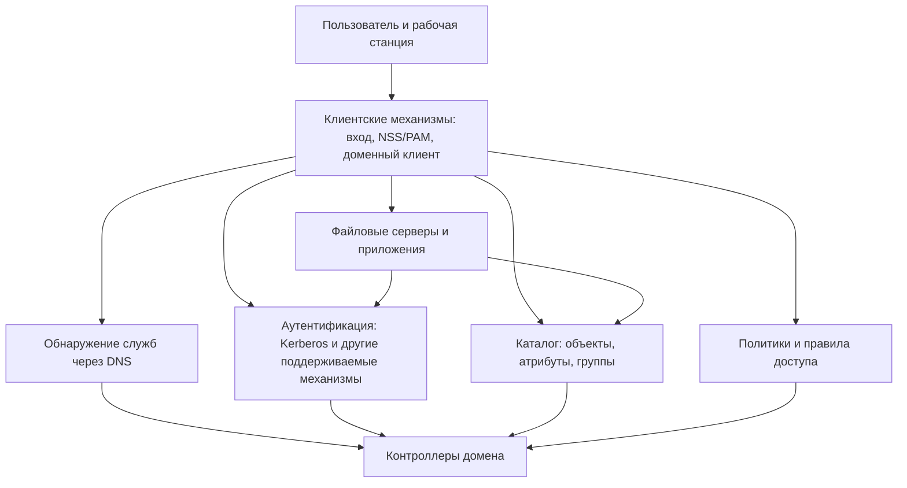
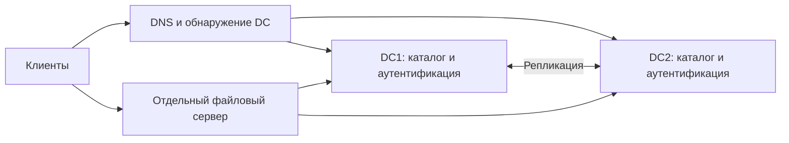
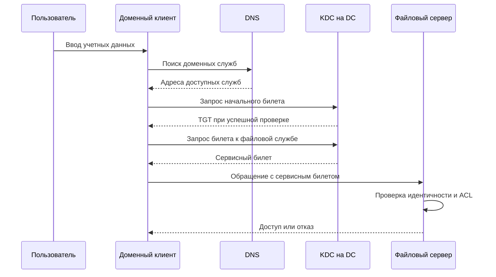
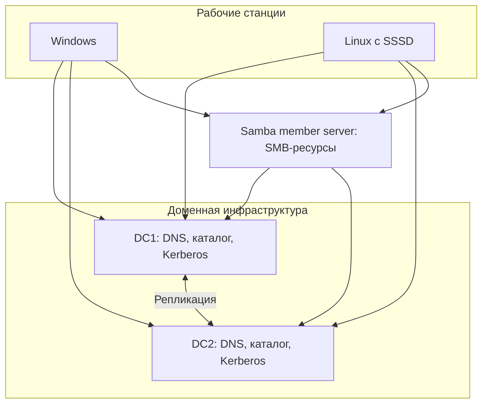

## 1. Что такое домен и зачем он нужен

**Домен в контексте централизованного управления ИТ-инфраструктурой** — логическая административная область, в которой учетные записи, компьютеры, группы, политики и службы идентификации управляются согласованно через общую инфраструктуру каталогов и аутентификации.

Не следует путать три значения слова «домен»:

| Термин | Что означает | Пример |
|---|---|---|
| DNS-домен | Пространство имен в DNS | `example.org` |
| Домен Active Directory | Граница хранения объектов каталога и ряда механизмов управления и безопасности | `ad.example.org` |
| Kerberos realm | Административная область Kerberos с собственным центром распределения ключей (KDC) | `AD.EXAMPLE.ORG` |

Эти имена часто связаны, но **не являются одной и той же сущностью**. DNS может существовать без AD, Kerberos — без AD, а домен AD использует обе технологии.

### 1.1. Проблема автономных компьютеров

Предположим, в организации 150 компьютеров. Без доменной инфраструктуры администратор может столкнуться с необходимостью отдельно создавать пользователей на каждом ПК, изменять пароли, назначать права, отзывать доступ и отслеживать изменения. При увольнении сотрудника локальные учетные записи и доступы приходится искать по всем системам.

Централизованный домен позволяет:

- хранить и управлять учетными записями в общем каталоге;
- аутентифицировать пользователей и компьютеры через согласованные службы;
- назначать права группам вместо ручной настройки для каждого пользователя;
- применять политики конфигурации и безопасности к управляемым устройствам;
- подключать файловые серверы и приложения к общей системе идентификации;
- обслуживать инфраструктуру несколькими контроллерами для повышения доступности;
- упрощать аудит, блокировку учетных записей и отзыв доступа.

**Важно:** домен сам по себе не делает инфраструктуру безопасной. Ошибочные разрешения, слабые политики, уязвимые клиенты или компрометация привилегированных учетных записей могут привести к масштабным последствиям.

### 1.2. Домен — не просто «единый логин»

Единая учетная запись — лишь видимый результат. За ней находятся каталог объектов, протоколы поиска и аутентификации, доверительные отношения, управление компьютерами, механизмы авторизации и операционные процессы.

Домен не равен VPN, файловому серверу, DNS-зоне или SSO-порталу. Эти компоненты могут использовать доменную идентификацию, но решают другие задачи.

## 2. Основные сущности доменной инфраструктуры

| Сущность | Назначение |
|---|---|
| Домен | Логическая область идентификации и управления |
| Контроллер домена (DC) | Сервер, обслуживающий доменные запросы и содержащий данные каталога либо их реплику |
| Каталог | Хранилище объектов, атрибутов и связей между ними |
| Пользователь | Учетная запись человека или отдельной служебной идентичности |
| Компьютерная учетная запись | Идентичность присоединенного к домену компьютера |
| Группа | Объединение идентичностей для управления разрешениями |
| Организационная единица (OU) | Контейнер AD для организации объектов, делегирования и привязки политик |
| Политика | Правила настройки, безопасности или доступа, применяемые к объектам |
| Ресурс | Файл, приложение, сервис, принтер или другая защищаемая сущность |
| Доверие | Отношение, позволяющее использовать идентичности из другой административной области при соблюдении правил доступа |

### 2.1. Пользователь, компьютер и служба — разные идентичности

Учетная запись пользователя подтверждает личность пользователя. Компьютерная учетная запись позволяет машине участвовать в доменных механизмах, а служебная идентичность используется приложением или системным сервисом. Их жизненный цикл, полномочия и секреты должны управляться отдельно.

### 2.2. Группы и принцип минимальных привилегий

Вместо предоставления прав каждому пользователю вручную права назначают группам, а пользователей включают в эти группы. Это упрощает аудит и изменение доступа.

Пример: группа `GGKIT-Teachers` получает чтение учебных материалов, а `GGKIT-IT-Admins` — административный доступ к определенным системам. Само членство в группе еще не гарантирует доступ: ресурс должен содержать соответствующее разрешение, а дополнительные политики могут его ограничивать.

## 3. Архитектурные уровни домена

Доменные службы удобнее рассматривать по функциям, а не как один монолитный сервер.

Схема логическая: конкретные протоколы и компоненты зависят от платформы, типа клиента и приложения.

### 3.1. Каталог: кто существует в инфраструктуре

Служба каталогов хранит объекты и атрибуты: имя, идентификатор, членство в группах, сведения о компьютере и другие данные. LDAP часто служит протоколом доступа к каталогу, но **LDAP не является самим каталогом** и не определяет всю архитектуру домена.

### 3.2. Аутентификация: кто предъявляет идентичность

**Аутентификация** — проверка заявленной идентичности. Kerberos позволяет клиенту получать билеты для обращения к службам, не пересылая пароль каждой службе. В инфраструктуре могут использоваться и другие механизмы, например NTLM в совместимых сценариях, сертификаты или интеграция с внешним провайдером идентификации.

### 3.3. Авторизация: что разрешено делать

**Авторизация** — решение о допустимости конкретного действия. Успешный вход в домен не означает разрешения читать любой общий каталог. Решение зависит от членства в группах, ACL, политик и настроек ресурса.

### 3.4. DNS: как находят доменные службы

Клиенту необходимо обнаружить подходящий контроллер и нужные сервисы. Для этого в AD-совместимой инфраструктуре используются DNS-записи, в том числе SRV. Некорректный DNS часто приводит к сбоям входа, присоединения компьютеров и обнаружения контроллеров, даже когда сеть доступна по IP.

### 3.5. Время: почему синхронизация критична

Kerberos опирается на ограничение допустимого расхождения часов для защиты от повторного использования сообщений. Значительный дрейф времени может приводить к отказам аутентификации. Для доменной инфраструктуры нужен согласованный и контролируемый источник времени.

## 4. Контроллер домена: роль и обязанности

**Контроллер домена** — сервер, реализующий доменные службы: хранение и предоставление данных каталога, обработку запросов аутентификации, репликацию и другие функции в зависимости от платформы.

В AD-совместимой инфраструктуре контроллер может обслуживать LDAP, Kerberos, DNS (при соответствующей конфигурации), а также механизмы, необходимые для доменных операций и политик.

### 4.1. Контроллер домена не обязан быть файловым сервером

Samba AD DC использует SMB и связанные механизмы для доменной инфраструктуры, включая SYSVOL и NETLOGON. Это **не означает**, что на нем следует размещать все пользовательские сетевые папки. Для производственной среды часто предпочтительнее выделить отдельный Samba member server, присоединенный к домену.

### 4.2. Один DC и несколько DC

Один контроллер создает единую точку отказа для ряда доменных операций. Несколько контроллеров могут обеспечивать доступность аутентификации и каталога при отказе одного узла, но требуют правильной репликации, DNS, времени, резервного копирования и проверки восстановления.

В реальной системе выбор DC определяется механизмами обнаружения, состоянием служб и топологией. Наличие двух DC не гарантирует, что все зависимые приложения продолжат работу при любом сбое.

## 5. Как происходит доменный вход и доступ к ресурсу

Ниже — упрощенный пример для клиента, использующего Kerberos. Реальный порядок зависит от ОС, способа входа и настроек службы.

**TGT** — билет для обращения к службе выдачи сервисных билетов. **Сервисный билет** предназначен для конкретной службы. **ACL** определяет разрешенные операции над ресурсом.

Критически важно разделять три события: пользователь прошел аутентификацию; сервер принял его идентичность; сервер разрешил конкретное действие. Эти события не тождественны.

## 6. Логическая организация домена

### 6.1. Имена и пространство DNS

Для домена выбирают стабильное DNS-имя, учитывая организационную структуру, сертификаты, разрешение имен и возможную интеграцию с внешними сервисами. Практически удобно использовать поддомен реально контролируемого DNS-домена, например `ad.example.org`. Встречаются и внутренние имена вроде `ggkit.local`, но при новом проектировании необходимо учитывать, что `.local` связан с Multicast DNS и способен создавать конфликты в некоторых средах.

**Имя домена после развертывания менять значительно сложнее, чем до установки**, а поддержка переименования зависит от платформы и конфигурации.

### 6.2. Организационные единицы

В Active Directory OU позволяют организовать объекты, делегировать управление и связывать групповые политики. OU — не то же самое, что группа безопасности. Например, OU `Computers/TeachingRooms` описывает размещение объектов, а группа `GGKIT-Lab-Operators` — совокупность субъектов доступа.

### 6.3. Домен, лес и доверие

В AD **домен** — одна из логических областей каталога; **лес** объединяет домены с общей схемой и отношениями доверия определенного типа. Не следует считать каждый DNS-поддомен отдельным доменом AD. Создание нескольких доменов существенно усложняет эксплуатацию и не должно быть автоматическим решением для разделения отделов.

### 6.4. Сайты и подсети

В Active Directory сайты отражают сетевую топологию и помогают направлять клиентов к подходящим контроллерам и управлять репликацией. Сайт AD не равен домену, OU или VLAN. Несколько подсетей могут принадлежать одному сайту, а один домен — охватывать множество сайтов.

## 7. Репликация и согласованность данных

При нескольких контроллерах изменения объектов должны распространяться между репликами. В AD-совместимых системах обычно используется многомастерная репликация для значительной части данных, но отдельные операции имеют специальных владельцев ролей.

### 7.1. Почему репликация не мгновенна

Изменение пароля, членства в группе или параметра объекта может стать видимым на разных DC не одновременно. Поэтому при диагностике важно знать, какой DC обслужил запрос, прошла ли репликация и не используются ли клиентские кэши.

### 7.2. Репликация — не резервная копия

Ошибочное удаление объекта или вредоносное изменение может распространиться на другие контроллеры. **Репликация повышает доступность, но не заменяет независимые резервные копии и проверенные процедуры восстановления.**

### 7.3. Специальные роли

В Active Directory отдельные операции выполняют владельцы FSMO-ролей. Их назначение и перенос требуют отдельного разбора; не следует предполагать, что все контроллеры полностью взаимозаменяемы для каждой административной операции.

## 8. Доменные платформы: общие идеи и различия

| Платформа | Основной фокус | Характерные особенности |
|---|---|---|
| Samba Active Directory DC | AD-совместимая доменная инфраструктура, включая Windows-клиентов | AD-совместимые протоколы, каталог, Kerberos, DNS и GPO-инфраструктура |
| FreeIPA | Централизованная идентификация Linux/Unix | 389 Directory Server, MIT Kerberos, SSSD, HBAC, sudo-политики, сертификаты |
| РЕД АДМ | Комплексное управление доменной инфраструктурой и конечными устройствами | Набор возможностей зависит от редакции, версии и выбранной архитектуры развертывания |
| Microsoft Active Directory Domain Services | Доменная инфраструктура Windows и смешанных сетей | AD DS, интеграция с Windows, GPO, доменные службы |

**FreeIPA не является прямой заменой AD DS по набору Windows-ориентированных функций.** И наоборот, наличие AD-совместимого домена не означает, что в нем автоматически присутствуют Linux-ориентированные политики HBAC или возможности FreeIPA.

РЕД АДМ следует рассматривать по конкретной редакции и версии: поддерживаемые функции службы каталогов, управления клиентами и интеграции могут различаться. Детали разбираются в отдельном разделе платформы.

## 9. Пример архитектуры для организации

Допустим, организация использует один домен, два контроллера, отдельный файловый сервер и смешанные рабочие станции Windows/Linux.

Это **логическая схема**, а не готовая сетевая конфигурация. В production-проекте дополнительно определяют маршрутизацию, DNS-резолверы клиентов, NTP, правила межсетевого экрана, бэкапы, мониторинг и порядок восстановления.

### 9.1. Что следует спроектировать заранее

1. Имя домена и правила именования объектов.
2. Платформу доменной инфраструктуры и совместимость клиентов.
3. Количество контроллеров и их размещение по отказным доменам.
4. DNS и источники точного времени.
5. Структуру OU, групп и делегирование полномочий.
6. Политику жизненного цикла пользователей, машин и служебных учетных записей.
7. Границы административного доступа и защиту привилегированных учетных записей.
8. Репликацию, резервное копирование и проверку восстановления.
9. Интеграцию файловых серверов, приложений и Linux-клиентов.
10. Мониторинг доступности, аутентификации и изменений каталога.

### 9.2. Частые ошибки проектирования

- Устанавливать единственный DC без плана восстановления.
- Использовать случайное или конфликтующее DNS-имя.
- Настраивать клиентам внешние DNS-серверы вместо корректного разрешения доменных записей.
- Смешивать административные и повседневные учетные записи.
- Давать широкие права непосредственно пользователям вместо управляемых групп.
- Считать репликацию заменой бэкапу.
- Размещать все роли на одном узле без анализа рисков.
- Предполагать, что Kerberos-аутентификация автоматически предоставляет доступ к файлам.
- Не документировать, какой контроллер обслуживает конкретный запрос.

## 10. Глоссарий

| Термин | Определение |
|---|---|
| Домен | Логическая область централизованного управления идентичностями и ресурсами |
| Контроллер домена (DC) | Сервер доменных служб и данных каталога |
| Каталог | Система хранения объектов и их атрибутов |
| LDAP | Протокол доступа к службам каталогов |
| Kerberos | Протокол сетевой аутентификации с использованием билетов |
| KDC | Центр распределения ключей в Kerberos |
| Realm | Административная область Kerberos |
| DNS | Система разрешения имен и обнаружения служб |
| SRV-запись | DNS-запись, публикующая расположение службы |
| OU | Организационная единица в каталоге Active Directory |
| GPO | Объект групповой политики Active Directory |
| ACL | Список правил доступа к ресурсу |
| SID | Идентификатор безопасности в Windows/AD-совместимой модели |
| TGT | Kerberos-билет для запроса сервисных билетов |
| Репликация | Распространение изменений между экземплярами каталога |
| FSMO | Набор специализированных ролей операций в AD |
| Сайт AD | Логическое представление сетевой топологии для клиентов и репликации |
| SSSD | Служба Linux для доступа к удаленным идентичностям и аутентификации |
| Member server | Сервер, присоединенный к домену, но не выполняющий роль DC |
| HBAC | Правила контроля доступа к хостам, применяемые, в частности, в FreeIPA |
| Отказный домен | Группа компонентов, которые могут одновременно выйти из строя из-за общей зависимости |

---

## Вопросы для самопроверки

1. Чем домен AD отличается от DNS-домена и Kerberos realm?
2. Какие задачи решает доменная инфраструктура помимо единого входа?
3. Почему LDAP и Kerberos нельзя считать взаимозаменяемыми технологиями?
4. В чем различие между аутентификацией и авторизацией?
5. Зачем клиенту домена DNS SRV-записи?
6. Почему рассинхронизация времени мешает Kerberos?
7. Чем OU отличается от группы безопасности?
8. Почему репликация не заменяет резервное копирование?
9. Для чего выделять файловый сервер отдельно от контроллера домена?
10. Чем принципиально отличаются Samba AD DC и FreeIPA?
11. Почему два контроллера не гарантируют полной отказоустойчивости всей инфраструктуры?
12. Какие решения следует принять до развертывания первого контроллера?

## Итоги — что было разобрано

- Домен — административная система идентификации и управления, а не просто DNS-имя.
- Основные архитектурные элементы: каталог, аутентификация, авторизация, DNS, политики, клиенты и ресурсы.
- Контроллер домена обслуживает ключевые доменные функции; отдельные файловые серверы могут использовать его идентичности.
- Несколько контроллеров повышают доступность, но требуют репликации, мониторинга и резервного копирования.
- Samba AD DC, FreeIPA и РЕД АДМ имеют пересекающиеся технологии, но разный набор возможностей и административные модели.
- Правильное проектирование имен, DNS, времени, прав и восстановления критично еще до установки платформы.

## Связанные заметки

- [[2. Active Directory — объекты, структура и службы|Active Directory — объекты, структура и службы]]
- [[3. LDAP — каталоги, DN, атрибуты и запросы|LDAP — каталоги, DN, атрибуты и запросы]]
- [[4. Kerberos — архитектура и процесс аутентификации|Kerberos — архитектура и процесс аутентификации]]
- [[5. DNS, SRV-записи и обнаружение контроллеров|DNS, SRV-записи и обнаружение контроллеров]]
- [[1. Архитектура и компоненты Samba AD DC|Архитектура Samba AD DC]]
- [[1. Архитектура и компоненты FreeIPA|Архитектура FreeIPA]]
- [[1. Архитектура, компоненты и редакции РЕД АДМ|Архитектура и редакции РЕД АДМ]]

---

#Linux #DomainController #Домен #ДоменнаяИнфраструктура #ActiveDirectory #ADDS #SambaAD #SambaDC #FreeIPA #REDADM #РЕДАДМ #LDAP #Kerberos #KDC #DNS #SRV #Authentication #Authorization #IdentityManagement #IAM #SSSD #NSS #PAM #GPO #OU #ACL #Replication #FSMO #HighAvailability #Backup #InfrastructureArchitecture #SysAdmin #DevOps
