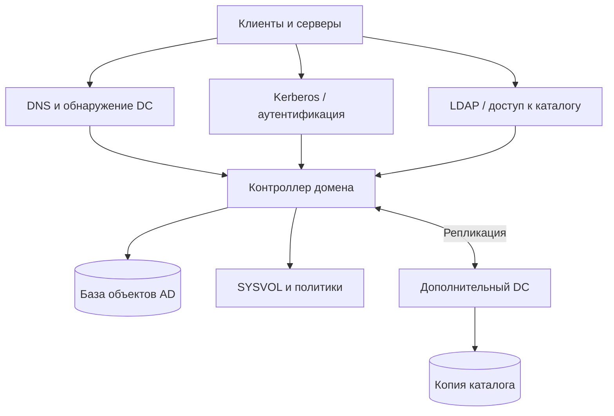
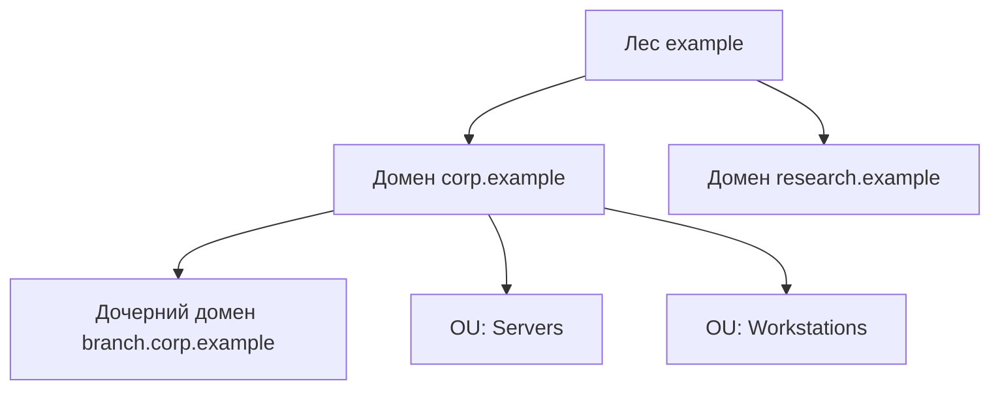
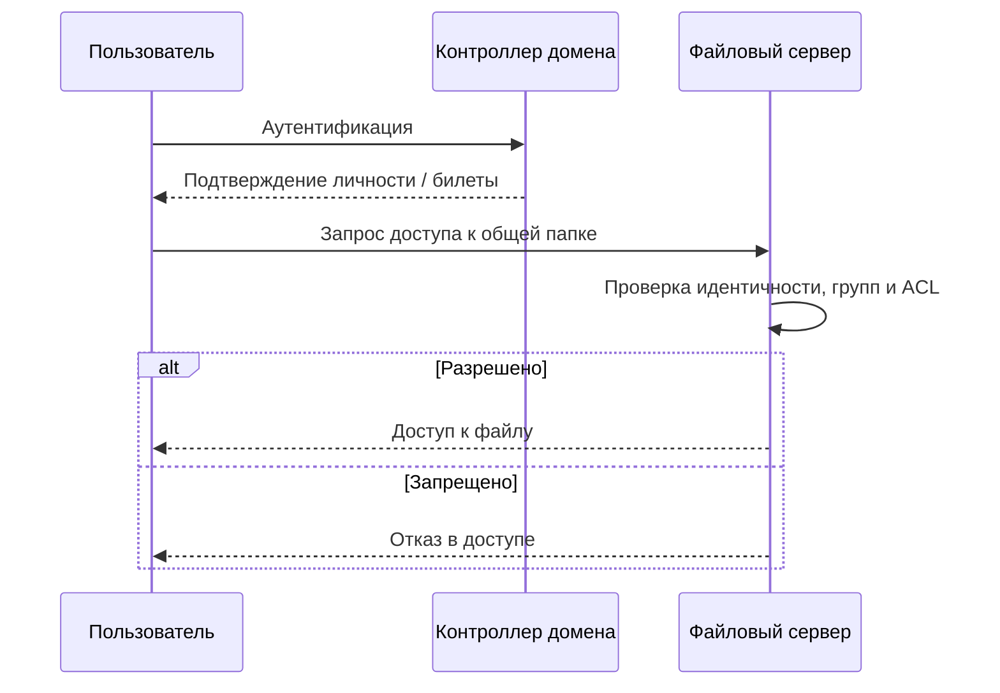
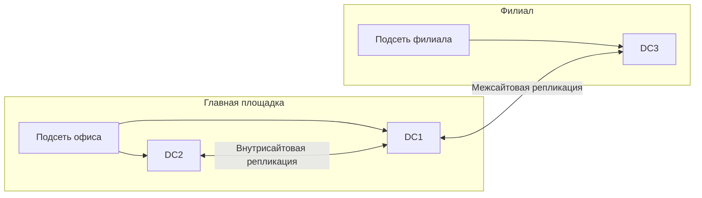
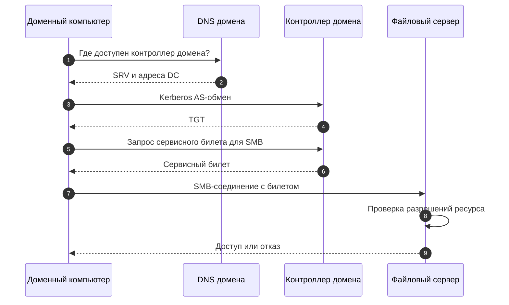

## 1. Что такое Active Directory

**Active Directory (AD)** — семейство технологий Microsoft для организации каталога, идентификации, аутентификации и централизованного управления ресурсами. В контексте доменных контроллеров обычно подразумевается **Active Directory Domain Services (AD DS)** — служба каталогов домена.

AD DS хранит сведения о пользователях, группах, компьютерах и других объектах, позволяет находить их, проверять учетные данные и применять административные политики. Это **не просто база паролей**: AD объединяет каталог, механизмы безопасности, репликацию, доменную иерархию и службы обнаружения.

Следует различать:

- **AD DS** — доменная служба каталогов и контроллеры домена.
- **LDAP** — протокол доступа к каталогу; не синоним AD.
- **Kerberos** — основной протокол доменной аутентификации; не заменяет каталог.
- **DNS** — разрешение имен и обнаружение служб; необходим для нормальной работы AD.
- **Group Policy** — механизм централизованного применения настроек, прежде всего к Windows-компьютерам и пользователям.
- **Microsoft Entra ID** — облачная платформа идентификации, отличающаяся от классического AD DS; не следует считать ее «контроллером домена в облаке».

**Пример:** в организации создан домен `corp.example`. Сотрудник входит в доменную рабочую станцию под учетной записью `CORP\ivanov`, а администратор добавляет его в группу `Accounting`. Файловый сервер предоставляет этой группе доступ к папке бухгалтерии. Каталог хранит учетные записи и членство в группах, а файловый сервер проверяет права на конкретный ресурс.

## 2. Из каких уровней состоит архитектура AD

Полезно рассматривать AD как несколько взаимосвязанных уровней.

| Уровень | Назначение | Примеры |
|---|---|---|
| Логическая структура | Границы каталога и управления | Лес, дерево, домен, OU |
| Объекты и схема | Какие сущности хранятся и какие атрибуты имеют | User, Group, Computer, Schema |
| Безопасность | Проверка личности и контроль доступа | Kerberos, SID, ACL, группы |
| Службы | Поиск, аутентификация, обнаружение и политики | LDAP, KDC, DNS, SYSVOL |
| Физическая структура | Размещение контроллеров и сетевые связи | DC, сайты, подсети, репликация |
| Эксплуатация | Обслуживание, изменения и восстановление | FSMO, резервные копии, мониторинг |



Диаграмма показывает логические функции, а не обязательное разделение служб по разным машинам: один DC обычно обслуживает несколько из них одновременно.

## 3. Лес, дерево и домен

### 3.1. Лес (Forest)

**Лес** — верхняя логическая граница AD DS, объединяющая один или несколько доменов с общей схемой каталога, конфигурацией и механизмами доверия. В типовой организации достаточно **одного леса и одного домена**.

Внутри леса существуют общие разделы каталога, включая Schema и Configuration. Между доменами одного леса действуют автоматические транзитивные доверительные отношения, однако это не означает, что все пользователи автоматически получают доступ ко всем ресурсам.

### 3.2. Дерево (Tree)

**Дерево доменов** — набор доменов с непрерывным пространством DNS-имен, например `corp.example` и `branch.corp.example`. В одном лесу могут быть несколько деревьев с разными пространствами имен.

### 3.3. Домен (Domain)

**Домен** — логическая область каталога, объединяющая объекты и контроллеры, которые обслуживают одну доменную базу. Домен имеет DNS-имя, например `corp.example`, и обычно короткое имя NetBIOS, например `CORP`.

Домен определяет важные границы администрирования и репликации доменного раздела каталога, но **не является абсолютной границей безопасности** внутри леса. Для строгого разграничения независимых организаций может потребоваться отдельный лес.



**Практическое правило:** не создавайте отдельный домен только ради каждого отдела или кабинета. Обычно достаточно OU и групп. Дополнительные домены усложняют DNS, репликацию, администрирование и восстановление.

## 4. Организационные единицы и контейнеры

**Organizational Unit (OU)** — контейнер каталога, предназначенный для логической группировки объектов, делегирования административных полномочий и привязки групповых политик.

Пример структуры:

```text
corp.example
  OU=Employees
    OU=Accounting
    OU=IT
  OU=Workstations
    OU=Classrooms
  OU=Servers
  OU=ServiceAccounts
```

Это **дерево каталогов**, а не схема сетевого взаимодействия.

В AD есть также встроенные контейнеры, например `CN=Users` и `CN=Computers`. В отличие от OU, к обычным контейнерам `CN` нельзя непосредственно привязать GPO. При проектировании важно не путать типы объектов.

OU **не задает права доступа к файлам автоматически** и **не является группой безопасности**. Для доступа к файловым ресурсам используются группы и ACL; для делегирования управления объектами — разрешения каталога.

**Пример:** компьютеры учебных классов размещены в `OU=Classrooms`, чтобы к ним применялись нужные политики. Учителя входят в группу `Teachers`, которой разрешен доступ к сетевым учебным материалам. OU и группа решают разные задачи.

## 5. Объекты каталога и их классы

Каждая запись каталога является **объектом** определенного класса и имеет набор **атрибутов**. Схема AD определяет допустимые классы, атрибуты, типы значений и ограничения.

| Класс / тип | Что представляет | Примеры атрибутов |
|---|---|---|
| `user` | Учетная запись пользователя или службы | `sAMAccountName`, `userPrincipalName`, `objectSid` |
| `group` | Группа безопасности или рассылки | `cn`, `member`, `groupType` |
| `computer` | Доменная учетная запись компьютера | `dNSHostName`, `servicePrincipalName` |
| `organizationalUnit` | Организационная единица | `ou`, `distinguishedName` |
| `contact` | Контакт без обычной учетной записи входа | `displayName`, `mail` |
| `groupPolicyContainer` | Объект групповой политики в AD | `displayName`, `gPCFileSysPath` |

Список не исчерпывающий: в каталоге также существуют объекты служб, доверий, DNS-зон и других компонентов.

### 5.1. Атрибуты идентификации

- **`cn`** — common name, компонент имени объекта; не обязательно совпадает с логином.
- **`sAMAccountName`** — короткое имя учетной записи, например `ivanov`.
- **`userPrincipalName` (UPN)** — имя входа в формате, похожем на email: `ivanov@corp.example`; суффикс UPN не обязан совпадать с DNS-именем домена.
- **`distinguishedName` (DN)** — полный путь объекта в иерархии каталога.
- **`objectGUID`** — глобально уникальный идентификатор объекта, обычно устойчивый при переименовании и перемещении внутри домена.
- **`objectSid`** — идентификатор безопасности, применяемый в механизмах авторизации Windows/AD.

Пример DN:

```text
CN=Ivan Ivanov,OU=Accounting,OU=Employees,DC=corp,DC=example
```

Здесь `CN` обозначает именованный объект, `OU` — организационные единицы, `DC` — компоненты DNS-имени домена. DN может измениться при перемещении или переименовании объекта; не следует использовать его как неизменный идентификатор во всех интеграциях.

### 5.2. Схема каталога

**Schema** задает, какие объекты и атрибуты существуют в лесу. Изменение схемы влияет на весь лес и требует аккуратного управления. Некоторые приложения расширяют схему при интеграции с AD.

Обычные операции с пользователями и группами **не требуют изменения схемы**. Подробный LDAP-синтаксис, поиск и фильтры рассматриваются в отдельной заметке.

## 6. Пользователи, компьютеры и служебные учетные записи

### 6.1. Пользовательские учетные записи

Учетная запись пользователя хранит идентификаторы, параметры входа, членство в группах и другие свойства. Сама запись каталога не означает автоматического доступа к конкретному серверу: доступ определяется политиками и разрешениями ресурса.

### 6.2. Компьютерные учетные записи

Компьютер, присоединенный к домену, имеет **собственную учетную запись** и секрет доверительного канала с доменом. Поэтому доменная рабочая станция — не просто устройство, на котором пользователь вводит логин.

Пример: `PC-101$` — типичное представление имени компьютерной учетной записи с завершающим `$` в `sAMAccountName`.

### 6.3. Служебные учетные записи

Приложения и службы могут работать под выделенными учетными записями. Для Windows существуют также управляемые служебные учетные записи, включая gMSA, но их поддержка зависит от версии и реализации доменной инфраструктуры. Нельзя автоматически считать любую функцию Microsoft AD доступной в Samba AD DC.

Принцип безопасности: минимальные привилегии, отсутствие интерактивного входа там, где он не нужен, контроль секретов и отдельные учетные записи для разных сервисов.

## 7. Группы: назначение, области действия и типы

**Группа** позволяет назначать права набору пользователей и компьютеров вместо индивидуальной настройки каждого объекта.

В классическом AD DS различают:

- **Security group** — используется для назначения разрешений и может применяться в рассылках.
- **Distribution group** — предназначена для рассылок; сама по себе не является группой безопасности для ACL.

По области действия группы бывают **Domain Local**, **Global** и **Universal**. Они отличаются правилами членства и тем, где их можно использовать для назначения разрешений, особенно в многодоменном лесу.

Упрощенная практика для одного домена:

1. Пользователей объединяют в глобальные группы по ролям (`GG_Accounting`).
2. На конкретный ресурс создают доменную локальную группу (`DL_Files_Accounting_RW`).
3. Глобальную группу включают в локальную группу ресурса.
4. Разрешения на файловом сервере назначают группе ресурса.

Такой подход известен как **AGDLP**: Accounts → Global groups → Domain Local groups → Permissions. Это шаблон проектирования, а не обязательное требование AD.

**Важное различие:** OU организует объекты и политики; группа выражает членство для авторизации. Вложенность групп может влиять на итоговый токен доступа пользователя.

## 8. SID, токен доступа и ACL

### 8.1. Security Identifier (SID)

**SID** — идентификатор безопасности, используемый для пользователей, групп и других субъектов безопасности. Права назначаются не просто текстовому имени `ivanov`, а идентификаторам, которые система может разрешить в отображаемые имена.

SID доменного пользователя включает идентификатор домена и относительный идентификатор **RID**. Например, изменение отображаемого имени учетной записи обычно не меняет ее SID.

### 8.2. Токен и авторизация

После аутентификации клиент и сервер используют сведения об идентичности и членстве в группах для проверки разрешений. В Windows-модели при доступе к ресурсу выполняется проверка токена против **DACL** (discretionary access control list) объекта.



**Аутентификация** отвечает на вопрос «кто обращается?», а **авторизация** — «что ему разрешено?». Успешный вход в домен не гарантирует доступа к любой сетевой папке.

В Linux-файловом сервере Samba дополнительно требуется корректное сопоставление доменных идентификаторов с Unix UID/GID и согласование ACL. Подробности относятся к разделу Samba SMB Server.

## 9. Контроллер домена и его службы

**Domain Controller (DC)** — сервер, на котором работает служба AD DS и размещена копия соответствующих разделов каталога. Он обрабатывает запросы каталога, участвует в аутентификации и репликации.

Ключевые компоненты:
.

| Компонент | Назначение |
|---|---|
| LDAP / LDAPS | Чтение и изменение объектов каталога с учетом разрешений |
| Kerberos KDC | Выдача билетов для аутентификации |
| DNS | Поиск DC, KDC и других служб по SRV-записям |
| Global Catalog | Поиск объектов по лесу и хранение частичных данных других доменов |
| SYSVOL | Распространение файлов политик и сценариев входа |
| Репликация | Согласование изменений между DC |
| Netlogon | Служебные функции доменного входа и обнаружения |

Некоторые механизмы и их реализация различаются между Microsoft AD DS и Samba AD DC. Например, нельзя без проверки переносить инструкции по DFS Replication Microsoft на Samba.

### 9.1. Global Catalog (GC)

**Глобальный каталог** хранит полную информацию о собственном домене DC и частичный набор атрибутов объектов других доменов леса. Он полезен для лесного поиска и некоторых операций входа. В одном домене различие между локальным поиском и лесным поиском часто неочевидно, но в многодоменной инфраструктуре GC становится важным архитектурным элементом.

### 9.2. SYSVOL и политики

**SYSVOL** — общий ресурс, содержащий файловую часть групповых политик и сценарии. Объект GPO включает сведения в AD и файлы в SYSVOL; их согласованность важна для применения политик.

Наличие `SYSVOL` не означает, что Linux-клиент автоматически применяет все Windows GPO. Для Linux применяются отдельные механизмы интеграции, а доступность функций зависит от клиентского ПО.

## 10. Разделы каталога (Naming Contexts)

Данные AD логически разделены на **разделы каталога**, или naming contexts.

| Раздел | Что содержит | Типичная область репликации |
|---|---|---|
| Domain | Пользователи, группы, компьютеры и доменные объекты | DC конкретного домена |
| Configuration | Конфигурация леса, сайты, службы | Лес |
| Schema | Определения классов и атрибутов | Лес |
| Application | Данные отдельных приложений, например интегрированных DNS-зон | Настраиваемая область |

Не каждый контроллер хранит полную копию **всех доменных разделов леса**. DC обычно хранит полный доменный раздел своего домена, а GC — частичные представления объектов других доменов.

Для DNS-зон AD могут применяться специальные разделы `DomainDnsZones` и `ForestDnsZones`; конкретная реализация зависит от DNS-бэкенда и конфигурации.

## 11. Физическая структура: сайты, подсети и контроллеры

**AD Site** — логическое представление сетевой топологии, обычно объединяющее подсети с хорошей связностью. Сайты помогают выбирать ближайший контроллер домена и планировать межсайтовую репликацию.

- **Site** — площадка или группа хорошо связанных сетей.
- **Subnet** — IP-подсеть, сопоставленная с сайтом.
- **Site Link** — описание связи между сайтами для репликации.
- **DC Locator** — механизм обнаружения подходящего контроллера домена.



Это условная топология. Наличие нескольких DC само по себе не гарантирует отказоустойчивость, если они находятся на одном физическом хосте, используют один диск или зависят от единственного DNS-сервера.

**Практическое правило:** создавайте сайты по сетевой топологии, а не автоматически по организационной структуре подразделений.

## 12. Репликация и согласованность каталога

В типовом AD большинство изменений могут приниматься разными записываемыми DC, после чего распространяются посредством **многомастерной репликации**. Однако отдельные операции закреплены за специальными ролями FSMO.

При репликации важно учитывать:

- **Не мгновенную согласованность:** изменения могут появляться на других DC с задержкой.
- **Конфликты:** при конкурентных изменениях используются правила разрешения конфликтов.
- **Топологию:** соединения и сайты влияют на передачу изменений.
- **Время и DNS:** ошибки синхронизации и разрешения имен нарушают работу домена.
- **Состояние DC:** наличие второго сервера не заменяет проверку репликации и резервное копирование.

Подробная диагностика репликации, FSMO и восстановление рассматриваются в профильных заметках по Samba AD DC и эксплуатации доменной инфраструктуры.

## 13. FSMO — почему не все операции многомастерные

**Flexible Single Master Operations (FSMO)** — набор специальных ролей, для которых в конкретный момент назначен один ответственный контроллер в пределах леса или домена.

| Роль | Область | Назначение |
|---|---|---|
| Schema Master | Лес | Координирует изменения схемы |
| Domain Naming Master | Лес | Координирует добавление и удаление доменов |
| RID Master | Домен | Выдает пула RID для новых SID |
| PDC Emulator | Домен | Участвует в важных операциях совместимости, времени и обработке изменений паролей |
| Infrastructure Master | Домен | Поддерживает определенные междоменные ссылки |

Не следует понимать FSMO как «единственный контроллер, через который проходят все входы в домен». Обычная аутентификация может обслуживаться несколькими DC.

## 14. DNS и обнаружение служб

AD критически зависит от DNS. Клиенту недостаточно знать IP одного контроллера: он должен обнаруживать подходящие службы по DNS-записям, включая **SRV**.

Примеры имен запросов:

```text
_ldap._tcp.dc._msdcs.corp.example
_kerberos._tcp.corp.example
```

Команды диагностики в Linux:

```bash
dig SRV _ldap._tcp.dc._msdcs.corp.example
dig SRV _kerberos._tcp.corp.example
resolvectl status
```

Ответы зависят от конфигурации DNS конкретного домена. В доменных клиентах следует использовать DNS, который корректно обслуживает AD-зоны и SRV-записи. Публичный DNS сам по себе не знает внутренних служб домена.

Важное различие: DNS помогает **найти** контроллер, Kerberos — **аутентифицироваться**, LDAP — **прочитать или изменить** сведения каталога.

## 15. Как связаны LDAP, Kerberos, DNS и SMB

Разберем упрощенный сценарий: пользователь входит на компьютер и открывает сетевой ресурс.



Это концептуальная схема. В реальной среде могут присутствовать кэширование билетов, обращения к каталогу, альтернативные протоколы аутентификации и дополнительные проверки. При этом **SMB — протокол файлового доступа, а не обязательный компонент каждой операции AD**.

## 16. Групповые политики: из чего состоит GPO

**Group Policy Object (GPO)** — объект централизованной конфигурации, который связывается с сайтом, доменом или OU. В Windows-клиентах политики применяются с учетом области действия, наследования, фильтрации безопасности и других правил.

GPO состоит из:

1. **Group Policy Container (GPC)** — объект в каталоге AD, содержащий метаданные.
2. **Group Policy Template (GPT)** — файлы политики в SYSVOL.

Не путайте GPO с LDAP-схемой или ACL сетевой папки. GPO может управлять параметрами ОС и приложений, а права доступа к файлам проверяются соответствующими файловыми службами.

Для Linux-клиентов применение политик отличается от Windows и зависит от SSSD, Samba и дополнительных средств управления. Полный разбор GPO — в отдельной заметке Samba AD DC.

## 17. Безопасность и административные границы

### 17.1. Разделение полномочий

Рекомендуется отделять повседневные учетные записи от административных, делегировать права на конкретные OU и минимизировать членство в высокопривилегированных группах.

### 17.2. Защита контроллеров

DC — критически важный узел: его компрометация может затронуть множество учетных записей и систем. Не следует использовать контроллер домена как универсальный сервер приложений, файловый сервер и рабочую станцию администратора одновременно.

### 17.3. Протоколы и устаревшие механизмы

Необходимо учитывать ограничения NTLM, LDAP signing, LDAP channel binding, SMB signing, Kerberos-шифрования и совместимости клиентов. Конкретные настройки зависят от версий ОС, Samba и требований среды; универсально отключать механизмы без проверки совместимости нельзя.

### 17.4. Резервное копирование

Репликация защищает от отказа отдельного DC, но **не заменяет резервное копирование**: ошибочно удаленные объекты или нежелательные изменения могут реплицироваться на остальные контроллеры.

## 18. Active Directory, Samba AD DC и FreeIPA: границы совместимости

| Критерий | Microsoft AD DS | Samba AD DC | FreeIPA |
|---|---|---|---|
| Основная модель | Active Directory | AD-совместимый домен | Linux-ориентированная IAM-платформа |
| Каталог | AD DS | AD-совместимый каталог Samba | 389 Directory Server |
| Аутентификация | Kerberos, другие механизмы | Kerberos, другие механизмы | MIT Kerberos |
| Windows GPO | Нативная поддержка | Поддержка с ограничениями и зависимостью от версии | Не является заменой Windows GPO |
| Основная аудитория | Windows и смешанные сети | Windows и смешанные сети | Linux/Unix и смешанные среды через интеграции |

**FreeIPA — не «Samba AD без Windows»**: у нее другая модель управления и набор сервисов, включая HBAC и централизованные sudo-правила. **РЕД АДМ** также следует изучать отдельно: функциональность зависит от редакции и используемой службы каталогов.

## 19. Практические принципы проектирования

1. **Начинайте с одного домена**, если нет конкретных требований к нескольким доменам.
2. **Проектируйте OU по управлению и политикам**, а не только по оргструктуре.
3. **Назначайте права группам**, а не отдельным пользователям.
4. **Используйте не менее двух DC** для важных доменов, учитывая физические зависимости.
5. **Проверяйте DNS и синхронизацию времени** до поиска сложных ошибок Kerberos.
6. **Разделяйте роли DC и файлового сервера** там, где важны гибкость и безопасность.
7. **Планируйте резервное копирование и тест восстановления** независимо от репликации.
8. **Проверяйте совместимость Samba** перед переносом инструкций Microsoft AD DS.
9. **Не усложняйте лес и домены без необходимости**; OU и группы решают большинство задач сегментации управления.
10. **Документируйте имена, сайты, подсети, роли и зависимости** — это упрощает диагностику.

## 20. Типичные ошибки и неверные представления

| Утверждение | Почему неверно | Корректное понимание |
|---|---|---|
| «AD — это LDAP» | LDAP — протокол, а не вся система | AD включает каталог, аутентификацию, репликацию и политики |
| «OU и группа — одно и то же» | У них разные задачи | OU — организация/делегирование/GPO; группа — членство/разрешения |
| «DNS нужен только для имен серверов» | Клиенты ищут службы по SRV | DNS — фундамент обнаружения DC и KDC |
| «Два DC означают, что резервные копии не нужны» | Ошибки реплицируются | Нужны независимые копии и проверка восстановления |
| «FSMO обрабатывает все входы» | Аутентификация распределена | FSMO обслуживает специальные операции |
| «Успешный вход дает доступ ко всем папкам» | Вход и разрешения — разные этапы | Доступ зависит от групп и ACL |
| «Samba AD полностью идентична Microsoft AD» | Функции и реализации различаются | Нужна проверка поддержки конкретной версии |
| «Каждому отделу нужен отдельный домен» | Усложняет эксплуатацию | Обычно достаточно OU, групп и политик |

## 21. Глоссарий

| Термин | Определение |
|---|---|
| **AD DS** | Служба каталогов Active Directory Domain Services |
| **Forest** | Верхняя логическая структура AD с общей схемой и конфигурацией |
| **Tree** | Иерархия доменов с непрерывным DNS-пространством имен |
| **Domain** | Логическая область каталога и доменных служб |
| **DC** | Контроллер домена, обслуживающий каталог и доменные запросы |
| **OU** | Организационная единица для организации объектов, делегирования и GPO |
| **Object** | Запись каталога определенного класса |
| **Attribute** | Свойство объекта каталога |
| **Schema** | Правила определения классов и атрибутов каталога |
| **DN** | Distinguished Name — полный путь объекта в иерархии LDAP |
| **CN** | Common Name — компонент имени объекта |
| **UPN** | User Principal Name — имя входа пользователя |
| **SID** | Security Identifier — идентификатор субъекта безопасности |
| **RID** | Relative Identifier — часть SID, уникальная в пределах домена |
| **GUID** | Глобально уникальный идентификатор объекта |
| **ACL** | Список управления доступом |
| **DACL** | Список разрешающих и запрещающих правил доступа |
| **LDAP** | Протокол доступа к службе каталогов |
| **Kerberos** | Протокол сетевой аутентификации на основе билетов |
| **KDC** | Центр распределения ключей Kerberos |
| **TGT** | Билет Kerberos для последующего получения сервисных билетов |
| **SPN** | Service Principal Name — идентификатор службы для Kerberos |
| **DNS SRV** | Запись DNS для обнаружения служб |
| **Global Catalog** | Частичное лесное представление каталога для поиска и отдельных операций |
| **SYSVOL** | Файловый ресурс контроллеров с политиками и сценариями |
| **GPO** | Объект групповой политики |
| **GPC / GPT** | Каталожная и файловая части групповой политики |
| **Naming Context** | Логический раздел данных каталога |
| **AD Site** | Логическое описание сетевой площадки для обнаружения DC и репликации |
| **DC Locator** | Механизм поиска подходящего контроллера домена |
| **FSMO** | Специальные единоличные роли AD для отдельных операций |
| **AGDLP** | Модель назначения прав через учетные записи, глобальные и локальные доменные группы |

---

## Вопросы для самопроверки

1. Чем Active Directory Domain Services отличается от LDAP и Kerberos?
2. Какие задачи решают лес, домен и OU? Когда действительно нужен второй домен?
3. Чем организационная единица отличается от группы безопасности?
4. Что такое `objectGUID`, `objectSid`, `sAMAccountName` и `userPrincipalName`?
5. Почему переименование учетной записи обычно не меняет назначенные ей разрешения?
6. Для чего компьютеру собственная доменная учетная запись?
7. Как работает модель AGDLP и зачем она нужна?
8. Чем аутентификация отличается от авторизации при доступе к SMB-ресурсу?
9. Какие службы обычно предоставляет контроллер домена?
10. Что хранится в SYSVOL и почему GPO имеет две части?
11. Что такое Global Catalog и когда он особенно важен?
12. Какие разделы каталога реплицируются в пределах домена, а какие — леса?
13. Зачем в AD существуют сайты и привязки подсетей?
14. Почему репликация не гарантирует мгновенного появления изменений?
15. Перечислите пять FSMO-ролей и области их действия.
16. Почему DNS SRV-записи критичны для работы доменных клиентов?
17. Почему два DC не заменяют резервное копирование?
18. Какие ограничения нужно учитывать при сравнении Microsoft AD DS, Samba AD DC и FreeIPA?

## Итоги — что было разобрано

- AD DS — это комплексная доменная служба каталогов, а не отдельный протокол.
- Основу логической организации составляют лес, домен, OU, объекты и схема.
- Учетные записи, группы, SID и ACL связывают идентификацию с контролем доступа.
- Контроллеры предоставляют LDAP, Kerberos, DNS-зависимые механизмы обнаружения, репликацию и инфраструктуру политик.
- Сайты и подсети отражают физическую топологию, а FSMO координируют отдельные операции.
- Для надежной архитектуры необходимы корректные DNS/время, несколько DC, разграничение ролей и резервное копирование.
- Samba AD DC, Microsoft AD DS и FreeIPA имеют общие концепции, но различаются возможностями и реализацией.

## Связанные заметки

- [[1. Назначение и архитектура домена|Назначение и архитектура домена]]
- [[3. LDAP — каталоги, DN, атрибуты и запросы|LDAP — каталоги, DN, атрибуты и запросы]]
- [[4. Kerberos — архитектура и процесс аутентификации|Kerberos — архитектура и аутентификация]]
- [[5. DNS, SRV-записи и обнаружение контроллеров|DNS и обнаружение контроллеров]]
- [[6. Домены, леса, доверительные отношения и FSMO|Домены, леса, доверия и FSMO]]
- [[1. Архитектура и компоненты Samba AD DC|Архитектура Samba AD DC]]
- [[1. Архитектура и компоненты FreeIPA|Архитектура FreeIPA]]
- [[1. Архитектура, компоненты и редакции РЕД АДМ|Архитектура РЕД АДМ]]

---

#ActiveDirectory #ADDS #DomainController #DomainServices #LDAP #Kerberos #DNS #SRV #Forest #Domain #OU #GroupPolicy #GPO #SYSVOL #GlobalCatalog #FSMO #Replication #SID #GUID #ACL #IdentityManagement #Authentication #Authorization #SambaAD #FreeIPA #REDADM #Linux #WindowsServer #Infrastructure #Security #DevOps
