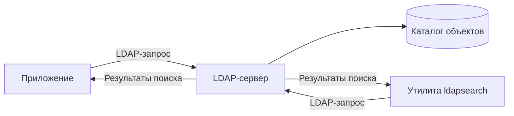
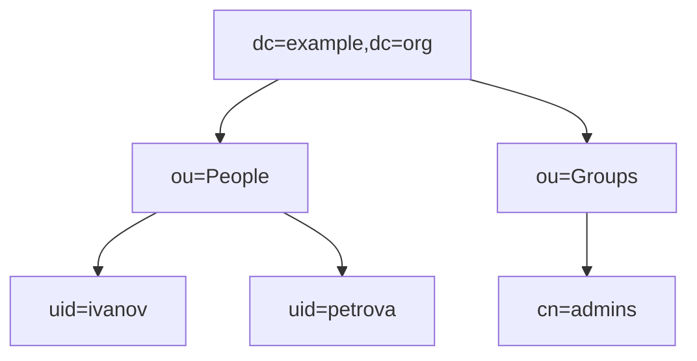
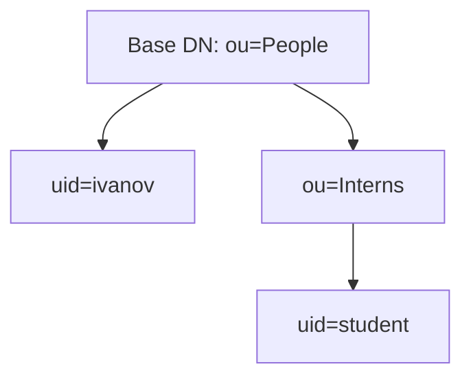

## 1. Назначение LDAP

**LDAP (Lightweight Directory Access Protocol)** — протокол обращения к службе каталогов. С его помощью приложения и администраторы могут находить объекты, читать их свойства и, при наличии разрешений, изменять записи.

**Служба каталогов** — система хранения структурированной информации об объектах инфраструктуры: пользователях, группах, компьютерах, подразделениях и других сущностях.

LDAP — **не сама база данных** и **не название конкретного сервера**. Протокол LDAP поддерживают, например, Active Directory Domain Services, Samba AD DC и OpenLDAP. Реализации могут отличаться схемой, набором атрибутов и правилами доступа.

Типичные задачи LDAP:

- Поиск пользователя по логину или адресу электронной почты.
- Получение имени, отдела и других атрибутов учетной записи.
- Поиск групп и проверка членства в них.
- Получение списка объектов в определенном подразделении.
- Создание и изменение записей при наличии соответствующих прав.

> [!IMPORTANT] LDAP и аутентификация — не одно и то же
> LDAP поддерживает операцию **Bind**, позволяющую клиенту установить контекст аутентификации. Однако в доменах Active Directory для входа пользователей часто применяется **Kerberos**. LDAP обычно используется для поиска и управления объектами каталога. Сам факт наличия LDAP не означает, что вся доменная аутентификация происходит через него.

## 2. Архитектура LDAP

Взаимодействие строится по модели «клиент — сервер»:

- **LDAP-клиент** — приложение или утилита, отправляющая запросы.
- **LDAP-сервер** — служба, обрабатывающая запросы к каталогу.
- **Каталог** — иерархия записей с атрибутами.
- **Схема (schema)** — правила, определяющие типы объектов и допустимые атрибуты.



В AD и Samba AD DC каталог является частью доменной инфраструктуры, но LDAP не заменяет DNS, Kerberos и другие ее компоненты.

### 2.1. Основные операции

| Операция | Назначение |
|---|---|
| `Bind` | Установление контекста аутентификации клиента |
| `Search` | Поиск записей по условиям |
| `Compare` | Сравнение значения атрибута с заданным значением |
| `Add` | Создание записи |
| `Modify` | Изменение атрибутов |
| `Modify DN` | Переименование или перемещение записи |
| `Delete` | Удаление записи |
| `Unbind` | Завершение LDAP-сеанса |

Права на выполнение операций определяются сервером и его политиками доступа.

## 3. Иерархия каталога и LDAP-записи

LDAP-каталог организован как дерево — **DIT (Directory Information Tree)**. Каждый элемент дерева представляет собой запись (**entry**).

Пример условного каталога `example.org`:



В этом примере:

- `dc=example,dc=org` — корень рассматриваемой части каталога.
- `ou=People` — организационная единица (Organizational Unit).
- `uid=ivanov` — запись пользователя.
- `cn=admins` — запись группы.

> [!NOTE] Структура каталога зависит от реализации
> Пример выше характерен для обобщенного LDAP-каталога. В Active Directory пользователи часто размещаются в `CN=Users,DC=example,DC=org` или в специально созданных OU; именование объектов может строиться через `CN`, а не `uid`.

## 4. DN и RDN — имена объектов

**DN (Distinguished Name)** — полное уникальное имя записи, определяющее ее положение в дереве каталога.

**RDN (Relative Distinguished Name)** — относительное имя записи на конкретном уровне дерева.

Пример:

```text
uid=ivanov,ou=People,dc=example,dc=org
```

Разбор компонентов:

| Часть | Значение |
|---|---|
| `uid=ivanov` | RDN записи пользователя |
| `ou=People` | Родительская организационная единица |
| `dc=example` | Компонент доменного имени |
| `dc=org` | Следующий компонент доменного имени |

DN записывается **от конкретного объекта к корню дерева**, слева направо.

### 4.1. Распространенные компоненты DN

| Обозначение | Расшифровка | Пример |
|---|---|---|
| `DC` | Domain Component | `DC=example` |
| `OU` | Organizational Unit | `OU=IT` |
| `CN` | Common Name | `CN=Ivan Ivanov` |
| `UID` | User Identifier | `UID=ivanov` |
| `O` | Organization | `O=Example` |
| `C` | Country | `C=RU` |

`CN`, `OU` и `DC` в DN — это типы атрибутов, используемые для именования. Их наличие не гарантирует определенный класс объекта.

### 4.2. DN, логин и DNS-имя

Это разные понятия:

- **DN:** `CN=Ivan Ivanov,OU=IT,DC=example,DC=org` — путь к записи.
- **Логин:** `ivanov` — идентификатор входа, если он назначен.
- **UPN в AD:** `ivanov@example.org` — пользовательское имя входа.
- **DNS-имя:** `example.org` — имя домена в DNS.

Изменение OU или имени объекта может изменить DN, даже если логин пользователя остался прежним.

### 4.3. Специальные символы в DN

Запятые и некоторые другие символы внутри значения RDN необходимо экранировать. Например:

```text
CN=Ivanov\, Petr,OU=People,DC=example,DC=org
```

Здесь `\,` обозначает запятую **внутри значения**, а не разделитель компонентов DN. Для программной обработки DN следует применять библиотеку LDAP, а не разделять строку по каждой запятой.

## 5. Атрибуты и классы объектов

**Атрибут (attribute)** — именованное свойство записи. Атрибут может содержать одно или несколько значений.

Условный пример записи пользователя:

```ldif
dn: uid=ivanov,ou=People,dc=example,dc=org
objectClass: inetOrgPerson
uid: ivanov
cn: Ivan Ivanov
sn: Ivanov
givenName: Ivan
mail: ivanov@example.org
```

В этом фрагменте используется формат **LDIF (LDAP Data Interchange Format)** — текстовое представление LDAP-записей и изменений.

| Атрибут | Назначение |
|---|---|
| `objectClass` | Классы, которым соответствует объект |
| `cn` | Общее имя |
| `sn` | Фамилия |
| `givenName` | Имя |
| `mail` | Электронная почта |
| `uid` | Идентификатор пользователя в схемах, где он предусмотрен |
| `member` | Ссылки на участников группы в схемах, использующих этот атрибут |
| `distinguishedName` | DN объекта, в частности в Active Directory |

**Класс объекта (objectClass)** определяет назначение записи и набор обязательных и разрешенных атрибутов. Например, `inetOrgPerson` применяется для описания человека, а в Active Directory используются классы вроде `user`, `group` и `computer`.

### 5.1. Однозначные и многозначные атрибуты

Атрибут `sn` обычно содержит одно значение. Атрибут `member` группы может содержать несколько DN:

```ldif
dn: cn=admins,ou=Groups,dc=example,dc=org
objectClass: groupOfNames
cn: admins
member: uid=ivanov,ou=People,dc=example,dc=org
member: uid=petrova,ou=People,dc=example,dc=org
```

> [!IMPORTANT] Членство в группах зависит от схемы
> В разных реализациях используются разные классы и атрибуты групп. Например, для AD характерен `member` с DN участников. Не следует считать, что любая LDAP-группа обязательно использует `groupOfNames`.

### 5.2. Схема каталога

Схема определяет:

1. Какие классы объектов существуют.
2. Какие атрибуты обязательны и допустимы.
3. Какие типы значений и правила сравнения используются.
4. Какие ограничения действуют для записей.

Поэтому нельзя произвольно записать любой атрибут в любой объект: сервер проверяет соответствие схеме и права доступа.

## 6. LDAP-запросы: из чего состоит поиск

Операция `Search` обычно включает четыре основных параметра:

1. **Base DN** — запись, с которой начинается поиск.
2. **Scope** — глубина поиска.
3. **Filter** — условие отбора записей.
4. **Attributes** — список возвращаемых атрибутов.

Пример задачи: найти пользователей в подразделении IT, у которых заполнен адрес электронной почты.

```text
Base DN: ou=IT,dc=example,dc=org
Scope: subtree
Filter: (&(objectClass=inetOrgPerson)(mail=*))
Attributes: cn, mail
```

Результат — подходящие записи и только запрошенные атрибуты, если сервер разрешает их чтение.

### 6.1. Область поиска (Scope)

| Scope | Что проверяется |
|---|---|
| `base` | Только запись Base DN |
| `one` | Только непосредственные дочерние записи |
| `sub` | Base DN и все вложенные записи |



Для показанного дерева
* `base` проверяет только `ou=People`;
* `one` проверяет `uid=ivanov` и `ou=Interns`
* `sub` проверяет все четыре записи.

## 7. Синтаксис LDAP-фильтров

Фильтр записывается в круглых скобках. Он определяет, какие записи попадут в результат.

### 7.1. Простые фильтры

| Фильтр | Значение |
|---|---|
| `(uid=ivanov)` | Значение `uid` равно `ivanov` |
| `(mail=*)` | Атрибут `mail` существует |
| `(cn=Ivan*)` | Значение `cn` начинается с `Ivan` при поддержке соответствующего сравнения |
| `(objectClass=person)` | Объект соответствует классу `person` |
| `(uid>=m)` | Сравнение «больше либо равно» по правилу сопоставления атрибута, если оно поддерживается |

Символ `*` в фильтре может означать наличие атрибута или подстановку в строковом сравнении; результат зависит от типа фильтра и правил сопоставления.

### 7.2. Логические операции

**И (AND):** все условия должны выполняться.

```text
(&(objectClass=person)(sn=Ivanov))
```

**ИЛИ (OR):** достаточно одного условия.

```text
(|(uid=ivanov)(uid=petrova))
```

**НЕ (NOT):** исключение условия.

```text
(!(mail=*))
```

Комбинированный пример:

```text
(&(objectClass=person)(|(sn=Ivanov)(sn=Petrov))(!(mail=*)))
```

Поиск объектов класса `person` с фамилией Ivanov или Petrov, у которых отсутствует атрибут `mail`.

### 7.3. Экранирование значений фильтра

Если значение содержит специальные символы, их нужно экранировать по правилам LDAP-фильтров. Например, буквальная звездочка записывается как `\2a`, а скобки — `\28` и `\29`.

> [!DANGER] LDAP Injection
> Нельзя собирать LDAP-фильтр простой конкатенацией строк с пользовательским вводом. Специальные символы должны экранироваться функциями LDAP-библиотеки. Иначе пользователь может изменить смысл фильтра и получить непредусмотренные результаты поиска.

## 8. Практика чтения каталога через ldapsearch

`ldapsearch` — консольная утилита для выполнения LDAP-поиска. В Ubuntu она обычно предоставляется пакетом `ldap-utils`.

```bash
sudo apt install ldap-utils
```

Для примеров используется условный сервер `ldap.example.org`. Команды требуют доступного LDAP-сервера и подходящих разрешений. Данные и DN нужно заменить на значения своей инфраструктуры.

### 8.1. Анонимный запрос

```bash
ldapsearch -x -H ldap://ldap.example.org \
  -b 'dc=example,dc=org' '(uid=ivanov)' cn mail
```

Разбор:

| Параметр | Назначение |
|---|---|
| `-x` | Simple authentication вместо SASL; без `-D` выполняется анонимный Bind |
| `-H` | URI LDAP-сервера |
| `-b` | Base DN |
| `'(uid=ivanov)'` | LDAP-фильтр |
| `cn mail` | Атрибуты, которые нужно вывести |

Анонимный поиск может быть запрещен политикой сервера. В Active Directory анонимное чтение большинства объектов обычно недоступно.

### 8.2. Поиск с учетной записью

```bash
ldapsearch -x -H ldaps://ldap.example.org \
  -D 'uid=reader,ou=Service,dc=example,dc=org' -W \
  -b 'dc=example,dc=org' '(uid=ivanov)' cn mail
```

Дополнительные параметры:

- `-D` — DN учетной записи, от имени которой выполняется Bind.
- `-W` — запрос пароля в терминале без передачи его в аргументах команды.
- `ldaps://` — LDAP через TLS с начала соединения.

Указанный DN `reader` — пример: такая учетная запись должна существовать на сервере.

### 8.3. Поиск всех групп в OU

```bash
ldapsearch -x -H ldaps://ldap.example.org \
  -D 'uid=reader,ou=Service,dc=example,dc=org' -W \
  -b 'ou=Groups,dc=example,dc=org' \
  '(objectClass=groupOfNames)' cn member
```

`member` может возвращаться многократно — по одному значению на участника. Если используется AD, фильтр обычно нужно адаптировать под его схему, например `(objectClass=group)`.

### 8.4. Управление глубиной поиска

```bash
ldapsearch -x -H ldaps://ldap.example.org \
  -D 'uid=reader,ou=Service,dc=example,dc=org' -W \
  -b 'ou=People,dc=example,dc=org' -s one \
  '(objectClass=person)' cn
```

`-s one` — поиск только среди непосредственных дочерних записей. Возможные значения: `base`, `one`, `sub`.

### 8.5. Особенности запроса к Active Directory

В AD могут использоваться другие атрибуты:

```bash
ldapsearch -x -H ldaps://dc1.example.org \
  -D 'reader@example.org' -W \
  -b 'dc=example,dc=org' \
  '(&(objectCategory=person)(objectClass=user)(sAMAccountName=ivanov))' \
  cn sAMAccountName userPrincipalName mail
```

Здесь `sAMAccountName` — традиционное имя входа AD, а `userPrincipalName` — имя вида `user@domain`. Возможность использовать UPN в `-D` зависит от сервера; в AD это распространенный вариант.

> [!TIP] Запросы к большим каталогам
> LDAP-сервер может ограничивать количество результатов одного запроса. Для больших выборок применяется постраничное получение результатов (paged results), например опция `-E pr=500/noprompt` в реализациях `ldapsearch`, которые ее поддерживают. Также полезно задавать узкий Base DN и точный фильтр.

## 9. Bind, безопасность и транспорт

### 9.1. Основные варианты подключения

| Подключение | Обычно используемый порт | Особенности |
|---|---:|---|
| `ldap://` | TCP 389 | Само по себе не шифрует соединение |
| `ldap://` + StartTLS | TCP 389 | Переход к защищенному TLS-сеансу |
| `ldaps://` | TCP 636 | TLS устанавливается сразу |
| LDAP Global Catalog в AD | TCP 3268 | Поиск по глобальному каталогу леса |
| Защищенный Global Catalog в AD | TCP 3269 | Global Catalog через TLS |

**Simple Bind** может передавать пароль в форме, доступной для прочтения при отсутствии защиты канала. Поэтому передачу учетных данных следует выполнять только по защищенному соединению и с проверкой сертификата сервера.

### 9.2. StartTLS

Пример защищенного подключения через StartTLS:

```bash
ldapsearch -x -ZZ -H ldap://ldap.example.org \
  -D 'uid=reader,ou=Service,dc=example,dc=org' -W \
  -b 'dc=example,dc=org' '(uid=ivanov)' cn
```

`-ZZ` требует успешного установления TLS; при неудаче запрос завершается ошибкой. Не следует отключать проверку сертификата ради обхода ошибок подключения.

### 9.3. SASL и Kerberos

LDAP поддерживает механизмы SASL, включая GSSAPI. В доменной инфраструктуре это позволяет использовать Kerberos вместо передачи пароля через Simple Bind. При наличии действующего Kerberos-билета пример может выглядеть так:

```bash
ldapsearch -Y GSSAPI -H ldap://dc1.example.org \
  -b 'dc=example,dc=org' '(sAMAccountName=ivanov)' cn
```

Работа команды зависит от настройки Kerberos, DNS, клиента и сервера. Защита содержимого соединения определяется согласованным механизмом и политиками безопасности, а не одним лишь наличием GSSAPI.

### 9.4. Правила безопасного использования

- Использование TLS и проверка доверия к сертификату сервера.
- Минимально необходимые права для сервисных учетных записей.
- Отдельные учетные записи для чтения и административных изменений.
- Ограничение доступных LDAP-серверов сетевыми правилами.
- Отказ от паролей в командной строке и открытых конфигурационных файлах.
- Ограничение размера и частоты запросов к каталогу.
- Аудит операций изменения каталога.

## 10. LDAP в доменной инфраструктуре

LDAP решает задачу **доступа к объектам каталога**, но не покрывает все функции домена.

| Технология | Основная задача |
|---|---|
| LDAP | Поиск и изменение объектов каталога |
| Kerberos | Аутентификация с использованием билетов |
| DNS | Разрешение имен и обнаружение доменных служб |
| Group Policy | Централизованное применение настроек в AD-совместимой среде |
| SMB | Доступ к файлам и другим сетевым ресурсам |

Типичный сценарий: приложение обращается к LDAP-каталогу, чтобы найти пользователя и его группы. Затем приложение использует полученные сведения для принятия решения о доступе согласно собственной модели авторизации. Само по себе членство в группе LDAP не гарантирует доступ к ресурсу.

> [!NOTE] LDAP не является полноценной системой управления идентификацией
> Каталог хранит и предоставляет сведения об объектах. Создание учетных записей, выдача прав, политики входа, жизненный цикл пользователей и SSO зависят от других компонентов и приложений.

## 11. Типичные ошибки и диагностика

| Симптом | Возможная причина | Что проверить |
|---|---|---|
| `Can't contact LDAP server` | DNS, сеть, порт, TLS | Имя сервера, доступность порта, сертификат |
| `Invalid credentials (49)` | Неверные учетные данные или ограничения входа | Формат Bind-имени, пароль, состояние учетной записи; для AD — дополнительные диагностические коды |
| `No such object (32)` | Неверный Base DN | Реальный DN записи и корневые naming contexts |
| `Insufficient access (50)` | Недостаточно прав | Права учетной записи и ACL каталога |
| Пустой результат | Неподходящий фильтр или область поиска | `objectClass`, Base DN, `-s`, имена атрибутов |
| Ошибка сертификата | Недоверенный CA или несовпадение имени | Цепочку доверия, SAN сертификата и имя сервера |

### 11.1. Как последовательно проверить запрос

1. Проверка DNS-имени и сетевой доступности LDAP-сервера.
2. Проверка выбранного способа TLS и доверия к сертификату.
3. Проверка Bind-учетной записи.
4. Проверка Base DN.
5. Проверка Scope и фильтра.
6. Проверка запрошенных атрибутов и разрешений на их чтение.

## Вопросы для самопроверки

1. Чем LDAP отличается от службы каталогов и конкретного LDAP-сервера?
2. Как устроено дерево DIT и что такое запись каталога?
3. Чем DN отличается от RDN и пользовательского логина?
4. Какую роль играют `objectClass` и схема каталога?
5. Для чего нужны Base DN, Scope, Filter и Attributes?
6. Чем отличаются области поиска `base`, `one` и `sub`?
7. Как составить фильтр, объединяющий несколько условий через AND и OR?
8. Чем отличаются LDAP, LDAPS и StartTLS?
9. Почему нельзя выполнять Simple Bind с паролем по незащищенному соединению?
10. Как связаны LDAP, Kerberos и DNS в доменной инфраструктуре?

## Итоги — что было разобрано

- LDAP — протокол доступа к службе каталогов, а не самостоятельный домен или база данных.
- Каталог состоит из иерархических записей с DN, атрибутами и классами объектов.
- Поиск определяется Base DN, Scope, фильтром и набором возвращаемых атрибутов.
- `ldapsearch` позволяет выполнять чтение каталога и анализировать результаты.
- Для безопасного доступа необходимы защищенное соединение, проверка сертификатов и минимальные права.
- LDAP используется вместе с Kerberos, DNS и другими службами доменной инфраструктуры.

## Связанные заметки

- [[Synced/DevOps/Сетевое и системное администрирование/3. Доменная инфраструктура/0. Основы доменной инфраструктуры/1. Назначение и архитектура домена.md|Назначение и архитектура домена]]
- [[Synced/DevOps/Сетевое и системное администрирование/3. Доменная инфраструктура/0. Основы доменной инфраструктуры/2. Active Directory — объекты, структура и службы.md|Объекты, структура и службы Active Directory]]
- [[Synced/DevOps/Сетевое и системное администрирование/3. Доменная инфраструктура/0. Основы доменной инфраструктуры/4. Kerberos — архитектура и процесс аутентификации.md|Архитектура Kerberos и аутентификация]]
- [[Synced/DevOps/Сетевое и системное администрирование/3. Доменная инфраструктура/0. Основы доменной инфраструктуры/5. DNS, SRV-записи и обнаружение контроллеров.md|DNS и обнаружение контроллеров домена]]
- [[Synced/DevOps/Сетевое и системное администрирование/3. Доменная инфраструктура/2. Samba Active Directory DC/6. LDAP-каталог, схема и управление объектами.md|LDAP-каталог в Samba AD DC]]

---

## Теги

#devops #networking #system-administration #domain-infrastructure #ldap #directory-services #active-directory #samba-ad #dit #dn #rdn #ldap-schema #ldap-filters #ldapsearch #ldaps #starttls #kerberos #identity-management #authentication #authorization #linux
